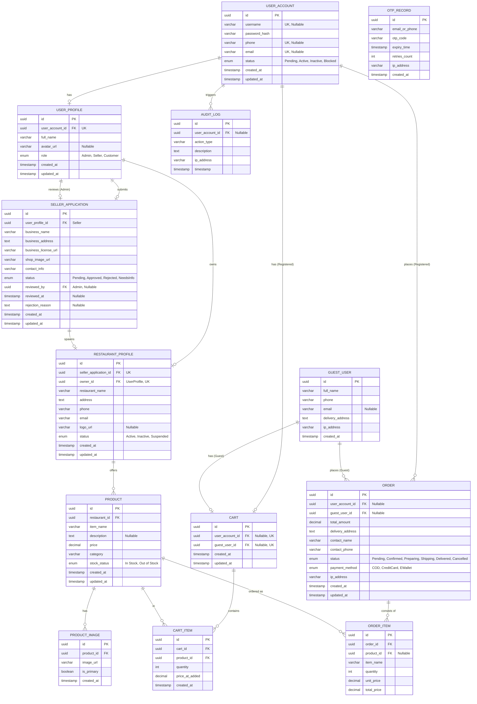

# Entity-Relationship Diagram (ERD) - UniEats

Tài liệu này đặc tả sơ đồ thực thể mối quan hệ (ERD) hoàn chỉnh cho hệ thống **UniEats**, được xây dựng dựa trên thiết kế và 4 Use Cases cốt lõi:
1. **User Registration** (Đăng ký tài khoản)
2. **Review Seller Application** (Duyệt hồ sơ đối tác bán hàng)
3. **Guest Checkout** (Thanh toán khách vãng lai)
4. **Add Menu Item** (Thêm món ăn vào thực đơn)

---

## 1. Sơ đồ ERD (Mermaid Diagram)

Dưới đây là sơ đồ quan hệ thực thể mô tả cấu trúc dữ liệu và các mối quan hệ giữa các bảng.

---

## 2. Chi tiết các thực thể & Thuộc tính (Data Dictionary)

### 2.1. Thực thể: `USER_ACCOUNT`
Quản lý thông tin xác thực và trạng thái đăng nhập chính của người dùng (Customer, Seller, Admin).

| Thuộc tính | Kiểu dữ liệu | Ràng buộc | Mô tả |
| :--- | :--- | :--- | :--- |
| `id` | UUID | PK | Khóa chính tự sinh |
| `username` | VARCHAR(50) | UNIQUE, Nullable | Tên đăng nhập |
| `password_hash`| VARCHAR(255) | NOT NULL | Mật khẩu băm (bcrypt/argon2) |
| `phone` | VARCHAR(15) | UNIQUE, Nullable | Số điện thoại dùng để nhận OTP |
| `email` | VARCHAR(100) | UNIQUE, Nullable | Email dùng đăng ký và nhận OTP |
| `status` | ENUM | NOT NULL | Trạng thái: `Pending` (chờ OTP), `Active`, `Inactive`, `Blocked` |
| `created_at` | TIMESTAMP | NOT NULL | Thời gian tạo tài khoản |
| `updated_at` | TIMESTAMP | NOT NULL | Thời gian cập nhật gần nhất |

### 2.2. Thực thể: `USER_PROFILE`
Chứa thông tin chi tiết cá nhân và phân quyền hệ thống.

| Thuộc tính | Kiểu dữ liệu | Ràng buộc | Mô tả |
| :--- | :--- | :--- | :--- |
| `id` | UUID | PK | Khóa chính tự sinh |
| `user_account_id`| UUID | FK (USER_ACCOUNT), UNIQUE, NOT NULL | Tham chiếu 1-1 tới tài khoản đăng nhập |
| `full_name` | VARCHAR(100) | NOT NULL | Họ tên người dùng |
| `avatar_url` | VARCHAR(255) | Nullable | Link ảnh đại diện |
| `role` | ENUM | NOT NULL | Vai trò: `Admin`, `Seller`, `Customer` |
| `created_at` | TIMESTAMP | NOT NULL | Thời gian tạo profile |
| `updated_at` | TIMESTAMP | NOT NULL | Thời gian cập nhật profile |

### 2.3. Thực thể: `SELLER_APPLICATION`
Quản lý các đơn đăng ký trở thành đối tác bán hàng của Seller nộp lên Admin xét duyệt.

| Thuộc tính | Kiểu dữ liệu | Ràng buộc | Mô tả |
| :--- | :--- | :--- | :--- |
| `id` | UUID | PK | Khóa chính |
| `user_profile_id`| UUID | FK (USER_PROFILE), NOT NULL | Seller gửi hồ sơ |
| `business_name` | VARCHAR(150) | NOT NULL | Tên cửa hàng/nhà hàng đăng ký |
| `business_address`| TEXT | NOT NULL | Địa chỉ hoạt động chính |
| `business_license_url`| VARCHAR(255)| NOT NULL | Đường dẫn file ảnh giấy phép kinh doanh |
| `shop_image_url`| VARCHAR(255) | NOT NULL | Đường dẫn ảnh cửa hàng thực tế |
| `contact_info` | VARCHAR(100) | NOT NULL | Thông tin liên hệ của quán |
| `status` | ENUM | NOT NULL | Trạng thái hồ sơ: `Pending`, `Approved`, `Rejected`, `NeedsInfo` |
| `reviewed_by` | UUID | FK (USER_PROFILE), Nullable | Admin thực hiện duyệt đơn |
| `reviewed_at` | TIMESTAMP | Nullable | Thời điểm duyệt |
| `rejection_reason`| TEXT | Nullable | Lý do từ chối (bắt buộc khi trạng thái là `Rejected`) |
| `created_at` | TIMESTAMP | NOT NULL | Thời gian nộp đơn |
| `updated_at` | TIMESTAMP | NOT NULL | Thời gian sửa đổi đơn |

### 2.4. Thực thể: `RESTAURANT_PROFILE`
Thông tin nhà hàng chính thức hoạt động sau khi đơn đăng ký được duyệt.

| Thuộc tính | Kiểu dữ liệu | Ràng buộc | Mô tả |
| :--- | :--- | :--- | :--- |
| `id` | UUID | PK | Khóa chính |
| `seller_application_id`| UUID | FK (SELLER_APPLICATION), UNIQUE, NOT NULL | Tham chiếu tới hồ sơ đã duyệt |
| `owner_id` | UUID | FK (USER_PROFILE), UNIQUE, NOT NULL | Tham chiếu tới tài khoản Seller sở hữu |
| `restaurant_name`| VARCHAR(150) | NOT NULL | Tên thương hiệu hiển thị trên app |
| `address` | TEXT | NOT NULL | Địa chỉ giao nhận thức ăn |
| `phone` | VARCHAR(15) | NOT NULL | Hotline của quán |
| `email` | VARCHAR(100) | NOT NULL | Email liên hệ của quán |
| `logo_url` | VARCHAR(255) | Nullable | Logo nhà hàng |
| `status` | ENUM | NOT NULL | Trạng thái hoạt động: `Active`, `Inactive`, `Suspended` |
| `created_at` | TIMESTAMP | NOT NULL | Thời điểm khởi tạo quán |
| `updated_at` | TIMESTAMP | NOT NULL | Thời điểm cập nhật quán |

### 2.5. Thực thể: `PRODUCT` (Menu Item)
Thông tin chi tiết về từng món ăn trong menu của nhà hàng.

| Thuộc tính | Kiểu dữ liệu | Ràng buộc | Mô tả |
| :--- | :--- | :--- | :--- |
| `id` | UUID | PK | Khóa chính |
| `restaurant_id` | UUID | FK (RESTAURANT_PROFILE), NOT NULL | Thuộc thực đơn của nhà hàng nào |
| `item_name` | VARCHAR(100) | NOT NULL | Tên món ăn (Tối đa 100 ký tự) |
| `description` | TEXT | Nullable | Mô tả món ăn |
| `price` | DECIMAL(12,2)| NOT NULL | Giá bán của món (> 0) |
| `category` | VARCHAR(50) | NOT NULL | Danh mục món ăn (ví dụ: Đồ uống, Khai vị, Món chính) |
| `stock_status` | ENUM | NOT NULL | Tình trạng: `In Stock` (Còn hàng - mặc định), `Out of Stock` (Hết hàng) |
| `created_at` | TIMESTAMP | NOT NULL | Thời điểm thêm món |
| `updated_at` | TIMESTAMP | NOT NULL | Thời điểm chỉnh sửa món |

### 2.6. Thực thể: `PRODUCT_IMAGE`
Quản lý các hình ảnh của món ăn. Quy định tối thiểu có 1 ảnh đại diện.

| Thuộc tính | Kiểu dữ liệu | Ràng buộc | Mô tả |
| :--- | :--- | :--- | :--- |
| `id` | UUID | PK | Khóa chính |
| `product_id` | UUID | FK (PRODUCT), NOT NULL | Tham chiếu món ăn |
| `image_url` | VARCHAR(255) | NOT NULL | Định dạng JPG/PNG |
| `is_primary` | BOOLEAN | NOT NULL | `True` nếu là ảnh hiển thị chính đại diện cho món |
| `created_at` | TIMESTAMP | NOT NULL | Ngày upload ảnh |

### 2.7. Thực thể: `GUEST_USER`
Lưu trữ thông tin tạm thời cho những khách hàng đặt hàng không cần tạo tài khoản hệ thống (Guest Checkout).

| Thuộc tính | Kiểu dữ liệu | Ràng buộc | Mô tả |
| :--- | :--- | :--- | :--- |
| `id` | UUID | PK | Khóa chính |
| `full_name` | VARCHAR(100) | NOT NULL | Họ tên người nhận |
| `phone` | VARCHAR(15) | NOT NULL | Số điện thoại nhận OTP xác thực đơn |
| `email` | VARCHAR(100) | Nullable | Email nhận hóa đơn (nếu có) |
| `delivery_address`| TEXT | NOT NULL | Địa chỉ giao nhận |
| `ip_address` | VARCHAR(45) | NOT NULL | IPv4/IPv6 để kiểm tra Rate Limit |
| `created_at` | TIMESTAMP | NOT NULL | Thời điểm lưu thông tin khách |

### 2.8. Thực thể: `CART` và `CART_ITEM`
Quản lý giỏ hàng của cả người dùng đăng ký lẫn khách vãng lai.

- **CART**:
  - `user_account_id` và `guest_user_id` đều là `Nullable` nhưng phải thỏa mãn ràng buộc: có tối thiểu và duy nhất một trường có giá trị để xác định giỏ hàng thuộc về ai.

- **CART_ITEM**:
  - `price_at_added`: Lưu giá bán của món tại thời điểm thêm vào giỏ.

### 2.9. Thực thể: `ORDER` và `ORDER_ITEM`
Lưu trữ thông tin hóa đơn mua hàng và các sản phẩm chi tiết trong đơn hàng.

- **ORDER**:
  - `status`: Trạng thái đơn hàng (`Pending` - mặc định ban đầu, `Confirmed`, `Preparing`, `Shipping`, `Delivered`, `Cancelled`).
  - `payment_method`: Phương thức thanh toán (`COD` - mặc định cho Guest, `CreditCard`, `EWallet`).

- **ORDER_ITEM**:
  - `item_name` và `unit_price` được lưu độc lập trực tiếp từ món ăn tại thời điểm đặt hàng. Điều này đảm bảo khi Seller cập nhật giá hoặc tên món ăn trong tương lai, lịch sử hóa đơn cũ không bị thay đổi.

### 2.10. Thực thể: `OTP_RECORD`
Quản lý mã OTP phục vụ xác thực người dùng đăng ký và xác thực đặt đơn của Guest.

| Thuộc tính | Kiểu dữ liệu | Ràng buộc | Mô tả |
| :--- | :--- | :--- | :--- |
| `id` | UUID | PK | Khóa chính |
| `email_or_phone`| VARCHAR(100) | NOT NULL | Nơi nhận OTP |
| `otp_code` | VARCHAR(6) | NOT NULL | Mã OTP 6 chữ số |
| `expiry_time` | TIMESTAMP | NOT NULL | Hạn sử dụng của mã OTP (5 phút kể từ khi tạo) |
| `retries_count` | INT | NOT NULL | Số lần đã nhập sai (tối đa 3 lần) |
| `ip_address` | VARCHAR(45) | NOT NULL | IP yêu cầu OTP để thực hiện rate limiting |
| `created_at` | TIMESTAMP | NOT NULL | Thời gian tạo mã |

### 2.11. Thực thể: `AUDIT_LOG`
Bảng ghi nhận nhật ký hệ thống nhằm mục đích bảo mật và giám sát hoạt động.

| Thuộc tính | Kiểu dữ liệu | Ràng buộc | Mô tả |
| :--- | :--- | :--- | :--- |
| `id` | UUID | PK | Khóa chính |
| `user_account_id`| UUID | FK (USER_ACCOUNT), Nullable | Tài khoản thực hiện hành động |
| `action_type` | VARCHAR(50) | NOT NULL | Loại hành động (ví dụ: `REGISTRATION_SUCCESS`, `REGISTRATION_FAILED`, `SELLER_APPROVED`, `GUEST_CHECKOUT_FAILED`) |
| `description` | TEXT | NOT NULL | Chi tiết hành động |
| `ip_address` | VARCHAR(45) | NOT NULL | IP thực hiện hành động |
| `timestamp` | TIMESTAMP | NOT NULL | Thời điểm xảy ra sự kiện |

---

## 3. Các ràng buộc nghiệp vụ được ánh xạ vào DB Schema

1. **Khóa Ngoại & Ràng buộc Nullable trong Giỏ hàng & Đơn hàng:**
   - Cả hai bảng `CART` và `ORDER` đều hỗ trợ liên kết tới `USER_ACCOUNT` (khách có tài khoản) hoặc `GUEST_USER` (khách vãng lai).
   - Ràng buộc: `(user_account_id IS NULL AND guest_user_id IS NOT NULL) OR (user_account_id IS NOT NULL AND guest_user_id IS NULL)`.

2. **Duyệt hồ sơ bán hàng (Seller Applications):**
   - Mối quan hệ giữa `SELLER_APPLICATION` và `RESTAURANT_PROFILE` là mối quan hệ `1-1` hoặc `1-N` (trong trường hợp đối tác muốn mở chuỗi). Thiết kế trên định nghĩa khóa ngoại `seller_application_id` và `owner_id` tại `RESTAURANT_PROFILE` là duy nhất (`UNIQUE`) để đảm bảo quy trình chuẩn hóa: **Một hồ sơ duyệt thành công tạo ra duy nhất một Nhà hàng hiển thị.**

3. **Lưu vết Audit Log & Rate Limiting OTP:**
   - IP và SĐT/Email được ghi nhận trong `OTP_RECORD` để hệ thống thực hiện kiểm tra bằng query: `COUNT(id) WHERE ip_address = :ip AND created_at > NOW() - INTERVAL 1 HOUR`. Giúp kiểm soát không quá 3 lần gửi lại OTP và chặn IP nếu vi phạm.
   - Tương tự với Checkout của Guest: Kiểm tra IP trong `ORDER` trong vòng 24 giờ qua: `COUNT(id) WHERE ip_address = :ip AND created_at > NOW() - INTERVAL 24 HOUR <= 3` để thực thi quy tắc giới hạn tối đa 3 đơn/ngày đối với khách vãng lai.
