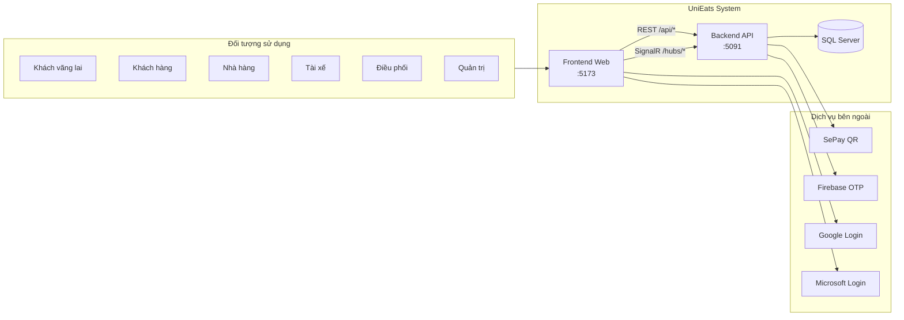
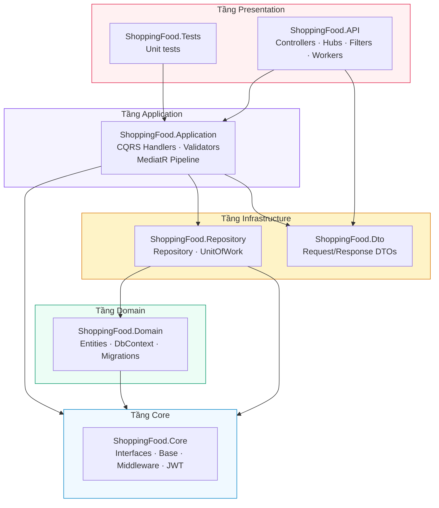
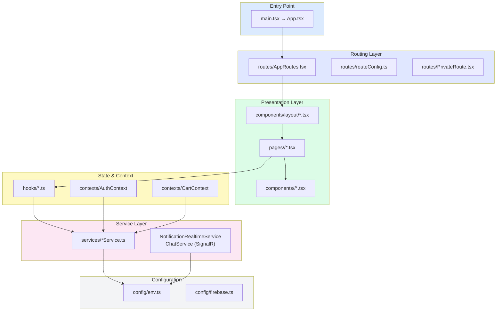
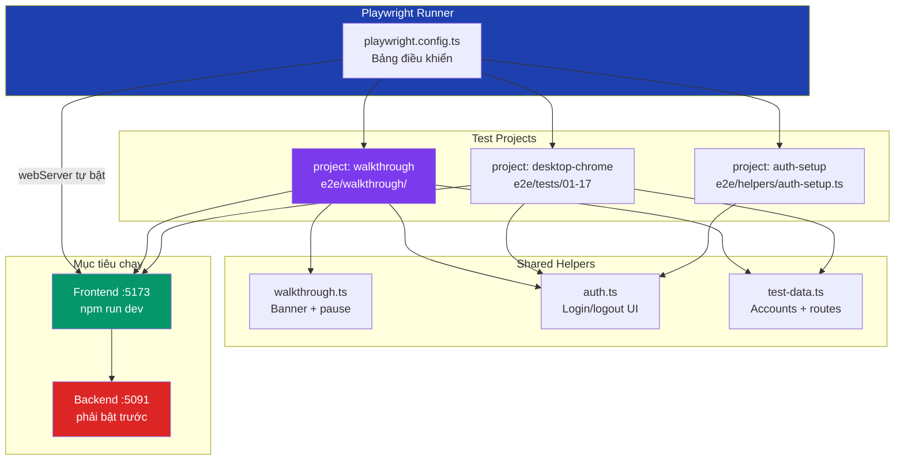
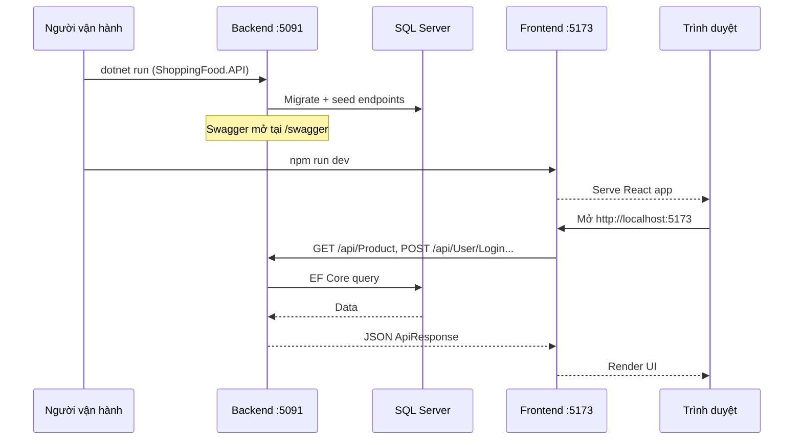
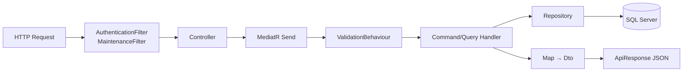
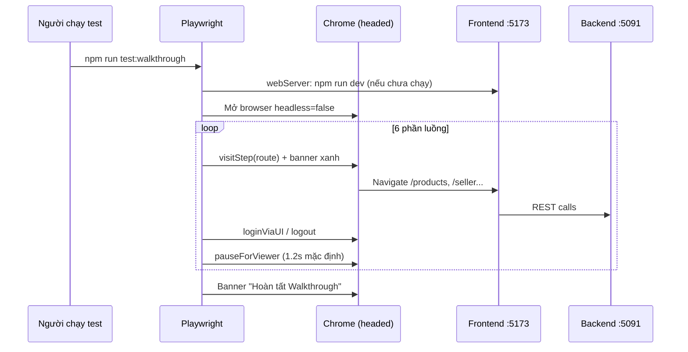

# UniEats — System Design & Hướng dẫn vận hành

Tài liệu này viết theo góc nhìn **người thiết kế hệ thống**: phạm vi hệ thống, đối tượng, cấu trúc package, hướng chạy code, và lưu ý khi vận hành (đặc biệt **Screen Run Test**).

> Bảng tiến độ chi tiết (192 use case + API): [`TRACKING_USE_CASES_APIS.csv`](./TRACKING_USE_CASES_APIS.csv)

---

## 1. Tầm nhìn hệ thống

**UniEats** là nền tảng đặt và giao đồ ăn trực tuyến (marketplace B2C), gồm:

| Thành phần | Vai trò | Thư mục |
|------------|---------|---------|
| **Backend API** | Xử lý nghiệp vụ, lưu trữ, bảo mật, thanh toán | `src/` |
| **Frontend Web** | Giao diện người dùng trên trình duyệt | `ShoppingFood.FE/` |
| **E2E / Walkthrough** | Robot mô phỏng người dùng, chạy demo tự động | `ShoppingFood.FE/e2e/` |

### Sơ đồ ngữ cảnh (Context Diagram)



---

## 2. Phạm vi hệ thống (System Scope)

### 2.1. Trong phạm vi (In Scope)

| Phân hệ | Chức năng chính | Trạng thái |
|---------|-----------------|------------|
| Authentication & Profile | Đăng ký, đăng nhập, OTP, hồ sơ, địa chỉ | Đã xong |
| Product & Menu | Món ăn, topping, danh mục, tìm kiếm | Đã xong |
| Restaurant & Shop | Hồ sơ nhà hàng, duyệt seller | Đã xong |
| Order & Cart | Giỏ hàng, đặt hàng, theo dõi đơn | Đã xong |
| Logistics & Shipping | Shipper nhận/giao, đề xuất đơn | Đã xong |
| Payment & Finance | COD, ví, SePay QR, đối soát | **Đang làm** |
| Promotion & Loyalty | Khuyến mãi, flash sale, tích điểm | Đã xong |
| Support & Trust | FAQ, đánh giá, báo cáo | Đã xong |
| Admin Analytics | Quản trị, phê duyệt, tài chính sàn | Đã xong |
| Coordinator & Dispatch | Gán shipper, giám sát, sự cố | Đã xong |
| Chat & Notification | Chat realtime, thông báo push | Đã xong |

### 2.2. Ngoài phạm vi / chưa có (Out of Scope)

- Gợi ý món thông minh (AI recommendation) — chưa có API riêng
- Ứng dụng mobile native (iOS/Android) — hiện chỉ có Web
- Tích hợp SMS OTP thương mại — cần nhà cung cấp bên thứ 3

### 2.3. Ranh giới hệ thống

```
┌─────────────────────────────────────────────────────────────┐
│  BIÊN HỆ THỐNG                                              │
│                                                             │
│  Browser (Chrome)  ←→  Frontend :5173  ←→  API :5091       │
│                              ↕                    ↕         │
│                         LocalStorage          SQL Server    │
│                         JWT token             + Background    │
│                                               Workers       │
└─────────────────────────────────────────────────────────────┘
         ↑                              ↑
    Người dùng thật              SePay / Firebase (webhook)
    hoặc Playwright bot
```

---

## 3. Đối tượng (Actors) & phân vùng nghiệp vụ

| Actor | Mô tả | Khu vực UI | API chính |
|-------|-------|------------|-----------|
| **Guest** | Chưa đăng nhập, xem món, guest checkout | Public routes | `Product`, `Cart`, `Order` |
| **Customer** | Khách đã đăng nhập | `UserLayout` | `User`, `Order`, `Payment` |
| **Seller** | Chủ nhà hàng | `SellerLayout` | `Restaurant`, `Product`, `Order` |
| **Shipper** | Tài xế giao hàng | `ShipperLayout` | `Shipper`, `Order` |
| **Coordinator** | Điều phối giao hàng | `CoordinatorLayout` | `Coordinator` |
| **Admin** | Quản trị sàn | `AdminLayout` | `Admin`, `System` |

### Domain objects cốt lõi

```
User ──1:1── UserProfile
  │
  ├── Cart ──1:N── CartItem ──N:1── Product
  │
  └── Order ──1:N── OrderItem
         │
         ├── RestaurantProfile (Seller)
         ├── Shipper (giao hàng)
         └── Payment (COD / Ví / SePay)
```

---

## 4. Package Diagram — Backend (`src/`)

Kiến trúc **Clean Architecture** (.NET 8), dependency chỉ đi **từ trên xuống dưới**.



### Bảng package → trách nhiệm

| Package | File entry quan trọng | Làm gì |
|---------|----------------------|--------|
| `ShoppingFood.API` | `Program.cs` | Khởi động server, DI, middleware, map routes |
| | `Controllers/*.cs` (23 controller) | Nhận HTTP request, trả JSON |
| | `Hubs/ChatHub`, `NotificationHub` | Realtime SignalR |
| | `Workers/*.cs` | Background: thanh toán, đối soát SePay, hạng thành viên |
| `ShoppingFood.Application` | `Features/*/` | Mỗi use case = Command/Query + Handler + Validator |
| `ShoppingFood.Repository` | `*Repository.cs` | Truy vấn EF Core |
| `ShoppingFood.Domain` | `Models/*.cs`, `Context/` | Entity, DbContext, migration |
| `ShoppingFood.Dto` | `User/`, `Order/`, … | Dữ liệu vào/ra API |
| `ShoppingFood.Core` | `Behaviors/`, `Middlewares/` | Validation pipeline, exception, JWT |

### Controllers ↔ phân hệ nghiệp vụ

| Controller | Phân hệ |
|------------|---------|
| `UserController`, `UserAddressController` | Auth & Profile |
| `ProductController`, `ToppingController`, `MenuCategoryController` | Product & Menu |
| `RestaurantController` | Restaurant |
| `CartController`, `OrderController` | Order & Cart |
| `ShipperController`, `CoordinatorController` | Logistics |
| `PaymentController`, `SepayController` | Payment |
| `PromotionController`, `DiscountController`, `FlashSaleController`, `LoyaltyPointController` | Promotion |
| `SupportController`, `FaqController` | Support |
| `AdminController`, `SystemController` | Admin |
| `ChatController`, `NotificationController` | Chat & Notification |
| `CommonController` | Shared utilities |

---

## 5. Package Diagram — Frontend (`ShoppingFood.FE/`)



### Luồng phụ thuộc Frontend (hướng gọi)

```
Page → Hook/Context → Service → axios → API :5091/api/*
                              → SignalR → API :5091/hubs/*
```

| Thư mục | Vai trò | Ví dụ |
|---------|---------|-------|
| `pages/` | Màn hình theo role | `CheckoutPage`, `SellerOrdersPage` |
| `components/` | UI tái sử dụng | `CartDrawer`, `LoginForm` |
| `services/` | Gọi API, 1 service ≈ 1 controller | `OrderService.ts` ↔ `OrderController` |
| `contexts/` | Trạng thái toàn app | JWT, giỏ hàng |
| `routes/` | Định tuyến + guard quyền | Chặn Customer vào `/admin` |
| `hooks/` | Logic tái sử dụng trong page | `useCart`, `useProducts` |
| `interfaces/` | Kiểu dữ liệu TypeScript | `IProduct`, `IOrder` |
| `config/env.ts` | Biến môi trường | `VITE_API_BASE_URL` |

---

## 6. Package Diagram — E2E / Screen Run Test



---

## 7. Hướng chạy hệ thống (Runtime Flow)

### 7.1. Khởi động thủ công (dev)



**Thứ tự bắt buộc:** Backend trước → Frontend sau.

| Bước | Lệnh | Cổng | Ghi chú |
|------|------|------|---------|
| 1 | `cd src/ShoppingFood.API && dotnet run` | **5091** | Tự migrate DB lần đầu |
| 2 | `cd ShoppingFood.FE && npm run dev` | **5173** | Vite dev server |

### 7.2. Luồng xử lý 1 request API (Backend)



**Hướng dependency:** `Controller → Application → Repository → Domain → Core`  
Tầng dưới **không** biết tầng trên.

### 7.3. Luồng Screen Run Test (Walkthrough)



**Điểm vào → điểm ra Screen Run:**

| | |
|---|---|
| **File kịch bản** | `e2e/walkthrough/all-flows.spec.ts` |
| **Lệnh chạy** | `npm run test:walkthrough` |
| **Bắt đầu** | `/` — Trang chủ (Guest) |
| **Kết thúc** | `/coordinator/history` + banner "Hoàn tất Walkthrough" |
| **Thời gian tối đa** | 600 giây (10 phút) |

#### Bản đồ 6 phần Walkthrough

```
Phần 1  Guest công khai     /  →  /products  →  …  →  /register/shipper
Phần  2  Customer           login testcustomer  →  /checkout  →  /orders
Phần  3  Seller             login testseller    →  /seller  →  /seller/wallet
Phần  4  Shipper            login testshipper   →  /shipper  →  /shipper/history
Phần  5  Admin              login admin         →  /admin  →  /admin/restaurants
Phần  6  Coordinator        login testcoord     →  /coordinator  →  /coordinator/history  ✓
```

---

## 8. Ánh xạ file quan trọng → vai trò trong hệ thống

### 8.1. Tài liệu thiết kế (đọc theo vai trò)

| File | Vai trò trong system design |
|------|----------------------------|
| `README.md` | Index tổng, link module |
| `Use_Cases.md` / `Use_Cases_Master_List.md` | Đặc tả nghiệp vụ (requirements) |
| `screen_flow.md` | Screen flow diagram theo role |
| `ARCHITECTURE_GUIDE.md` | Chi tiết từng class backend |
| `ERD.md` | Mô hình dữ liệu |
| `docs/TRACKING_USE_CASES_APIS.csv` | Traceability: UC ↔ API ↔ trạng thái |
| `docs/TRACKING_USE_CASES_APIS.md` | **File này** — system design tổng hợp |

### 8.2. File code “điểm neo” khi debug

| Khi cần hiểu… | Mở file |
|---------------|---------|
| Server khởi động thế nào | `src/ShoppingFood.API/Program.cs` |
| Route API nào tồn tại | `src/ShoppingFood.API/Controllers/*.cs` + Swagger `/swagger` |
| Logic nghiệp vụ 1 use case | `src/ShoppingFood.Application/Features/<Domain>/` |
| Bảng DB / migration | `src/ShoppingFood.Domain/Models/`, `Migrations/` |
| Route màn hình FE | `ShoppingFood.FE/src/routes/AppRoutes.tsx` |
| Gọi API từ FE | `ShoppingFood.FE/src/services/<X>Service.ts` |
| Cấu hình cổng FE/API khi test | `ShoppingFood.FE/playwright.config.ts` |
| Kịch bản demo tự động | `ShoppingFood.FE/e2e/walkthrough/all-flows.spec.ts` |

### 8.3. File test E2E lẻ (không phải Walkthrough)

| File | Phạm vi kiểm |
|------|--------------|
| `01-public-pages` | Trang công khai |
| `02-auth-register` / `03-auth-login` | Xác thực |
| `04`–`06` | Customer: browse, checkout, orders |
| `07` / `13` | Seller |
| `08` / `14` | Admin |
| `09` | Navigation guards (phân quyền route) |
| `10`–`12` | Luồng approvals, shipper, coordinator |
| `16` | Payment flows |
| `17` | Business flows tổng hợp |

---

## 9. Lưu ý vận hành (Operational Notes)

### 9.1. Điều kiện tiên quyết

| # | Lưu ý | Hậu quả nếu thiếu |
|---|-------|-------------------|
| 1 | **API phải chạy trước** tại `http://localhost:5091` | FE/test báo lỗi network, trang trống |
| 2 | SQL Server local (connection string trong `appsettings.json`) | API không start được |
| 3 | `npm install` + `npx playwright install chromium` (lần đầu) | Test không chạy |
| 4 | Tài khoản test tồn tại trong DB | Walkthrough fail ở bước login |

### 9.2. Tài khoản test mặc định

| Role | Username | Password |
|------|----------|----------|
| Customer | `testcustomer` | `Test@123` |
| Seller | `testseller` | `Test@123` |
| Shipper | `testshipper` | `Test@123` |
| Admin | `admin` | `Admin@123` |
| Coordinator | `testcoord` | `Test@123` |

Có thể override qua biến môi trường `TEST_*_USERNAME` / `TEST_*_PASSWORD`.

### 9.3. Cổng và biến môi trường

| Biến / Cổng | Giá trị mặc định | Dùng ở đâu |
|-------------|------------------|------------|
| API | `:5091` | `launchSettings.json`, FE `env.ts` |
| Frontend | `:5173` | Vite dev, Playwright `baseURL` |
| `VITE_API_BASE_URL` | `http://localhost:5091/api` | FE gọi REST |
| SignalR hubs | `/hubs/chat`, `/hubs/notifications` | Chat, notification realtime |
| `WALKTHROUGH_PAUSE_MS` | `1200` | Thời gian dừng giữa bước demo |
| `WALKTHROUGH_SLOW_MO` | `400` | Làm chậm thao tác Playwright |

### 9.4. Background workers (chạy ngầm trong API)

| Worker | Nhiệm vụ |
|--------|----------|
| `PaymentProcessingWorker` | Xử lý thanh toán pending |
| `PaymentExpiryWorker` | Hết hạn giao dịch |
| `SepayReconciliationWorker` | Đối soát SePay |
| `MemberTierEvaluationWorker` | Cập nhật hạng thành viên |

→ Khi test payment, cần API chạy liên tục, không chỉ gọi 1 request rồi tắt.

### 9.5. Ràng buộc kiến trúc cần nhớ

1. **Clean Architecture:** không import ngược tầng (Domain không reference API).
2. **CQRS + MediatR:** Controller không chứa logic nghiệp vụ — chỉ gửi Command/Query.
3. **ApiResponse chuẩn:** mọi API trả `{ error, code, message, data, total }`.
4. **JWT Bearer:** FE lưu token, gửi header `Authorization: Bearer …`.
5. **PrivateRoute:** FE chặn route theo role; API cũng phải validate (defense in depth).
6. **Playwright walkthrough:** `workers: 1`, `fullyParallel: false` — chạy tuần tự vì luồng phụ thuộc login/logout.

---

## 10. Hướng dẫn chạy nhanh

### Chạy hệ thống dev

```powershell
# Terminal 1 — Backend
cd E:\Shopping-Food\src\ShoppingFood.API
dotnet run

# Terminal 2 — Frontend
cd E:\Shopping-Food\ShoppingFood.FE
npm run dev
```

Mở trình duyệt: `http://localhost:5173`  
Swagger API: `http://localhost:5091/swagger`

### Chạy Screen Run Test (Walkthrough)

```powershell
# Đảm bảo API đang chạy (:5091)
cd E:\Shopping-Food\ShoppingFood.FE
npm run test:walkthrough
```

| Lệnh | Mục đích |
|------|----------|
| `npm run test:walkthrough` | Demo tự chạy trên Chrome |
| `npm run test:walkthrough:ui` | UI Mode — pause / xem từng bước |
| `$env:WALKTHROUGH_PAUSE_MS="2500"; npm run test:walkthrough` | Chậm hơn, dễ theo dõi |
| `npm run test:e2e` | Chạy 17 file test lẻ (headless) |
| `npm run test:e2e:report` | Xem báo cáo HTML sau khi chạy |

---

## 11. Checklist vận hành Screen Run

```
□ API đang chạy tại localhost:5091
□ cd ShoppingFood.FE
□ npm run test:walkthrough
□ Chrome mở, banner xanh hiện từng bước
□ Đi qua 6 phần: Guest → Customer → Seller → Shipper → Admin → Coordinator
□ Thấy banner "Hoàn tất Walkthrough" → PASS
```

---

## 12. Tài liệu liên quan

| Tài liệu | Nội dung |
|----------|----------|
| [`ARCHITECTURE_GUIDE.md`](../ARCHITECTURE_GUIDE.md) | Chi tiết từng class backend |
| [`screen_flow.md`](../screen_flow.md) | Sơ đồ màn hình Mermaid |
| [`ERD.md`](../ERD.md) | Entity-Relationship Diagram |
| [`ShoppingFood.FE/Testing_Guide.md`](../ShoppingFood.FE/Testing_Guide.md) | Hướng dẫn kỹ thuật E2E |
| [`TRACKING_USE_CASES_APIS.csv`](./TRACKING_USE_CASES_APIS.csv) | Bảng UC ↔ API ↔ trạng thái |

---

*Cập nhật: 2026-07-15 — System Design view: phạm vi, package diagram, hướng chạy, Screen Run Test.*
