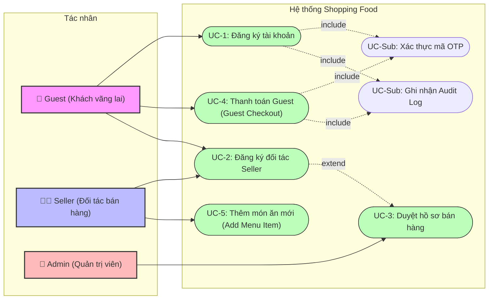

# System Use Cases - Shopping Food

Tài liệu này đặc tả chi tiết các Use Cases (Trường hợp sử dụng) của hệ thống **Shopping Food**, phân loại theo tác nhân (Actors) và mối tương quan giữa các hành vi trong hệ thống.

---

## 1. Sơ đồ Use Case tổng quát (Mermaid Diagram)

Sơ đồ dưới đây trực quan hóa các Tác nhân (Actors) và các trường hợp sử dụng cốt lõi của hệ thống cùng các mối quan hệ `include` (bao gồm) và `extend` (mở rộng).

---

## 2. Mô tả các Tác nhân (Actors)

| Tác nhân (Actor) | Phân loại | Mô tả vai trò |
| :--- | :--- | :--- |
| **Guest** (Khách) | Con người (Chưa định danh) | Người truy cập ứng dụng/website nhưng chưa đăng nhập. Có quyền xem menu, thêm vào giỏ hàng, đăng ký tài khoản mới hoặc thanh toán trực tiếp không cần tài khoản (Guest Checkout). |
| **Customer** (Khách hàng) | Con người (Đã định danh) | Khách hàng đã đăng ký tài khoản thành công và đăng nhập. Có đầy đủ quyền của Guest nhưng có thêm các đặc quyền tích điểm, theo dõi lịch sử đơn hàng dài hạn. |
| **Seller** (Đối tác bán hàng) | Con người (Đã định danh) | Nhà hàng, quán ăn đăng ký hợp tác. Sau khi được duyệt hồ sơ, họ quản lý thực đơn (món ăn, giá cả, trạng thái) và xử lý các đơn đặt hàng. |
| **Admin** (Quản trị viên) | Con người (Đã định danh) | Nhân viên vận hành của hệ thống Shopping Food. Có nhiệm vụ phê duyệt hồ sơ đối tác Seller, kiểm tra tính pháp lý của giấy phép kinh doanh, giám sát an toàn thông tin và giải quyết tranh chấp. |

---

## 3. Đặc tả chi tiết các Use Cases chính

### UC-1: Đăng ký tài khoản (User Registration)
* **Tác nhân chính:** Guest
* **Mục tiêu:** Tạo tài khoản người dùng hoạt động hợp lệ để đặt hàng hoặc đăng ký bán hàng.
* **Tiền điều kiện:** Guest chưa đăng nhập vào hệ thống.
* **Hậu điều kiện:** Tài khoản người dùng được tạo với trạng thái 'Active', tạo profile cá nhân tương ứng và ghi nhận nhật ký hệ thống.
* **Luồng chính (Main Flow):**
  1. Guest nhập thông tin đăng ký (Họ tên, SĐT/Email, Mật khẩu).
  2. Hệ thống kiểm tra hợp lệ của dữ liệu (format SĐT/Email, độ mạnh mật khẩu >= 8 ký tự, có chữ hoa, thường, số và ký tự đặc biệt).
  3. Hệ thống kiểm tra xem SĐT/Email đã tồn tại trong DB chưa.
  4. Hệ thống tạo mã OTP 6 số ngẫu nhiên, lưu vào DB (hạn 5 phút) và gửi tới SĐT/Email của Guest.
  5. Guest nhận và điền mã OTP vào hệ thống.
  6. Hệ thống đối khớp mã OTP.
  7. Kích hoạt tài khoản sang trạng thái `Active`, tạo bản ghi `USER_PROFILE` và lưu sự kiện vào `AUDIT_LOG`.
  8. Thông báo thành công và chuyển hướng sang trang chủ/đăng nhập.
* **Luồng thay thế (Alternative/Exception Flows):**
  - **Tài khoản đã tồn tại:** Trả lỗi và đề xuất Guest đăng nhập hoặc lấy lại mật khẩu.
  - **Nhập sai hoặc hết hạn OTP:** Cho phép nhập lại hoặc gửi lại OTP (tối đa 3 lần). Nếu vượt quá số lần cho phép hoặc nhập sai liên tục, khóa IP yêu cầu trong 1 giờ.
  - **Mật khẩu yếu:** Hệ thống từ chối và hướng dẫn chi tiết quy tắc đặt mật khẩu.

---

### UC-2: Đăng ký đối tác Seller & UC-3: Duyệt hồ sơ bán hàng (Review Seller Application)
* **Tác nhân chính:** Seller (đăng ký), Admin (duyệt hồ sơ)
* **Mục tiêu:** Kiểm duyệt tính pháp lý và thông tin cửa hàng trước khi kích hoạt gian hàng của Seller trên ứng dụng.
* **Tiền điều kiện:** Nhà hàng/Seller đã gửi hồ sơ đăng ký qua cổng thông tin.
* **Hậu điều kiện:** Tài khoản Seller được kích hoạt (Approved) hoặc bị từ chối/cần bổ sung thông tin (Rejected/NeedsInfo).
* **Luồng chính (Main Flow):**
  1. Admin truy cập trang quản trị, vào danh sách "Yêu cầu đăng ký Seller mới".
  2. Admin mở xem chi tiết đơn đăng ký của một nhà hàng.
  3. Admin kiểm tra các tài liệu bắt buộc đi kèm: Giấy phép kinh doanh, ảnh chụp biển hiệu/mặt tiền, thông tin liên hệ.
  4. Admin kiểm chứng thông tin thực tế khớp với giấy phép.
  5. Admin chọn **"Duyệt (Approve)"**.
  6. Hệ thống kích hoạt tài khoản của Seller, tạo bản ghi `RESTAURANT_PROFILE` chính thức.
  7. Hệ thống tự động gửi email/thông báo chúc mừng và hướng dẫn Seller đăng nhập đăng món.
* **Luồng thay thế (Alternative Flows):**
  - **Từ chối (Reject Application):** Admin chọn "Từ chối" và nhập lý do bắt buộc (ví dụ: Giấy phép kinh doanh hết hạn, địa chỉ không trùng khớp). Hệ thống lưu trạng thái `Rejected`, gửi thông báo chi tiết lý do và hướng dẫn bổ sung hồ sơ tới email của Seller.

---

### UC-4: Thanh toán khách vãng lai (Guest Checkout)
* **Tác nhân chính:** Guest
* **Mục tiêu:** Hoàn tất đơn hàng nhanh chóng mà không cần đăng ký tài khoản dài hạn.
* **Tiền điều kiện:** Giỏ hàng có tối thiểu 1 sản phẩm và tất cả các món trong giỏ đều còn hàng (`In Stock`).
* **Hậu điều kiện:** Đơn hàng được tạo thành công với trạng thái `Pending`. Thông tin khách vãng lai được liên kết vào đơn hàng.
* **Luồng chính (Main Flow):**
  1. Guest bấm nút "Thanh toán" tại màn hình giỏ hàng.
  2. Hệ thống hiển thị lựa chọn: "Đăng nhập" hoặc "Mua hàng không cần tài khoản (Guest Checkout)".
  3. Guest chọn "Guest Checkout".
  4. Hệ thống yêu cầu điền: Họ tên, Số điện thoại, Email (tùy chọn) và Địa chỉ giao hàng.
  5. Guest gửi thông tin. Hệ thống kiểm tra rate limit của IP trong 24 giờ qua (Tối đa 3 đơn/IP/24h).
  6. Hệ thống gửi mã OTP xác thực qua số điện thoại đã nhập.
  7. Guest điền mã OTP chính xác.
  8. Hệ thống xác nhận OTP, tạo đơn hàng với trạng thái `Pending`, ghi nhận IP người mua, lưu thông tin khách vào bảng `GUEST_USER` và hiển thị mã theo dõi đơn hàng (Tracking ID).
  9. Hệ thống gợi ý đăng ký tài khoản để nhận điểm thưởng.
* **Luồng ngoại lệ (Exceptions):**
  - **Vượt quá Rate Limit (IP):** Chặn tiến trình checkout và thông báo: *"Bạn đã vượt quá giới hạn đặt hàng vãng lai (tối đa 3 đơn/ngày). Vui lòng đăng ký tài khoản để tiếp tục mua sắm không giới hạn"*.
  - **Nhập sai OTP:** Báo lỗi, cho phép gửi lại tối đa 3 lần. Nếu vượt quá, khóa chức năng thanh toán của IP này trong 15 phút.

---

### UC-5: Thêm món ăn mới (Add Menu Item)
* **Tác nhân chính:** Seller
* **Mục tiêu:** Thêm một món ăn mới kèm hình ảnh, giá cả vào thực đơn hiển thị của nhà hàng.
* **Tiền điều kiện:** Nhà hàng đã được duyệt hoạt động (`Active`).
* **Hậu điều kiện:** Món ăn được hiển thị trên thực đơn với trạng thái mặc định là "Còn hàng (In Stock)".
* **Luồng chính (Main Flow):**
  1. Seller chọn "Thêm món mới" trên trang quản trị nhà hàng.
  2. Seller nhập các trường thông tin: Tên món (bắt buộc, <=100 ký tự), Mô tả, Giá bán (> 0), và chọn Danh mục món.
  3. Seller upload tối thiểu 1 hình ảnh món ăn (định dạng JPG hoặc PNG).
  4. Seller chọn **"Lưu"**.
  5. Hệ thống xác thực tính hợp lệ của dữ liệu đầu vào.
  6. Hệ thống lưu món ăn vào bảng `PRODUCT` và hình ảnh vào `PRODUCT_IMAGE` (gán ảnh đầu tiên làm `is_primary = true`).
  7. Hệ thống thông báo thêm món thành công và cập nhật lên menu online của quán.
* **Luồng thay thế (Alternative Flows):**
  - **Dữ liệu không hợp lệ:** Giá <= 0 hoặc thiếu tên món. Hệ thống hiển thị cảnh báo lỗi cụ thể tại từng trường đầu vào để Seller điều chỉnh lại dữ liệu trước khi lưu lại.

---

## 4. Bảng phân quyền chức năng (Use Case Matrix)

| Chức năng / Use Case | Guest | Customer | Seller | Admin |
| :--- | :---: | :---: | :---: | :---: |
| **UC-1: Đăng ký tài khoản** | ✔ | ✖ | ✖ | ✖ |
| **UC-2: Đăng ký đối tác Seller** | ✔ | ✔ | ✔ | ✖ |
| **UC-3: Duyệt hồ sơ bán hàng** | ✖ | ✖ | ✖ | ✔ |
| **UC-4: Thanh toán Guest** | ✔ | ✖ | ✖ | ✖ |
| **UC-5: Thêm món ăn mới** | ✖ | ✖ | ✔ | ✖ |
| **Quản lý giỏ hàng riêng** | ✔ | ✔ | ✖ | ✖ |
| **Xem lịch sử Audit Log** | ✖ | ✖ | ✖ | ✔ |
