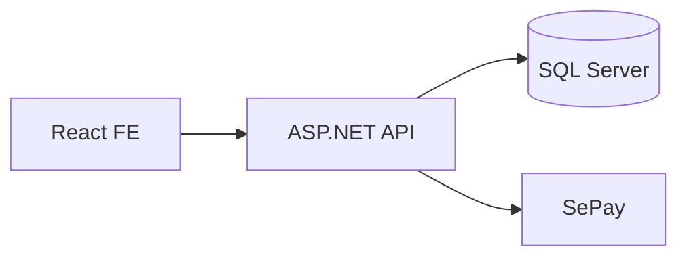

# Shopping Food — Tài liệu Onboarding

> **Developer mới bắt đầu tại đây.**

Hệ thống tài liệu chia 3 lớp:

| Lớp | Thư mục | Mục đích |
|-----|---------|----------|
| **Requirements (FR)** | [requirements/](./requirements/README.md) | *Phải làm gì* — FR-ID, rule, acceptance |
| **Alerts** | [requirements/ALERTS_INDEX.md](./requirements/ALERTS_INDEX.md) | *Cảnh báo / toast / confirm* từng Feature |
| **Workflows** | [workflows/README.md](./workflows/README.md) | *Chạy thế nào* — bước + code + call chain |

---

## Đọc ngay — Tiền & chia tiền

| # | Tài liệu |
|---|----------|
| 1 | [requirements/Revenue_Split_Requirements.md](./requirements/Revenue_Split_Requirements.md) — **Sàn/Seller/Shipper kiếm tiền thế nào** |
| 2 | [requirements/Payment_Requirements.md](./requirements/Payment_Requirements.md) |
| 3 | [requirements/alerts/Payment_Alerts.md](./requirements/alerts/Payment_Alerts.md) · [Revenue_Split_Alerts](./requirements/alerts/Revenue_Split_Alerts.md) |
| 4 | Workflows: [Payment_Checkout](./workflows/Payment_Checkout_Workflow.md) → [SePay](./workflows/Payment_Sepay_Workflow.md) → [Wallet](./workflows/Payment_Wallet_Withdraw_Workflow.md) |

---

## Bản đồ nhanh



**Roles:** Guest · Customer · Seller · Mall · Shipper · Coordinator · Admin

---

## Toàn bộ Requirements

Xem mục lục: **[requirements/README.md](./requirements/README.md)**  
Xem cảnh báo: **[requirements/ALERTS_INDEX.md](./requirements/ALERTS_INDEX.md)**  
Xem workflow: **[workflows/README.md](./workflows/README.md)**

---

## Checklist 1 ngày

- [ ] Đọc Revenue Split + Payment Requirements + Payment Alerts  
- [ ] Login + ForgotPassword workflow  
- [ ] Cart → Checkout (COD) end-to-end  
- [ ] Hiểu settle khi giao hàng (ai được bao nhiêu)  
- [ ] Biết tìm toast theo `AL-*-NN` trong `requirements/alerts/`

---

## Khác

| File | Mô tả |
|------|--------|
| [TRACKING_USE_CASES_APIS.md](./TRACKING_USE_CASES_APIS.md) | Use case / Screen Run |
| [TRACKING_USE_CASES_APIS.csv](./TRACKING_USE_CASES_APIS.csv) | Tracking CSV |

```bash
cd src/ShoppingFood.API && dotnet run   # :5091
cd ShoppingFood.FE && npm run dev       # :5173
```
