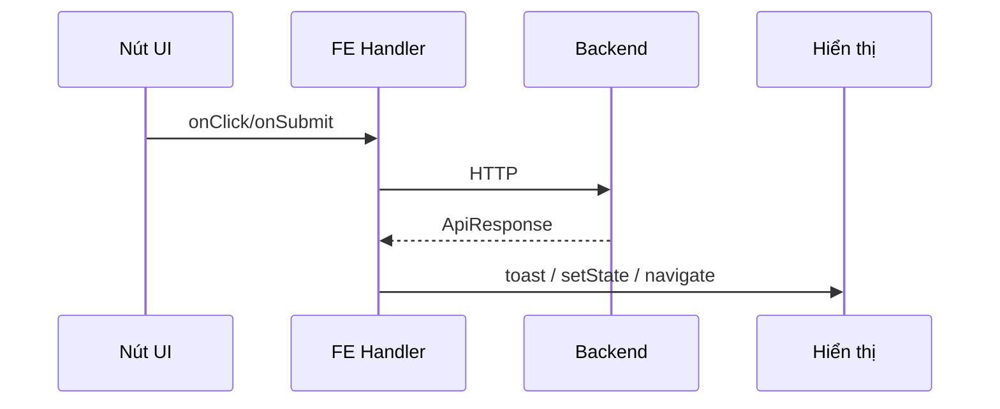

# Mẫu chuẩn — UI Interaction Trace

Mọi file trong `docs/ui-traces/` viết theo mẫu này.

---

## Cấu trúc một thao tác

### UT-<DOMAIN>-NN — Tên thao tác (nhãn nút)

#### 1. Giao diện nút bấm ở đâu?

| Mục | Giá trị |
|-----|---------|
| **Route** | `/login` |
| **Page** | `pages/LoginPage.tsx` |
| **Component** | `components/auth/LoginForm.tsx` |
| **Nhãn nút** | `"Đăng nhập"` |
| **Loại control** | `<Button type="submit">` trong `<form>` |
| **Điều kiện hiện** | `step === 1`, `loginMethod === 'standard'` |

#### 2. Bấm xong chạy đến đâu? (Frontend)

```text
User submit form
  → LoginForm.handleLoginSubmit (LoginForm.tsx)
  → useAuth().login(credentials) (hooks/useAuth.ts)
  → authService.login(credentials) (services/AuthService.ts)
  → httpClient.post(...) (services/base/HttpClient.ts)
       · gắn Authorization nếu có token
       · baseURL = ENV.API_BASE_URL (vd http://localhost:5091/api)
```

#### 3. Backend chạy đoạn nào?

```text
POST /api/User/Login
  → AuthenticationFilter (bypass public)
  → UserController.Login (Controllers/UserController.cs)
  → (logic inline hoặc MediatR Handler)
  → ShoppingFoodContext / Repository
  → return Ok(ApiResponse) hoặc BadRequest(ApiResponse)
```

#### 4. Dữ liệu trả về ở đâu?

```json
{
  "code": 200,
  "error": false,
  "message": "...",
  "data": { "...": "..." }
}
```

| Field | Ý nghĩa |
|-------|---------|
| `data.token` | JWT access |
| `data.refreshToken` | Refresh |
| `message` | Có thể là `"RequireOtp"` |

#### 5. Làm sao hiển thị ra?

| Nhánh | Hành vi UI |
|-------|------------|
| Success + có token | `StorageUtil.setToken` → `getProfile` → `AuthContext.login` → `toast.success` → `navigate` theo role |
| RequireOtp | `setStep(2)` hiện form OTP — **không** lưu session đầy đủ |
| Error | `toast.error(message)` + có thể `setErrors` trên Input |

#### 6. Sơ đồ nhanh



---

## Quy ước ID

```text
UT-AUTH-01, UT-CART-02, UT-PAY-03, ...
```

## Checklist khi thêm nút mới vào doc

- [ ] Ghi đúng route + component + nhãn
- [ ] Có tên hàm FE thật trong source
- [ ] Có METHOD + path API
- [ ] Có Controller + Handler (hoặc inline)
- [ ] Mô tả `data` trả về
- [ ] Mô tả toast / state / navigate
