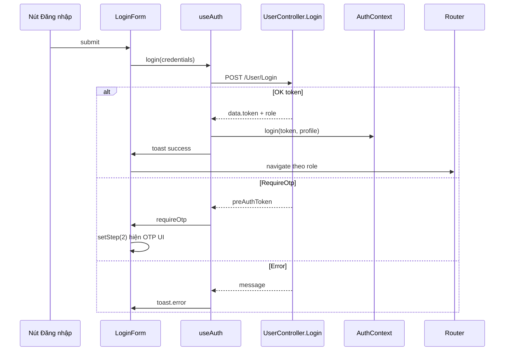

# UI Trace — Auth (Login / OTP / OAuth / Forgot Password)

> Template: [00_TEMPLATE.md](./00_TEMPLATE.md) · Requirements: [../requirements/Auth_Requirements.md](../requirements/Auth_Requirements.md) · Alerts: [../requirements/alerts/Auth_Alerts.md](../requirements/alerts/Auth_Alerts.md)

**Page gốc:** Route `/login` → `pages/LoginPage.tsx` render `components/auth/LoginForm.tsx`.

---

## UT-AUTH-01 — Nút / Form **「Đăng nhập」** (username + password)

### 1. Giao diện nút bấm ở đâu?

| Mục | Giá trị |
|-----|---------|
| **Route** | `/login` |
| **Page** | `ShoppingFood.FE/src/pages/LoginPage.tsx` |
| **Component** | `ShoppingFood.FE/src/components/auth/LoginForm.tsx` |
| **Nhãn** | Button `"Đăng nhập"` (`size="lg"`, `type="submit"`) |
| **Form** | `<form onSubmit={handleLoginSubmit}>` khi `loginMethod === 'standard'` và `step === 1` |
| **Input** | Username/Email + Password (có nút hiện/ẩn MK) |

### 2. Bấm xong chạy đến đâu? (Frontend)

```text
User nhấn 「Đăng nhập」 / Enter
  → form onSubmit
  → LoginForm.handleLoginSubmit (LoginForm.tsx ~89+)
       · validate userName/password (setErrors nếu rỗng)
  → useAuth().login({ userName, password })     hooks/useAuth.ts → login()
  → authService.login(credentials)              services/AuthService.ts → login()
  → httpClient.post(API_ENDPOINTS.AUTH.LOGIN, credentials)
       · services/base/HttpClient.ts
       · URL: POST {API_BASE}/User/Login
```

### 3. Backend chạy đoạn nào?

```text
POST /api/User/Login
  → AuthenticationFilter — BYPASS (public)
  → UserController.Login                          Controllers/UserController.cs ~86+
       · Include Profile, tìm theo UserName hoặc Email
       · So sánh PasswordHash (SHA256)
       · TrustedDevice? → JWT đầy đủ
       · Else → PreAuthToken + message "RequireOtp"
       · Account locked → message "AccountLocked"
  → TokenHelper.GenerateToken / GenerateRefreshToken / GeneratePreAuthToken
       Core/Security/TokenHelper.cs
  → return Ok(ApiResponse) hoặc BadRequest
```

### 4. Dữ liệu trả về ở đâu?

**Success (không OTP):**

```json
{
  "code": 200,
  "error": false,
  "message": "...",
  "data": {
    "token": "<JWT>",
    "refreshToken": "...",
    "username": "...",
    "fullName": "...",
    "role": "Customer|Seller|Admin|...",
    "avatarUrl": "..."
  }
}
```

**Cần OTP thiết bị mới:**

```json
{
  "error": false,
  "message": "RequireOtp",
  "data": { "preAuthToken": "...", "availableMethods": ["email","phone"], ... }
}
```

### 5. Làm sao hiển thị?

| Nhánh | Code FE | Hiển thị |
|-------|---------|----------|
| Success | `fetchAndSetProfile` → `AuthContext.login` → `StorageUtil.setToken/setUser` → `toast.success('Đăng nhập thành công!')` → `handleRedirectByRole(role)` | Đổi route: Admin→`/admin`, Seller→`/seller`, Shipper→`/shipper`, Coordinator→dispatch, else `/` |
| RequireOtp | `setPreAuthToken`, `setStep(2)`, `setAvailableMethods` | UI đổi sang màn chọn gửi OTP (không vào app) |
| AccountLocked | tương tự OTP + `setIsLocked(true)` | Tiêu đề “Tài khoản đang bị khóa” |
| Error | `toast.error(message)` | Toast đỏ góc phải (`App.tsx` Toaster) |

`handleRedirectByRole` — `LoginForm.tsx` ~67–84.

### 6. Sequence



---

## UT-AUTH-02 — Nút **「Gửi OTP Email / Phone」** (sau RequireOtp)

### 1. UI ở đâu?

| Mục | Giá trị |
|-----|---------|
| **Khi nào hiện** | `step === 2` trong `LoginForm.tsx` |
| **Nút** | `"Gửi mã qua Email"` / `"Gửi mã qua SĐT"` (`handleSendOtp('email'|'phone')`) |

### 2. FE chạy đâu?

```text
onClick → handleSendOtp(method)
  → useAuth().sendLoginOtp({ preAuthToken, method })
  → authService.sendLoginOtp(...)
  → POST /api/User/SendLoginOtp
```

### 3. Backend

```text
UserController.SendLoginOtp → SendLoginOtpCommand → Handler
  → Gửi email/SMS OTP gắn PreAuth
  → ApiResponse success/fail
```

### 4–5. Data & hiển thị

- Success: `toast.success('Mã OTP đã được gửi!')` → thường chuyển `setStep(3)` nhập OTP (theo logic form)
- Fail: `toast.error(...)`

---

## UT-AUTH-03 — Form **「Xác nhận OTP」** (Verify Login / Unlock)

### 1. UI

- `step` nhập OTP 6 số + Button submit `"Xác nhận"`
- `onSubmit={isLocked ? ... : handleVerifyOtp}`

### 2. FE

```text
handleVerifyOtp
  → nếu isLocked: verifyUnlockAccount(preAuthToken, otpCode)
  → else: verifyLoginOtp(preAuthToken, otpCode)
  → authService.verifyLoginOtp / VerifyUnlockAccount
  → POST /User/VerifyLoginOtp  hoặc  /User/VerifyUnlockAccount
```

### 3. BE

```text
VerifyLoginOtpHandler / VerifyUnlock...
  → Check OTP + PreAuth
  → Generate JWT + Refresh
  → (Unlock) đổi UserStatus Active
```

### 4–5. Data & hiển thị

- `data` giống login success (token, role…)
- `fetchAndSetProfile` + toast success + `handleRedirectByRole`

---

## UT-AUTH-04 — Nút **Google Login**

### 1. UI

- `LoginForm.tsx` — component `@react-oauth/google` `GoogleLogin` (onSuccess / onError)

### 2. FE

```text
handleGoogleSuccess(credentialResponse)
  → useAuth().loginGoogle(credentialResponse.credential)
  → authService.loginGoogle({ credential })
  → POST /api/User/LoginGoogle
```

### 3. BE

`UserController.LoginGoogle` → `LoginGoogleHandler` (verify Google token → tìm/tạo user → JWT)

### 4–5. Hiển thị

- Success: toast Google thành công + redirect theo role  
- Fail: `toast.error('Đăng nhập Google thất bại')` (`handleGoogleError` hoặc hook)

---

## UT-AUTH-05 — Nút **Microsoft Login**

### 1. UI

- Button Microsoft trên `LoginForm` → `onClick={handleMicrosoftLogin}`

### 2. FE

```text
handleMicrosoftLogin
  → window.open(Microsoft authorize URL)  // popup
  → popup nhận ?code= → main.tsx postMessage { type: 'microsoft-auth-code', code }
  → LoginForm useEffect listener
  → loginMicrosoft(code, redirectUri)
  → POST /api/User/LoginMicrosoft
```

**Entry popup handler:** `ShoppingFood.FE/src/main.tsx` (trước khi render App).

### 3–5. BE / hiển thị

- `LoginMicrosoftHandler` → JWT  
- toast + `handleRedirectByRole`

---

## UT-AUTH-06 — Tab **Đăng nhập SĐT** + Firebase OTP

### 1. UI

- Tab `"Số điện thoại"` → `setLoginMethod('phone')`
- Form submit `handlePhoneLoginSubmit` → Firebase `signInWithPhoneNumber`
- Step OTP: `handleVerifyPhoneLoginOtp`

### 2. FE

```text
confirmationResult.confirm(otpCode)
  → idToken = user.getIdToken()
  → loginFirebasePhone(idToken)
  → POST /api/User/LoginFirebasePhone
```

### 3–5

- BE verify Firebase token → JWT  
- Toast / redirect như login thường  
- Lỗi: `toast.error('Mã OTP không hợp lệ')`

---

## UT-AUTH-07 — Link **「Quên mật khẩu?」**

### 1. UI

| Mục | Giá trị |
|-----|---------|
| **Nút** | `<button>Quên mật khẩu?</button>` trong LoginForm (~352) |
| **onClick** | `setIsForgotModalOpen(true)` |
| **Modal** | `ForgotPasswordModal` (`isOpen`, `onClose`) |

### 2–5. Ba bước trong Modal (chi tiết workflow)

| Bước UI | Hàm FE | API | Hiển thị sau success |
|---------|--------|-----|----------------------|
| 1 Gửi mã | `handleRequestOtp` → `authService.forgotPassword` | `POST /User/ForgotPassword` | toast + `setStep(2)` |
| 2 Xác nhận OTP | `handleVerifyOtp` → `verifyResetOtp` | `POST /User/VerifyResetOtp` | toast + `setStep(3)` |
| 3 Đặt MK mới | `handleResetPassword` → `resetPassword` | `POST /User/ResetPassword` | toast success + `handleClose()` đóng modal |

**BE:** `ForgotPasswordHandler` → Email OTP; `VerifyResetOtpHandler`; `ResetPasswordHandler` (SHA256 + IsUsed).

**Hiển thị lỗi:** `toast.error` + `setErrors` trên Input.

→ Xem thêm: [../workflows/ForgotPassword_Workflow.md](../workflows/ForgotPassword_Workflow.md)

---

## UT-AUTH-08 — Đăng xuất (Header / Layout)

### 1. UI

- Thường trong Header user menu / Dashboard layout — gọi `useAuth().logout`

### 2. FE

```text
logout()
  → authService.logout() → POST /User/Logout (optional)
  → AuthContext.logout() → clear token/user storage
  → toast.success('Đã đăng xuất')
  → navigate('/login') (tùy chỗ gọi)
```

### 3–5

- BE invalidate refresh token  
- UI: mất session → PrivateRoute đẩy về login nếu vào trang bảo vệ

---

## UT-AUTH-09 — Tự động Refresh Token (không phải nút)

### 1. “UI” / điểm kích hoạt

- Mọi request Axios 401 trong `HttpClient.ts` interceptor

### 2–5

```text
401 → authService.refreshToken(token)
  → POST /User/RefreshToken
  → nếu OK: setToken mới, retry request gốc
  → nếu fail: clearAuth + window.location = /login
```

**Hiển thị:** thường không toast; user thấy bị đưa về `/login`.

---

## Bảng tóm tắt Auth

| ID | Nhãn / Sự kiện | Component | FE hàm | API | Hiển thị kết quả |
|----|----------------|-----------|--------|-----|------------------|
| UT-AUTH-01 | Đăng nhập | LoginForm | handleLoginSubmit → useAuth.login | POST /User/Login | toast + navigate / OTP UI |
| UT-AUTH-02 | Gửi OTP | LoginForm step2 | handleSendOtp | SendLoginOtp | toast |
| UT-AUTH-03 | Xác nhận OTP | LoginForm | handleVerifyOtp | VerifyLoginOtp | toast + navigate |
| UT-AUTH-04 | Google | LoginForm | handleGoogleSuccess | LoginGoogle | toast + navigate |
| UT-AUTH-05 | Microsoft | LoginForm + main.tsx | handleMicrosoftLogin | LoginMicrosoft | toast + navigate |
| UT-AUTH-06 | SĐT Firebase | LoginForm | handleVerifyPhoneLoginOtp | LoginFirebasePhone | toast + navigate |
| UT-AUTH-07 | Quên MK | ForgotPasswordModal | 3 handlers | Forgot/Verify/Reset | toast + đóng modal |
| UT-AUTH-08 | Đăng xuất | Header/Layout | useAuth.logout | Logout | clear + login |
| UT-AUTH-09 | Auto refresh | HttpClient | interceptor | RefreshToken | retry / redirect |

---

## File neo Auth

| Tầng | Path |
|------|------|
| Page | `ShoppingFood.FE/src/pages/LoginPage.tsx` |
| Form | `.../components/auth/LoginForm.tsx` |
| Forgot Modal | `.../components/auth/ForgotPasswordModal.tsx` |
| Hook | `.../hooks/useAuth.ts` |
| Context | `.../contexts/AuthContext.tsx` |
| Storage | `.../utils/storage.ts` (`sf_token`, `sf_user`) |
| Service | `.../services/AuthService.ts` |
| HTTP | `.../services/base/HttpClient.ts` |
| Toaster host | `.../App.tsx` |
| Controller | `src/ShoppingFood.API/Controllers/UserController.cs` |
| Token | `src/ShoppingFood.Core/Security/TokenHelper.cs` |
