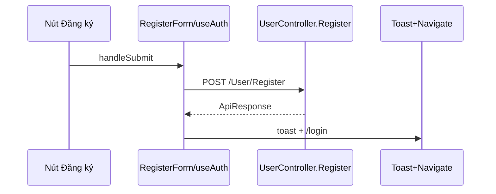
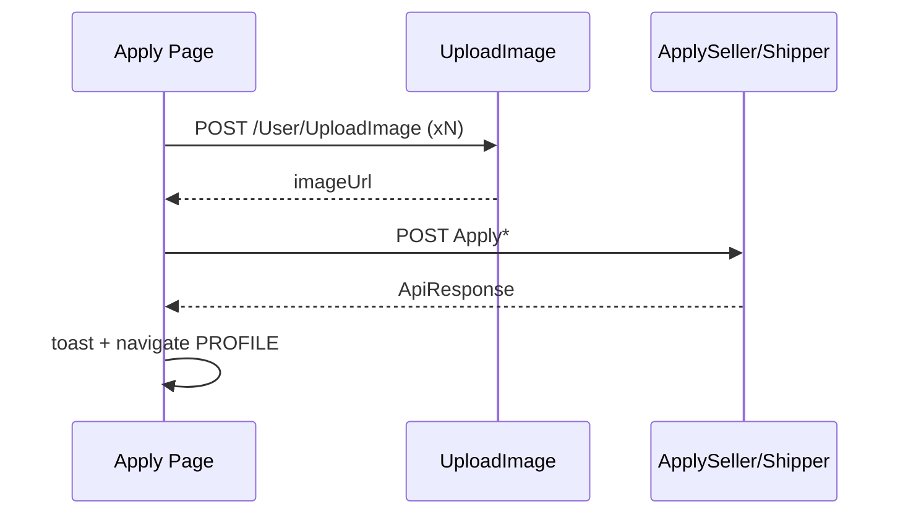

# UI Trace — Đăng ký / Apply Seller & Shipper

> Template: [00_TEMPLATE.md](./00_TEMPLATE.md) · Requirements: [../requirements/Auth_Requirements.md](../requirements/Auth_Requirements.md)

---

### UT-REG-01 — Đăng ký Customer (`"Đăng ký"`)

#### 1. Giao diện nút bấm ở đâu?

| Mục | Giá trị |
|-----|---------|
| **Route** | `/register` |
| **Page** | `pages/RegisterPage.tsx` → render `RegisterForm` |
| **Component** | `components/auth/RegisterForm.tsx` |
| **Nhãn nút** | `"Đăng ký"` (submit) |
| **Loại control** | `<Button type="submit">` trong `<form onSubmit={handleSubmit}>` |
| **Điều kiện hiện** | `!isSeller` (Customer) |

#### 2. Bấm xong chạy đến đâu? (Frontend)

```text
form onSubmit
  → RegisterForm.handleSubmit (RegisterForm.tsx)
  → validateStep1()
  → useAuth().register({ userName, password, fullName, email, phone, role:'Customer', idToken:'bypass' })
       (hooks/useAuth.ts)
  → authService.register(data) (services/AuthService.ts)
  → httpClient.post(API_ENDPOINTS.AUTH.REGISTER, data)
```

#### 3. Backend chạy đoạn nào?

```text
POST /api/User/Register
  → AuthenticationFilter (bypass)
  → UserController.Register
  → MediatR → AddUserHandler / RegisterCommand
  → Hash password, tạo USER_ACCOUNT + USER_PROFILE (Role=Customer)
  → return ApiResponse
```

#### 4. Dữ liệu trả về ở đâu?

```json
{ "code": 200, "error": false, "message": "...", "data": { /* user dto */ } }
```

Lỗi validation thường trả `errors` dictionary theo field.

#### 5. Làm sao hiển thị ra?

| Nhánh | Hành vi UI |
|-------|------------|
| Success | `toast.success('Đăng ký thành công! Vui lòng đăng nhập.')` → `navigate(ROUTES.LOGIN)` |
| Error field | `setErrors(mappedErrors)` hiện dưới Input |
| Error chung | toast từ `useAuth.register` |

#### 6. Sơ đồ nhanh



---

### UT-REG-02 — Đăng ký Seller (2 bước, `"Hoàn tất đăng ký"`)

#### 1. Giao diện nút bấm ở đâu?

| Mục | Giá trị |
|-----|---------|
| **Route** | `/register/seller` |
| **Page** | `RegisterPage` với `isSeller` |
| **Component** | `RegisterForm.tsx` step 2 |
| **Nhãn nút** | Submit bước 2 (sau `"Tiếp tục"` ở step 1) |
| **Điều kiện hiện** | `isSeller && step === 2` |

#### 2. Frontend

```text
Step1: Button onClick={handleNext} → validateStep1 → setStep(2)
Step2: form submit → handleSubmit
  → useAuth().registerSeller({ ...account, businessName, businessAddress, businessLicenseUrl, shopImageUrl, contactInfo, idToken })
  → authService.registerSeller → POST /User/RegisterSeller
```

Upload giấy phép / ảnh quán: `handleFileChange` / `handleShopFileChange` → `authService.uploadImage` → `POST /User/UploadImage` → gán URL vào form.

#### 3. Backend

```text
POST /api/User/RegisterSeller
  → RegisterSellerCommand / Handler
  → Tạo User (Seller pending) + SellerApplication + (Restaurant khi duyệt)
```

#### 4–5. Response & hiển thị

| Success | `toast.success('Đăng ký cửa hàng thành công! Đang chờ duyệt.')` → `navigate(/login)` |
| Error | `setErrors` + có thể `setStep(1)` nếu lỗi userName/email/phone |

Validate file: toast `File không được vượt quá 5MB` / sai định dạng.

---

### UT-REG-03 — Apply Seller khi đã login (`"Gửi đăng ký"`)

#### 1. Giao diện

| Mục | Giá trị |
|-----|---------|
| **Route** | `/seller/apply` (PrivateRoute Customer) |
| **Page** | `pages/SellerApplyPage.tsx` |
| **Nhãn nút** | Submit form `"Đăng ký trở thành Người Bán"` |

#### 2. Frontend

```text
handleSubmit
  → validate files (license + shop image, size/type)
  → authService.uploadImage(license) → imageUrl
  → authService.uploadImage(shop) → imageUrl
  → authService.applySeller({ businessName, businessAddress, contactInfo, businessLicenseUrl, shopImageUrl })
  → POST /User/ApplySeller
```

#### 3. Backend

```text
POST /api/User/ApplySeller (Auth)
  → ApplySellerHandler
  → Insert SELLER_APPLICATION Status=Pending
```

#### 4–5. Hiển thị

| Success | toast `Đăng ký thành công! Vui lòng chờ phê duyệt.` → `navigate(PROFILE)` |
| Already seller | toast `Bạn đã là Người Bán hoặc Mall.` |
| Pending exists | toast `Bạn đang có một yêu cầu... chờ duyệt.` |
| Missing file | toast validate trước khi gọi API |

---

### UT-REG-04 — Đăng ký Shipper public (`ShipperApplyPage`)

#### 1. Giao diện

| Mục | Giá trị |
|-----|---------|
| **Route** | `/register/shipper` |
| **Page** | `pages/ShipperApplyPage.tsx` |
| **Nhãn** | Multi-step; cuối form `onSubmit={handleSubmit}` nút gửi đăng ký |

#### 2. Frontend

```text
handleNext / handleBack (steps)
handleFileSelect → validate → set file state
handleSubmit
  → upload lần lượt CMND/GPLX/cavet/avatar qua authService.uploadImage
  → authService.registerShipper({ ...account, vehicle, urls })
  → POST /User/register-shipper
```

#### 3. Backend

```text
POST /api/User/register-shipper (Public)
  → tạo User + ShipperApplication Pending
```

#### 4–5. Hiển thị

| Success | toast `Đăng ký tài xế thành công! Vui lòng chờ phê duyệt.` → `navigate(HOME)` |
| Upload fail | toast `Lỗi tải lên {name}: ...` dừng submit |
| Validation | toast / `errors` trên field |

---

### UT-REG-05 — Apply Shipper khi đã login (`"Gửi yêu cầu"`)

#### 1. Giao diện

| Mục | Giá trị |
|-----|---------|
| **Route** | `/shipper/apply` (auth Customer/Seller/Mall) |
| **Page** | `pages/shipper/AuthShipperApplyPage.tsx` |
| **Nhãn nút** | `"Gửi yêu cầu"` / `"Đang gửi..."` |
| **Nút phụ** | `"Hủy bỏ"` → `navigate(-1)` |

#### 2. Frontend

```text
handleSubmit
  → validate identityCardNumber, plate, 4 files bắt buộc
  → upload 4 ảnh tuần tự (uploadImage)
  → authService.applyShipper({ identityCardNumber, vehicleType, vehiclePlateNumber, urls... })
  → POST /User/apply-shipper
```

#### 3. Backend

```text
POST /api/User/apply-shipper (Auth)
  → ApplyShipperHandler → SHIPPER_APPLICATION Pending
```

#### 4–5. Hiển thị

| Success | toast `Gửi yêu cầu đăng ký tài xế thành công!...` → `navigate(PROFILE)` |
| Missing fields | toast `Vui lòng điền đủ thông tin và tải lên các tệp tin bắt buộc` |
| Error API | `toast.error(res.message)` |

#### 6. Sơ đồ Apply (Seller/Shipper auth)



---

## Call chain tóm tắt

| UT | FE entry | Service | API |
|----|----------|---------|-----|
| REG-01 | `RegisterForm.handleSubmit` | `authService.register` | `POST /User/Register` |
| REG-02 | `RegisterForm.handleSubmit` | `registerSeller` | `POST /User/RegisterSeller` |
| REG-03 | `SellerApplyPage.handleSubmit` | `applySeller` | `POST /User/ApplySeller` |
| REG-04 | `ShipperApplyPage.handleSubmit` | `registerShipper` | `POST /User/register-shipper` |
| REG-05 | `AuthShipperApplyPage.handleSubmit` | `applyShipper` | `POST /User/apply-shipper` |

**Duyệt hồ sơ:** xem [13_Admin_Support_UI_Trace.md](./13_Admin_Support_UI_Trace.md) UT-ADM-01.
