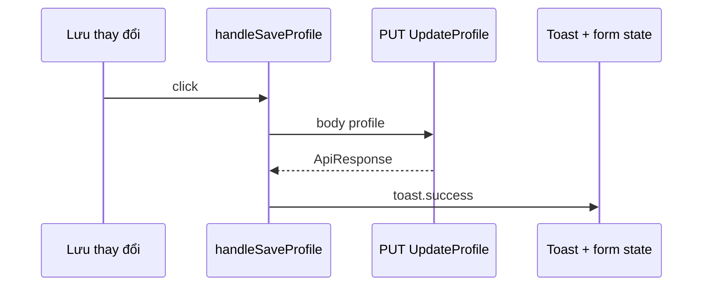

# UI Trace — Profile / Địa chỉ / Lock / Xóa TK

> Template: [00_TEMPLATE.md](./00_TEMPLATE.md) · Requirements: [../requirements/Profile_Requirements.md](../requirements/Profile_Requirements.md)

---

### UT-PRF-01 — Lưu hồ sơ (`"Lưu thay đổi"`)

#### 1. Giao diện nút bấm ở đâu?

| Mục | Giá trị |
|-----|---------|
| **Route** | `/profile` |
| **Page** | `pages/ProfilePage.tsx` |
| **Nhãn nút** | Lưu profile (Button cạnh `"Đổi mật khẩu"`) |
| **Loại** | `onClick={handleSaveProfile}` |

#### 2. Frontend

```text
handleSaveProfile
  → validate fullName không rỗng
  → authService.updateProfile({ fullName, gender, dateOfBirth, avatarUrl? })
  → httpClient.put('/User/UpdateProfile', data)
```

#### 3. Backend

```text
PUT /api/User/UpdateProfile (Auth)
  → UserController.UpdateProfile
  → UpdateProfileCommand / Handler
  → cập nhật USER_PROFILE
```

#### 4. Response

```json
{ "code": 200, "error": false, "message": "Cập nhật thông tin thành công!", "data": null }
```

#### 5. Hiển thị

| Success | `toast.success(...)` + có thể refresh profile state |
| Empty name | `toast.error('Vui lòng nhập họ tên')` — không gọi API |
| Network | `toast.error('Lưu thông tin cá nhân thất bại...')` |

---

### UT-PRF-02 — Upload avatar (click vùng ảnh)

#### 1. Giao diện

| Mục | Giá trị |
|-----|---------|
| **Component** | `ProfilePage.tsx` — click avatar → `fileInputRef.click()` |
| **Input ẩn** | `<input type="file" onChange={handleFileChange} accept="image/*">` |

#### 2. Frontend

```text
handleFileChange
  → validate size ≤5MB, ext jpg/jpeg/png/webp
  → toast.loading('Đang tải ảnh lên...')
  → authService.uploadAvatar(file)  // FormData
  → POST /User/UploadAvatar
  → (thường kèm update profile avatarUrl)
```

#### 3. Backend

```text
POST /api/User/UploadAvatar
  → PhotoService (Cloudinary) → lưu URL vào Profile
```

#### 4–5. Hiển thị

| Success | `toast.success('Cập nhật ảnh đại diện thành công!', { id: toastId })` + cập nhật `user.avatarUrl` trên UI |
| >5MB / sai type | toast error, không upload |
| Fail | toast error với cùng `toastId` |

---

### UT-PRF-03 — Đổi mật khẩu (Modal)

#### 1. Giao diện

| Mục | Giá trị |
|-----|---------|
| **Mở modal** | Button `"Đổi mật khẩu"` → `setIsChangePasswordOpen(true)` |
| **Component** | `components/auth/ChangePasswordModal.tsx` |
| **Nhãn submit** | Đổi / Cập nhật mật khẩu |

#### 2. Frontend

```text
ChangePasswordModal submit
  → validate old/new/confirm
  → authService.changePassword({ oldPassword, newPassword })
  → POST /User/ChangePassword
```

#### 3. Backend

```text
ChangePasswordHandler
  → so khớp hash MK cũ → SHA256 hash MK mới → USER_ACCOUNT.PasswordHash
```

#### 4–5. Hiển thị

| Success | toast thành công + đóng modal |
| Sai MK cũ | toast `Mật khẩu cũ không chính xác.` |
| Validation | lỗi inline trên Input |

---

### UT-PRF-04 — Đổi email/SĐT (ChangeContactModal)

#### 1. Giao diện

| Mục | Giá trị |
|-----|---------|
| **Mở** | link `"Thay đổi"` cạnh email trên ProfilePage → `setIsChangeContactOpen(true)` |
| **Component** | `ChangeContactModal.tsx` — 2 bước OTP |

#### 2–3. Flow

```text
Request OTP → POST /User/RequestUpdateContact
Verify OTP  → POST /User/VerifyUpdateContact
  → Handler cập nhật Email/Phone sau khi OTP hợp lệ
```

#### 5. Hiển thị

Toast OTP đã gửi / xác thực thành công; lỗi OTP hết hạn.

---

### UT-PRF-05 — Địa chỉ CRUD (`UserAddressManager`)

#### 1. Giao diện

| Mục | Giá trị |
|-----|---------|
| **Tab** | Profile `activeTab === 'address'` |
| **Component** | `components/profile/UserAddressManager.tsx` |
| **Nút** | Thêm / Sửa / Xóa / Đặt mặc định |

#### 2. Frontend → API

```text
add     → userAddressService.addAddress → POST /UserAddress
update  → PUT /UserAddress/{id}
delete  → DELETE /UserAddress/{id}
default → PUT /UserAddress/{id}/SetDefault
list    → GET /UserAddress (load tab)
```

#### 5. Hiển thị

Toast success từng thao tác; validation `Vui lòng nhập tên người nhận / SĐT / địa chỉ`; list re-render từ state sau API.

---

### UT-PRF-06 — Khóa tài khoản

#### 1. Giao diện

| Mục | Giá trị |
|-----|---------|
| **Nút** | Mở modal khóa → Confirm `"Khóa"` `onClick={handleLockAccount}` |
| **Page** | `ProfilePage.tsx` |

#### 2–3.

```text
handleLockAccount → authService.lockAccount → POST /User/LockAccount
  → User.Status = Locked/Inactive (theo handler)
```

#### 5. Hiển thị

`toast.success('Tài khoản đã bị khóa.')` → `navigate(LOGIN)` + clear session (logout flow).

---

### UT-PRF-07 — Yêu cầu xóa tài khoản

#### 1. Giao diện

Confirm modal xóa → `handleRequestDeletion`

#### 2–3.

```text
POST /User/RequestDeletion (Auth, có [Authorize])
  → ghi DeleteRequestedAt
```

#### 5. Hiển thị

toast `Đã gửi yêu cầu xóa tài khoản.` → `navigate(LOGIN)`.

---

### UT-PRF-08 — Xem / cập nhật hồ sơ đăng ký (Applications)

#### 1. Giao diện

Tab/component `CustomerApplications.tsx` trên Profile — nút gửi lại đơn khi NeedsInfo.

#### 2–3.

```text
GET /User/my-applications
PUT /User/SellerApplication hoặc update-shipper-application
```

#### 5. Hiển thị

toast cập nhật thành công; status Pending/Approved/Rejected hiển thị trên card.

---

## Sơ đồ Profile save


