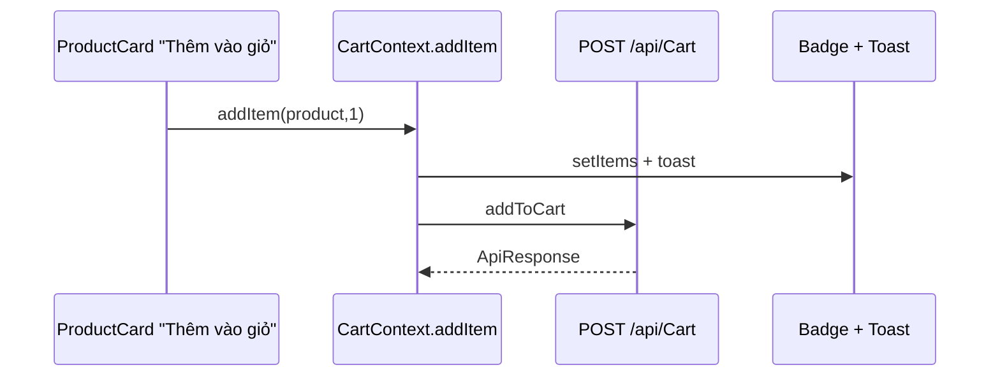
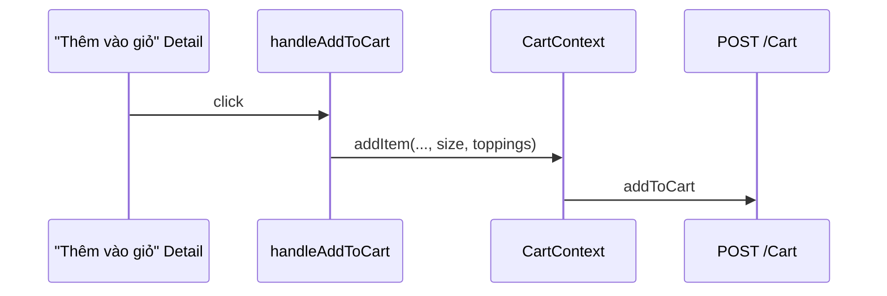
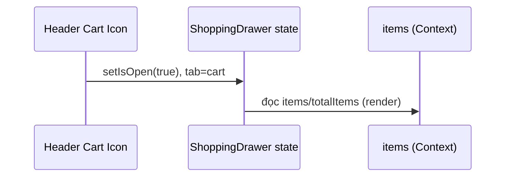
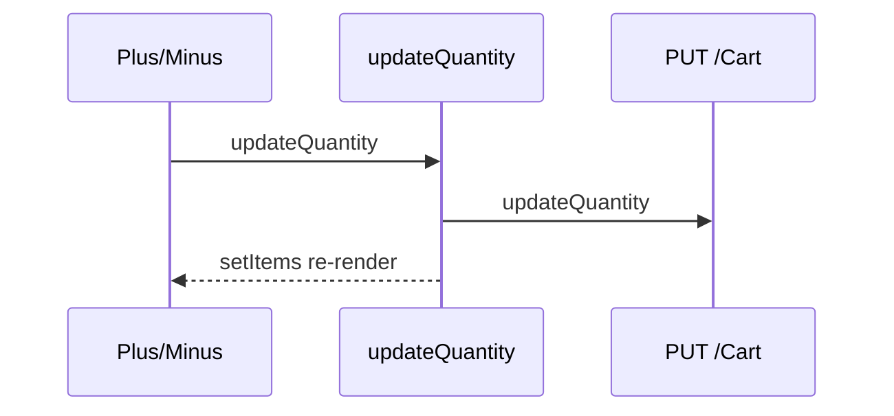
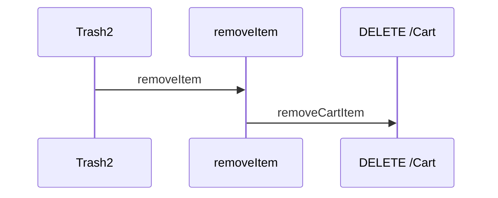
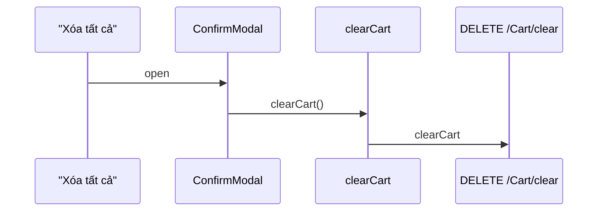
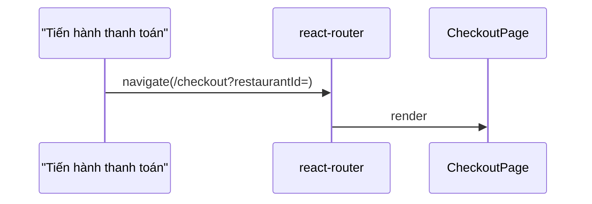

# UI Interaction Trace — Giỏ hàng (Cart)

> Format: [00_TEMPLATE.md](./00_TEMPLATE.md)  
> Requirements: [../requirements/Cart_Requirements.md](../requirements/Cart_Requirements.md) · Alerts: [../requirements/alerts/Cart_Alerts.md](../requirements/alerts/Cart_Alerts.md)

**State trung tâm:** `CartProvider` trong `ShoppingFood.FE/src/contexts/CartContext.tsx`  
**Hook:** `useCart()` → `hooks/useCart.ts` (re-export context)  
**Keys localStorage:** `sf_cart` (optimistic), `sf_guest_id` (guest)

---

## UT-CART-01 — Thêm vào giỏ từ ProductCard

#### 1. Giao diện nút bấm ở đâu?

| Mục | Giá trị |
|-----|---------|
| **Route** | `/`, `/products`, `/restaurant/:id`, … (mọi nơi render `ProductCard`) |
| **Page** | Ví dụ `pages/HomePage.tsx`, `pages/ProductsPage.tsx` |
| **Component** | `components/product/ProductCard.tsx` |
| **Nhãn nút** | `"Thêm vào giỏ"` (hoặc `"Hết hàng"` nếu OutOfStock) |
| **Loại control** | `<button onClick={...}>` cuối card |
| **Điều kiện hiện** | Luôn hiện; `disabled` khi `stockStatus === 'OutOfStock'` |

#### 2. Bấm xong chạy đến đâu? (Frontend)

```text
ProductCard button onClick (ProductCard.tsx ~104–110)
  → e.stopPropagation()  // không navigate vào detail
  → if stockStatus !== 'OutOfStock':
       addItem(product, 1)   // từ useCart()
  → CartContext.addItem (CartContext.tsx ~119–169)
       1) setItems(...) optimistic (cộng qty nếu trùng product+size+toppings)
       2) setTimeout → toast.success("Đã thêm vào giỏ: …" | "Đã cập nhật số lượng: …")
       3) cartService.addToCart({ productId, quantity, guestUserId })
  → httpClient.post('/Cart', body)
```

**Cùng pattern add nhanh:**
- `HomePage.tsx` ~356: `onClick={() => addItem(product, 1)}`
- `FlashSalePage.tsx`, `BuyXGetYPage.tsx`, `BuyXGetYSection.tsx` — `addItem(...)` với qty khác

#### 3. Backend chạy đoạn nào?

```text
POST /api/Cart
  → CartController.AddToCart (CartController.cs L14–18)
  → MediatR → AddToCartHandler.Handle (Features/Carts/Commands/AddToCartHandler.cs)
  → Kiểm tra product tồn tại / stock
  → Conflict 409 nếu khác restaurant với item đang có trong cart
  → Insert/Update CartItem → SaveChanges
  → ApiResponse.Success(dto, "Added item to cart successfully")
```

#### 4. Dữ liệu trả về ở đâu?

```json
{
  "code": 200,
  "error": false,
  "message": "Added item to cart successfully",
  "data": { /* cart DTO */ }
}
```

| Field / Case | Ý nghĩa |
|--------------|---------|
| 404 | Product not found / unavailable |
| 400 | Out of stock |
| 409 | Khác cửa hàng — message hỏi empty cart |

**Request FE gửi:** `{ productId, quantity, guestUserId? }` — size/toppings hiện **optimistic local**, API add cơ bản theo productId.

#### 5. Làm sao hiển thị ra?

| Nhánh | Hành vi UI |
|-------|------------|
| Optimistic OK | `items` trong Context đổi ngay → badge giỏ Header (`totalItems`) tăng |
| Toast success | `Đã thêm vào giỏ: {itemName}` hoặc cập nhật số lượng |
| API error | `toast.error(...)` — state local **không rollback** (comment trong code) |
| localStorage | `useEffect` ghi `sf_cart` mỗi khi `items` đổi |

#### 6. Sơ đồ nhanh



---

## UT-CART-02 — Thêm vào giỏ từ ProductDetailPage (có size/topping)

#### 1. Giao diện nút bấm ở đâu?

| Mục | Giá trị |
|-----|---------|
| **Route** | `/products/:id` |
| **Page** | `pages/ProductDetailPage.tsx` |
| **Component** | cùng page |
| **Nhãn nút** | `"Thêm vào giỏ"` (disabled/"Hết hàng" nếu out of stock) |
| **Loại control** | Button `onClick={handleAddToCart}` (~292) |
| **Điều kiện hiện** | Sau khi load product; user chọn size/topping phía trên |

#### 2. Bấm xong chạy đến đâu? (Frontend)

```text
handleAddToCart (ProductDetailPage.tsx L85–87)
  → addItem(product, 1, selectedSize || undefined, selectedToppings.length ? selectedToppings : undefined)
  → CartContext.addItem (như UT-CART-01)
  → cartService.addToCart({ productId, quantity, guestUserId })
```

#### 3. Backend chạy đoạn nào?

Giống UT-CART-01 — `AddToCartHandler`.

#### 4. Dữ liệu trả về ở đâu?

Giống UT-CART-01.

#### 5. Làm sao hiển thị ra?

| Nhánh | Hành vi UI |
|-------|------------|
| Success | Toast + Context `items` có `selectedSize` / `selectedToppings` (local) |
| Key trùng | Cùng product+size+toppings → cộng `quantity` trong `setItems` |

#### 6. Sơ đồ nhanh



---

## UT-CART-03 — Mở giỏ hàng (ShoppingDrawer) từ Header

#### 1. Giao diện nút bấm ở đâu?

| Mục | Giá trị |
|-----|---------|
| **Route** | Mọi trang dùng `MainLayout` / Header |
| **Page** | Layout |
| **Component** | `components/layout/Header.tsx` nhúng `<ShoppingDrawer />` (~95, ~184) |
| **Nhãn nút** | Icon `ShoppingCart` (title `"Giỏ hàng & Đơn hàng"`) |
| **Loại control** | `<button onClick={() => { setIsOpen(true); setActiveTab('cart'); }}>` — ShoppingDrawer.tsx ~225–236 |
| **Điều kiện hiện** | Luôn; badge số nếu `totalItems > 0` |

#### 2. Bấm xong chạy đến đâu? (Frontend)

```text
ShoppingDrawer trigger button
  → setIsOpen(true)
  → setActiveTab('cart')
  → createPortal drawer (không gọi API ngay cho cart — items đã có trong Context)
  → Nếu sau đó user chuyển tab "Đơn hàng":
       useEffect → fetchOrders → orderService.getMyOrders / getGuestOrders
```

**Không** gọi lại `getCart` chỉ vì mở drawer (cart đã sync lúc mount/`isAuthenticated` đổi qua `fetchCart`).

#### 3. Backend chạy đoạn nào?

Không HTTP khi chỉ mở drawer.  
(Khi load lần đầu app: `GET /api/Cart?guestUserId=` → `GetCartHandler`.)

#### 4. Dữ liệu trả về ở đâu?

N/A cho click mở.  
`GET /Cart` khi `fetchCart`: `data` = array items hoặc `{ items: [...] }`.

#### 5. Làm sao hiển thị ra?

| Nhánh | Hành vi UI |
|-------|------------|
| Mở | Overlay + panel phải `max-w-md`, tab Giỏ hàng |
| Badge | `totalItems` từ Context |
| Empty | Text "Giỏ hàng trống" + nút "Tiếp tục tìm kiếm" |

#### 6. Sơ đồ nhanh



---

## UT-CART-04 — Tăng / giảm số lượng (+ / −)

#### 1. Giao diện nút bấm ở đâu?

| Mục | Giá trị |
|-----|---------|
| **Route** | Drawer đang mở |
| **Component** | `ShoppingDrawer.tsx` trong từng dòng item |
| **Nhãn nút** | Icon `Minus` / `Plus` (~423–433) |
| **Loại control** | `<button onClick={() => updateQuantity(...)}>` |
| **Điều kiện hiện** | Có item trong group nhà hàng |

#### 2. Bấm xong chạy đến đâu? (Frontend)

```text
Minus: updateQuantity(productId, quantity - 1, selectedSize, selectedToppings)
Plus:  updateQuantity(productId, quantity + 1, ...)
  → CartContext.updateQuantity (L190–222)
       if quantity <= 0 → removeItem(...)
       else setItems map quantity
       → cartService.updateQuantity({ productId, quantity, guestUserId })
  → httpClient.put('/Cart', body)
```

#### 3. Backend chạy đoạn nào?

```text
PUT /api/Cart
  → CartController.UpdateQuantity
  → UpdateCartItemQuantityHandler.Handle
  → Success: "Cart item quantity updated successfully."
```

#### 4. Dữ liệu trả về ở đâu?

```json
{ "error": false, "message": "Cart item quantity updated successfully.", "data": { /* cart dto */ } }
```

404 nếu cart/item không tồn tại.

#### 5. Làm sao hiển thị ra?

| Nhánh | Hành vi UI |
|-------|------------|
| OK | Số qty trên UI đổi ngay (optimistic); `totalPrice` / `selectedTotal` recalculate |
| qty→0 | Item biến mất (qua `removeItem`) |
| Error | `toast.error('Lỗi cập nhật số lượng trên server')` |

#### 6. Sơ đồ nhanh



---

## UT-CART-05 — Xóa một món (Trash)

#### 1. Giao diện nút bấm ở đâu?

| Mục | Giá trị |
|-----|---------|
| **Component** | `ShoppingDrawer.tsx` ~378 |
| **Nhãn nút** | Icon `Trash2` |
| **Loại control** | `onClick={() => removeItem(item.product.id, item.selectedSize, item.selectedToppings)}` |

#### 2. Bấm xong chạy đến đâu? (Frontend)

```text
removeItem(...) (CartContext L171–188)
  → setItems(filter ...) optimistic
  → cartService.removeCartItem({ productId, guestUserId })
  → httpClient.delete('/Cart', { params })
```

#### 3. Backend chạy đoạn nào?

```text
DELETE /api/Cart?productId=&guestUserId=
  → CartController.RemoveCartItem
  → RemoveCartItemCommandHandler
  → "Item removed from cart successfully."
```

#### 4. Dữ liệu trả về ở đâu?

Success message như trên; 404 Cart/Item not found.

#### 5. Làm sao hiển thị ra?

| Nhánh | Hành vi UI |
|-------|------------|
| OK | Dòng item biến mất; badge giảm |
| Error | `toast.error('Lỗi khi xóa món trên server')` |

#### 6. Sơ đồ nhanh



---

## UT-CART-06 — Xóa tất cả giỏ (ConfirmModal)

#### 1. Giao diện nút bấm ở đâu?

| Mục | Giá trị |
|-----|---------|
| **Component** | `ShoppingDrawer.tsx` |
| **Nhãn nút** | `"Xóa tất cả"` (~252–257) — chỉ khi `activeTab==='cart' && groups.length>0` |
| **Confirm** | `ConfirmModal` title `"Xóa giỏ hàng"`, description `"Bạn có chắc chắn muốn xóa toàn bộ giỏ hàng?"` (~579–586) |

#### 2. Bấm xong chạy đến đâu? (Frontend)

```text
"Xóa tất cả" → setClearCartConfirmModal(true)
User Confirm → onConfirm:
  → clearCart() (CartContext L224–231)
       setItems([])
       cartService.clearCart({ guestUserId })
  → httpClient.delete('/Cart/clear', { params })
  → setClearCartConfirmModal(false)
```

#### 3. Backend chạy đoạn nào?

```text
DELETE /api/Cart/clear?guestUserId=
  → CartController.ClearCart
  → ClearCartCommandHandler
  → "Cart cleared successfully."
```

#### 4. Dữ liệu trả về ở đâu?

Success dto + message; 404 nếu không có cart.

#### 5. Làm sao hiển thị ra?

| Nhánh | Hành vi UI |
|-------|------------|
| Confirm | Modal đóng; `items=[]`; UI empty state; badge 0 |
| API fail | `console.error` — **không** toast (khác remove single) |

#### 6. Sơ đồ nhanh



---

## UT-CART-07 — Tiến hành thanh toán (vào Checkout)

#### 1. Giao diện nút bấm ở đâu?

| Mục | Giá trị |
|-----|---------|
| **Component** | `ShoppingDrawer.tsx` footer ~464–470 |
| **Nhãn nút** | `"Tiến hành thanh toán"` |
| **Loại control** | `<Button onClick={handleCheckout} disabled={!selectedProvider}>` |
| **Điều kiện** | Đã chọn 1 nhà hàng (`selectedProvider`) trong drawer |

#### 2. Bấm xong chạy đến đâu? (Frontend)

```text
handleCheckout (ShoppingDrawer.tsx L71–86)
  → Nếu item isProductDeleted trong group → toast.error(...) return
  → setIsOpen(false)
  → checkoutUrl = `/checkout?restaurantId={selectedProvider}`
  → if isAuthenticated: navigate(checkoutUrl)
  → else: navigate(/login, { state: { returnUrl: checkoutUrl } })
```

**Không** gọi API cart ở bước này.

#### 3. Backend chạy đoạn nào?

N/A (navigation only). Checkout gọi API ở `CheckoutPage`.

#### 4. Dữ liệu trả về ở đâu?

N/A.

#### 5. Làm sao hiển thị ra?

| Nhánh | Hành vi UI |
|-------|------------|
| Auth | Đóng drawer → trang `/checkout?restaurantId=...` |
| Guest | Đóng drawer → `/login` rồi quay lại checkout |
| Món ngừng bán | Toast đỏ, ở lại drawer |

#### 6. Sơ đồ nhanh



---

## Tóm tắt call chain Cart

```text
UI (ProductCard / Detail / Drawer)
  → useCart() / CartContext
  → CartService (/Cart, /Cart/clear)
  → CartController → *Handler
  → Context setItems + toast + localStorage sf_cart
  → Header badge totalItems
```

| File quan trọng | Vai trò |
|-----------------|---------|
| `contexts/CartContext.tsx` | State + optimistic + API |
| `services/CartService.ts` | HTTP |
| `components/layout/ShoppingDrawer.tsx` | UI giỏ |
| `components/product/ProductCard.tsx` | Add nhanh |
| `pages/ProductDetailPage.tsx` | Add + options |
| `API/Controllers/CartController.cs` | Endpoints |
| `Application/Features/Carts/**` | Handlers |
