# UI Interaction Trace — Checkout & Vòng đời đơn (Order)

> Format: [00_TEMPLATE.md](./00_TEMPLATE.md)  
> Requirements: [../requirements/Order_Requirements.md](../requirements/Order_Requirements.md) · Payment: [06_Payment_UI_Trace.md](./06_Payment_UI_Trace.md)

---

## UT-ORD-01 — Load trang Checkout

#### 1. Giao diện nút bấm ở đâu?

| Mục | Giá trị |
|-----|---------|
| **Route** | `/checkout?restaurantId={id}` |
| **Page** | `pages/CheckoutPage.tsx` |
| **Component** | Page mount (`useEffect`) — không phải nút, là entry |
| **Nhãn** | — |
| **Điều kiện** | Có `items` từ `useCart()`; nếu trống → toast + về home |

#### 2. Bấm xong chạy đến đâu? (Frontend)

```text
CheckoutPage mount
  → useCart(): items, clearCart
  → useAuth(): isAuthenticated, user
  → useEffect: nếu items.length===0 → toast('Giỏ hàng trống...') → navigate HOME
  → Lọc items theo restaurantId query
  → paymentService.getPaymentMethods() → setPaymentMethods
  → (auth) paymentService.getWallet() → setWalletBalance
  → (auth) userAddressService.list → setSavedAddresses
```

#### 3. Backend chạy đoạn nào?

```text
GET /api/Payment/methods → GetPaymentMethodsHandler
GET /api/Payment/wallet → wallet handler
GET /api/UserAddress → address query
```

#### 4. Dữ liệu trả về ở đâu?

| API | `data` dùng để |
|-----|----------------|
| methods | Render radio COD / SystemWallet / Sepay / … |
| wallet | Text "Số dư ví: …" khi chọn SystemWallet |
| addresses | `<select>` địa chỉ đã lưu |

#### 5. Làm sao hiển thị ra?

Form step 1: thông tin giao hàng + map + payment methods + summary tổng tiền (`finalTotal` useMemo).

#### 6. Sơ đồ nhanh

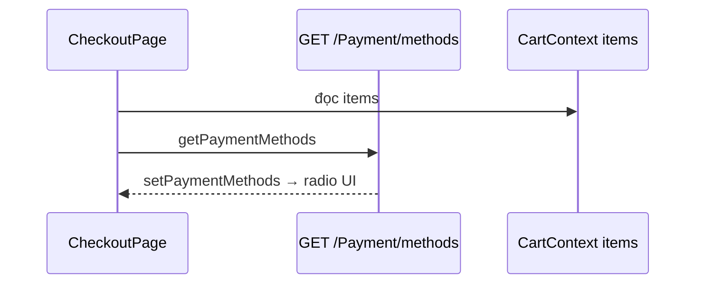

---

## UT-ORD-02 — Nút "Áp dụng" mã giảm giá

#### 1. Giao diện nút bấm ở đâu?

| Mục | Giá trị |
|-----|---------|
| **Route** | `/checkout` |
| **Page** | `CheckoutPage.tsx` |
| **Nhãn nút** | `"Áp dụng"` trong modal mã giảm giá (~807) |
| **Loại control** | `<Button onClick={handleApplyCode}>` |
| **Điều kiện** | Modal mở; có `formData.discountCode` |

#### 2. Bấm xong chạy đến đâu? (Frontend)

```text
handleApplyCode (L262–285)
  → discountService.applyDiscount({ code, restaurantId, cartAmount: checkoutTotal })
  → httpClient.post('/Discount/apply', ...)
```

#### 3. Backend chạy đoạn nào?

```text
POST /api/Discount/apply
  → DiscountController → ApplyDiscountHandler
  → Check active/expiry/usage/min order
```

#### 4. Dữ liệu trả về ở đâu?

```json
{
  "error": false,
  "data": {
    "discountId": "...",
    "code": "SALE10",
    "discountAmount": 10000
  }
}
```

#### 5. Làm sao hiển thị ra?

| Nhánh | Hành vi UI |
|-------|------------|
| OK | `toast.success('Áp dụng mã giảm giá thành công')`; `setSelectedDiscount(...)`; đóng modal; `finalTotal` giảm |
| Fail | `toast.error(res.message \|\| 'Mã giảm giá không hợp lệ')` |
| Gỡ mã | Nút gỡ → `toast.success('Đã gỡ mã giảm giá')`; clear selectedDiscount |

#### 6. Sơ đồ nhanh

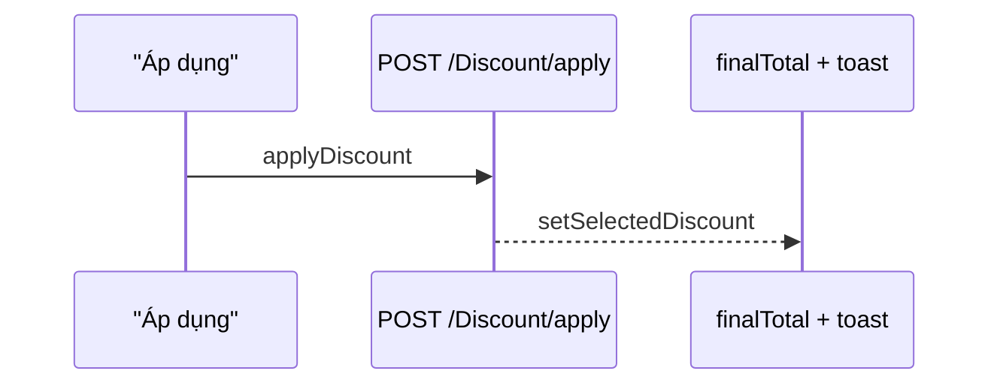

---

## UT-ORD-03 — Nút "Vị trí hiện tại" (GPS)

#### 1. Giao diện nút bấm ở đâu?

| Mục | Giá trị |
|-----|---------|
| **Page** | `CheckoutPage.tsx` map panel (~515–517) |
| **Nhãn nút** | `"Vị trí hiện tại"` + icon MapPin |
| **Loại control** | `<Button type="button" onClick={handleGetLocation}>` |

#### 2. Bấm xong chạy đến đâu? (Frontend)

```text
handleGetLocation (~330–351)
  → navigator.geolocation.getCurrentPosition
  → setFormData({ deliveryLatitude, deliveryLongitude })
  → fetchAddressFromCoordinates (Nominatim OpenStreetMap — không qua ShoppingFood API)
  → toast.success('Đã lấy vị trí hiện tại')
```

#### 3. Backend chạy đoạn nào?

Không gọi API UniEats. Gọi ngoài: `nominatim.openstreetmap.org/reverse`.

#### 4. Dữ liệu trả về ở đâu?

Nominatim `display_name` → ghi vào `formData.deliveryAddress`.

#### 5. Làm sao hiển thị ra?

| Nhánh | Hành vi UI |
|-------|------------|
| OK | Marker map cập nhật; ô địa chỉ fill; toast success |
| Deny GPS | `toast.error('Không thể lấy vị trí...')` |
| No API | `toast.error('Trình duyệt... không hỗ trợ định vị.')` |

#### 6. Sơ đồ nhanh

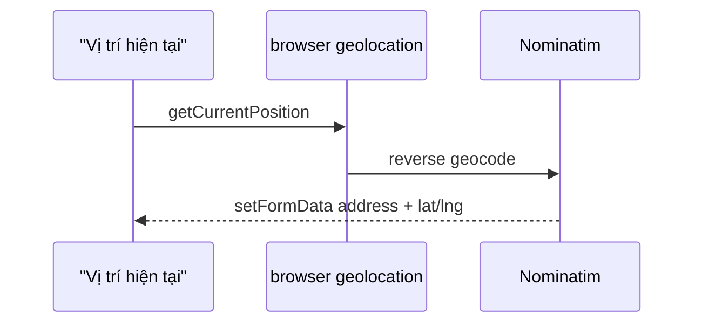

---

## UT-ORD-04 — "Tiếp tục" / "Đặt hàng ngay" (step 1)

#### 1. Giao diện nút bấm ở đâu?

| Mục | Giá trị |
|-----|---------|
| **Page** | `CheckoutPage.tsx` ~630–634 |
| **Nhãn nút** | Guest: `"Tiếp tục"` · Auth: `"Đặt hàng ngay"` |
| **Loại control** | `onClick={handleNextStep}` |
| **Điều kiện** | `step === 1` |

#### 2. Bấm xong chạy đến đâu? (Frontend)

```text
handleNextStep (L233–260)
  → Validate contactName/phone/deliveryAddress/contactEmail
       fail → toast.error('Vui lòng điền đầy đủ thông tin giao hàng')
  → Guest:
       orderService.sendCheckoutOtp({ fullName, phone, email, deliveryAddress, guestUserId })
       → POST /Order/checkout/sent-otp
       toast.success OTP gửi email → setStep(2)
  → Auth:
       handleCheckout()  // UT-ORD-06
```

#### 3. Backend chạy đoạn nào? (Guest)

```text
POST /api/Order/checkout/sent-otp
  → OrderController.SendCheckoutOtp
  → SendCheckoutOtpCommand handler
  → Tạo/gửi OTP email (OtpRecord)
```

#### 4. Dữ liệu trả về ở đâu?

Success message OTP đã gửi; error trong `error.response.data.message`.

#### 5. Làm sao hiển thị ra?

| Nhánh | Hành vi UI |
|-------|------------|
| Guest OK | `setStep(2)` hiện ô OTP + nút "Xác nhận Đặt hàng" |
| Auth | Nhảy thẳng checkout |
| Validate | Toast đỏ, ở step 1 |

#### 6. Sơ đồ nhanh

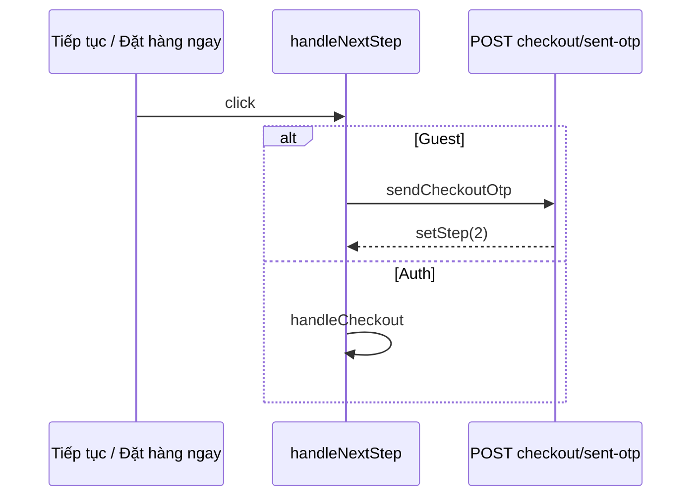

---

## UT-ORD-05 — Guest: "Xác nhận Đặt hàng" (nhập OTP step 2)

#### 1. Giao diện nút bấm ở đâu?

| Mục | Giá trị |
|-----|---------|
| **Nhãn nút** | `"Xác nhận Đặt hàng"` (~670–674) |
| **Điều kiện** | `step === 2` (guest) |
| **Input kèm** | `otpCode` state |

#### 2. Bấm xong chạy đến đâu? (Frontend)

```text
onClick={handleCheckout}
  → if !isAuthenticated && !otpCode → toast.error('Vui lòng nhập mã OTP')
  → tiếp UT-ORD-06
```

#### 3–6. Xem UT-ORD-06

---

## UT-ORD-06 — Đặt hàng (checkout API) — nhánh COD / Wallet / SePay / stub

#### 1. Giao diện nút bấm ở đâu?

| Mục | Giá trị |
|-----|---------|
| **Nhãn** | Auth step1: `"Đặt hàng ngay"` · Guest step2: `"Xác nhận Đặt hàng"` |
| **Hàm** | `handleCheckout` (CheckoutPage L365–417) |

#### 2. Bấm xong chạy đến đâu? (Frontend)

```text
handleCheckout
  → setIsSubmitting(true)
  → orderService.checkout(checkoutPayload)
       payload: formData + otpCode + guestUserId + discountCode + paymentMethod + card/eWallet fields
  → POST /api/Order/checkout
  → Đọc res.data:
       orderId, paymentSessionId
       requiresSepayRedirect, requiresPaymentConfirmation
```

#### 3. Backend chạy đoạn nào?

```text
POST /api/Order/checkout
  → OrderController.Checkout (L79–85)
  → CheckoutHandler
       CalculateTotalAmountAsync (ship + shipper income)
       Tạo Order + OrderItems
       PaymentSettlementService.ProcessCheckoutPaymentAsync
       Clear cart phía BE (theo handler)
  → Response flags requiresSepayRedirect / requiresPaymentConfirmation
```

#### 4. Dữ liệu trả về ở đâu?

```json
{
  "error": false,
  "data": {
    "orderId": "guid",
    "paymentSessionId": "guid|null",
    "requiresSepayRedirect": true,
    "requiresPaymentConfirmation": false,
    "totalAmount": 115000,
    "shippingFee": 15000
  }
}
```

(Tên field có thể PascalCase — FE đọc cả hai.)

#### 5. Làm sao hiển thị ra?

| Nhánh | Hành vi UI |
|-------|------------|
| **SePay** | `setSepaySessionId` + `setIsSepayModalOpen(true)`; toast `"Đơn hàng đã tạo. Quét mã QR..."`; **chưa** clearCart / navigate (đợi paid) |
| **requiresConfirm** (Card/EWallet stub) | `paymentService.confirmPayment(sessionId)` rồi clearCart + toast success + navigate `/?track=true&orderId=` |
| **COD / SystemWallet** | `clearCart()`; toast mã đơn; `navigate(HOME?track=true&orderId=)` |
| **onPaid SePay modal** | `clearCart()`; đóng modal; navigate track (xem CheckoutPage ~861–870) |
| Error | `toast.error(error.response?.data?.message \|\| 'Lỗi khi đặt hàng')` |

#### 6. Sơ đồ nhanh

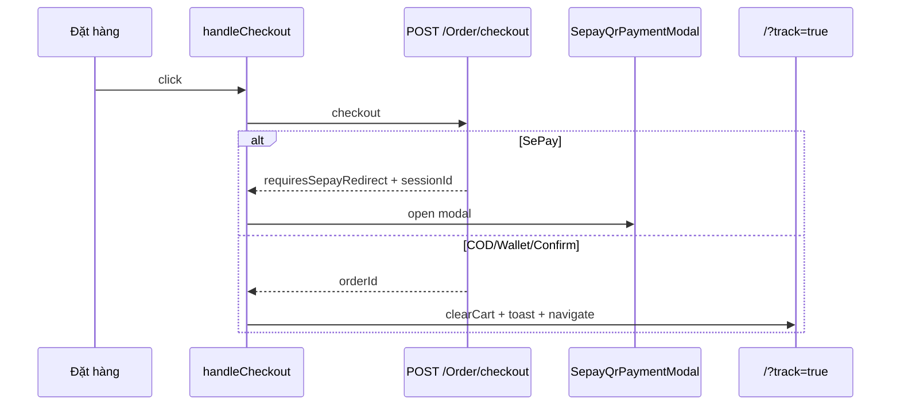

---

## UT-ORD-07 — Customer: Hủy đơn (ConfirmModal)

#### 1. Giao diện nút bấm ở đâu?

| Mục | Giá trị |
|-----|---------|
| **Component** | `components/order/CustomerOrderDetailModal.tsx` |
| **Mở modal từ** | `ShoppingDrawer` tab Đơn hàng → click đơn → `detailModal` |
| **Nhãn** | Nút hủy → mở `ConfirmModal` (`cancelConfirmModal`) |
| **Confirm title** | Hủy đơn hàng (ConfirmModal common) |

#### 2. Bấm xong chạy đến đâu? (Frontend)

```text
confirmCancelOrder (L81–91)
  → orderService.cancelOrder({ orderId })
  → PUT /api/Order/cancel
  → toast.success('Hủy đơn hàng thành công')
  → setCancelConfirmModal(false)
  → loadOrderDetails()  // GET details/{id}
```

#### 3. Backend chạy đoạn nào?

```text
PUT /api/Order/cancel
  → OrderController → CancelOrderHandler
  → (Refund ví nếu đã Paid online)
```

#### 4. Dữ liệu trả về ở đâu?

ApiResponse success/error message.

#### 5. Làm sao hiển thị ra?

| Nhánh | Hành vi UI |
|-------|------------|
| OK | Toast; `setOrderData` status mới (Cancelled); badge màu đổi |
| Fail | `toast.error(msg)` |
| Realtime | SignalR notification `targetId===orderId` → `loadOrderDetails` lại |

#### 6. Sơ đồ nhanh

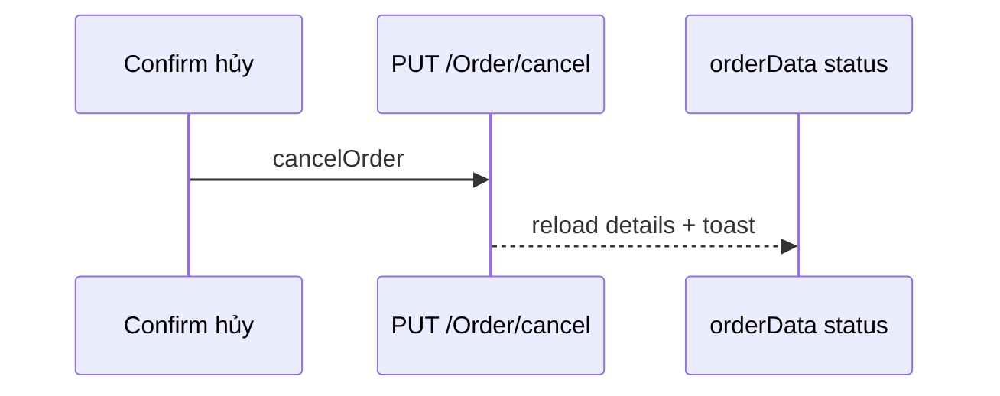

---

## UT-ORD-08 — Customer: Đặt lại (Reorder)

#### 1. Giao diện nút bấm ở đâu?

| Mục | Giá trị |
|-----|---------|
| **Component** | `CustomerOrderDetailModal.tsx` |
| **Nhãn** | Nút đặt lại / reorder (gọi `handleReorder`) |
| **Icon** | `RefreshCw` trong imports |

#### 2. Bấm xong chạy đến đâu? (Frontend)

```text
handleReorder (L93–104)
  → orderService.reorder({ orderId })
  → POST /api/Order/reorder
  → refreshCart()  // CartContext.fetchCart → GET /Cart
  → window.dispatchEvent('openCartTab')
  → toast.success('Đã thêm lại các món vào giỏ hàng')
  → onClose()
```

#### 3. Backend chạy đoạn nào?

```text
POST /api/Order/reorder → ReorderHandler
  (fail nếu không còn món available)
```

#### 4. Dữ liệu trả về ở đâu?

Success hoặc `"None of the items... available for reorder"`.

#### 5. Làm sao hiển thị ra?

| Nhánh | Hành vi UI |
|-------|------------|
| OK | Modal đóng; Drawer mở tab giỏ (`openCartTab` listener trong ShoppingDrawer L112–114); items mới trong Context |
| Fail | toast.error |

#### 6. Sơ đồ nhanh

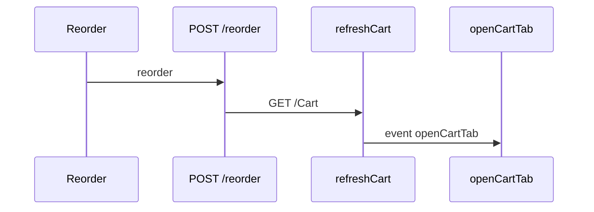

---

## UT-ORD-09 — Seller: Chấp nhận đơn

#### 1. Giao diện nút bấm ở đâu?

| Mục | Giá trị |
|-----|---------|
| **Route** | `/seller/orders` |
| **Page** | `pages/seller/SellerOrdersPage.tsx` |
| **Nhãn** | Nút chấp nhận (gọi `handleAccept(orderId)`) — status Pending |
| **Loading toast** | `'Đang chấp nhận đơn hàng...'` |

#### 2. Bấm xong chạy đến đâu? (Frontend)

```text
handleAccept (L145–161)
  → orderService.acceptOrder({ orderId })
  → POST /api/Order/accept
  → toast.success('Đã chấp nhận đơn hàng!')
  → fetchOrders()  // GET RestaurantOrders
  → setSelectedOrder status 'Confirmed' nếu đang mở
```

#### 3. Backend chạy đoạn nào?

```text
POST /api/Order/accept → AcceptOrderHandler
  Pending → Confirmed (chỉ owner restaurant)
```

#### 4. Dữ liệu trả về ở đâu?

ApiResponse; list orders refresh.

#### 5. Làm sao hiển thị ra?

Badge status → `"Đã xác nhận"` (blue); list re-fetch; toast thay loading.

#### 6. Sơ đồ nhanh

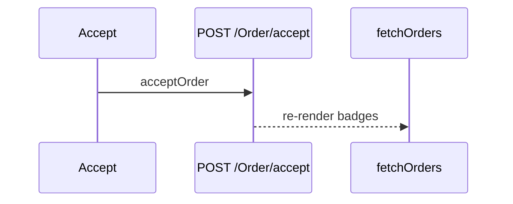

---

## UT-ORD-10 — Seller: Chuẩn bị (Prepare)

#### 1. Giao diện

`SellerOrdersPage` — khi status Confirmed → `handlePrepare`.

#### 2. Frontend

```text
handlePrepare → orderService.prepareOrder → POST /Order/prepare
toast: 'Đang thực hiện nấu món!'
setSelectedOrder status Preparing
```

#### 3. Backend

`PrepareOrderHandler` — Confirmed → Preparing.

#### 4–5. Response + UI

Badge `"Đang chuẩn bị"` (yellow); `fetchOrders()`.

#### 6. Mermaid

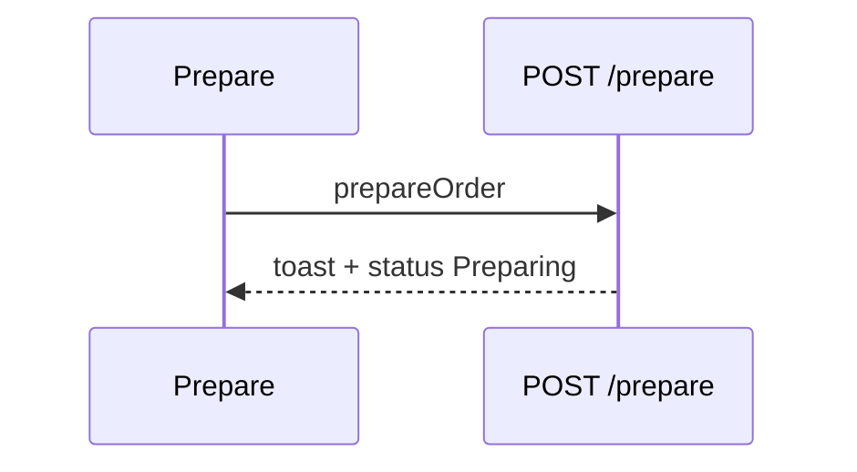

---

## UT-ORD-11 — Seller: Chờ tài xế (WaitingForShipper)

#### 1. Giao diện

Nút chờ shipper khi Preparing (platform delivery).

#### 2. Frontend

```text
handleWaitingForShipper → POST /Order/waiting-for-shipper
toast: 'Chuẩn bị xong! Đang chờ tài xế đến lấy...'
status → WaitingForShipper
```

#### 3. Backend

Handler chuyển WaitingForShipper — sẵn sàng dispatch.

#### 4–5. UI

Badge purple `"Chờ tài xế"`; coordinator board có thể thấy đơn.

#### 6. Mermaid

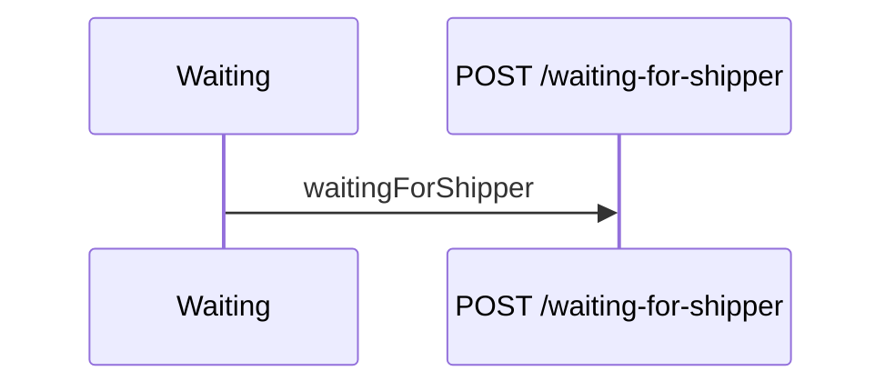

---

## UT-ORD-12 — Seller: Từ chối đơn (PromptModal lý do)

#### 1. Giao diện nút bấm ở đâu?

| Mục | Giá trị |
|-----|---------|
| **Page** | `SellerOrdersPage.tsx` |
| **Modal** | Reject modal / Prompt — state `isRejectModalOpen`, `rejectReason` |
| **Confirm action** | `handleReject` |

#### 2. Bấm xong chạy đến đâu? (Frontend)

```text
handleReject (L199–222)
  → if !rejectReason.trim() → toast.error('Vui lòng nhập lý do từ chối')
  → orderService.rejectOrder({ orderId, rejectReason })
  → POST /api/Order/reject
  → đóng modal, clear selectedOrder, fetchOrders
  → toast.success('Đã từ chối đơn hàng thành công')
```

#### 3. Backend

`RejectOrderHandler` — chỉ Pending; ghi lý do.

#### 4–5. Response + UI

Đơn biến mất khỏi Pending list / status Cancelled-Rejected; toast.

#### 6. Mermaid

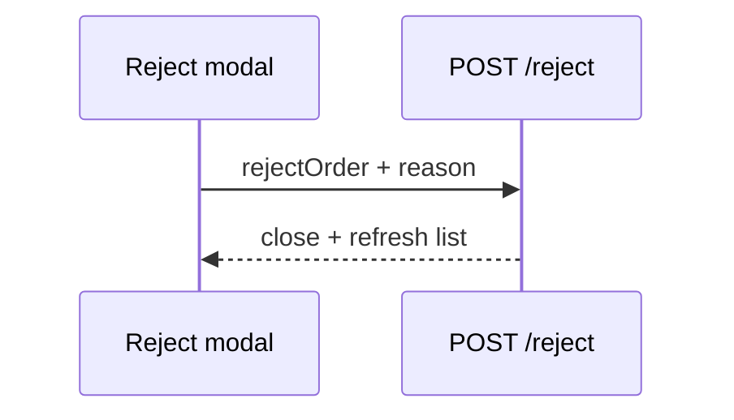

---

## UT-ORD-13 — Seller: Hủy đơn (PromptModal)

#### 1. Giao diện

`handleSellerCancelClick` → `PromptModal` (`isCancelModalOpen`) nhập lý do → `handleSellerCancelConfirm(reason)`.

#### 2. Frontend

```text
orderService.sellerCancelOrder({ orderId, reason })
→ POST /api/Order/seller-cancel
toast success 'Đã hủy đơn hàng thành công'
```

#### 3. Backend

Seller-cancel handler + refund rules nếu cần.

#### 4–5. UI

List refresh; selectedOrder null.

#### 6. Mermaid

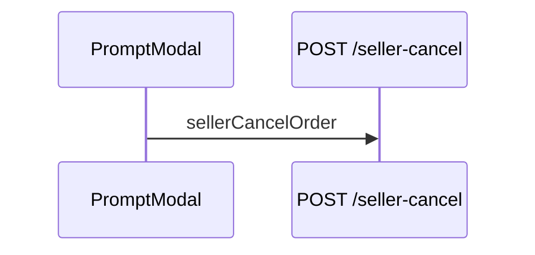

---

## UT-ORD-14 — Seller: Xác nhận tự giao thành công

#### 1. Giao diện

Khi đơn self-delivery ở trạng thái phù hợp — `handleConfirmSelfDelivery(orderId)`.

#### 2. Frontend

```text
orderService.confirmSelfDelivery(orderId)
→ POST /api/Order/{id}/self-delivery/confirm-success
toast: 'Xác nhận giao hàng thành công!'
status → Delivered
```

#### 3. Backend

```text
→ SettleSelfDeliveryOrderAsync (chia tiền Seller + Commission)
```

#### 4–5. UI

Badge Delivered; ví seller cập nhật (không hiện ngay trên page orders — xem wallet).

#### 6. Mermaid

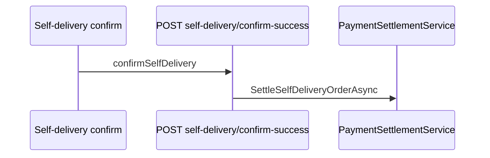

---

## Tóm tắt Order UI files

| File | Vai trò |
|------|---------|
| `CheckoutPage.tsx` | UT-ORD-01…06 |
| `CustomerOrderDetailModal.tsx` | UT-ORD-07…08 |
| `SellerOrdersPage.tsx` | UT-ORD-09…14 |
| `OrderService.ts` | HTTP wrapper |
| `OrderController.cs` + `Features/Orders/**` | BE |
| `ShoppingDrawer.tsx` | Mở detail / track tab |

**Payment chi tiết sau checkout SePay:** [06_Payment_UI_Trace.md](./06_Payment_UI_Trace.md).
