# UI Interaction Trace — Thanh toán (Payment / SePay / Wallet)

> Format: [00_TEMPLATE.md](./00_TEMPLATE.md)  
> Requirements: [../requirements/Payment_Requirements.md](../requirements/Payment_Requirements.md) · Alerts: [../requirements/alerts/Payment_Alerts.md](../requirements/alerts/Payment_Alerts.md)  
> Checkout gắn session: [05_Checkout_Order_UI_Trace.md](./05_Checkout_Order_UI_Trace.md) UT-ORD-06

---

## UT-PAY-01 — Chọn phương thức thanh toán (radio trên Checkout)

#### 1. Giao diện nút bấm ở đâu?

| Mục | Giá trị |
|-----|---------|
| **Route** | `/checkout` |
| **Page** | `pages/CheckoutPage.tsx` |
| **Nhãn** | Radio theo `paymentMethods`: COD, SystemWallet, Sepay, (CreditCard/EWallet stub) |
| **Loại control** | `<input type="radio" name="paymentMethod" ... onChange={handleInputChange}>` (~598–601) |
| **Điều kiện** | List từ `GET /Payment/methods`; fallback hardcode nếu API trống |

#### 2. Bấm xong chạy đến đâu? (Frontend)

```text
handleInputChange
  → setFormData(prev => ({ ...prev, paymentMethod: method.code }))
  → Không gọi API ngay
  → Nếu SystemWallet: hiện "Số dư ví: {formatCurrency(walletBalance)}"
  → Nếu EWallet: hiện chọn Momo/ZaloPay/VNPay
  → Nếu CreditCard: hiện cardBrand + cardLastFour inputs
```

Load methods lúc mount:

```text
paymentService.getPaymentMethods() → GET /api/Payment/methods
→ setPaymentMethods(res.data)
```

#### 3. Backend chạy đoạn nào?

```text
GET /api/Payment/methods
  → GetPaymentMethodsHandler
  → COD + SystemWallet luôn; Sepay nếu enabled+bank; else Card/EWallet stub
```

#### 4. Dữ liệu trả về ở đâu?

```json
{
  "data": [
    { "code": "COD", "name": "Tiền mặt", "requiresAuth": false },
    { "code": "SystemWallet", "name": "...", "requiresAuth": true },
    { "code": "Sepay", "name": "...", "requiresAuth": true }
  ]
}
```

#### 5. Làm sao hiển thị ra?

| Nhánh | Hành vi UI |
|-------|------------|
| Chọn radio | Border cam + ring; `formData.paymentMethod` dùng lúc `handleCheckout` |
| SystemWallet | Hiện số dư (đã `getWallet` lúc load) |
| Value gửi checkout | `paymentMethod` trong payload UT-ORD-06 |

#### 6. Sơ đồ nhanh

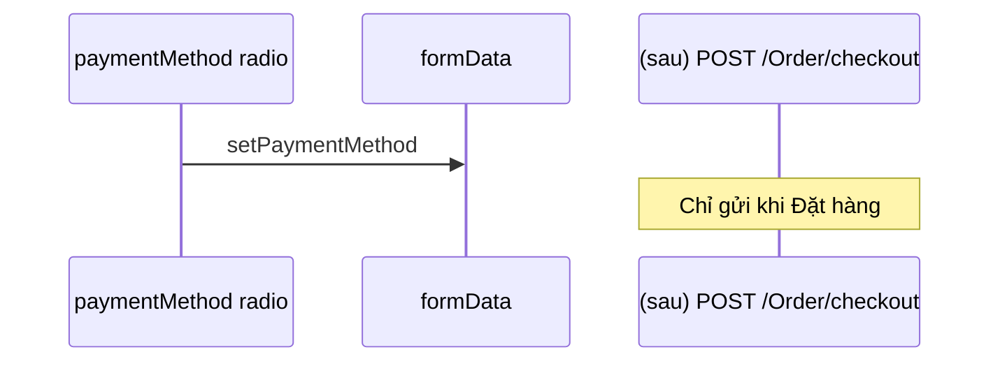

---

## UT-PAY-02 — Mở SepayQrPaymentModal + load QR

#### 1. Giao diện nút bấm ở đâu?

| Mục | Giá trị |
|-----|---------|
| **Không phải nút riêng** | Tự mở sau checkout SePay (UT-ORD-06) |
| **Component** | `components/payment/SepayQrPaymentModal.tsx` |
| **Trigger** | `CheckoutPage`: `setIsSepayModalOpen(true)` + `sessionId` |
| **Cũng mở từ** | `SepayRedirectPage` `/payment/sepay?sessionId=`; Order detail thanh toán lại |

#### 2. Bấm xong chạy đến đâu? (Frontend)

```text
Modal isOpen + sessionId
  → useEffect → loadQr() (L98–142)
  → paymentService.getSepayQr(sessionId)
  → GET /api/Payment/sepay/qr/{sessionId}
  → setQrData({ qrImageUrl, invoiceNumber, transferContent, amount, remainingSeconds, bankName, ... })
  → Poll: getPaymentSessionStatus (interval) → applySessionStatus
  → Listen window event ON_REALTIME_NOTIFICATION → nếu payment paid → notifyPaid
```

#### 3. Backend chạy đoạn nào?

```text
GET /api/Payment/sepay/qr/{sessionId}
  → SepayController.GetQr → GetSepayQrHandler
  → Build VietQR URL, transfer content, remainingSeconds

GET /api/Payment/sepay/session/status?sessionId=
  → GetPaymentSessionStatusHandler
```

#### 4. Dữ liệu trả về ở đâu?

**QR (`ISepayQrDto` / data):**

| Field | Hiển thị |
|-------|----------|
| `qrImageUrl` | `` |
| `transferContent` / `invoiceNumber` | Text nội dung CK + nút copy |
| `amount` | Số tiền |
| `itemsSubtotal`, `shippingFee` | Breakdown nếu có |
| `remainingSeconds` | Countdown `m:ss` |
| `bankName`, `bankAccountNumber`, `accountHolder` | Thông tin TK nhận |
| `isPaid`, `displayStatus`, `statusLabel` | Badge trạng thái |
| code **410** | `setError('Mã QR đã hết hạn (10 phút)...')` |

#### 5. Làm sao hiển thị ra?

| Nhánh | Hành vi UI |
|-------|------------|
| Loading | Spinner trong Modal |
| OK | Ảnh QR + số tiền + countdown + bank info |
| Paid | `markPaid()` → badge "Đã thanh toán"; `toast.success('SePay đã xác nhận...')`; `onPaid(invoice)` |
| Checkout `onPaid` | `clearCart()`; đóng modal; navigate track (CheckoutPage) |
| Expired poll | `toast.error('Mã QR đã hết hạn')` |

#### 6. Sơ đồ nhanh

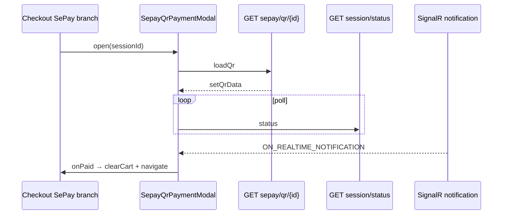

---

## UT-PAY-03 — Copy nội dung chuyển khoản

#### 1. Giao diện nút bấm ở đâu?

| Mục | Giá trị |
|-----|---------|
| **Component** | `SepayQrPaymentModal.tsx` ~357 |
| **Nhãn** | Nút copy cạnh `transferContent` |
| **Hàm** | `copyTransferContent` (L205–210) |

#### 2. Bấm xong chạy đến đâu? (Frontend)

```text
copyTransferContent()
  → navigator.clipboard.writeText(qrData.transferContent)
  → toast.success('Đã sao chép nội dung chuyển khoản')
```

**Không** gọi API.

#### 3. Backend

N/A.

#### 4. Dữ liệu

Dùng `qrData.transferContent` đã load từ QR API.

#### 5. Hiển thị

Toast success; clipboard OS.

#### 6. Mermaid

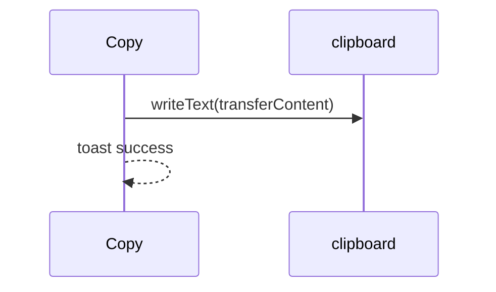

---

## UT-PAY-04 — Nút đồng bộ / Reconcile thủ công

#### 1. Giao diện nút bấm ở đâu?

| Mục | Giá trị |
|-----|---------|
| **Component** | `SepayQrPaymentModal.tsx` — nút đồng bộ SePay |
| **Hàm** | `handleManualReconcile` (L212–230) |
| **Cũng có** | `PaymentResultPages.tsx` nút reconcile |

#### 2. Bấm xong chạy đến đâu? (Frontend)

```text
handleManualReconcile
  → toast.loading('Đang đồng bộ từ SePay...')
  → paymentService.reconcileSepayPayment({ sessionId })
  → POST /api/Payment/sepay/reconcile
  → nếu success: applySessionStatus(paid) + toast.success
  → else toast.error('Chưa thấy giao dịch...')
```

#### 3. Backend chạy đoạn nào?

```text
POST /api/Payment/sepay/reconcile
  → SepayController.Reconcile
  → ReconcileSepayPaymentHandler
  → PaymentOrchestrationService.TryReconcileSessionAsync
  → (cooldown 30s; query SePay API; ConfirmPaymentSessionByInvoiceAsync)
```

#### 4. Dữ liệu trả về ở đâu?

```json
{
  "error": false,
  "data": {
    "success": true,
    "message": "..."
  }
}
```

#### 5. Làm sao hiển thị ra?

| Nhánh | Hành vi UI |
|-------|------------|
| success | UI chuyển paid + toast + `onPaid` path |
| fail | toast.error; QR vẫn awaiting |
| loading | toast.loading rồi dismiss |

#### 6. Mermaid

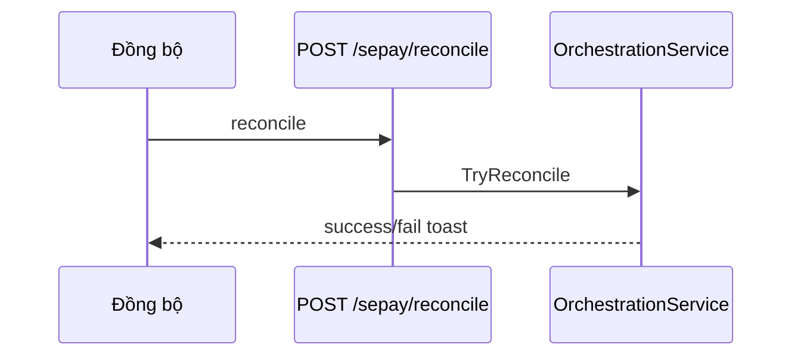

---

## UT-PAY-05 — SignalR / notification xác nhận thanh toán

#### 1. Giao diện

Không nút — listener trong modal.

#### 2. Frontend

```text
window.addEventListener('ON_REALTIME_NOTIFICATION', handleNotification)
  → NotificationBell / NotificationRealtimeService phát event khi Hub nhận
  → Nếu payload liên quan payment/session → notifyPaid / applySessionStatus
  → toast 'SePay đã xác nhận thanh toán qua webhook!'
```

Hub phía BE: `/hubs/notifications` sau khi webhook worker confirm → insert Notification → Interceptor push.

#### 3. Backend

```text
SePay Webhook/IPN → queue → PaymentProcessingWorker
  → ConfirmPaymentSessionByInvoiceAsync
  → Order Paid + Notification entity
  → NotificationPushInterceptor → NotificationHub
```

#### 4. Dữ liệu

Notification DTO: `title`, `message`, `type`, `targetId` (order/session).

#### 5. Hiển thị

Modal paid state + toast; Checkout `onPaid` clearCart + navigate.

#### 6. Mermaid

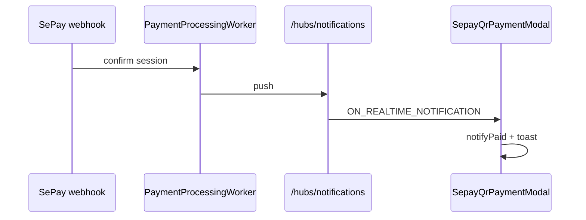

---

## UT-PAY-06 — Đóng modal QR

#### 1. Giao diện

Nút đóng Modal (`onClose`) / X — SepayQrPaymentModal ~303; props từ CheckoutPage.

#### 2. Frontend

```text
CheckoutPage onClose:
  setIsSepayModalOpen(false)
  clearCart()   // chú ý: clear cả khi chưa chắc paid — theo code hiện tại L865–866
```

#### 3–4. Backend / data

N/A (local UI). Session vẫn Pending trên server đến khi expire/webhook.

#### 5. Hiển thị

Modal đóng; giỏ cleared; user có thể track đơn qua `?track=true` nếu đã navigate trước đó — nếu chỉ đóng sớm, đơn vẫn tồn tại chờ thanh toán.

#### 6. Mermaid

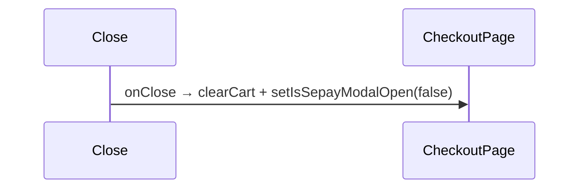

---

## UT-PAY-07 — Customer nạp ví (Top-up)

#### 1. Giao diện nút bấm ở đâu?

| Mục | Giá trị |
|-----|---------|
| **Route** | Profile tab wallet / `CustomerWalletPage` (thường `/profile` tab) |
| **Page** | `pages/payment/CustomerWalletPage.tsx` |
| **Nhãn nút** | `"Nạp tiền"` (~171–175) |
| **Input** | `topUpAmount` (default `'100000'`); chip số nhanh `onClick={() => setTopUpAmount(String(v))}` |

#### 2. Bấm xong chạy đến đâu? (Frontend)

```text
handleTopUp (L63–83)
  → validate amount >= 10000 else toast.error('Số tiền nạp tối thiểu 10.000đ')
  → paymentService.topUpWallet(amount)
  → POST /api/Payment/wallet/top-up { amount }
  → toast.success('Đang chuyển hướng sang trang thanh toán...')
  → navigate(`/payment/sepay?sessionId=${res.data.sessionId}&returnUrl=...profile?tab=wallet`)
  → SepayRedirectPage / SepayQrPaymentModal flow (UT-PAY-02)
```

#### 3. Backend chạy đoạn nào?

```text
POST /api/Payment/wallet/top-up
  → TopUpWalletHandler
  → CreateTopUpSessionAsync (PaymentSession OrderId=null, expiry 10p)
  → trả sessionId
```

Confirm tiền vào ví: webhook → `ConfirmPaymentSessionByInvoiceAsync` nhánh TopUp → `FinancialTransactionType.TopUp`.

#### 4. Dữ liệu trả về ở đâu?

```json
{
  "error": false,
  "data": { "sessionId": "guid" }
}
```

#### 5. Làm sao hiển thị ra?

| Nhánh | Hành vi UI |
|-------|------------|
| OK | Navigate SePay page; sau paid quay `returnUrl` wallet; `loadData` lại thấy balance tăng |
| Validate | toast min 10k |
| API error | toast.error |

#### 6. Mermaid

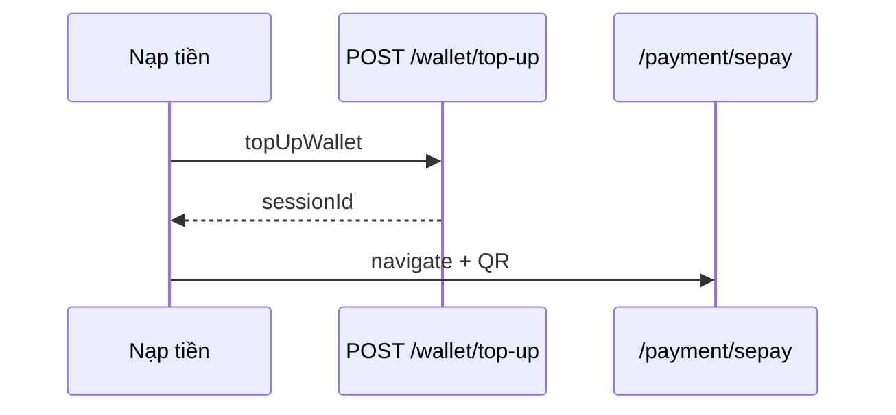

---

## UT-PAY-08 — Seller/Shipper rút tiền (Withdraw)

#### 1. Giao diện nút bấm ở đâu?

| Mục | Giá trị |
|-----|---------|
| **Page** | `pages/payment/PartnerWalletPages.tsx` (SellerWalletPage / ShipperWalletPage) |
| **Nhãn nút** | `"Gửi yêu cầu rút tiền"` (~263–267, ~517–521) |
| **Form** | amount, bankName, bankAccountNumber, bankAccountHolder |

#### 2. Bấm xong chạy đến đâu? (Frontend)

```text
handleWithdraw
  → validate đủ field; amount >= 50000 (Seller page) → toast lỗi nếu sai
  → paymentService.requestWithdrawal({ amount, bankName, bankAccountNumber, bankAccountHolder })
  → POST /api/Payment/withdraw
  → toast.success('Yêu cầu rút tiền đã được gửi')
  → refresh wallet/transactions
```

#### 3. Backend chạy đoạn nào?

```text
POST /api/Payment/withdraw
  → RequestWithdrawalHandler
  → Chỉ Seller/Shipper (Customer 403)
  → Debit ví ngay + WithdrawalRequest Pending
```

#### 4. Dữ liệu trả về ở đâu?

```json
{
  "data": { "withdrawalId": "...", "status": "Pending" }
}
```

Balance mới phản ánh qua `GET /Payment/wallet`.

#### 5. Làm sao hiển thị ra?

| Nhánh | Hành vi UI |
|-------|------------|
| OK | Toast; số dư giảm; form có thể reset; danh sách GD cập nhật |
| Validate | toast thiếu info / min 50k |
| 403 Customer | toast message API |

#### 6. Mermaid

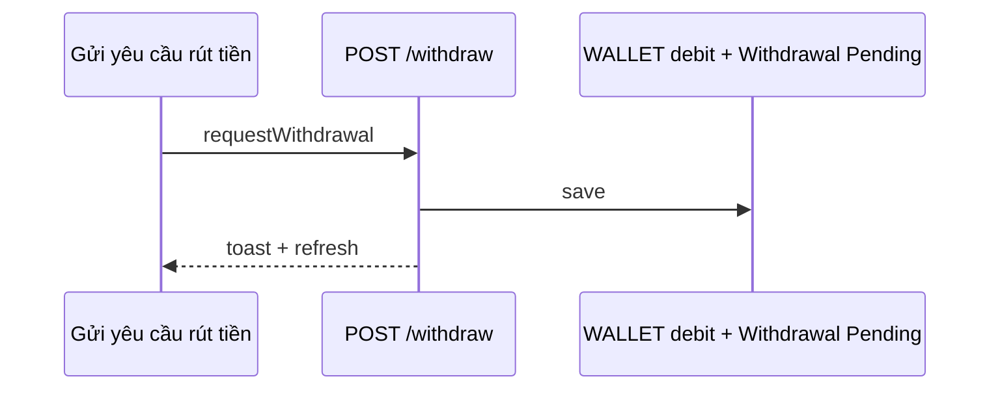

---

## UT-PAY-09 — Shipper nộp công nợ COD

#### 1. Giao diện nút bấm ở đâu?

| Mục | Giá trị |
|-----|---------|
| **Page** | `PartnerWalletPages.tsx` (Shipper section) |
| **Nhãn nút** | `"Nộp tiền"` (~468–472) |
| **Input** | `repayAmount`; chip max `setRepayAmount(String(codCollected))` |

#### 2. Bấm xong chạy đến đâu? (Frontend)

```text
handleRepay
  → parseFloat(repayAmount) > 0
  → paymentService.repayShipperDebt(amount)
  → POST /api/Payment/shipper/repay-debt
  → toast.success(`Đã nộp ${formatCurrency(res.data?.repaid || amount)} công nợ COD`)
  → reload wallet (codCollected giảm)
```

#### 3. Backend

```text
POST /api/Payment/shipper/repay-debt
  → giảm CodCollectedAmount / ghi txn CodRemittance
```

#### 4. Dữ liệu

`data.repaid` (số đã nộp) nếu có.

#### 5. Hiển thị

Toast + UI công nợ cập nhật sau `loadData`.

#### 6. Mermaid

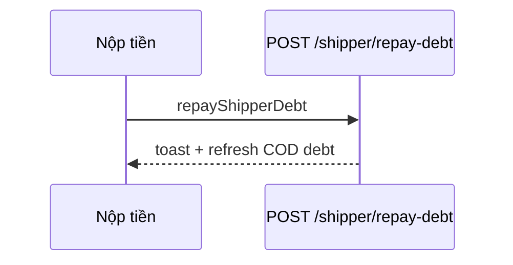

---

## UT-PAY-10 — Admin duyệt / từ chối rút tiền

#### 1. Giao diện nút bấm ở đâu?

| Mục | Giá trị |
|-----|---------|
| **Route** | Admin finance (vd `/admin/finance` — `AdminFinancePage.tsx`) |
| **Nhãn nút** | `"Duyệt"` / `"Từ chối"` (~84–88) |
| **Hàm** | `handleApprove(w.id, true\|false)` |

#### 2. Bấm xong chạy đến đâu? (Frontend)

```text
handleApprove(id, approve)
  → paymentService.approveWithdrawal(id, approve)
  → POST /api/Payment/withdrawals/approve { withdrawalId, approve, rejectReason? }
  → toast.success(approve ? 'Đã duyệt' : 'Đã từ chối')
  → reload withdrawals list
```

#### 3. Backend

```text
ApproveWithdrawal handler
  → Approve: status Approved/Completed
  → Reject: status Rejected + Refund txn hoàn ví
```

#### 4. Dữ liệu

ApiResponse; list `GET /Payment/withdrawals` refresh.

#### 5. Hiển thị

Toast; hàng Pending biến mất / đổi status trên bảng Admin.

#### 6. Mermaid

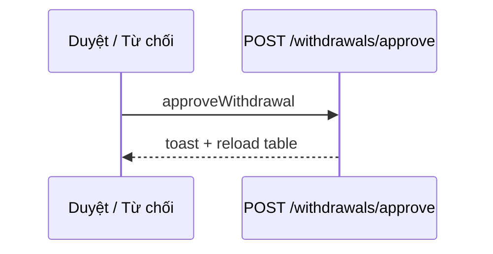

---

## UT-PAY-11 — Confirm payment stub (Card/EWallet) từ Checkout

#### 1. Giao diện

Không nút riêng — tự gọi trong `handleCheckout` khi `requiresPaymentConfirmation`.

#### 2. Frontend

```text
await paymentService.confirmPayment(sessionId)
→ POST /api/Payment/confirm
→ rồi clearCart + toast đặt hàng thành công + navigate
```

#### 3. Backend

`ConfirmPaymentSessionHandler` — **reject nếu method = Sepay**.

#### 4–5. Data + UI

Session Completed; Order Paid; UI như COD success path.

#### 6. Mermaid

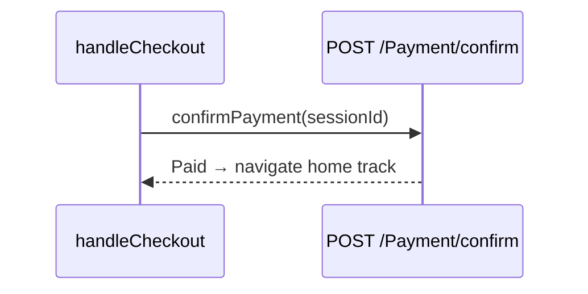

---

## Bảng field hiển thị quan trọng

| Nguồn | Field | UI |
|-------|-------|-----|
| Checkout response | `paymentSessionId` | Truyền vào Modal |
| Checkout response | `requiresSepayRedirect` | Mở QR |
| QR API | `qrImageUrl` | `` |
| QR API | `transferContent` | Text + copy |
| QR API | `remainingSeconds` | Countdown |
| Top-up | `sessionId` | Query `/payment/sepay` |
| Wallet GET | `balance`, `codCollected` | Card số dư / nợ |
| Withdraw | `withdrawalId`, `status` | Admin table / history |

---

## File neo Payment UI

| File | UT |
|------|-----|
| `CheckoutPage.tsx` | PAY-01, ORD-06 gắn SePay |
| `SepayQrPaymentModal.tsx` | PAY-02…06 |
| `CustomerWalletPage.tsx` | PAY-07 |
| `PartnerWalletPages.tsx` | PAY-08, PAY-09 |
| `AdminFinancePage.tsx` | PAY-10 |
| `PaymentService.ts` | Tất cả HTTP |
| `SepayController.cs` / `PaymentController.cs` | BE |
| Workers `Payment*` / `Sepay*` | Background confirm |

**Chia tiền sau giao:** [../requirements/Revenue_Split_Requirements.md](../requirements/Revenue_Split_Requirements.md).
