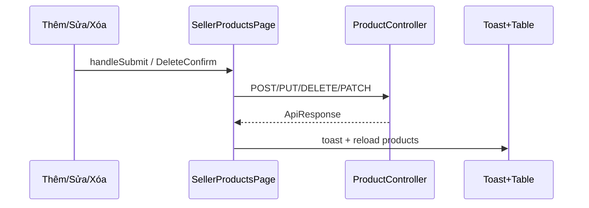

# UI Trace — Product (Browse / Detail / Seller CRUD / Admin duyệt)

> Template: [00_TEMPLATE.md](./00_TEMPLATE.md) · Requirements: [../requirements/Product_Requirements.md](../requirements/Product_Requirements.md)

---

### UT-PRD-01 — Tìm kiếm / lọc trên ProductsPage

#### 1. Giao diện

| Mục | Giá trị |
|-----|---------|
| **Route** | `/products` |
| **Page** | `pages/ProductsPage.tsx` |
| **Control** | Ô search, filter category, nút lấy vị trí |

#### 2. Frontend

```text
Search / filter change
  → productService.search / get list (query params)
  → GET /Product/Search hoặc GET /Product
GPS filter → toast loading/success vị trí → gửi lat/lng query
```

#### 5. Hiển thị

Grid/list `ProductCard` từ `res.data`; toast lỗi mạng; toast vị trí.

---

### UT-PRD-02 — Chi tiết SP: Thêm vào giỏ

#### 1. Giao diện

| Mục | Giá trị |
|-----|---------|
| **Route** | `/products/:id` |
| **Page** | `ProductDetailPage.tsx` |
| **Nhãn** | `"Thêm vào giỏ"` (hoặc tương đương) |

#### 2. Frontend

```text
onClick add
  → useCart() / CartContext.addItem({ productId, quantity, size, toppings })
  → cartService.add → POST /Cart
  (+ guestUserId nếu chưa login)
```

#### 3. Backend

```text
CartController POST → AddCartItemHandler → CART / CART_ITEM
```

#### 5. Hiển thị

`toast.success('Đã thêm vào giỏ: {name}')` (CartContext); lỗi conflict 1 quán → toast error API.

**Chi tiết cart:** [04_Cart_UI_Trace.md](./04_Cart_UI_Trace.md) (nếu có) / workflow Cart.

---

### UT-PRD-03 — Báo cáo sản phẩm / Viết đánh giá

#### 1. Giao diện

`ProductDetailPage` / `ProductReviews.tsx` — nút Báo cáo, form đánh giá.

#### 2–3.

```text
Report  → POST /Product/Report → SystemReport
Review  → POST /Product/review → ProductReview
Reply   → POST /Product/review/{id}/reply (Seller)
Report review → POST /Product/review/{id}/report
```

#### 5. Hiển thị

toast success từng action; list reviews re-fetch `GET /Product/{id}/reviews`.

---

### UT-PRD-04 — Seller: Thêm sản phẩm (`"Thêm sản phẩm"`)

#### 1. Giao diện

| Mục | Giá trị |
|-----|---------|
| **Route** | `/seller/products` |
| **Page** | `pages/seller/SellerProductsPage.tsx` |
| **Mở form** | `handleAdd` → modal form |
| **Submit** | `ProductForm` `onSubmit={handleSubmit}` |

#### 2. Frontend

```text
handleUploadImage → authService.uploadImage → POST /User/UploadImage → imageUrls[]
handleSubmit
  → validate name, price>0, category
  → productService.create(...) → POST /Product
  → (edit) productService.update → PUT /Product/{id}
```

Có thể qua `useProducts` hook (toast chuẩn).

#### 3. Backend

```text
AddProductHandler
  → Product Status=Pending, gắn Restaurant của seller
  → Images / Sizes / Toppings
```

#### 4–5. Hiển thị

| Create OK | toast `Thêm sản phẩm thành công!` + đóng modal + reload list |
| Update OK | toast `Cập nhật sản phẩm thành công!` |
| Validate | toast tên/giá/danh mục |
| Upload | toast.loading → success/error |

---

### UT-PRD-05 — Seller: Ẩn/hiện & Còn/hết hàng

#### 1. Giao diện

Icon/button trên từng row product: `handleToggleVisibility` / `handleToggleStock`.

#### 2–3.

```text
PATCH /Product/Visibility/{id}
PATCH /Product/StockStatus/{id}
```

#### 5. Hiển thị

toast `Đã hiện/ẩn sản phẩm` / `Đã mở bán lại` / `Đã đánh dấu hết hàng`; cập nhật state row.

---

### UT-PRD-06 — Seller: Xóa sản phẩm

#### 1. Giao diện

| Mục | Giá trị |
|-----|---------|
| **Mở** | `handleDeleteClick` → `DeleteConfirmModal` |
| **Nhãn confirm** | `"Xóa"` `onClick={onConfirm}` → `handleDeleteConfirm` |

#### 2–3.

```text
DELETE /Product/{id} → soft-delete IsDeleted
```

#### 5. Hiển thị

toast xóa thành công; đóng modal; remove khỏi list.

---

### UT-PRD-07 — Admin: Duyệt / Từ chối sản phẩm

#### 1. Giao diện

| Mục | Giá trị |
|-----|---------|
| **Route** | `/admin/approvals` tab products |
| **Page** | `AdminApprovalsPage.tsx` |
| **Nút** | Duyệt / Từ chối → `openActionModal` → Modal confirm `handleActionSubmit` |

#### 2–3.

```text
adminService.approveProduct({ productId, isApproved, rejectionReason? })
  → POST /Admin/ApproveProduct
```

#### 5. Hiển thị

toast `Đã phê duyệt thành công!` / `Đã từ chối...`; bắt buộc lý do khi reject; reload danh sách Pending.

---

## Sơ đồ Seller CRUD


