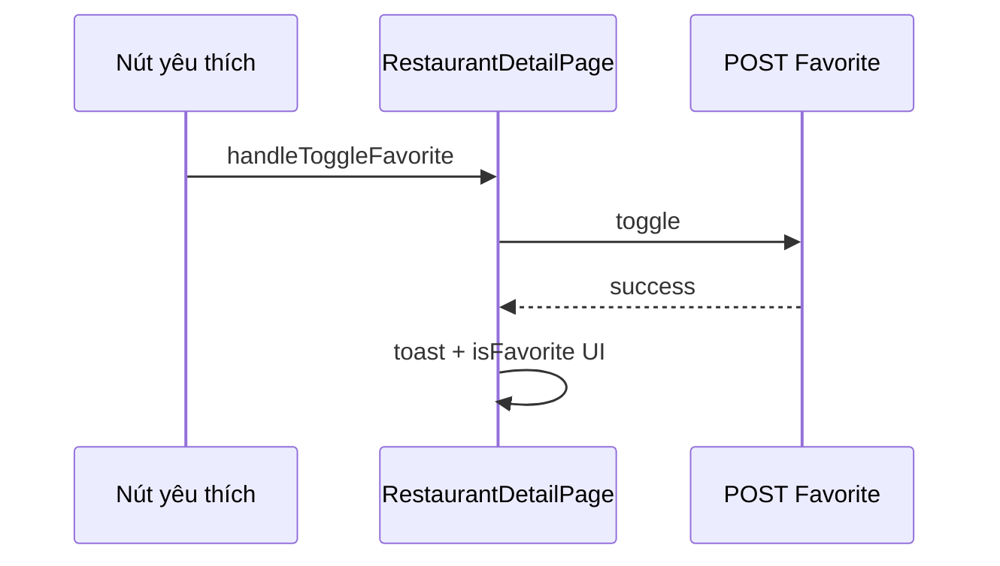

# UI Trace — Restaurant / Seller Settings / Admin treo quán

> Template: [00_TEMPLATE.md](./00_TEMPLATE.md) · ApplySeller: [02_Register_UI_Trace.md](./02_Register_UI_Trace.md) UT-REG-03

---

### UT-RES-01 — Yêu thích quán (`Favorite`)

#### 1. Giao diện

| Mục | Giá trị |
|-----|---------|
| **Route** | `/restaurant/:id` |
| **Page** | `pages/RestaurantDetailPage.tsx` |
| **Nhãn** | Nút tim / lưu quán `onClick={handleToggleFavorite}` |
| **Điều kiện** | User đã đăng nhập (unauth thường redirect login) |

#### 2. Frontend

```text
handleToggleFavorite
  → restaurantService.toggleFavorite(id)
  → POST /Restaurant/{id}/Favorite
```

#### 3. Backend

```text
Toggle FavoriteRestaurant (composite PK UserProfile+Restaurant)
```

#### 5. Hiển thị

| Success | toast `Đã lưu quán...` hoặc `Đã bỏ lưu quán` + đổi icon `isFavorite` |
| Error | toast lỗi API / mạng |
| Load fail | toast `Không thể tải thông tin nhà hàng` lúc mount |

---

### UT-RES-02 — Seller: Lưu thông tin cơ bản cửa hàng

#### 1. Giao diện

| Mục | Giá trị |
|-----|---------|
| **Route** | `/seller/settings` |
| **Page** | `pages/seller/SellerSettingsPage.tsx` |
| **Form** | `onSubmit={handleUpdateBasicInfo}` |

#### 2. Frontend

```text
handleLogoUpload → uploadImage → set logo URL
handleUpdateBasicInfo
  → validate tên/ảnh...
  → toast.loading
  → restaurantService.updateBasicInfo(...)
  → PUT /Restaurant/basic-info
```

GPS: lấy vị trí → toast → điền lat/lng; reverse geocode toast địa chỉ.

#### 3. Backend

```text
Update restaurant profile fields (name, address, geo, logo...)
```

#### 5. Hiển thị

toast `Đã cập nhật thông tin thành công!` (cùng toastId loading).

---

### UT-RES-03 — Seller: Cập nhật giờ mở cửa

```text
form onSubmit={handleUpdateHours}
  → PUT /Restaurant/operating-hours
  → toast success giờ hoạt động
```

---

### UT-RES-04 — Seller: Mở / Đóng cửa

#### 1. Giao diện

Hai nút: `handleUpdateStatus('Active'|'Inactive')`

#### 2–3.

```text
PUT /Restaurant/status { status }
```

#### 5. Hiển thị

toast `Cửa hàng đã mở cửa!` / `tạm đóng cửa!`

---

### UT-RES-05 — Seller: Cấu hình giao hàng

```text
handleUpdateDeliveryConfig
  → validate bán kính > 0, phí hợp lệ
  → PUT /Restaurant/delivery-config (và/hoặc delivery-radius, shipping-fee)
  → toast thành công
```

---

### UT-RES-06 — Admin: Treo / mở nhà hàng

#### 1. Giao diện

| Mục | Giá trị |
|-----|---------|
| **Route** | `/admin/restaurants` |
| **Page** | `AdminRestaurantsPage.tsx` |
| **Nút** | Suspend / unsuspend / toggle verification |

#### 2–3.

```text
PUT /Admin/suspend-restaurant
POST /Admin/Restaurants/{id}/toggle-verification
```

#### 5. Hiển thị

toast treo/mở; Seller bị Suspended → Filter chặn write API (403) khi thao tác bán hàng.

---

### UT-RES-07 — Apply Seller / Mall (cross-link)

- Apply Seller đã login: **UT-REG-03** trong [02_Register_UI_Trace.md](./02_Register_UI_Trace.md)
- Upgrade Mall: Profile/SellerLayout PromptModal → `POST /User/UpgradeToMall`

---

## Sơ đồ Favorite


