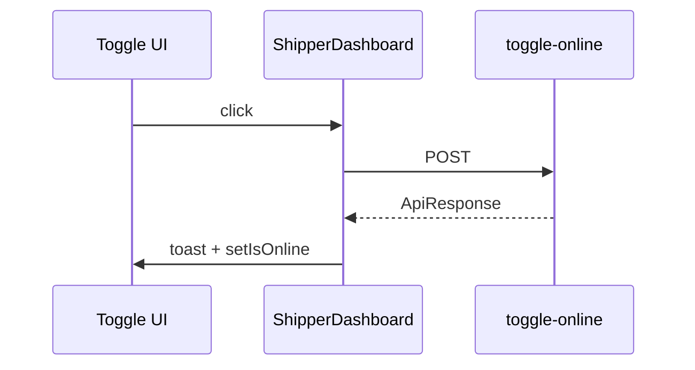

# UI Trace — Shipper (Online / Offer / Giao hàng)

> Template: [00_TEMPLATE.md](./00_TEMPLATE.md) · Alerts: [../requirements/alerts/Shipper_Alerts.md](../requirements/alerts/Shipper_Alerts.md)

**Route:** `/shipper` · **Page:** `pages/shipper/ShipperDashboard.tsx`  
**Service:** `services/ShipperService.ts`

---

## UT-SHP-01 — Toggle **「Bật / Tắt trực tuyến」**

### 1. Giao diện nút ở đâu?

| Mục | Giá trị |
|-----|---------|
| **Route** | `/shipper` |
| **Page** | `ShipperDashboard.tsx` |
| **Control** | Toggle / button `onClick={handleToggleOnline}` (~605) |
| **Nhãn UX** | BẬT / TẮT trạng thái trực tuyến |

### 2. FE chạy đâu?

```text
onClick
  → handleToggleOnline (ShipperDashboard.tsx ~385+)
       · newStatus = !isOnline
  → shipperService.toggleOnline({ isOnline: newStatus })
  → HttpClient POST /api/Shipper/toggle-online
```

### 3. BE chạy đâu?

```text
ShipperController → ToggleShipperOnlineHandler
  → Kiểm tra role Shipper, profile tồn tại
  → Nếu Suspended → Failure 403 + lý do / thời gian còn
  → IsOnline = newStatus → Save
```

### 4. Data trả về

```json
{ "code": 200, "error": false, "message": "...", "data": null }
```
Hoặc `error: true`, `message`: `"Tài khoản của bạn đã bị khóa. Lý do: ..."`

### 5. Hiển thị

| Nhánh | UI |
|-------|-----|
| OK | `setIsOnline(newStatus)` + `toast.success('Bạn đã BẬT/TẮT trạng thái trực tuyến!')` |
| Fail | `toast.error(res.message \|\| ...)` — **không** đổi toggle |

### 6. Sequence



---

## UT-SHP-02 — Nút **「Nhận đơn」** trên card Available Offers

### 1. UI ở đâu?

| Mục | Giá trị |
|-----|---------|
| **Vùng** | Danh sách available offers trên Dashboard |
| **Nút** | Accept trên card — `onClick` → `handleAcceptOffer(offer.orderId)` (~860) |
| **Nút phụ** | Reject → `handleRejectOffer` (~874) |
| **Click card** | `setProposalPopupOffer(offer)` mở popup |

### 2. FE

```text
handleAcceptOffer(orderId)
  → nếu !isOnline: toast.error('Vui lòng bật trạng thái trực tuyến để nhận đơn'); return
  → shipperService.acceptOffer({ orderId })
  → POST /api/Shipper/accept-offer
  → success: toast 'Đã chấp nhận đơn hàng!' + refresh active delivery / offers
```

### 3. BE

```text
Accept offer handler
  → Gán ShipperId lên Order, Proposal Accepted
  → Có thể tạo notification cho Customer/Seller
```

### 4–5. Data & hiển thị

- Success: toast + `fetchAvailableOffers` / set `activeDelivery`  
- Error API: `toast.error(err.response?.data?.message || 'Không thể nhận đơn...')`

---

## UT-SHP-03 — Popup đề xuất **OrderProposalPopup** (Accept / Reject / Timeout)

### 1. UI

| Mục | Giá trị |
|-----|---------|
| **Component** | `pages/shipper/components/OrderProposalPopup.tsx` |
| **Mở khi** | Coordinator broadcast / force-assign / click card → `proposalPopupOffer` state |
| **Nút** | Accept → `onAccept={handleAcceptProposal}` · Reject → `handleRejectProposal` |
| **Timeout** | Timer trong popup → `handleTimeoutProposal` |

### 2. FE

```text
handleAcceptProposal(orderId) (~271)
  → POST /Shipper/accept-offer
  → toast.success('Nhận đơn thành công!')
  → đóng popup, đưa đơn vào active

handleRejectProposal → POST /Shipper/reject-offer
handleTimeoutProposal → toast.error('Đã hết thời gian phản hồi đề xuất.')
```

**Force-assign qua SignalR** (~228): toast → `GET /Shipper/proposed-offer/{orderId}` → mở popup / set active.

### 3–5. BE / hiển thị

- Accept/Reject handlers cập nhật `OrderDeliveryProposal` + Order  
- Thu hồi: toast.error `'Đơn hàng đã bị thu hồi!...'` (~257)

---

## UT-SHP-04 — Nút **「Đã đến quán」** / **「Đã lấy hàng」**

### 1. UI

Trên card **active delivery** — các bước:

| Nhãn UX | Handler | API |
|---------|---------|-----|
| Đến quán / Next step | `handleStepTransition` → confirm-arrived hoặc confirm-picked-up tùy status | `POST /Shipper/confirm-arrived` · `confirm-picked-up` |
| (~756) | `onClick={() => handleStepTransition(activeDelivery.orderId)}` | |

### 2. FE (~431+)

```text
handleStepTransition(orderId)
  → shipperService.confirmArrived / confirmPickedUp (theo bước hiện tại)
  → cập nhật local activeDelivery status
  → lỗi: toast.error('Đơn hàng không còn hợp lệ hoặc đã bị thu hồi.')
```

### 3. BE

Handlers đổi `OrderStatus` / trạng thái giao tương ứng.

### 5. Hiển thị

- UI bước tiến trên card (không nhất thiết toast success mỗi bước — xem code nhánh success)
- Fail: toast error

---

## UT-SHP-05 — Nút **「Giao thành công」** → SuccessDeliveryModal

### 1. UI

| Mục | Giá trị |
|-----|---------|
| **Nút** | Mở modal — `setSuccessModalOrderId(activeDelivery.orderId)` (~766) |
| **Modal** | `components/SuccessDeliveryModal.tsx` |
| **Trong modal** | Upload ảnh chứng minh + nút xác nhận giao |

### 2. FE

```text
SuccessDeliveryModal submit
  → (upload ảnh nếu cần) authService.uploadImage / UploadImage
  → shipperService.confirmDelivered({ orderId, proofImageUrl? })
  → POST /api/Shipper/confirm-delivered
```

### 3. BE

```text
ConfirmDelivered handler
  → Order status Delivered
  → PaymentSettlementService.SettleOrderOnDeliveryAsync
       · Cộng ví Seller / Shipper / Platform (xem Revenue_Split)
  → ApiResponse success
```

### 4. Data trả về

`{ error: false, message: "..." }` — settle xảy ra server-side.

### 5. Hiển thị

| Success | `toast` trong modal: `'Chúc mừng! Giao hàng thành công.'` · đóng modal · xóa activeDelivery · refresh income nếu có |
| Thiếu ảnh | `toast.error('Vui lòng tải ảnh chứng minh giao hàng')` |

---

## UT-SHP-06 — Nút **「Giao thất bại」** (PromptModal)

### 1. UI

```text
onClick → handleDeliveryFailedClick(orderId) (~773)
  → mở PromptModal nhập lý do
  → confirm → POST /Shipper/confirm-failed
```

### 5. Hiển thị

- Hiện code: `toast.error('Đã báo cáo giao hàng thất bại.')` sau khi gửi OK (dùng error toast — xem AL-SHP-12)

---

## UT-SHP-07 — Nút **「Báo cáo sự cố」** → ReportIncidentModal

### 1. UI

| Mục | Giá trị |
|-----|---------|
| **Mở** | `setReportModalOrderId(...)` (~786) |
| **Modal** | `ReportIncidentModal.tsx` |
| **Nút gửi** | Submit form chi tiết sự cố |

### 2–5

```text
→ shipperService.reportOrder / POST /Shipper/Orders/{orderId}/report
→ toast.success('Gửi báo cáo sự cố thành công. Coordinator sẽ xem xét...')
→ đóng modal
```

Validation: `toast.error('Vui lòng nhập chi tiết sự cố')`

---

## UT-SHP-08 — Nút **「Làm mới」** danh sách offers

```text
onClick={fetchAvailableOffers} (~814, ~893)
  → GET /Shipper/available-offers
  → setOffers(res.data)
  → nếu offline/API lỗi: toast theo message BE
```

---

## Bảng tóm tắt Shipper

| ID | Nhãn | FE hàm | API | Hiển thị |
|----|------|--------|-----|----------|
| UT-SHP-01 | Toggle online | handleToggleOnline | POST toggle-online | toast BẬT/TẮT |
| UT-SHP-02 | Nhận đơn (card) | handleAcceptOffer | accept-offer | toast + refresh |
| UT-SHP-03 | Popup accept/reject | handleAcceptProposal… | accept/reject-offer | toast + đóng popup |
| UT-SHP-04 | Đến quán / lấy hàng | handleStepTransition | confirm-arrived/picked-up | cập nhật bước UI |
| UT-SHP-05 | Giao thành công | SuccessDeliveryModal | confirm-delivered | toast chúc mừng + settle |
| UT-SHP-06 | Giao thất bại | PromptModal | confirm-failed | toast |
| UT-SHP-07 | Báo sự cố | ReportIncidentModal | Orders/{id}/report | toast success |
| UT-SHP-08 | Refresh offers | fetchAvailableOffers | available-offers | re-render list |

## File neo

| File |
|------|
| `ShoppingFood.FE/src/pages/shipper/ShipperDashboard.tsx` |
| `.../components/OrderProposalPopup.tsx` |
| `.../components/SuccessDeliveryModal.tsx` |
| `.../components/ReportIncidentModal.tsx` |
| `ShoppingFood.FE/src/services/ShipperService.ts` |
| `src/ShoppingFood.API/Controllers/ShipperController.cs` |
| `Application/Services/PaymentSettlementService.SettleOrderOnDeliveryAsync` |
