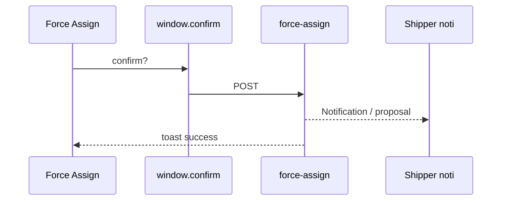

# UI Trace — Coordinator Dispatch Board

> Template: [00_TEMPLATE.md](./00_TEMPLATE.md) · Requirements: [../requirements/Logistics_Coordinator_Requirements.md](../requirements/Logistics_Coordinator_Requirements.md)

---

### UT-COO-01 — Mở gợi ý shipper + Gửi đề xuất

#### 1. Giao diện

| Mục | Giá trị |
|-----|---------|
| **Route** | `/coordinator` / dispatch |
| **Page** | `pages/coordinator/DispatchBoardPage.tsx` |
| **Nút trên order** | Mở suggest → `handleOpenSuggestModal(order)` |
| **Trong modal** | `"Gửi đề xuất"` → `handleSendProposal(shipperId)` |

#### 2. Frontend

```text
handleOpenSuggestModal
  → GET /Coordinator/orders/{orderId}/suggested-shippers
  → set list vào modal
handleSendProposal
  → POST /Coordinator/proposals { orderId, shipperId }
```

#### 5. Hiển thị

toast `Đã gửi đề xuất đến shipper thành công!`; lỗi toast API/mạng; Shipper nhận popup/noti.

---

### UT-COO-02 — Force-assign (`window.confirm`)

#### 1. Giao diện

Nút gán bắt buộc trong suggest modal → `handleForceAssign(shipperId)`.

#### 2. Frontend

```text
window.confirm('Bạn có chắc chắn muốn gán bắt buộc...')
  → nếu OK: POST /Coordinator/orders/force-assign
  → toast success / error
```

#### 5. Hiển thị

| Confirm Cancel | Không gọi API |
| Success | toast `Đã gán đơn hàng thành công!` + đóng modal + refresh board |
| Shipper side | SignalR/notification force-assign (xem UT-SHP-02) |

---

### UT-COO-03 — Broadcast gần khu vực

#### 1. Giao diện

Nút broadcast trên order → `handleBroadcastOrder(order)`.

#### 2. Frontend

```text
window.confirm(`Bạn có muốn gửi thông báo cho tất cả tài xế gần đơn...`)
  → POST /Coordinator/orders/{orderId}/broadcast
  → toast.success(res.message)  // có thể "Đã gửi... N tài xế" hoặc "Không có tài xế..."
```

---

### UT-COO-04 — Thu hồi / Release đơn

#### 1. Giao diện

`handleOpenReleaseModal` → modal nhập lý do (+ optional reassign) → `handleReleaseOrder`.

#### 2. Frontend

```text
validate reason không rỗng
  → POST /Coordinator/orders/{orderId}/release
  → toast thu hồi / gán shipper mới
```

Validate fail: toast `Vui lòng nhập lý do giải phóng đơn`.

---

### UT-COO-05 — Resolve incident

#### 1. Giao diện

`handleOpenIncidentModal` → nhập chi tiết → `handleResolveIncident`.

#### 2–3.

```text
POST /Coordinator/orders/{orderId}/resolve-incident
(hoặc complaint resolve tùy flow)
```

#### 5. Hiển thị

toast `Đã giải quyết sự cố đơn hàng thành công!`; validate chi tiết bắt buộc.

---

### UT-COO-06 — Monitor: Suspend shipper

#### 1. Giao diện

| Mục | Giá trị |
|-----|---------|
| **Page** | `MonitorShippersPage.tsx` |
| **Confirm** | `window.confirm` khóa vô thời hạn / mở khóa |

#### 2–3.

```text
POST /Coordinator/shippers/{shipperId}/suspend
```

#### 5. Hiển thị

toast tạm khóa X phút / khóa-mở tài khoản.

---

### UT-COO-07 — AdjustReputationModal

#### 1. Giao diện

Modal chỉnh điểm → submit.

#### 2–3.

```text
POST /Coordinator/shippers/{id}/adjust-reputation
  → ShipperReputationHistory
```

#### 5. Hiển thị

toast `Đã thay đổi điểm uy tín thành công`.

---

### UT-COO-08 — Tabs board

Click tab WaitingForShipper / Shipping / incident / … → `setActiveTab` + `setPage(1)` → re-fetch `GET /Coordinator/orders`.

---

## Sơ đồ Force-assign


