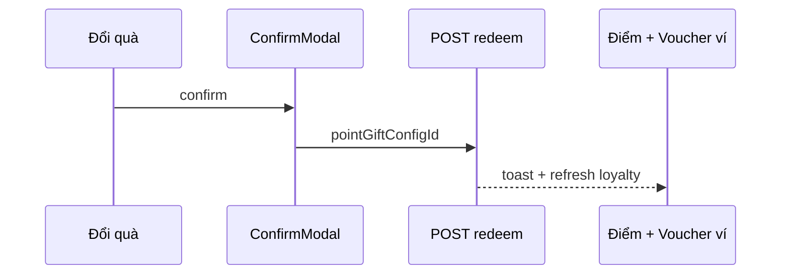

# UI Trace — Promo / Loyalty / Flash / Discount

> Template: [00_TEMPLATE.md](./00_TEMPLATE.md) · Checkout apply voucher: cũng xem [05_Checkout_Order_UI_Trace.md](./05_Checkout_Order_UI_Trace.md)

---

### UT-PRO-01 — Áp mã giảm giá tại Checkout (cross-link)

#### 1. Giao diện

| Mục | Giá trị |
|-----|---------|
| **Route** | `/checkout` |
| **Page** | `CheckoutPage.tsx` |
| **Nút** | Áp dụng mã trong modal/form → `handleApplyCode` |

#### 2–3.

```text
discountService.applyDiscount({ code, restaurantId?, cartAmount })
  → POST /Discount/apply
  → data: { discountId, code, discountAmount, ... }
```

#### 5. Hiển thị

| OK | toast success + `setSelectedDiscount` → giảm `finalTotal` trên UI |
| Fail | toast `Mã giảm giá không hợp lệ` / message BE (expired, min order…) |
| Gỡ mã | toast `Đã gỡ mã giảm giá` + clear selectedDiscount |

---

### UT-PRO-02 — Lưu voucher vào ví (`CustomerVouchers`)

#### 1. Giao diện

| Mục | Giá trị |
|-----|---------|
| **Nơi** | Profile tab vouchers — `components/profile/CustomerVouchers.tsx` |
| **Nút** | Lưu mã `onClick={() => handleSaveVoucher(voucher.id)}` |

#### 2–3.

```text
discountService.saveDiscount({ discountId })
  → POST /Discount/save
  → CUSTOMER_DISCOUNT
```

#### 5. Hiển thị

toast `Đã lưu mã giảm giá vào ví!`; đã lưu rồi → toast error message API; reload list đã lưu.

---

### UT-PRO-03 — Đổi điểm lấy quà (`CustomerLoyalty`)

#### 1. Giao diện

| Mục | Giá trị |
|-----|---------|
| **Component** | `components/profile/CustomerLoyalty.tsx` |
| **Nút** | Đổi quà trên gift card → `handleRedeemGift(gift.id)` → ConfirmModal → confirm redeem |

#### 2–3.

```text
loyaltyPointService.redeemGift({ pointGiftConfigId })
  → POST /LoyaltyPoint/redeem
  → trừ điểm + tạo CustomerDiscount
```

#### 5. Hiển thị

| OK | toast `Đổi quà thành công! Mã giảm giá đã được thêm vào ví.` + refresh điểm/quà |
| Thiếu điểm | toast Insufficient points… |
| Confirm hủy | không gọi API |

---

### UT-PRO-04 — Seller: CRUD Discount / BuyXGetY / Flash register

#### Discount

| UI | `SellerDiscountsPage.tsx` |
| Submit create/update | `POST /Discount` hoặc update `POST /Discount/{id}` |
| Delete | ConfirmModal → `DELETE /Discount/{id}` |
| Hiển thị | toast tạo/sửa/xóa + reload table |

#### Buy X Get Y

| UI | `SellerPromotionsPage.tsx` |
| API | `GET/POST/DELETE /Promotion` |
| Hiển thị | toast CRUD |

#### Flash Sale đăng ký SP

| UI | `SellerFlashSalesPage.tsx` |
| API | `POST /FlashSale/register` |
| Hiển thị | toast đăng ký thành công; lỗi giá ≥ gốc / đã đăng ký / status không Pending |

---

### UT-PRO-05 — Admin: Flash Sale & Discount

#### Flash Admin (`AdminFlashSalePage.tsx`)

| Nút | Flow |
|-----|------|
| Tạo/sửa chương trình | `POST /FlashSale/flash-sales` / update |
| Xóa | `window.confirm` → `DELETE /FlashSale/flash-sales/{id}` |
| Duyệt/từ chối SP | `POST /FlashSale/review-product` (+ PromptModal lý do từ chối) |

#### Discount Admin (`AdminDiscountsPage.tsx`)

CRUD + ConfirmModal xóa/khóa → `PATCH /Discount/{id}/lock`.

#### Loyalty Admin (`AdminLoyaltyConfigPage.tsx`)

Gift config / tier / evaluate → `/LoyaltyPoint/tier-configs`, `evaluate-tiers`, Admin point-gift-config.

---

## Sơ đồ Redeem


