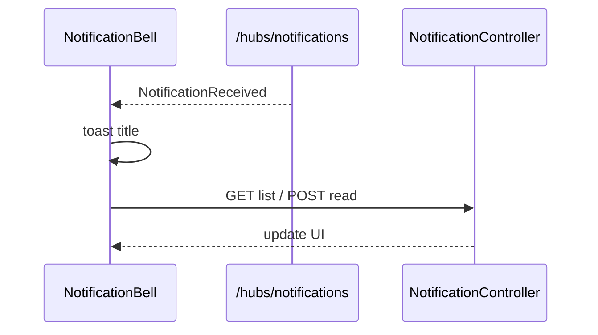

# UI Trace — Chat & Notification Bell

> Template: [00_TEMPLATE.md](./00_TEMPLATE.md) · Requirements: [../requirements/Chat_Notification_Requirements.md](../requirements/Chat_Notification_Requirements.md)

---

### UT-CHAT-01 — Mở widget Live Chat (FAB)

#### 1. Giao diện

| Mục | Giá trị |
|-----|---------|
| **Component** | `components/chat/LiveChatWidget.tsx` (thường trong MainLayout) |
| **Nút** | Floating button `onClick={() => setIsOpen(true)}` |
| **Event ngoài** | `window` event `openLiveChat` cũng mở widget |

#### 2. Frontend (khi mở / chọn topic)

```text
setIsOpen(true) → view history hoặc create
handleStartChat(topic)
  → chatService.createSession({ topic }) → POST /Chat/sessions
  → chatService.startConnection + JoinSession (SignalR /hubs/chat)
```

#### 5. Hiển thị

Panel chat mở; list sessions; lỗi toast `Không tạo được phiên chat` / mạng; SignalR fail → toast realtime.

---

### UT-CHAT-02 — Gửi tin nhắn

#### 1. Giao diện

`<form onSubmit={handleSendMessage}>` trong session view.

#### 2. Frontend

```text
handleSendMessage
  → chatService.sendMessage (Hub invoke SendMessage) 
    và/hoặc REST tùy impl
  → append message local / nhận lại qua onReceiveMessage
```

#### 5. Hiển thị

Bubble tin nhắn mới trong list; fail → toast gửi thất bại; `SupportJoined` → toast `Nhân viên hỗ trợ đã tham gia...`; `SessionClosed` → toast phiên kết thúc.

---

### UT-CHAT-03 — OrderSellerChatModal (chat theo đơn)

#### 1. Giao diện

Modal từ order detail / seller orders — mở chat order.

#### 2–3.

```text
POST /Chat/sessions/order/{orderId}
  → load messages GET /Chat/sessions/{id}/messages
  → SignalR JoinSession
```

#### 5. Hiển thị

| Empty | toast/info `Khách chưa gửi tin nhắn về đơn này` |
| Error | không mở được chat / gửi thất bại |

Seller inbox: `SellerChatPage` — `GET /Chat/sessions/seller/orders`.

---

### UT-NOT-01 — Mở chuông thông báo

#### 1. Giao diện

| Mục | Giá trị |
|-----|---------|
| **Component** | `components/layout/NotificationBell.tsx` (Header) |
| **Nút** | Bell icon `onClick={handleToggle}` |

#### 2. Frontend

```text
handleToggle → setOpen dropdown
  → (đã load) notificationService.getList → GET /Notification
Realtime: NotificationRealtimeService → Hub /hubs/notifications
  → event NotificationReceived → toast(n.title, { icon:'🔔' }) + prepend list
```

#### 5. Hiển thị

Dropdown list unread badge; toast realtime khi có noti mới.

---

### UT-NOT-02 — Đánh dấu đọc / Đọc tất cả

#### 1. Giao diện

| Click 1 noti | `handleNotificationClick` → nếu chưa đọc `handleMarkAsRead` → mở detail modal |
| Nút đọc hết | `handleMarkAllAsRead` |

#### 2–3.

```text
POST /Notification/{id}/read
POST /Notification/read-all
```

#### 5. Hiển thị

| Read one | bỏ badge item; có thể `handleNavigateFromModal` điều hướng theo target |
| Read all | toast `Đã đọc toàn bộ thông báo` + clear unread |

---

## Sơ đồ Bell


