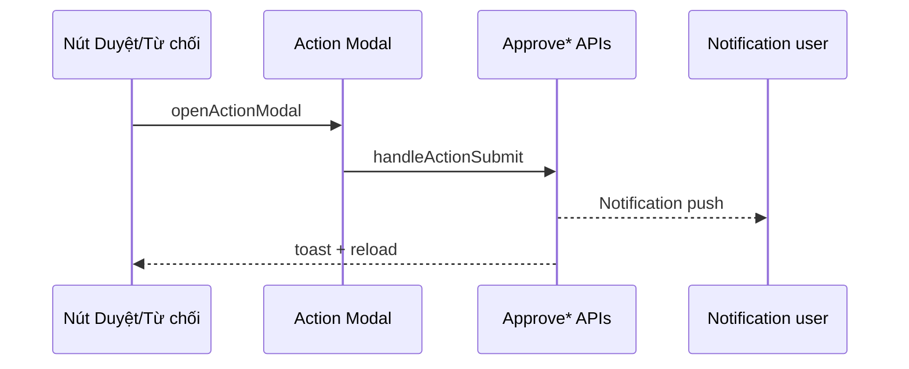

# UI Trace — Admin Approvals / FAQ / Blacklist / Permissions / Maintenance / Support forms

> Template: [00_TEMPLATE.md](./00_TEMPLATE.md) · Requirements: [../requirements/Support_Admin_Requirements.md](../requirements/Support_Admin_Requirements.md)

---

### UT-ADM-01 — Duyệt / Từ chối hồ sơ & sản phẩm

#### 1. Giao diện

| Mục | Giá trị |
|-----|---------|
| **Route** | `/admin/approvals` |
| **Page** | `pages/admin/AdminApprovalsPage.tsx` |
| **Tabs** | sellers / shippers / products |
| **Nút** | Duyệt / Từ chối / NeedsInfo → `openActionModal(...)` |
| **Confirm** | Modal form `onSubmit` → `handleActionSubmit` |

#### 2. Frontend

```text
handleActionSubmit
  → validate lý do nếu reject/needsInfo
  → sellers:  adminService.approveSellerApplication({ id, action, rejectionReason? })
  → shippers: adminService.approveShipperApplication(...)
  → products: adminService.approveProduct({ productId, isApproved, rejectionReason? })
```

#### 3. Backend

```text
POST /Admin/ApproveSellerApplication
POST /Admin/approve-shipper-application
POST /Admin/ApproveProduct
  → cập nhật ApplicationStatus / ProductStatus
  → có thể tạo RestaurantProfile / ShipperProfile khi Approved
  → Notification cho user
```

#### 5. Hiển thị

| Approve | toast `Đã phê duyệt thành công!` + reload list |
| Reject | toast `Đã từ chối đơn đăng ký.` |
| NeedsInfo | toast `Đã gửi yêu cầu bổ sung.` |
| Missing reason | toast `Vui lòng nhập lý do/thông báo.` — không gọi API |

Realtime: `notificationRealtimeService.onNotification` → refresh danh sách.

---

### UT-ADM-02 — FAQ CRUD

#### 1. Giao diện

`AdminFaqPage.tsx` — Thêm / Sửa / Xóa.

#### 2–3.

```text
POST /Faq · PUT /Faq/{id} · DELETE /Faq/{id}
GET /Faq (public Help center cũng đọc)
```

#### 5. Hiển thị

toast thêm/cập nhật/xóa thành công; validate `Vui lòng nhập câu hỏi/câu trả lời`.

---

### UT-ADM-03 — Blacklist keywords

`AdminBlacklistPage.tsx`:

```text
GET/POST/DELETE /Admin/blacklist-keywords*
PUT toggle
→ toast CRUD; từ khóa dùng khi filter review/chat (BlacklistFilterService)
```

---

### UT-ADM-04 — Lưu phân quyền Role

#### 1. Giao diện

`AdminPermissionsPage.tsx` — chọn role, tick endpoints → Lưu.

#### 2–3.

```text
GET /Admin/permissions/endpoints
GET /Admin/permissions/role/{role}
PUT /Admin/permissions/role/{role}  { grants... }
  → ROLE_PERMISSION
```

#### 5. Hiển thị

toast lưu thành công (**Critical** — ảnh hưởng 403 toàn hệ thống).

---

### UT-ADM-05 — Bật/Tắt bảo trì

#### 1. Giao diện

`AdminSystemConfigPage.tsx` — toggle maintenance.

#### 2–3.

```text
GET/POST /Admin/system/maintenance
  → SystemConfig
  → MaintenanceFilter trả 503 cho user thường
```

#### 5. Hiển thị

toast cập nhật bảo trì; FE `HttpClient` gặp 503 → redirect `/maintenance`.

---

### UT-SUP-01 — User gửi khiếu nại đơn (`UserReportIncidentPage`)

#### 1. Giao diện

| Mục | Giá trị |
|-----|---------|
| **Route** | `/support/report` |
| **Page** | `pages/support/UserReportIncidentPage.tsx` |
| **Submit** | `handleSubmit` |

#### 2. Frontend

```text
validate order + lý do + mô tả
handleImageUpload → uploadImage
supportService.orderComplaint(...) → POST /Support/order-complaint
```

#### 5. Hiển thị

toast `Gửi khiếu nại thành công! Chúng tôi sẽ xem xét trong 24h.`; validate thiếu field → toast error.

---

### UT-SUP-02 — Seller Appeal

#### 1. Giao diện

`SellerAppealPage.tsx` — form lý do → `handleSubmit`.

#### 2–3.

```text
POST /Support/appeal (Seller/Mall only)
```

#### 5. Hiển thị

toast gửi thành công chờ Admin; 403 nếu không phải Seller → toast Forbidden message.

---

### UT-ADM-06 — Xử lý khiếu nại (Admin)

`AdminOrderComplaintsPage.tsx` — nút xử lý → toast `Đã xử lý khiếu nại thành công` (moderate/resolve API).

Coordinator resolve: xem [10_Coordinator_UI_Trace.md](./10_Coordinator_UI_Trace.md) UT-COO-05.

---

## Sơ đồ Approvals


