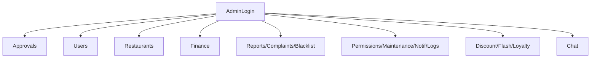

# Tài liệu Quy trình: Cổng Admin (Admin Main Portal)

Tài liệu mô tả **các luồng chính trên Admin portal**: phê duyệt, user/staff, nhà hàng, tài chính, phân quyền, bảo trì, blacklist, báo cáo/khiếu nại, thông báo, log, payment dashboard, FAQ, promo (tóm tắt), chat.

> Promo chi tiết: [Promotion_Loyalty_Workflow.md](./Promotion_Loyalty_Workflow.md) · Payment: [Payment_Wallet_Withdraw_Workflow.md](./Payment_Wallet_Withdraw_Workflow.md) · Chat: [Chat_Notification_Workflow.md](./Chat_Notification_Workflow.md) · Mall: [Mall_Upgrade_Workflow.md](./Mall_Upgrade_Workflow.md)

---

## Phần A — UI Interaction Trace (Nút bấm → Code → Data → Hiển thị)

> Mỗi thao tác: **nút ở đâu** · **FE chạy đâu** · **API/BE** · **data** · **hiển thị**

**Layout:** routes dưới `/admin/*` · JWT role Admin (và staff có quyền endpoint theo RolePermission).

---

## UT-ADM-01 — Load & duyệt **AdminApprovalsPage**

### 1. Giao diện

| Mục | Giá trị |
|-----|---------|
| **Route** | `/admin/approvals` |
| **Page** | `pages/admin/AdminApprovalsPage.tsx` |
| **Tabs** | Cửa hàng · Tài xế · Món ăn |
| **Nút** | Phê duyệt · Từ chối · Yêu cầu bổ sung (NeedsInfo) · xem ảnh |

### 2. FE

```text
Mount / đổi page
  → Promise.all:
       adminService.getSellerApplications({ status: 'Pending', skip, take })
       adminService.getShipperApplications({ status: 'Pending', skip, take })
       productService.search({ status: 'Pending', skip, take })
  → SignalR notificationRealtimeService.onNotification → refetch

openActionModal(type, tab, id, name) → Modal lý do (bắt buộc nếu reject/needsInfo)
handleActionSubmit
  → sellers:  adminService.approveSellerApplication({ applicationId, action, rejectionReason? })
  → shippers: adminService.approveShipperApplication({ ... })
  → products: adminService.approveProduct({ productId, isApproved, rejectionReason? })
  → action map: approve→Approve | reject→Reject | needsInfo→NeedsInfo
  → toast.success('Đã phê duyệt...' | 'Đã gửi yêu cầu bổ sung.' | 'Đã từ chối...')
  → đóng modal + fetchData
```

### 3. BE

| API | Controller |
|-----|------------|
| `GET /api/Admin/SellerApplications` | AdminController |
| `GET /api/Admin/ShipperApplications` | AdminController |
| `GET /api/Product/Search?status=Pending` | ProductController |
| `POST /api/Admin/ApproveSellerApplication` | → ApproveApplicationCommand (Seller + UpgradeToMall) |
| `POST /api/Admin/approve-shipper-application` | → ApproveShipperApplicationCommand |
| `POST /api/Admin/ApproveProduct` | → ApproveProductCommand |

### 4–5. Data & hiển thị

- List pending apps/products + `total` phân trang  
- Toast success/error; row biến mất khỏi Pending sau duyệt  
- Mall upgrade cũng nằm trong SellerApplications (`Type=UpgradeToMall`) — xem Mall_Upgrade_Workflow  

---

## UT-ADM-02 — **AdminUsersPage**: tạo staff · toggle status · chỉnh tier

### 1. UI

| Mục | Giá trị |
|-----|---------|
| **Route** | `/admin/users` |
| **Page** | `AdminUsersPage.tsx` |
| **Nút** | Tạo tài khoản nội bộ · Khóa/Mở · Đổi hạng · Xem lịch sử khiếu nại |

### 2–5

```text
Mount → userService.getAll({ skip, take, filter }) → GET /api/User
handleCreateStaff → adminService.createStaff(newStaff)
  → POST /api/Admin/users/staff
  → toast.success('Tạo tài khoản nội bộ thành công')
handleToggleStatus(userId) → adminService.toggleUserStatus(userId)
  → PUT /api/Admin/users/{userId}/toggle-status
  → toast cập nhật trạng thái
handleSubmitTier → loyaltyPointService.adjustUserTier(userId, newTier)
  → PUT /api/LoyaltyPoint/adjust-user-tier
  → toast.success(`Đã cập nhật hạng ... thành {tier}`)
getUserComplaintHistory → GET /api/Admin/users/{id}/complaints → Modal lịch sử
```

---

## UT-ADM-03 — **AdminRestaurantsPage**: Suspend · Verify

### 1. UI

| Mục | Giá trị |
|-----|---------|
| **Route** | `/admin/restaurants` |
| **Page** | `AdminRestaurantsPage.tsx` |
| **Nút** | KHÓA / MỞ KHÓA · Cấp/hủy nhãn Quán Ăn Chuẩn · Search/filter |

### 2–5

```text
fetchRestaurants → GET /api/Admin/Restaurants?skip&take&filter&status
handleToggleSuspend
  → confirm → PUT /api/Admin/suspend-restaurant { restaurantId, isSuspended }
  → toast.success('Đã khóa|mở khóa nhà hàng')
handleToggleVerification
  → confirm → POST /api/Admin/Restaurants/{id}/toggle-verification
  → toast.success('Đã cập nhật nhãn tín nhiệm')
```

---

## UT-ADM-04 — **AdminFinancePage**: đối soát + duyệt rút tiền

### 1. UI

| Mục | Giá trị |
|-----|---------|
| **Route** | `/admin/finance` |
| **Page** | `AdminFinancePage.tsx` |
| **Nút** | Duyệt / Từ chối trên từng withdrawal Pending |

### 2–5

```text
loadData
  → paymentService.getReconciliation() → GET /api/Payment/reconciliation
  → paymentService.getWithdrawals('Pending') → GET /api/Payment/withdrawals?status=Pending
handleApprove(id, approve)
  → paymentService.approveWithdrawal(id, approve)
  → POST /api/Payment/withdrawals/approve { withdrawalId, approve, rejectReason? }
  → toast.success('Đã duyệt' | 'Đã từ chối') + reload
```

Cards: tổng doanh thu, commission, seller payout, COD/prepaid counts.

---

## UT-ADM-05 — **AdminFinanceOperationsPage**: finance-config · delivery · commission quán

### 1. UI

| Mục | Giá trị |
|-----|---------|
| **Route** | `/admin/finance-operations` (hoặc route config tương đương) |
| **Page** | `AdminFinanceOperationsPage.tsx` |

### 2–5

```text
Mount
  → GET /api/Admin/finance-config
  → GET /api/Admin/system/delivery
  → GET /api/Admin/finance-config/restaurants
Submit platform config → PUT /api/Admin/finance-config
Submit delivery → POST /api/Admin/system/delivery
Update commission quán → PUT /api/Admin/finance-config/restaurants/{id} { customCommissionRate }
  → toast success/error theo từng form
```

> Lưu ý settle: `CustomCommissionRate` lưu DB; kiểm tra `PaymentSettlementService` có dùng rate quán hay chỉ default platform (xem Revenue_Split_Requirements).

---

## UT-ADM-06 — **AdminPermissionsPage**: lưu quyền role

### 1–5

```text
Route: /admin/permissions · AdminPermissionsPage.tsx
Mount → getApiEndpoints() GET /api/Admin/permissions/endpoints
Chọn role → getRolePermissions(role) GET /api/Admin/permissions/role/{role}
Checkbox endpointIds → Lưu
  → updateRolePermissions(role, endpointIds)
  → PUT /api/Admin/permissions/role/{role} { apiEndpointIds }
  → toast success
```

---

## UT-ADM-07 — **AdminSystemConfigPage**: Maintenance

### 1–5

```text
Route: /admin/system-config · AdminSystemConfigPage.tsx
Mount → GET /api/Admin/system/maintenance
Save → POST /api/Admin/system/maintenance { isEnabled, message, ... }
  → toast cập nhật bảo trì
```

Khi maintenance bật: FE/gateway chặn thao tác khách (theo middleware/filter nếu có).

---

## UT-ADM-08 — **AdminBlacklistPage**

### 1–5

```text
Route: /admin/blacklist · AdminBlacklistPage.tsx
Mount → GET /api/Admin/blacklist-keywords
Thêm → POST /api/Admin/blacklist-keywords { keyword }
Toggle → PUT /api/Admin/blacklist-keywords/{id}/toggle
Xóa → DELETE /api/Admin/blacklist-keywords/{id}
  → toast tương ứng + refresh list
```

Dùng để lọc từ khóa độc hại (review/chat/content — theo handler blacklist).

---

## UT-ADM-09 — **AdminProductReportsPage**

### 1–5

```text
Route: /admin/product-reports
Mount → GET /api/Admin/product-reports
Xem món → productService.getById
Moderate modal: isApproved, hideProduct, adminNote
  → POST /api/Admin/product-reports/{reportId}/moderate
  → toast + refresh
```

---

## UT-ADM-10 — **AdminReviewReportsPage**

### 1–5

```text
Route: /admin/review-reports
Mount → GET /api/Admin/review-reports?skip&take
Moderate action: 0=Dismiss, 1=DeleteReview, 2=WarnUser
  → POST /api/Admin/review-reports/{reportId}/moderate
  → toast.success('Đã xử lý báo cáo thành công')
```

---

## UT-ADM-11 — **AdminOrderComplaintsPage**

### 1. UI

| Mục | Giá trị |
|-----|---------|
| **Route** | `/admin/order-complaints` |
| **Page** | `AdminOrderComplaintsPage.tsx` |
| **Nút** | Filter status · Mở modal xử lý · Submit resolve |

### 2–5

```text
fetch → coordinatorService.getOrderComplaints(filter)
  → GET /api/Coordinator/complaints/orders?status=
handleResolve
  → coordinatorService.resolveComplaint(reportId, {
       resolutionType, notes, refundAmount, deductionAmount, responsibleParty, penaltyScore
     })
  → POST /api/Coordinator/complaint/{reportId}/resolve
  → toast.success('Đã xử lý khiếu nại thành công')
```

ResolutionType ví dụ: Dismiss, CompensateCustomer, SellerFault, ShipperFault.

---

## UT-ADM-12 — **AdminNotificationsPage** broadcast

### 1–5

```text
Route: /admin/notifications
Load flash sales → flashSaleService.getAllFlashSales()
Submit form
  → adminService.broadcastNotification({
       flashSaleId, customMessage, targetAudience, targetTier?, targetUserIds?
     })
  → POST /api/Admin/notifications/broadcast
  → toast.success('Gửi thông báo thành công')
```

`targetAudience`: 0=AllCustomers, 1=ByTier, 2=SpecificCustomers.

---

## UT-ADM-13 — **AdminSystemLogsPage**

### 1–5

```text
Route: /admin/system-logs · AdminSystemLogsPage.tsx
Tab Action / Error
  → adminService.getActionLogs(skip, take, search, orderDirection)
       → GET /api/System/action-logs
  → adminService.getErrorLogs(...)
       → GET /api/System/error-logs
  → bảng log + search + pagination
```

---

## UT-ADM-14 — **AdminPaymentDashboardPage**

### 1–5

```text
Route: /admin/payment-dashboard
Mount → paymentService.getPaymentDashboard()
  → GET /api/Payment/dashboard
  → render KPI / charts theo data DTO
```

---

## UT-ADM-15 — **AdminFaqPage** CRUD

### 1–5

```text
Route: /admin/faq · AdminFaqPage.tsx
List → faqService.getList() → GET /api/Faq
Create → POST /api/Faq
Update → PUT /api/Faq/{id}
Delete → DELETE /api/Faq/{id}
  → toast success từng thao tác
```

Public đọc FAQ: [Help_FAQ_Appeal_Workflow.md](./Help_FAQ_Appeal_Workflow.md).

---

## UT-ADM-16 — Promo admin (tóm tắt)

| Page | Việc chính | API chính | Doc đầy đủ |
|------|------------|-----------|------------|
| `AdminDiscountsPage` | CRUD/lock discount | `/api/Discount` | Promotion_Loyalty_Workflow |
| `AdminFlashSalePage` | CRUD flash + review product | `/api/FlashSale/*` | Promotion_Loyalty_Workflow |
| `AdminLoyaltyConfigPage` | tier config + evaluate | `/api/LoyaltyPoint/tier-configs`, `evaluate-tiers` | Promotion_Loyalty_Workflow |
| `AdminSettingsPage` | Global menu category CRUD | `/api/Admin/GlobalMenuCategory` | Product_Catalog / Browse |
| `AdminLegalSettingsPage` | POST legal HTML | `POST /api/Admin/system/legal` | Help_FAQ_Appeal |

---

## UT-ADM-17 — **AdminChatPage**

### 1–5

```text
Route: /admin/chat · AdminChatPage.tsx
  → <SupportChatDashboard role="Admin" />
  → Chat sessions claim/reply qua ChatController + SignalR
  → Chi tiết: Chat_Notification_Workflow.md
```

API tiêu biểu: `GET /api/Chat/sessions`, `POST .../claim`, messages hub.

---

## Phần B — Workflow nghiệp vụ & Backend

### 1. Luồng tổng quan Admin

1. Đăng nhập Admin → portal.  
2. **Approvals**: seller (kể cả Mall) / shipper / product Pending.  
3. **Users**: staff, khóa user, chỉnh loyalty tier.  
4. **Restaurants**: suspend / verify badge.  
5. **Finance**: withdraw approve + config commission/delivery.  
6. **Moderation**: product/review reports, order complaints, blacklist.  
7. **Ops**: permissions, maintenance, broadcast, logs, payment dashboard, FAQ, chat.  



### 2. Bảng API Admin chính

| Method | Route | Việc |
|--------|-------|------|
| GET/POST | `/api/Admin/SellerApplications`, `ApproveSellerApplication` | Duyệt seller/mall |
| GET/POST | `/api/Admin/ShipperApplications`, `approve-shipper-application` | Duyệt shipper |
| POST | `/api/Admin/ApproveProduct` | Duyệt món |
| GET/PUT | `/api/Admin/Restaurants`, `suspend-restaurant`, `.../toggle-verification` | Quán |
| POST/PUT | `/api/Admin/users/staff`, `users/{id}/toggle-status` | Staff / khóa |
| GET/PUT | `/api/Admin/finance-config`, `.../restaurants/{id}` | Config tiền |
| GET/POST | `/api/Admin/system/maintenance`, `system/delivery`, `system/legal` | Hệ thống |
| GET/PUT | `/api/Admin/permissions/*` | RBAC endpoint |
| CRUD | `/api/Admin/blacklist-keywords` | Blacklist |
| GET/POST | `/api/Admin/*-reports*` | Moderate reports |
| POST | `/api/Admin/notifications/broadcast` | Broadcast |
| GET/POST | `/api/Payment/withdrawals*`, `dashboard`, `reconciliation` | Finance pay |
| GET | `/api/System/action-logs`, `error-logs` | Logs |
| CRUD | `/api/Faq` | FAQ |
| POST | `/api/Coordinator/complaint/{id}/resolve` | Order complaint |

### 3. Bảo mật

- Chỉ Admin (và role được map permission endpoint).  
- `AuthenticationFilter` + bảng RolePermission theo API path.  
- Thao tác khóa quán/user ghi audit (action-logs).  
- Withdraw approve ảnh hưởng wallet — cần Admin tin cậy.  

### 4. Checklist

- [ ] Approvals 3 tab: Approve / Reject / NeedsInfo + toast  
- [ ] Suspend restaurant → seller thấy banner khóa + appeal  
- [ ] Create staff + toggle status  
- [ ] Withdraw Pending → approve/reject  
- [ ] Finance config + delivery lưu được  
- [ ] Permissions save theo role  
- [ ] Maintenance toggle  
- [ ] Blacklist CRUD/toggle  
- [ ] Product/Review moderate  
- [ ] Order complaint resolve (refund/deduct)  
- [ ] Broadcast gắn FlashSale  
- [ ] Logs đọc được  
- [ ] FAQ CRUD phản ánh HelpCenter  

### 5. File neo

| FE | BE |
|----|-----|
| `pages/admin/Admin*.tsx` | `AdminController.cs` |
| `AdminService.ts`, `PaymentService.ts` | Features/Admin/*, Payment/*, Support/* |
| `CoordinatorService.ts` (complaints) | `CoordinatorController` complaint resolve |
| `SupportChatDashboard` | `ChatController` + hubs |
| `FaqService.ts` | `FaqController` |
