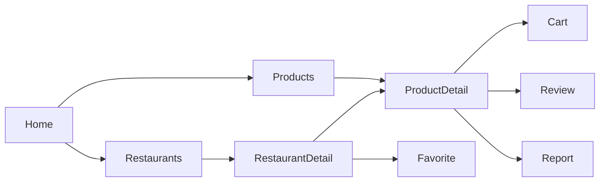

# Tài liệu Quy trình: Khám phá / Duyệt món & nhà hàng (Browse & Discovery)

Tài liệu mô tả luồng khách **vào Home → tìm món/quán → xem chi tiết → thêm giỏ / yêu thích / đánh giá / báo cáo**.

> Requirements liên quan: Product, Restaurant · Cart: [Cart_Workflow.md](./Cart_Workflow.md)

---

## Phần A — UI Interaction Trace (Nút bấm → Code → Data → Hiển thị)

> Mỗi thao tác: **nút ở đâu** · **FE chạy đâu** · **API/BE** · **data** · **hiển thị**

---

## UT-BRW-01 — Load **HomePage**

### 1. Giao diện

| Mục | Giá trị |
|-----|---------|
| **Route** | `/` |
| **Page** | `pages/HomePage.tsx` |
| **Trigger** | Mount (`useEffect`) — không phải nút |

### 2. FE chạy đâu?

```text
HomePage mount
  → adminService.getGlobalMenuCategories(false)     // chip danh mục sàn
  → useProducts().fetchBestSellers(8)               // món bán chạy
  → <FlashSaleSection />                            // flash đang chạy
  → <RecommendationSection />                       // GET /api/Product/recommendations
  → (auth) orderService.getRecentItems()            // mua lại gần đây
  → restaurantService.getNearby({ lat, lon, ... })  // quán gần (nếu có GPS)
  → Chip danh mục onClick → navigate(/products?globalCategoryId=...)
  → Nút "Xem tất cả" → navigate PRODUCTS / RESTAURANTS
  → Nút thêm giỏ trên card gần đây → addItem(product, 1) (CartContext)
```

### 3. Backend

| API | Handler / Controller |
|-----|----------------------|
| `GET /api/Admin/GlobalMenuCategory` hoặc public global cat | Admin / System |
| `GET /api/Product/BestSellers` | ProductController |
| `GET /api/FlashSale/active` (trong FlashSaleSection) | FlashSaleController |
| `GET /api/Order/recent-items` | OrderController (Auth) |
| `GET /api/Restaurant/nearby` | RestaurantController |

### 4. Data trả về

`ApiResponse` list: products, restaurants, categories, flash sale products.

### 5. Hiển thị

- Render sections: FlashSale · Best sellers · Nearby restaurants · Recent items  
- Empty → placeholder / ẩn section  
- Click card → `ProductDetail` / `RestaurantDetail`

---

## UT-BRW-02 — **ProductsPage**: Search / Category / Near me / Filter

### 1. Giao diện

| Mục | Giá trị |
|-----|---------|
| **Route** | `/products` |
| **Page** | `pages/ProductsPage.tsx` |
| **Controls** | Form search · chip category · nút Near me · mở filter modal · Apply filter |

### 2. FE

```text
Mount → load global categories + productService.search(queryParams từ URL)
handleSearch(e) → setSearchParams(q) → re-fetch search
handleCategoryChange(id) → set globalCategoryId trên URL → search
handleNearMeClick
  → nếu đang bật: tắt lọc + toast.success('Đã tắt lọc vị trí')
  → else: mở location modal → proceedWithLocation
       toast.loading('Đang lấy vị trí...')
       navigator.geolocation → set lat/lon → toast.success → search kèm tọa độ
applyFilters → ghi tempFilters vào URL (sortBy, minPrice, maxPrice, minRating, isFreeship) → search
```

### 3. BE

```text
GET /api/Product/Search?q=&globalCategoryId=&lat=&lon=&minPrice=&maxPrice=&...
  → SearchProductHandler
```

### 4–5. Data & hiển thị

- `data`: list ProductDto + total  
- Re-render grid `ProductCard`  
- Toast GPS success/error  

---

## UT-BRW-03 — **ProductDetailPage**: Xem + Thêm giỏ

### 1. Giao diện

| Mục | Giá trị |
|-----|---------|
| **Route** | `/products/:id` |
| **Page** | `pages/ProductDetailPage.tsx` |
| **Nút** | Chọn size · toggle topping · **"Thêm vào giỏ"** · **"Báo cáo"** |

### 2. FE

```text
Mount → productService.getById(id) / get detail
handleToppingToggle(name) → local selectedToppings state
handleAddToCart → useCart().addItem(product, qty, size, toppings)
  → CartContext → POST /api/Cart  (xem Cart_Workflow)
Nút Báo cáo → setIsReportOpen(true)
```

### 3–5

- Cart success: toast trong CartContext `Đã thêm vào giỏ: {name}`  
- Detail fail: toast lỗi tải  

---

## UT-BRW-04 — **Báo cáo món** (Report Modal)

### 1. UI

Modal `"Báo cáo món ăn vi phạm"` — chọn lý do + mô tả + Submit.

### 2–5

```text
handleReportSubmit
  → productService.reportProduct({ productId, reason, detail })
  → POST /api/Product/Report
  → toast.success('Báo cáo của bạn đã được gửi...')
  → đóng modal
```

**BE:** tạo `SystemReport` (TargetType=Product).

---

## UT-BRW-05 — **Gửi đánh giá** (ProductReviews)

### 1. UI

| Mục | Giá trị |
|-----|---------|
| **Component** | `components/product/ProductReviews.tsx` (embed trong ProductDetail) |
| **Form** | rating stars + comment + submit |

### 2–5

```text
Mount → productService.getProductReviews(productId) → GET /api/Product/{id}/reviews
handleSubmitReview → POST /api/Product/review { productId, rating, comment }
  → toast.success('Đánh giá của bạn đã được gửi!')
  → refresh list reviews
handleReportReview → POST /api/Product/review/{id}/report
  → toast.success('Đã gửi báo cáo vi phạm...')
```

---

## UT-BRW-06 — **RestaurantsPage** / Nearby

### 1–5

```text
Route: /restaurants · pages/RestaurantsPage.tsx
Mount / filter → restaurantService.getNearby({ latitude, longitude, ... })
  → GET /api/Restaurant/nearby
  → render RestaurantCard → click → /restaurant/:id
```

---

## UT-BRW-07 — **RestaurantDetailPage**: Menu + Favorite

### 1. UI

| Mục | Giá trị |
|-----|---------|
| **Route** | `/restaurant/:id` |
| **Page** | `pages/RestaurantDetailPage.tsx` |
| **Nút** | `"Lưu quán"` / `"Đã lưu quán"` (Heart) · chip category · ProductCard |

### 2. FE

```text
Mount
  → restaurantService.getDetail(id)        GET /api/Restaurant/{id}
  → menuCategoryService.getByRestaurant    GET /api/MenuCategory/{restaurantId}
  → productService.search({ restaurantId, categoryId })
handleToggleFavorite
  → cần auth; restaurantService.toggleFavorite(id)
  → POST /api/Restaurant/{id}/Favorite
  → setRestaurant.isFavorite đảo ngược
  → toast.success('Đã lưu quán...' | 'Đã bỏ lưu quán')
handleCategoryChange → filter products local/API
```

### 3. BE

Favorite: insert/delete `FAVORITE_RESTAURANT` composite PK.

### 5. Hiển thị

- Header quán + nút Heart đỏ khi favorite  
- Tab danh mục + grid món  

---

## Phần B — Workflow nghiệp vụ & Backend

### 1. Luồng tổng quan

1. Khách vào `/` → load best sellers / flash / nearby / recent.  
2. Tìm món `/products` (search, category, GPS, filter).  
3. Vào chi tiết món → chọn size/topping → thêm giỏ.  
4. (Tuỳ chọn) báo cáo món / viết review.  
5. Duyệt quán `/restaurants` → chi tiết → lưu yêu thích → chọn món.  



### 2. API chính

| Method | Route | Việc |
|--------|-------|------|
| GET | `/api/Product/Search` | Tìm/lọc món |
| GET | `/api/Product/BestSellers` | Bán chạy |
| GET | `/api/Product/recommendations` | Gợi ý (RecommendationSection) |
| GET | `/api/Product/{id}` | Chi tiết |
| GET | `/api/Product/{id}/reviews` | Reviews |
| POST | `/api/Product/review` | Viết review (Auth) |
| POST | `/api/Product/Report` | Báo cáo món |
| POST | `/api/Product/review/{id}/report` | Báo cáo review |
| GET | `/api/Restaurant/nearby` | Quán gần |
| GET | `/api/Restaurant/{id}` | Chi tiết quán |
| POST | `/api/Restaurant/{id}/Favorite` | Toggle favorite |
| GET | `/api/MenuCategory/{restaurantId}` | Menu quán |
| GET | `/api/FlashSale/active` | Flash đang chạy |

### 3. Bảo mật

- Browse/search/detail: public (GET).  
- Favorite / review / report: JWT + RBAC.  
- Soft-delete Product: query filter `!IsDeleted`.  

### 4. Checklist

- [ ] Home hiện best sellers + flash (nếu có campaign)  
- [ ] Search + category + near-me lọc đúng  
- [ ] Add cart từ detail (size/topping)  
- [ ] Report / review toast đúng  
- [ ] Favorite toggle cần login; guest bị 401/redirect  

### 5. File neo

| FE | BE |
|----|-----|
| `HomePage.tsx`, `ProductsPage.tsx`, `ProductDetailPage.tsx` | `ProductController`, `RestaurantController` |
| `RestaurantsPage.tsx`, `RestaurantDetailPage.tsx` | `MenuCategoryController` |
| `ProductReviews.tsx`, `FlashSaleSection.tsx` | Features/Products, Restaurants, FlashSales |
