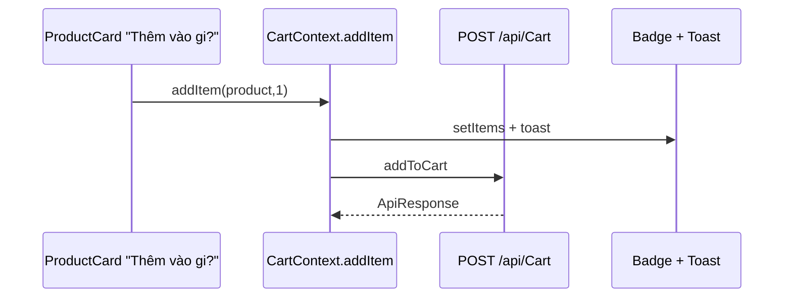
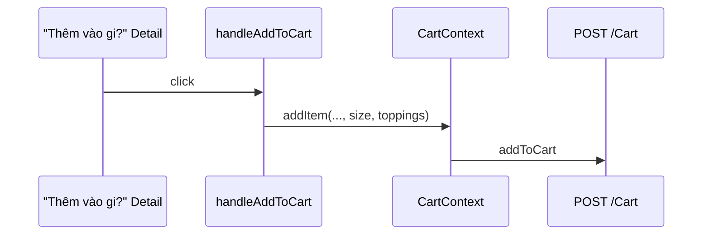
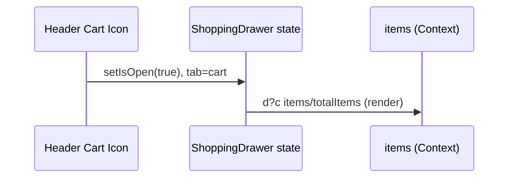
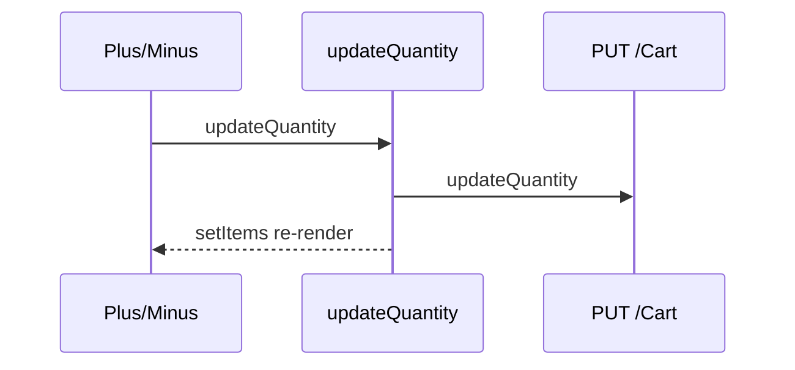
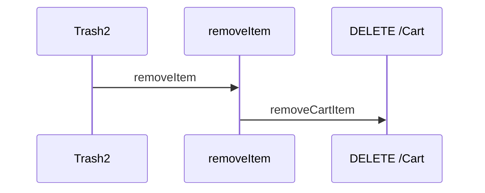
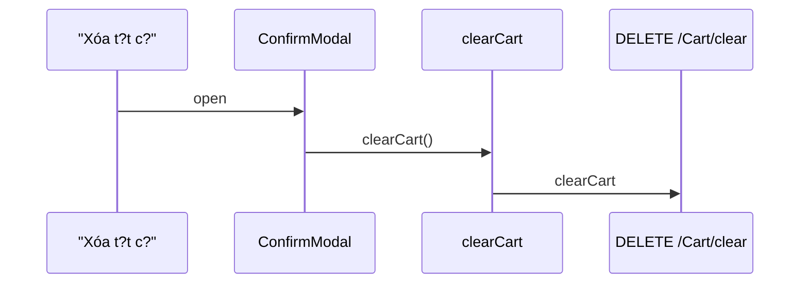
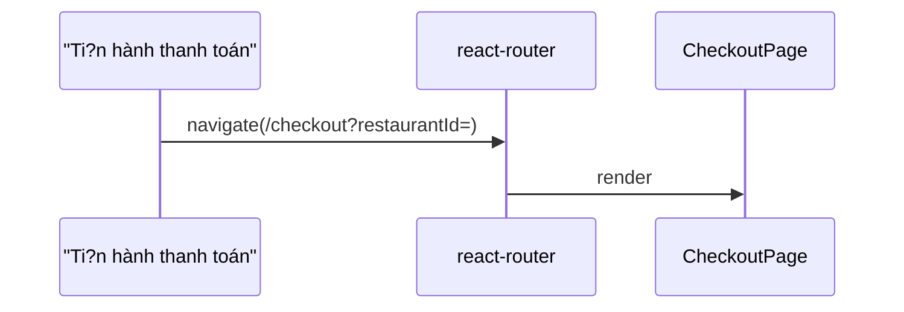

# Tài li?u Quy trình: Gi? hàng (Cart)

Tài li?u này mô t? chi ti?t lu?ng **thêm / xem / c?p nh?t / xóa / clear** gi? hàng trong h? th?ng **UniEats**, h? tr? c? **user dã dang nh?p** và **guest** (`guestUserId` luu `localStorage` key `sf_guest_id`).

> Guest cart: request **không** g?i header `Authorization` ? `AuthenticationFilter` coi là `isGuestCartRequest` và bypass JWT. User dã login: Filter inject `CurrentUserId` vào Command/Query.

---


---

## Ph?n A — UI Interaction Trace (Nút b?m ? Code ? Data ? Hi?n th?)

> UI Trace — Cart  
> M?i thao tác tr? l?i: **nút ? dâu** · **b?m ch?y file/hàm nào** · **API/BE dâu** · **data tr? v?** · **hi?n th? th? nào**.


**State trung tâm:** `CartProvider` trong `ShoppingFood.FE/src/contexts/CartContext.tsx`  
**Hook:** `useCart()` ? `hooks/useCart.ts` (re-export context)  
**Keys localStorage:** `sf_cart` (optimistic), `sf_guest_id` (guest)

---

## UT-CART-01 — Thêm vào gi? t? ProductCard

#### 1. Giao di?n nút b?m ? dâu?

| M?c | Giá tr? |
|-----|---------|
| **Route** | `/`, `/products`, `/restaurant/:id`, … (m?i noi render `ProductCard`) |
| **Page** | Ví d? `pages/HomePage.tsx`, `pages/ProductsPage.tsx` |
| **Component** | `components/product/ProductCard.tsx` |
| **Nhãn nút** | `"Thêm vào gi?"` (ho?c `"H?t hàng"` n?u OutOfStock) |
| **Lo?i control** | `<button onClick={...}>` cu?i card |
| **Ði?u ki?n hi?n** | Luôn hi?n; `disabled` khi `stockStatus === 'OutOfStock'` |

#### 2. B?m xong ch?y d?n dâu? (Frontend)

```text
ProductCard button onClick (ProductCard.tsx ~104–110)
  ? e.stopPropagation()  // không navigate vào detail
  ? if stockStatus !== 'OutOfStock':
       addItem(product, 1)   // t? useCart()
  ? CartContext.addItem (CartContext.tsx ~119–169)
       1) setItems(...) optimistic (c?ng qty n?u trùng product+size+toppings)
       2) setTimeout ? toast.success("Ðã thêm vào gi?: …" | "Ðã c?p nh?t s? lu?ng: …")
       3) cartService.addToCart({ productId, quantity, guestUserId })
  ? httpClient.post('/Cart', body)
```

**Cùng pattern add nhanh:**
- `HomePage.tsx` ~356: `onClick={() => addItem(product, 1)}`
- `FlashSalePage.tsx`, `BuyXGetYPage.tsx`, `BuyXGetYSection.tsx` — `addItem(...)` v?i qty khác

#### 3. Backend ch?y do?n nào?

```text
POST /api/Cart
  ? CartController.AddToCart (CartController.cs L14–18)
  ? MediatR ? AddToCartHandler.Handle (Features/Carts/Commands/AddToCartHandler.cs)
  ? Ki?m tra product t?n t?i / stock
  ? Conflict 409 n?u khác restaurant v?i item dang có trong cart
  ? Insert/Update CartItem ? SaveChanges
  ? ApiResponse.Success(dto, "Added item to cart successfully")
```

#### 4. D? li?u tr? v? ? dâu?

```json
{
  "code": 200,
  "error": false,
  "message": "Added item to cart successfully",
  "data": { /* cart DTO */ }
}
```

| Field / Case | Ý nghia |
|--------------|---------|
| 404 | Product not found / unavailable |
| 400 | Out of stock |
| 409 | Khác c?a hàng — message h?i empty cart |

**Request FE g?i:** `{ productId, quantity, guestUserId? }` — size/toppings hi?n **optimistic local**, API add co b?n theo productId.

#### 5. Làm sao hi?n th? ra?

| Nhánh | Hành vi UI |
|-------|------------|
| Optimistic OK | `items` trong Context d?i ngay ? badge gi? Header (`totalItems`) tang |
| Toast success | `Ðã thêm vào gi?: {itemName}` ho?c c?p nh?t s? lu?ng |
| API error | `toast.error(...)` — state local **không rollback** (comment trong code) |
| localStorage | `useEffect` ghi `sf_cart` m?i khi `items` d?i |

#### 6. So d? nhanh



---

## UT-CART-02 — Thêm vào gi? t? ProductDetailPage (có size/topping)

#### 1. Giao di?n nút b?m ? dâu?

| M?c | Giá tr? |
|-----|---------|
| **Route** | `/products/:id` |
| **Page** | `pages/ProductDetailPage.tsx` |
| **Component** | cùng page |
| **Nhãn nút** | `"Thêm vào gi?"` (disabled/"H?t hàng" n?u out of stock) |
| **Lo?i control** | Button `onClick={handleAddToCart}` (~292) |
| **Ði?u ki?n hi?n** | Sau khi load product; user ch?n size/topping phía trên |

#### 2. B?m xong ch?y d?n dâu? (Frontend)

```text
handleAddToCart (ProductDetailPage.tsx L85–87)
  ? addItem(product, 1, selectedSize || undefined, selectedToppings.length ? selectedToppings : undefined)
  ? CartContext.addItem (nhu UT-CART-01)
  ? cartService.addToCart({ productId, quantity, guestUserId })
```

#### 3. Backend ch?y do?n nào?

Gi?ng UT-CART-01 — `AddToCartHandler`.

#### 4. D? li?u tr? v? ? dâu?

Gi?ng UT-CART-01.

#### 5. Làm sao hi?n th? ra?

| Nhánh | Hành vi UI |
|-------|------------|
| Success | Toast + Context `items` có `selectedSize` / `selectedToppings` (local) |
| Key trùng | Cùng product+size+toppings ? c?ng `quantity` trong `setItems` |

#### 6. So d? nhanh



---

## UT-CART-03 — M? gi? hàng (ShoppingDrawer) t? Header

#### 1. Giao di?n nút b?m ? dâu?

| M?c | Giá tr? |
|-----|---------|
| **Route** | M?i trang dùng `MainLayout` / Header |
| **Page** | Layout |
| **Component** | `components/layout/Header.tsx` nhúng `<ShoppingDrawer />` (~95, ~184) |
| **Nhãn nút** | Icon `ShoppingCart` (title `"Gi? hàng & Ðon hàng"`) |
| **Lo?i control** | `<button onClick={() => { setIsOpen(true); setActiveTab('cart'); }}>` — ShoppingDrawer.tsx ~225–236 |
| **Ði?u ki?n hi?n** | Luôn; badge s? n?u `totalItems > 0` |

#### 2. B?m xong ch?y d?n dâu? (Frontend)

```text
ShoppingDrawer trigger button
  ? setIsOpen(true)
  ? setActiveTab('cart')
  ? createPortal drawer (không g?i API ngay cho cart — items dã có trong Context)
  ? N?u sau dó user chuy?n tab "Ðon hàng":
       useEffect ? fetchOrders ? orderService.getMyOrders / getGuestOrders
```

**Không** g?i l?i `getCart` ch? vì m? drawer (cart dã sync lúc mount/`isAuthenticated` d?i qua `fetchCart`).

#### 3. Backend ch?y do?n nào?

Không HTTP khi ch? m? drawer.  
(Khi load l?n d?u app: `GET /api/Cart?guestUserId=` ? `GetCartHandler`.)

#### 4. D? li?u tr? v? ? dâu?

N/A cho click m?.  
`GET /Cart` khi `fetchCart`: `data` = array items ho?c `{ items: [...] }`.

#### 5. Làm sao hi?n th? ra?

| Nhánh | Hành vi UI |
|-------|------------|
| M? | Overlay + panel ph?i `max-w-md`, tab Gi? hàng |
| Badge | `totalItems` t? Context |
| Empty | Text "Gi? hàng tr?ng" + nút "Ti?p t?c tìm ki?m" |

#### 6. So d? nhanh



---

## UT-CART-04 — Tang / gi?m s? lu?ng (+ / -)

#### 1. Giao di?n nút b?m ? dâu?

| M?c | Giá tr? |
|-----|---------|
| **Route** | Drawer dang m? |
| **Component** | `ShoppingDrawer.tsx` trong t?ng dòng item |
| **Nhãn nút** | Icon `Minus` / `Plus` (~423–433) |
| **Lo?i control** | `<button onClick={() => updateQuantity(...)}>` |
| **Ði?u ki?n hi?n** | Có item trong group nhà hàng |

#### 2. B?m xong ch?y d?n dâu? (Frontend)

```text
Minus: updateQuantity(productId, quantity - 1, selectedSize, selectedToppings)
Plus:  updateQuantity(productId, quantity + 1, ...)
  ? CartContext.updateQuantity (L190–222)
       if quantity <= 0 ? removeItem(...)
       else setItems map quantity
       ? cartService.updateQuantity({ productId, quantity, guestUserId })
  ? httpClient.put('/Cart', body)
```

#### 3. Backend ch?y do?n nào?

```text
PUT /api/Cart
  ? CartController.UpdateQuantity
  ? UpdateCartItemQuantityHandler.Handle
  ? Success: "Cart item quantity updated successfully."
```

#### 4. D? li?u tr? v? ? dâu?

```json
{ "error": false, "message": "Cart item quantity updated successfully.", "data": { /* cart dto */ } }
```

404 n?u cart/item không t?n t?i.

#### 5. Làm sao hi?n th? ra?

| Nhánh | Hành vi UI |
|-------|------------|
| OK | S? qty trên UI d?i ngay (optimistic); `totalPrice` / `selectedTotal` recalculate |
| qty?0 | Item bi?n m?t (qua `removeItem`) |
| Error | `toast.error('L?i c?p nh?t s? lu?ng trên server')` |

#### 6. So d? nhanh



---

## UT-CART-05 — Xóa m?t món (Trash)

#### 1. Giao di?n nút b?m ? dâu?

| M?c | Giá tr? |
|-----|---------|
| **Component** | `ShoppingDrawer.tsx` ~378 |
| **Nhãn nút** | Icon `Trash2` |
| **Lo?i control** | `onClick={() => removeItem(item.product.id, item.selectedSize, item.selectedToppings)}` |

#### 2. B?m xong ch?y d?n dâu? (Frontend)

```text
removeItem(...) (CartContext L171–188)
  ? setItems(filter ...) optimistic
  ? cartService.removeCartItem({ productId, guestUserId })
  ? httpClient.delete('/Cart', { params })
```

#### 3. Backend ch?y do?n nào?

```text
DELETE /api/Cart?productId=&guestUserId=
  ? CartController.RemoveCartItem
  ? RemoveCartItemCommandHandler
  ? "Item removed from cart successfully."
```

#### 4. D? li?u tr? v? ? dâu?

Success message nhu trên; 404 Cart/Item not found.

#### 5. Làm sao hi?n th? ra?

| Nhánh | Hành vi UI |
|-------|------------|
| OK | Dòng item bi?n m?t; badge gi?m |
| Error | `toast.error('L?i khi xóa món trên server')` |

#### 6. So d? nhanh



---

## UT-CART-06 — Xóa t?t c? gi? (ConfirmModal)

#### 1. Giao di?n nút b?m ? dâu?

| M?c | Giá tr? |
|-----|---------|
| **Component** | `ShoppingDrawer.tsx` |
| **Nhãn nút** | `"Xóa t?t c?"` (~252–257) — ch? khi `activeTab==='cart' && groups.length>0` |
| **Confirm** | `ConfirmModal` title `"Xóa gi? hàng"`, description `"B?n có ch?c ch?n mu?n xóa toàn b? gi? hàng?"` (~579–586) |

#### 2. B?m xong ch?y d?n dâu? (Frontend)

```text
"Xóa t?t c?" ? setClearCartConfirmModal(true)
User Confirm ? onConfirm:
  ? clearCart() (CartContext L224–231)
       setItems([])
       cartService.clearCart({ guestUserId })
  ? httpClient.delete('/Cart/clear', { params })
  ? setClearCartConfirmModal(false)
```

#### 3. Backend ch?y do?n nào?

```text
DELETE /api/Cart/clear?guestUserId=
  ? CartController.ClearCart
  ? ClearCartCommandHandler
  ? "Cart cleared successfully."
```

#### 4. D? li?u tr? v? ? dâu?

Success dto + message; 404 n?u không có cart.

#### 5. Làm sao hi?n th? ra?

| Nhánh | Hành vi UI |
|-------|------------|
| Confirm | Modal dóng; `items=[]`; UI empty state; badge 0 |
| API fail | `console.error` — **không** toast (khác remove single) |

#### 6. So d? nhanh



---

## UT-CART-07 — Ti?n hành thanh toán (vào Checkout)

#### 1. Giao di?n nút b?m ? dâu?

| M?c | Giá tr? |
|-----|---------|
| **Component** | `ShoppingDrawer.tsx` footer ~464–470 |
| **Nhãn nút** | `"Ti?n hành thanh toán"` |
| **Lo?i control** | `<Button onClick={handleCheckout} disabled={!selectedProvider}>` |
| **Ði?u ki?n** | Ðã ch?n 1 nhà hàng (`selectedProvider`) trong drawer |

#### 2. B?m xong ch?y d?n dâu? (Frontend)

```text
handleCheckout (ShoppingDrawer.tsx L71–86)
  ? N?u item isProductDeleted trong group ? toast.error(...) return
  ? setIsOpen(false)
  ? checkoutUrl = `/checkout?restaurantId={selectedProvider}`
  ? if isAuthenticated: navigate(checkoutUrl)
  ? else: navigate(/login, { state: { returnUrl: checkoutUrl } })
```

**Không** g?i API cart ? bu?c này.

#### 3. Backend ch?y do?n nào?

N/A (navigation only). Checkout g?i API ? `CheckoutPage`.

#### 4. D? li?u tr? v? ? dâu?

N/A.

#### 5. Làm sao hi?n th? ra?

| Nhánh | Hành vi UI |
|-------|------------|
| Auth | Ðóng drawer ? trang `/checkout?restaurantId=...` |
| Guest | Ðóng drawer ? `/login` r?i quay l?i checkout |
| Món ng?ng bán | Toast d?, ? l?i drawer |

#### 6. So d? nhanh



---

## Tóm t?t call chain Cart

```text
UI (ProductCard / Detail / Drawer)
  ? useCart() / CartContext
  ? CartService (/Cart, /Cart/clear)
  ? CartController ? *Handler
  ? Context setItems + toast + localStorage sf_cart
  ? Header badge totalItems
```

| File quan tr?ng | Vai trò |
|-----------------|---------|
| `contexts/CartContext.tsx` | State + optimistic + API |
| `services/CartService.ts` | HTTP |
| `components/layout/ShoppingDrawer.tsx` | UI gi? |
| `components/product/ProductCard.tsx` | Add nhanh |
| `pages/ProductDetailPage.tsx` | Add + options |
| `API/Controllers/CartController.cs` | Endpoints |
| `Application/Features/Carts/**` | Handlers |


---

## Ph?n B — Workflow nghi?p v? & Backend (chi ti?t lu?ng)
## 1. Lu?ng T?ng Quan (Workflow)

1. **Kh?i t?o FE:** `CartProvider` mount ? `getGuestUserId()` n?u chua login ? `cartService.getCart(guestUserId)` ? d?ng b? state + `sf_cart` localStorage.
2. **Thêm món:** UI g?i `addItem` ? optimistic update + toast ? `POST /api/Cart` (`productId`, `quantity`, optional `guestUserId`, `clearCartIfConflict`).
3. **Backend Add:** T?o GuestUser n?u c?n ? GetOrCreate Cart ? check quán conflict / stock ? thêm ho?c c?ng d?n `CartItem` (giá FlashSale n?u có).
4. **Xem gi?:** `GET /api/Cart?guestUserId=` ? sync giá flash sale ? tr? `CartDto`.
5. **Ð?i s? lu?ng:** `PUT /api/Cart` — quantity = 0 thì xóa item.
6. **Xóa món:** `DELETE /api/Cart?productId=&guestUserId=`.
7. **Xóa h?t:** `DELETE /api/Cart/clear?guestUserId=` (ConfirmModal trên Drawer).
8. **Ràng bu?c quán:** M?t cart ch? 1 `RestaurantId`; khác quán ? HTTP **409** (FE có th? g?i `clearCartIfConflict: true`).


---

## Bu?c 1: Qu?n lý Guest ID & State (Frontend)

**Files:**
- `ShoppingFood.FE/src/contexts/CartContext.tsx`
- `ShoppingFood.FE/src/services/CartService.ts`
- `ShoppingFood.FE/src/hooks/useCart.ts` (wrapper)
- UI Drawer: `ShoppingFood.FE/src/components/layout/ShoppingDrawer.tsx`

```typescript
const GUEST_ID_KEY = 'sf_guest_id';

const getGuestUserId = useCallback(() => {
  if (isAuthenticated) return undefined;
  let guestId = localStorage.getItem(GUEST_ID_KEY);
  if (!guestId) {
    guestId = crypto.randomUUID();
    localStorage.setItem(GUEST_ID_KEY, guestId);
  }
  return guestId;
}, [isAuthenticated]);
```

**Service:**

```typescript
async addToCart(data: IAddToCartRequest) {
  return httpClient.post(API_ENDPOINTS.CART.BASE, data);
}
async getCart(guestUserId?: string) {
  return httpClient.get(API_ENDPOINTS.CART.BASE, {
    params: guestUserId ? { guestUserId } : {},
  });
}
async updateQuantity(data) { return httpClient.put(..., data); }
async removeCartItem(params) { return httpClient.delete(..., { params }); }
async clearCart(params) { return httpClient.delete(API_ENDPOINTS.CART.CLEAR, { params }); }
```

---

## Bu?c 2: Controller API

**File:** `src/ShoppingFood.API/Controllers/CartController.cs`  
**Base route:** `api/Cart` (qua `CommonController`)

| Method | Route | Command/Query | Vi?c |
|--------|-------|---------------|------|
| POST | `/api/Cart` | `AddToCartCommand` | Thêm / c?ng d?n |
| GET | `/api/Cart` | `GetCartQuery` | L?y gi? |
| PUT | `/api/Cart` | `UpdateCartItemQuantityCommand` | Ð?i SL |
| DELETE | `/api/Cart` | `RemoveCartItemCommand` (query) | Xóa 1 món |
| DELETE | `/api/Cart/clear` | `ClearCartCommand` (query) | Xóa h?t |

```csharp
[HttpPost]
public async Task<IActionResult> AddToCart([FromBody] AddToCartCommand command)
{
    var response = await _mediator.Send(command);
    return Ok(response);
}

[HttpGet]
public async Task<IActionResult> GetCart([FromQuery] GetCartQuery query) { ... }

[HttpPut]
public async Task<IActionResult> UpdateQuantity([FromBody] UpdateCartItemQuantityCommand command) { ... }

[HttpDelete]
public async Task<IActionResult> RemoveCartItem([FromQuery] RemoveCartItemCommand command) { ... }

[HttpDelete("clear")]
public async Task<IActionResult> ClearCart([FromQuery] ClearCartCommand command) { ... }
```

---

## Bu?c 3: Thêm vào gi? (AddToCart)

**Thông tin:**
- **URL:** `/api/Cart`
- **HTTP Method:** POST
- **Auth:** JWT **ho?c** Guest (không Authorization)

**Command:** `src/ShoppingFood.Application/Features/Carts/Commands/AddToCartCommand.cs`

```csharp
public class AddToCartCommand : BaseCommand, IRequest<ApiResponse>
{
    public Guid ProductId { get; set; }
    public int Quantity { get; set; }
    public Guid? GuestUserId { get; set; }
    public bool ClearCartIfConflict { get; set; } = false;
}
```

**Handler:** `AddToCartHandler.cs`

```csharp
// N?u không có CurrentUserId và GuestUserId ? t? t?o Guid m?i làm guest
var product = await _productRepository.GetByIdAsync(request.ProductId);
if (product == null || product.Status != ProductStatus.Approved || product.IsHidden)
    return ApiResponse.Failure(404, "Product not found or unavailable.");
if (product.StockStatus != StockStatus.InStock)
    return ApiResponse.Failure(400, "Product is out of stock.");

var cart = await GetOrCreateCartAsync(request.CurrentUserId, guestUserId);
// Conflict khác RestaurantId ? 409 ho?c clear n?u ClearCartIfConflict
await AddOrUpdateCartItemAsync(cart.Id, product, request.Quantity);
// PriceAtAdded = FlashSale price ?? product.Price
return ApiResponse.Success(dto, "Added item to cart successfully");
```

**T?o GuestUser** (khi guest chua có trong DB):

```csharp
var guestUser = new GuestUser
{
    Id = guestUserId.Value,
    FullName = "Guest Customer",
    Phone = string.Empty,
    DeliveryAddress = string.Empty,
    IpAddress = GetClientIpAddress()
};
```

**Inject CurrentUserId:** `AuthenticationFilter` Lines ~215–224 — n?u có JWT h?p l?:

```csharp
command.CurrentUserId = user.Id;
```

**Guest bypass:** `AuthenticationFilter` — `isGuestCartRequest` khi path `/api/Cart` và **không** có header Authorization (Lines 98–108).

---

## Bu?c 4: L?y gi? (GetCart)

**Thông tin:**
- **URL:** `/api/Cart?guestUserId={guid}` (guest) ho?c Bearer (user)
- **HTTP Method:** GET

**Query:** `GetCartQuery.cs` — `GuestUserId`

**Handler:** `GetCartHandler.cs`

```csharp
if (!request.CurrentUserId.HasValue && !request.GuestUserId.HasValue)
    return ApiResponse.Failure(401, "Unauthorized. Neither logged-in user nor guest ID was provided.");

// Load cart by UserAccountId OR GuestUserId
await _flashSalePricingService.SyncCartItemPricesAsync(cart);
return ApiResponse.Success(dto, "Get cart details successfully");
// Cart null ? empty CartDto
```

---

## Bu?c 5: C?p nh?t s? lu?ng (Update)

**Thông tin:**
- **URL:** `/api/Cart`
- **HTTP Method:** PUT
- **Body:** `{ productId, quantity, guestUserId? }`

**Handler:** `UpdateCartItemQuantityHandler.cs`

```csharp
if (request.Quantity <= 0)
    _cartItemRepository.Delete(cartItem);
else
{
    cartItem.Quantity = request.Quantity;
    // c?p nh?t PriceAtAdded theo flash sale n?u có
}
```

**FE:** `CartContext.updateQuantity` — n?u `quantity <= 0` g?i `removeItem`.

---

## Bu?c 6: Xóa món / Clear

### Remove m?t món

- **URL:** `DELETE /api/Cart?productId=...&guestUserId=...`
- **Handler:** `RemoveCartItemCommandHandler.cs` — 401 n?u thi?u user/guest; 404 n?u không có cart/item.

### Clear toàn b?

- **URL:** `DELETE /api/Cart/clear?guestUserId=...`
- **Handler:** `ClearCartCommandHandler.cs` — xóa t?t c? `CartItem` c?a cart.
- **FE Confirm:** `ConfirmModal` trong `ShoppingDrawer.tsx` tru?c khi `clearCart()`.

---

## Database liên quan

| B?ng | Vi?c |
|------|------|
| `GUEST_USER` | T?o khi guest thêm món l?n d?u |
| `CART` | 1-1 v?i User **ho?c** Guest (`UserAccountId` / `GuestUserId`) |
| `CART_ITEM` | ProductId, Quantity, PriceAtAdded |
| `PRODUCT` | Check Approved, !Hidden, InStock, RestaurantId |

---

## So d? file di qua (Call chain)

```text
ProductCard / ProductDetail / ShoppingDrawer
  ?
CartContext.addItem | updateQuantity | removeItem | clearCart | fetchCart
  ?
CartService.ts ? HttpClient
  ?
AuthenticationFilter  (guest bypass HO?C JWT ? CurrentUserId)
  ?
CartController
  ?
AddToCartHandler / GetCartHandler / UpdateCartItemQuantityHandler
RemoveCartItemCommandHandler / ClearCartCommandHandler
  ?
ICartRepository + ICartItemRepository + ShoppingFoodContext
  ?
CART / CART_ITEM / GUEST_USER
```

| Vai trò | Ðu?ng d?n d?y d? |
|---------|------------------|
| Context FE | `ShoppingFood.FE/src/contexts/CartContext.tsx` |
| Service FE | `ShoppingFood.FE/src/services/CartService.ts` |
| Drawer UI | `ShoppingFood.FE/src/components/layout/ShoppingDrawer.tsx` |
| Controller | `src/ShoppingFood.API/Controllers/CartController.cs` |
| Add Handler | `src/ShoppingFood.Application/Features/Carts/Commands/AddToCartHandler.cs` |
| Get Handler | `src/ShoppingFood.Application/Features/Carts/Queries/GetCartHandler.cs` |
| Update / Remove / Clear | `.../UpdateCartItemQuantityHandler.cs`, `RemoveCartItemCommandHandler.cs`, `ClearCartCommandHandler.cs` |
| Guest auth rule | `src/ShoppingFood.API/Filters/AuthenticationFilter.cs` |

---

## Các thông báo (Toast / Message)

| Message | Noi | Trigger |
|---------|-----|---------|
| `Ðã thêm vào gi?: {itemName}` | `CartContext.addItem` | Thêm m?i |
| `Ðã c?p nh?t s? lu?ng: {itemName}` | `CartContext.addItem` | Ðã có s?n trong state |
| `L?i khi thêm vào gi? hàng trên server` | catch addItem | API fail |
| `L?i khi xóa món trên server` | removeItem | API fail |
| `L?i c?p nh?t s? lu?ng trên server` | updateQuantity | API fail |
| `Product not found or unavailable.` | API | SP không h?p l? |
| `Product is out of stock.` | API | H?t hàng |
| `The item you selected is not from the same store...` (409) | API | Conflict quán |
| `Unauthorized. Neither logged-in user nor guest ID was provided.` | API | Thi?u c? 2 id |
| `Cart is empty.` / `Get cart details successfully` | API Get | — |
| `Added item to cart successfully` | API Add | — |

---

## Các co ch? b?o m?t / nghi?p v? quan tr?ng

1. **Guest không c?n JWT** nhung **b?t bu?c** `guestUserId` (FE luôn t?o UUID).
2. **Không tr?n Authorization gi?** v?i guest path n?u mu?n di bypass guest — có Bearer thì Filter c? map user.
3. **M?t cart = m?t nhà hàng** — 409 khi conflict (tr? khi `clearCartIfConflict`).
4. **Ch? SP Approved, không ?n, còn hàng** m?i thêm du?c.
5. **Giá lúc thêm** l?y FlashSale active n?u có (`IFlashSalePricingService`).
6. GetCart **IgnoreQueryFilters** trên items d? v?n th?y SP soft-deleted (flag `isProductDeleted` phía DTO/FE).

---

## Checklist t? test

- [ ] Chua login: thêm món ? có `sf_guest_id` ? F5 v?n còn gi? (API)
- [ ] Thêm 2 món cùng quán ? c?ng d?n / nhi?u dòng OK
- [ ] Thêm món quán khác ? 409 (ho?c clear n?u FE g?i flag)
- [ ] Ð?i SL / xóa món / clear (có Confirm) ho?t d?ng
- [ ] Login sau khi có guest cart: ki?m tra hành vi (cart user riêng theo `UserAccountId` — **không t? merge** trong code hi?n t?i)
- [ ] SP OutOfStock / Hidden ? không thêm du?c
- [ ] Có Bearer h?p l? ? `CurrentUserId` du?c set, không c?n guestUserId

---

## Tóm t?t

Cart UniEats = **REST `/api/Cart`** + **CartContext** v?i **guest UUID** ho?c **JWT user**. Backend d?m b?o 1 quán/cart, stock, flash price; Filter cho phép guest thao tác khi không g?i Authorization.

> Liên k?t: [Login_Workflow.md](./Login_Workflow.md) · [Payment_Requirements.md](./Payment_Requirements.md) · [Checkout / Payment workflows](./Payment_Checkout_Workflow.md) · [INDEX](../ONBOARDING_INDEX.md)
