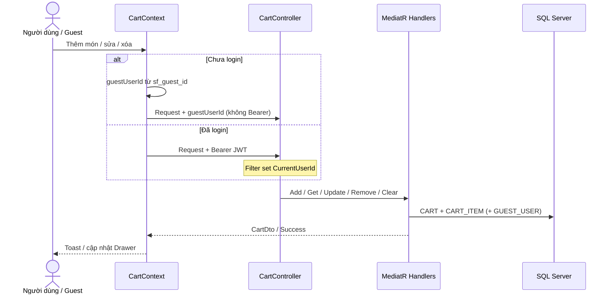

# Tài liệu Quy trình: Giỏ hàng (Cart)

Tài liệu này mô tả chi tiết luồng **thêm / xem / cập nhật / xóa / clear** giỏ hàng trong hệ thống **Shopping Food**, hỗ trợ cả **user đã đăng nhập** và **guest** (`guestUserId` lưu `localStorage` key `sf_guest_id`).

> Guest cart: request **không** gửi header `Authorization` → `AuthenticationFilter` coi là `isGuestCartRequest` và bypass JWT. User đã login: Filter inject `CurrentUserId` vào Command/Query.

---

## 1. Luồng Tổng Quan (Workflow)

1. **Khởi tạo FE:** `CartProvider` mount → `getGuestUserId()` nếu chưa login → `cartService.getCart(guestUserId)` → đồng bộ state + `sf_cart` localStorage.
2. **Thêm món:** UI gọi `addItem` → optimistic update + toast → `POST /api/Cart` (`productId`, `quantity`, optional `guestUserId`, `clearCartIfConflict`).
3. **Backend Add:** Tạo GuestUser nếu cần → GetOrCreate Cart → check quán conflict / stock → thêm hoặc cộng dồn `CartItem` (giá FlashSale nếu có).
4. **Xem giỏ:** `GET /api/Cart?guestUserId=` → sync giá flash sale → trả `CartDto`.
5. **Đổi số lượng:** `PUT /api/Cart` — quantity ≤ 0 thì xóa item.
6. **Xóa món:** `DELETE /api/Cart?productId=&guestUserId=`.
7. **Xóa hết:** `DELETE /api/Cart/clear?guestUserId=` (ConfirmModal trên Drawer).
8. **Ràng buộc quán:** Một cart chỉ 1 `RestaurantId`; khác quán → HTTP **409** (FE có thể gửi `clearCartIfConflict: true`).



---

## Bước 1: Quản lý Guest ID & State (Frontend)

**Files:**
- `ShoppingFood.FE/src/contexts/CartContext.tsx`
- `ShoppingFood.FE/src/services/CartService.ts`
- `ShoppingFood.FE/src/hooks/useCart.ts` (wrapper)
- UI Drawer: `ShoppingFood.FE/src/components/layout/ShoppingDrawer.tsx`

```typescript
const GUEST_ID_KEY = 'sf_guest_id';

const getGuestUserId = useCallback(() => {
  if (isAuthenticated) return undefined;
  let guestId = localStorage.getItem(GUEST_ID_KEY);
  if (!guestId) {
    guestId = crypto.randomUUID();
    localStorage.setItem(GUEST_ID_KEY, guestId);
  }
  return guestId;
}, [isAuthenticated]);
```

**Service:**

```typescript
async addToCart(data: IAddToCartRequest) {
  return httpClient.post(API_ENDPOINTS.CART.BASE, data);
}
async getCart(guestUserId?: string) {
  return httpClient.get(API_ENDPOINTS.CART.BASE, {
    params: guestUserId ? { guestUserId } : {},
  });
}
async updateQuantity(data) { return httpClient.put(..., data); }
async removeCartItem(params) { return httpClient.delete(..., { params }); }
async clearCart(params) { return httpClient.delete(API_ENDPOINTS.CART.CLEAR, { params }); }
```

---

## Bước 2: Controller API

**File:** `src/ShoppingFood.API/Controllers/CartController.cs`  
**Base route:** `api/Cart` (qua `CommonController`)

| Method | Route | Command/Query | Việc |
|--------|-------|---------------|------|
| POST | `/api/Cart` | `AddToCartCommand` | Thêm / cộng dồn |
| GET | `/api/Cart` | `GetCartQuery` | Lấy giỏ |
| PUT | `/api/Cart` | `UpdateCartItemQuantityCommand` | Đổi SL |
| DELETE | `/api/Cart` | `RemoveCartItemCommand` (query) | Xóa 1 món |
| DELETE | `/api/Cart/clear` | `ClearCartCommand` (query) | Xóa hết |

```csharp
[HttpPost]
public async Task<IActionResult> AddToCart([FromBody] AddToCartCommand command)
{
    var response = await _mediator.Send(command);
    return Ok(response);
}

[HttpGet]
public async Task<IActionResult> GetCart([FromQuery] GetCartQuery query) { ... }

[HttpPut]
public async Task<IActionResult> UpdateQuantity([FromBody] UpdateCartItemQuantityCommand command) { ... }

[HttpDelete]
public async Task<IActionResult> RemoveCartItem([FromQuery] RemoveCartItemCommand command) { ... }

[HttpDelete("clear")]
public async Task<IActionResult> ClearCart([FromQuery] ClearCartCommand command) { ... }
```

---

## Bước 3: Thêm vào giỏ (AddToCart)

**Thông tin:**
- **URL:** `/api/Cart`
- **HTTP Method:** POST
- **Auth:** JWT **hoặc** Guest (không Authorization)

**Command:** `src/ShoppingFood.Application/Features/Carts/Commands/AddToCartCommand.cs`

```csharp
public class AddToCartCommand : BaseCommand, IRequest<ApiResponse>
{
    public Guid ProductId { get; set; }
    public int Quantity { get; set; }
    public Guid? GuestUserId { get; set; }
    public bool ClearCartIfConflict { get; set; } = false;
}
```

**Handler:** `AddToCartHandler.cs`

```csharp
// Nếu không có CurrentUserId và GuestUserId → tự tạo Guid mới làm guest
var product = await _productRepository.GetByIdAsync(request.ProductId);
if (product == null || product.Status != ProductStatus.Approved || product.IsHidden)
    return ApiResponse.Failure(404, "Product not found or unavailable.");
if (product.StockStatus != StockStatus.InStock)
    return ApiResponse.Failure(400, "Product is out of stock.");

var cart = await GetOrCreateCartAsync(request.CurrentUserId, guestUserId);
// Conflict khác RestaurantId → 409 hoặc clear nếu ClearCartIfConflict
await AddOrUpdateCartItemAsync(cart.Id, product, request.Quantity);
// PriceAtAdded = FlashSale price ?? product.Price
return ApiResponse.Success(dto, "Added item to cart successfully");
```

**Tạo GuestUser** (khi guest chưa có trong DB):

```csharp
var guestUser = new GuestUser
{
    Id = guestUserId.Value,
    FullName = "Guest Customer",
    Phone = string.Empty,
    DeliveryAddress = string.Empty,
    IpAddress = GetClientIpAddress()
};
```

**Inject CurrentUserId:** `AuthenticationFilter` Lines ~215–224 — nếu có JWT hợp lệ:

```csharp
command.CurrentUserId = user.Id;
```

**Guest bypass:** `AuthenticationFilter` — `isGuestCartRequest` khi path `/api/Cart` và **không** có header Authorization (Lines 98–108).

---

## Bước 4: Lấy giỏ (GetCart)

**Thông tin:**
- **URL:** `/api/Cart?guestUserId={guid}` (guest) hoặc Bearer (user)
- **HTTP Method:** GET

**Query:** `GetCartQuery.cs` — `GuestUserId`

**Handler:** `GetCartHandler.cs`

```csharp
if (!request.CurrentUserId.HasValue && !request.GuestUserId.HasValue)
    return ApiResponse.Failure(401, "Unauthorized. Neither logged-in user nor guest ID was provided.");

// Load cart by UserAccountId OR GuestUserId
await _flashSalePricingService.SyncCartItemPricesAsync(cart);
return ApiResponse.Success(dto, "Get cart details successfully");
// Cart null → empty CartDto
```

---

## Bước 5: Cập nhật số lượng (Update)

**Thông tin:**
- **URL:** `/api/Cart`
- **HTTP Method:** PUT
- **Body:** `{ productId, quantity, guestUserId? }`

**Handler:** `UpdateCartItemQuantityHandler.cs`

```csharp
if (request.Quantity <= 0)
    _cartItemRepository.Delete(cartItem);
else
{
    cartItem.Quantity = request.Quantity;
    // cập nhật PriceAtAdded theo flash sale nếu có
}
```

**FE:** `CartContext.updateQuantity` — nếu `quantity <= 0` gọi `removeItem`.

---

## Bước 6: Xóa món / Clear

### Remove một món

- **URL:** `DELETE /api/Cart?productId=...&guestUserId=...`
- **Handler:** `RemoveCartItemCommandHandler.cs` — 401 nếu thiếu user/guest; 404 nếu không có cart/item.

### Clear toàn bộ

- **URL:** `DELETE /api/Cart/clear?guestUserId=...`
- **Handler:** `ClearCartCommandHandler.cs` — xóa tất cả `CartItem` của cart.
- **FE Confirm:** `ConfirmModal` trong `ShoppingDrawer.tsx` trước khi `clearCart()`.

---

## Database liên quan

| Bảng | Việc |
|------|------|
| `GUEST_USER` | Tạo khi guest thêm món lần đầu |
| `CART` | 1-1 với User **hoặc** Guest (`UserAccountId` / `GuestUserId`) |
| `CART_ITEM` | ProductId, Quantity, PriceAtAdded |
| `PRODUCT` | Check Approved, !Hidden, InStock, RestaurantId |

---

## Sơ đồ file đi qua (Call chain)

```text
ProductCard / ProductDetail / ShoppingDrawer
  ↓
CartContext.addItem | updateQuantity | removeItem | clearCart | fetchCart
  ↓
CartService.ts → HttpClient
  ↓
AuthenticationFilter  (guest bypass HOẶC JWT → CurrentUserId)
  ↓
CartController
  ↓
AddToCartHandler / GetCartHandler / UpdateCartItemQuantityHandler
RemoveCartItemCommandHandler / ClearCartCommandHandler
  ↓
ICartRepository + ICartItemRepository + ShoppingFoodContext
  ↓
CART / CART_ITEM / GUEST_USER
```

| Vai trò | Đường dẫn đầy đủ |
|---------|------------------|
| Context FE | `ShoppingFood.FE/src/contexts/CartContext.tsx` |
| Service FE | `ShoppingFood.FE/src/services/CartService.ts` |
| Drawer UI | `ShoppingFood.FE/src/components/layout/ShoppingDrawer.tsx` |
| Controller | `src/ShoppingFood.API/Controllers/CartController.cs` |
| Add Handler | `src/ShoppingFood.Application/Features/Carts/Commands/AddToCartHandler.cs` |
| Get Handler | `src/ShoppingFood.Application/Features/Carts/Queries/GetCartHandler.cs` |
| Update / Remove / Clear | `.../UpdateCartItemQuantityHandler.cs`, `RemoveCartItemCommandHandler.cs`, `ClearCartCommandHandler.cs` |
| Guest auth rule | `src/ShoppingFood.API/Filters/AuthenticationFilter.cs` |

---

## Các thông báo (Toast / Message)

| Message | Nơi | Trigger |
|---------|-----|---------|
| `Đã thêm vào giỏ: {itemName}` | `CartContext.addItem` | Thêm mới |
| `Đã cập nhật số lượng: {itemName}` | `CartContext.addItem` | Đã có sẵn trong state |
| `Lỗi khi thêm vào giỏ hàng trên server` | catch addItem | API fail |
| `Lỗi khi xóa món trên server` | removeItem | API fail |
| `Lỗi cập nhật số lượng trên server` | updateQuantity | API fail |
| `Product not found or unavailable.` | API | SP không hợp lệ |
| `Product is out of stock.` | API | Hết hàng |
| `The item you selected is not from the same store...` (409) | API | Conflict quán |
| `Unauthorized. Neither logged-in user nor guest ID was provided.` | API | Thiếu cả 2 id |
| `Cart is empty.` / `Get cart details successfully` | API Get | — |
| `Added item to cart successfully` | API Add | — |

---

## Các cơ chế bảo mật / nghiệp vụ quan trọng

1. **Guest không cần JWT** nhưng **bắt buộc** `guestUserId` (FE luôn tạo UUID).
2. **Không trộn Authorization giả** với guest path nếu muốn đi bypass guest — có Bearer thì Filter cố map user.
3. **Một cart = một nhà hàng** — 409 khi conflict (trừ khi `clearCartIfConflict`).
4. **Chỉ SP Approved, không ẩn, còn hàng** mới thêm được.
5. **Giá lúc thêm** lấy FlashSale active nếu có (`IFlashSalePricingService`).
6. GetCart **IgnoreQueryFilters** trên items để vẫn thấy SP soft-deleted (flag `isProductDeleted` phía DTO/FE).

---

## Checklist tự test

- [ ] Chưa login: thêm món → có `sf_guest_id` → F5 vẫn còn giỏ (API)
- [ ] Thêm 2 món cùng quán → cộng dồn / nhiều dòng OK
- [ ] Thêm món quán khác → 409 (hoặc clear nếu FE gửi flag)
- [ ] Đổi SL / xóa món / clear (có Confirm) hoạt động
- [ ] Login sau khi có guest cart: kiểm tra hành vi (cart user riêng theo `UserAccountId` — **không tự merge** trong code hiện tại)
- [ ] SP OutOfStock / Hidden → không thêm được
- [ ] Có Bearer hợp lệ → `CurrentUserId` được set, không cần guestUserId

---

## Tóm tắt

Cart Shopping Food = **REST `/api/Cart`** + **CartContext** với **guest UUID** hoặc **JWT user**. Backend đảm bảo 1 quán/cart, stock, flash price; Filter cho phép guest thao tác khi không gửi Authorization.

> Liên kết: [Login_Workflow.md](./Login_Workflow.md) · [Payment_Requirements.md](./Payment_Requirements.md) · [Checkout / Payment workflows](./Payment_Checkout_Workflow.md) · [INDEX](../ONBOARDING_INDEX.md)
