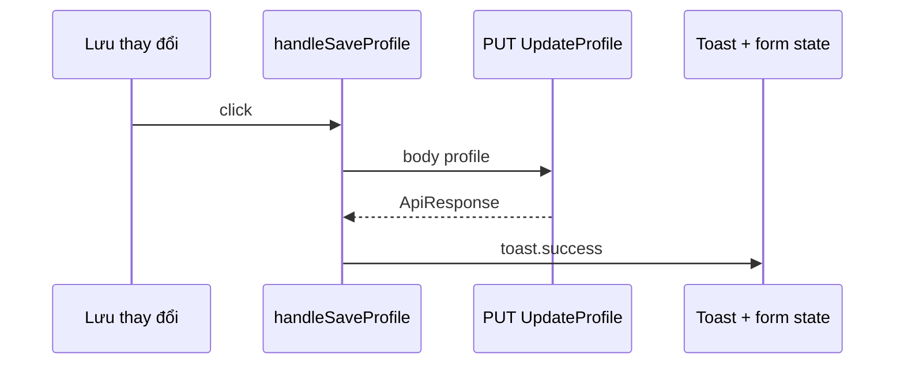
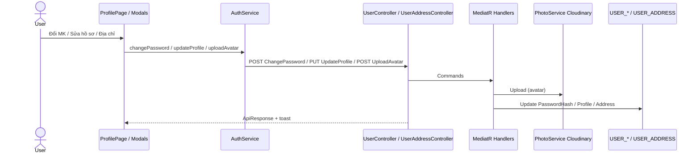

# Tài liệu Quy trình: Đổi mật khẩu, Hồ sơ & Địa chỉ (Profile)

Tài liệu mô tả **ChangePassword**, **UpdateProfile**, **UploadAvatar**, **UserAddress CRUD**, **Lock/Unlock Account**, **RequestDeletion** — cùng style workflow, gọn nhưng đủ call chain.

---


---

## Phần A — UI Interaction Trace (Nút bấm → Code → Data → Hiển thị)

> UI Trace — Profile  
> Mỗi thao tác trả lời: **nút ở đâu** · **bấm chạy file/hàm nào** · **API/BE đâu** · **data trả về** · **hiển thị thế nào**.


---

### UT-PRF-01 — Lưu hồ sơ (`"Lưu thay đổi"`)

#### 1. Giao diện nút bấm ở đâu?

| Mục | Giá trị |
|-----|---------|
| **Route** | `/profile` |
| **Page** | `pages/ProfilePage.tsx` |
| **Nhãn nút** | Lưu profile (Button cạnh `"Đổi mật khẩu"`) |
| **Loại** | `onClick={handleSaveProfile}` |

#### 2. Frontend

```text
handleSaveProfile
  → validate fullName không rỗng
  → authService.updateProfile({ fullName, gender, dateOfBirth, avatarUrl? })
  → httpClient.put('/User/UpdateProfile', data)
```

#### 3. Backend

```text
PUT /api/User/UpdateProfile (Auth)
  → UserController.UpdateProfile
  → UpdateProfileCommand / Handler
  → cập nhật USER_PROFILE
```

#### 4. Response

```json
{ "code": 200, "error": false, "message": "Cập nhật thông tin thành công!", "data": null }
```

#### 5. Hiển thị

| Success | `toast.success(...)` + có thể refresh profile state |
| Empty name | `toast.error('Vui lòng nhập họ tên')` — không gọi API |
| Network | `toast.error('Lưu thông tin cá nhân thất bại...')` |

---

### UT-PRF-02 — Upload avatar (click vùng ảnh)

#### 1. Giao diện

| Mục | Giá trị |
|-----|---------|
| **Component** | `ProfilePage.tsx` — click avatar → `fileInputRef.click()` |
| **Input ẩn** | `<input type="file" onChange={handleFileChange} accept="image/*">` |

#### 2. Frontend

```text
handleFileChange
  → validate size ≤5MB, ext jpg/jpeg/png/webp
  → toast.loading('Đang tải ảnh lên...')
  → authService.uploadAvatar(file)  // FormData
  → POST /User/UploadAvatar
  → (thường kèm update profile avatarUrl)
```

#### 3. Backend

```text
POST /api/User/UploadAvatar
  → PhotoService (Cloudinary) → lưu URL vào Profile
```

#### 4–5. Hiển thị

| Success | `toast.success('Cập nhật ảnh đại diện thành công!', { id: toastId })` + cập nhật `user.avatarUrl` trên UI |
| >5MB / sai type | toast error, không upload |
| Fail | toast error với cùng `toastId` |

---

### UT-PRF-03 — Đổi mật khẩu (Modal)

#### 1. Giao diện

| Mục | Giá trị |
|-----|---------|
| **Mở modal** | Button `"Đổi mật khẩu"` → `setIsChangePasswordOpen(true)` |
| **Component** | `components/auth/ChangePasswordModal.tsx` |
| **Nhãn submit** | Đổi / Cập nhật mật khẩu |

#### 2. Frontend

```text
ChangePasswordModal submit
  → validate old/new/confirm
  → authService.changePassword({ oldPassword, newPassword })
  → POST /User/ChangePassword
```

#### 3. Backend

```text
ChangePasswordHandler
  → so khớp hash MK cũ → SHA256 hash MK mới → USER_ACCOUNT.PasswordHash
```

#### 4–5. Hiển thị

| Success | toast thành công + đóng modal |
| Sai MK cũ | toast `Mật khẩu cũ không chính xác.` |
| Validation | lỗi inline trên Input |

---

### UT-PRF-04 — Đổi email/SĐT (ChangeContactModal)

#### 1. Giao diện

| Mục | Giá trị |
|-----|---------|
| **Mở** | link `"Thay đổi"` cạnh email trên ProfilePage → `setIsChangeContactOpen(true)` |
| **Component** | `ChangeContactModal.tsx` — 2 bước OTP |

#### 2–3. Flow

```text
Request OTP → POST /User/RequestUpdateContact
Verify OTP  → POST /User/VerifyUpdateContact
  → Handler cập nhật Email/Phone sau khi OTP hợp lệ
```

#### 5. Hiển thị

Toast OTP đã gửi / xác thực thành công; lỗi OTP hết hạn.

---

### UT-PRF-05 — Địa chỉ CRUD (`UserAddressManager`)

#### 1. Giao diện

| Mục | Giá trị |
|-----|---------|
| **Tab** | Profile `activeTab === 'address'` |
| **Component** | `components/profile/UserAddressManager.tsx` |
| **Nút** | Thêm / Sửa / Xóa / Đặt mặc định |

#### 2. Frontend → API

```text
add     → userAddressService.addAddress → POST /UserAddress
update  → PUT /UserAddress/{id}
delete  → DELETE /UserAddress/{id}
default → PUT /UserAddress/{id}/SetDefault
list    → GET /UserAddress (load tab)
```

#### 5. Hiển thị

Toast success từng thao tác; validation `Vui lòng nhập tên người nhận / SĐT / địa chỉ`; list re-render từ state sau API.

---

### UT-PRF-06 — Khóa tài khoản

#### 1. Giao diện

| Mục | Giá trị |
|-----|---------|
| **Nút** | Mở modal khóa → Confirm `"Khóa"` `onClick={handleLockAccount}` |
| **Page** | `ProfilePage.tsx` |

#### 2–3.

```text
handleLockAccount → authService.lockAccount → POST /User/LockAccount
  → User.Status = Locked/Inactive (theo handler)
```

#### 5. Hiển thị

`toast.success('Tài khoản đã bị khóa.')` → `navigate(LOGIN)` + clear session (logout flow).

---

### UT-PRF-07 — Yêu cầu xóa tài khoản

#### 1. Giao diện

Confirm modal xóa → `handleRequestDeletion`

#### 2–3.

```text
POST /User/RequestDeletion (Auth, có [Authorize])
  → ghi DeleteRequestedAt
```

#### 5. Hiển thị

toast `Đã gửi yêu cầu xóa tài khoản.` → `navigate(LOGIN)`.

---

### UT-PRF-08 — Xem / cập nhật hồ sơ đăng ký (Applications)

#### 1. Giao diện

Tab/component `CustomerApplications.tsx` trên Profile — nút gửi lại đơn khi NeedsInfo.

#### 2–3.

```text
GET /User/my-applications
PUT /User/SellerApplication hoặc update-shipper-application
```

#### 5. Hiển thị

toast cập nhật thành công; status Pending/Approved/Rejected hiển thị trên card.

---

## Sơ đồ Profile save




---

## Phần B — Workflow nghiệp vụ & Backend (chi tiết luồng)
## 1. Luồng Tổng Quan (Workflow)

1. User vào `/profile` (hoặc dashboard profile) → xem `GET /api/User/Profile`.
2. **Đổi MK:** Modal → `POST /api/User/ChangePassword` (cần JWT + old/new password).
3. **Sửa hồ sơ:** `PUT /api/User/UpdateProfile`; avatar `POST /api/User/UploadAvatar` (Cloudinary).
4. **Địa chỉ:** CRUD `api/UserAddress` + `SetDefault`.
5. **Khóa TK:** `POST /api/User/LockAccount` → login sau cần OTP unlock `VerifyUnlockAccount`.
6. **Xin xóa:** `POST /api/User/RequestDeletion` → ghi `DeleteRequestedAt`.



---

## Bước 1: Change Password

**Thông tin:**
- **FE:** `ChangePasswordModal.tsx`, Profile
- **API:** `POST /api/User/ChangePassword`
- **Auth:** Bắt buộc login
- **Body:** `{ oldPassword, newPassword }`

**Controller** — `UserController.cs`:

```csharp
[HttpPost("ChangePassword")]
public async Task<ActionResult<ApiResponse>> ChangePassword([FromBody] ChangePasswordCommand command)
{
    if (userDto == null)
        return Unauthorized(ApiResponse.Failure(401, "Vui lòng đăng nhập để thực hiện chức năng này."));
    command.CurrentUserId = userDto.Id;
    // mediator.Send...
}
```

**FE:**

```typescript
async changePassword(data: { oldPassword: string; newPassword: string }) {
  return httpClient.post('/User/ChangePassword', data);
}
```

**Handler:** `Features/Users/Commands/ChangePassword*` — verify hash cũ (SHA256), set hash mới.

---

## Bước 2: Update Profile & Avatar

| Method | Route | Việc |
|--------|-------|------|
| GET | `/api/User/Profile` | Lấy hồ sơ |
| PUT | `/api/User/UpdateProfile` | fullName, gender, DOB, avatarUrl… |
| POST | `/api/User/UploadAvatar` | multipart → Cloudinary URL |
| POST | `/api/User/RequestUpdateContact` | OTP đổi email/phone |
| POST | `/api/User/VerifyUpdateContact` | Xác nhận OTP contact |

**FE:** `UpdateProfileModal.tsx`, `ChangeContactModal.tsx`, `AuthService.updateProfile` / `uploadAvatar`.

```typescript
async updateProfile(data: { fullName?: string; avatarUrl?: string; gender?: string; dateOfBirth?: string }) {
  return httpClient.put('/User/UpdateProfile', data);
}
async uploadAvatar(file: File) { ... FormData ... }
```

**Service BE:** `PhotoService` (Cloudinary).  
**DB:** `USER_PROFILE`.

---

## Bước 3: User Address CRUD

**Controller:** `UserAddressController.cs`  
**FE:** `UserAddressManager.tsx`, `UserAddressService.ts`

| Method | Route | Việc |
|--------|-------|------|
| GET | `/api/UserAddress` | List |
| POST | `/api/UserAddress` | Thêm |
| PUT | `/api/UserAddress/{id}` | Sửa |
| DELETE | `/api/UserAddress/{id}` | Xóa |
| PUT | `/api/UserAddress/{id}/SetDefault` | Đặt mặc định |

```typescript
async getAddresses() { ... }
async addAddress(data: IAddUserAddress) { ... }
async update(id, data) { ... }
```

**DB:** `USER_ADDRESS` (FK UserAccountId). Dùng ở Checkout chọn địa chỉ giao.

---

## Bước 4: Lock / Unlock Account

| Method | Route | Auth | Việc |
|--------|-------|------|------|
| POST | `/api/User/LockAccount` | Auth | User tự khóa |
| POST | `/api/User/VerifyUnlockAccount` | Public | OTP + PreAuth mở khóa |

**FE:** Profile actions + flow OTP tương tự login 2FA (`verifyUnlockAccount`).

```typescript
async lockAccount() { return httpClient.post('/User/LockAccount'); }
async verifyUnlockAccount(data: { preAuthToken: string; otpCode: string }) { ... }
```

**DB:** `USER_ACCOUNT.Status` (Blocked/Inactive…), `OTP_RECORD` khi unlock.

---

## Bước 5: Request Deletion

**API:** `POST /api/User/RequestDeletion`  
**Auth:** Có `[Authorize]` trên action + JWT filter  
**FE:** Profile → `authService.requestDeletion()`

Ghi nhận `User.DeleteRequestedAt` — quy trình xóa thật có thể là batch/admin (xem handler).

---

## Call chain

```text
ProfilePage / ChangePasswordModal / UpdateProfileModal / UserAddressManager
  ↓
AuthService / UserAddressService
  ↓
UserController / UserAddressController
  ↓
ChangePasswordHandler / UpdateProfileHandler / UploadAvatarHandler / UserAddresses/*
  ↓
PhotoService (Cloudinary) / ShoppingFoodContext
  ↓
USER_ACCOUNT / USER_PROFILE / USER_ADDRESS / OTP_RECORD
```

| File | Vai trò |
|------|---------|
| `API/Controllers/UserController.cs` | Profile, password, lock, deletion |
| `API/Controllers/UserAddressController.cs` | Addresses |
| `FE/components/auth/ChangePasswordModal.tsx` | UI đổi MK |
| `FE/components/auth/UpdateProfileModal.tsx` | UI hồ sơ |
| `FE/components/profile/UserAddressManager.tsx` | Địa chỉ |
| `Application/Services/PhotoService.cs` | Upload |
| `Domain/Models/User.cs`, `UserProfile.cs`, `UserAddress.cs` | Entities |

---

## Toast / Message

| Message | Nơi | Trigger |
|---------|-----|---------|
| Đổi mật khẩu thành công / sai MK cũ | ChangePasswordModal | ChangePassword |
| Cập nhật hồ sơ OK | UpdateProfileModal | UpdateProfile |
| Upload avatar OK/fail | Profile | UploadAvatar |
| CRUD địa chỉ | UserAddressManager | UserAddress APIs |
| Khóa / mở khóa | Profile / Login unlock | Lock / VerifyUnlock |
| Xin xóa tài khoản | Profile | RequestDeletion |

---

## Bảo mật

1. ChangePassword bắt buộc JWT + đúng mật khẩu cũ.
2. Password hash SHA256 Base64 (đồng bộ Login).
3. UploadAvatar chỉ user hiện tại; Cloudinary URL lưu Profile.
4. LockAccount không cho dùng TK đến khi OTP unlock.
5. RequestDeletion cần authenticated; không xóa cứng ngay trên API này.

---

## Checklist

- [ ] ChangePassword: sai old → lỗi; đúng → login lại bằng MK mới
- [ ] UpdateProfile + UploadAvatar hiển thị avatar mới
- [ ] Address CRUD + SetDefault; Checkout chọn được default
- [ ] Lock → login bị chặn/OTP unlock
- [ ] RequestDeletion set DeleteRequestedAt

---

## Tóm tắt

Profile hub = **mật khẩu + hồ sơ + avatar + địa chỉ + khóa/xóa TK**. Entry chính: `UserController` + `UserAddressController`.

> [Login_Workflow.md](./Login_Workflow.md) · [ForgotPassword_Workflow.md](./ForgotPassword_Workflow.md) · [README](./README.md)
