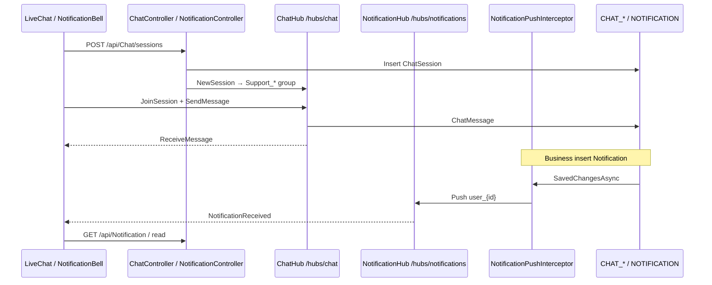

# Tài liệu Quy trình: Chat & Notification (Realtime)

Tài liệu mô tả **Chat REST + SignalR ChatHub** và **Notification REST + NotificationHub + EF Interceptor + NotificationBell**.

---

## 1. Luồng Tổng Quan (Workflow)

### Chat

1. User/Seller mở chat → REST tạo session (`POST /api/Chat/sessions` hoặc `/sessions/order/{orderId}`).
2. Controller broadcast `NewSession` tới group `Support_Admin` hoặc `Support_Coordinator` (theo topic).
3. Client kết nối hub `/hubs/chat` → `JoinSession` / `JoinSellerInbox` / `JoinAdminGroup`…
4. Gửi tin: Hub `SendMessage` → lưu `CHAT_MESSAGE` → `ReceiveMessage` tới group; blacklist filter nội dung.
5. Agent `POST /sessions/{id}/claim` nhận phiên.

### Notification

1. Handler/business insert entity `Notification`.
2. `SaveChanges` → `NotificationPushInterceptor` → `INotificationPushService` → Hub group `user_{id}`.
3. FE `NotificationRealtimeService` nhận `NotificationReceived` → `NotificationBell` toast 🔔 + cập nhật list.
4. Đọc: `GET /api/Notification`, `POST /{id}/read`, `POST /read-all`.



---

## Bước 1: Chat REST

**Controller:** `src/ShoppingFood.API/Controllers/ChatController.cs`  
**FE:** `ChatService.ts`, `LiveChatWidget.tsx`, `SupportChatDashboard.tsx`, `OrderSellerChatModal.tsx`, `SellerChatPage.tsx`, Admin/Coordinator chat pages.

| Method | Route | Việc |
|--------|-------|------|
| POST | `/api/Chat/sessions` | Mở session support |
| POST | `/api/Chat/sessions/order/{orderId}` | Chat theo đơn |
| GET | `/api/Chat/sessions/seller/orders` | Inbox seller |
| GET | `/api/Chat/sessions` | List (agent) |
| GET | `/api/Chat/sessions/current` | Session hiện tại |
| GET | `/api/Chat/sessions/my` | Sessions của user |
| GET | `/api/Chat/sessions/{sessionId}/messages` | Lịch sử |
| POST | `/api/Chat/sessions/{sessionId}/claim` | Agent claim |

**Tạo session + SignalR notify:**

```csharp
[HttpPost("sessions")]
public async Task<ActionResult<ApiResponse>> CreateSession([FromBody] CreateChatSessionCommand command)
{
    if (userDto != null) command.CurrentUserId = userDto.Id;
    var response = await _mediator.Send(command);

    if (!response.Error && response.Data != null)
    {
        var data = Newtonsoft.Json.Linq.JObject.FromObject(response.Data);
        var topicStr = data["topic"]?.ToString();
        var supportGroup = (topicStr == "SystemIssue" || topicStr == "General")
            ? "Support_Admin"
            : "Support_Coordinator";
        await _hubContext.Clients.Group(supportGroup).SendAsync("NewSession", response.Data);
    }
    return StatusCode(response.Code, response);
}
```

**FE:**

```typescript
async createSession(data: ICreateChatSessionRequest) { ... }
async createOrderSession(orderId: string) { ... }
async getHistory(sessionId: string) { ... }
```

**DB:** `CHAT_SESSION`, `CHAT_MESSAGE`.  
**Enums:** `ChatTopic` (OrderIssue, OrderCancellation, SystemIssue, General), `ChatSessionStatus` Open/Closed.

---

## Bước 2: ChatHub (SignalR)

**Path:** `/hubs/chat` (map trong `Program.cs`)  
**File:** `src/ShoppingFood.API/Hubs/ChatHub.cs`

| Invoke | Việc |
|--------|------|
| `JoinSession(sessionId)` | Vào group session |
| `LeaveSession` | Rời group |
| `JoinCoordinatorGroup` | Group `Support_Coordinator` |
| `JoinAdminGroup` | Group `Support_Admin` |
| `JoinSellerInbox(restaurantId)` | Group `seller_{restaurantId}` |
| `SendMessage(sessionId, senderId, senderRole, content)` | Lưu message + broadcast |
| Claim / Close (nếu có trên hub) | Đóng/nhận phiên realtime |

```csharp
public async Task JoinSession(string sessionId)
{
    await Groups.AddToGroupAsync(Context.ConnectionId, sessionId);
}

public async Task SendMessage(string sessionId, string senderId, string senderRole, string content)
{
    // validate Guid, blacklist filter, insert ChatMessage, Clients.Group.SendAsync("ReceiveMessage", ...)
}
```

**FE client:** `ChatService.ts` dùng `@microsoft/signalr` → events `ReceiveMessage`, `NewSession`, `SupportJoined`, `SessionClosed`, `OrderChatMessage`.

**Bảo mật chat:** `BlacklistFilterService` lọc từ khóa khi gửi tin.

---

## Bước 3: Notification REST

**Controller:** `NotificationController.cs`

```csharp
[HttpGet]
public async Task<IActionResult> GetNotifications()
{
    var query = new GetNotificationsQuery();
    query.CurrentUserId = userDto?.Id;
    var response = await _mediator.Send(query);
    return Ok(response);
}

[HttpPost("{id}/read")]
public async Task<IActionResult> MarkAsRead(Guid id) { ... }

[HttpPost("read-all")]
public async Task<IActionResult> MarkAllAsRead() { ... }
```

**FE:** `NotificationService.ts` — getAll / mark read / read-all.  
**Admin broadcast:** `POST /api/Admin/notifications/broadcast`.

---

## Bước 4: NotificationHub + Interceptor

**Hub:** `/hubs/notifications` — `NotificationHub.cs`

```csharp
public async Task JoinUser(string userId)
{
    if (Guid.TryParse(userId, out _))
        await Groups.AddToGroupAsync(Context.ConnectionId, $"user_{userId}");
}
```

**Interceptor:** `Repository/Interceptors/NotificationPushInterceptor.cs`

- Bắt entities `Notification` Added trong `SavingChangesAsync`
- Sau `SavedChangesAsync` → resolve `INotificationPushService` → push tới group user

**Push service:** `API/Services/NotificationPushService.cs` → `Clients.Group($"user_{id}").SendAsync("NotificationReceived", ...)`.

**FE:**  
- `NotificationRealtimeService.ts` — start connection, JoinUser  
- `NotificationBell.tsx` — `toast(n.title, { icon: '🔔' })`, dropdown, mark read  
- Custom event `ON_REALTIME_NOTIFICATION` để Cart/Order/Applications refresh

---

## Call chain

```text
LiveChatWidget / SupportChatDashboard / NotificationBell
  ↓
ChatService (REST + Hub) / NotificationService + NotificationRealtimeService
  ↓
ChatController + ChatHub | NotificationController + NotificationHub
  ↓
Features/Chat | Features/Notifications | Insert Notification anywhere
  ↓
NotificationPushInterceptor → NotificationPushService
  ↓
CHAT_SESSION / CHAT_MESSAGE / NOTIFICATION
```

| File | Vai trò |
|------|---------|
| `API/Controllers/ChatController.cs` | REST chat |
| `API/Hubs/ChatHub.cs` | Realtime chat |
| `API/Controllers/NotificationController.cs` | Inbox REST |
| `API/Hubs/NotificationHub.cs` | Realtime noti |
| `Repository/Interceptors/NotificationPushInterceptor.cs` | Auto-push |
| `FE/components/layout/NotificationBell.tsx` | UI + toast |
| `FE/services/ChatService.ts` | Client chat |

---

## Toast / Message

| Message | Nơi | Trigger |
|---------|-----|---------|
| toast(title, 🔔) | NotificationBell | SignalR NotificationReceived |
| Đã đọc toàn bộ thông báo | NotificationBell | read-all OK |
| Lỗi gửi tin / session | LiveChat / OrderSellerChat | Hub/REST fail |
| Broadcast Admin | AdminNotificationsPage | broadcast API |

---

## Bảo mật

1. Chat/Notification REST cần JWT (trừ khi seeder để public — mặc định Auth).
2. Hub nên truyền access token (FE SignalR options).
3. Blacklist keyword trên nội dung chat.
4. Chỉ join group user của chính mình (JoinUser với userId hiện tại).
5. Claim session chỉ role support/admin/coordinator (RBAC + handler).

---

## Checklist

- [ ] Tạo session → agent nhận NewSession
- [ ] JoinSession + SendMessage 2 phía thấy ReceiveMessage
- [ ] Order chat seller inbox
- [ ] Insert Notification → Bell toast không cần F5
- [ ] Mark read / read-all cập nhật UI
- [ ] Blacklist chặn từ cấm trong chat

---

## Tóm tắt

Chat = **REST session + Hub message**. Notification = **DB insert → Interceptor → Hub → Bell**. Hai hub: `/hubs/chat`, `/hubs/notifications`.

> [Support_Admin_Workflow.md](./Support_Admin_Workflow.md) · [README](./README.md)
