# Tài li?u Quy trình: Ð?t hàng & Vòng d?i don (Checkout / Order Lifecycle)

Tài li?u này mô t? chi ti?t lu?ng **d?t hàng** t? trang Checkout d?n `CheckoutHandler`, kèm **OTP guest checkout**, và các hành d?ng vòng d?i don (Seller / Customer).

> **Thanh toán:** Chi ti?t COD / Ví / SePay / session / webhook **không l?p l?i t?i dây**. Ð?c:
> - [Payment_Requirements.md](./Payment_Requirements.md) — yêu c?u nghi?p v? thanh toán
> - [Payment_Checkout_Workflow.md](./Payment_Checkout_Workflow.md) — x? lý thanh toán lúc checkout
> - [Payment_Sepay_Workflow.md](./Payment_Sepay_Workflow.md) — QR / webhook / reconcile (n?u có)

Giao hàng sau `WaitingForShipper`: xem [Shipper_Delivery_Workflow.md](./Shipper_Delivery_Workflow.md) và [Coordinator_Dispatch_Workflow.md](./Coordinator_Dispatch_Workflow.md).

---


---

## Ph?n A — UI Interaction Trace (Nút b?m ? Code ? Data ? Hi?n th?)

> UI Trace — Checkout & Order  
> M?i thao tác tr? l?i: **nút ? dâu** · **b?m ch?y file/hàm nào** · **API/BE dâu** · **data tr? v?** · **hi?n th? th? nào**.


---

## UT-ORD-01 — Load trang Checkout

#### 1. Giao di?n nút b?m ? dâu?

| M?c | Giá tr? |
|-----|---------|
| **Route** | `/checkout?restaurantId={id}` |
| **Page** | `pages/CheckoutPage.tsx` |
| **Component** | Page mount (`useEffect`) — không ph?i nút, là entry |
| **Nhãn** | — |
| **Ði?u ki?n** | Có `items` t? `useCart()`; n?u tr?ng ? toast + v? home |

#### 2. B?m xong ch?y d?n dâu? (Frontend)

```text
CheckoutPage mount
  ? useCart(): items, clearCart
  ? useAuth(): isAuthenticated, user
  ? useEffect: n?u items.length===0 ? toast('Gi? hàng tr?ng...') ? navigate HOME
  ? L?c items theo restaurantId query
  ? paymentService.getPaymentMethods() ? setPaymentMethods
  ? (auth) paymentService.getWallet() ? setWalletBalance
  ? (auth) userAddressService.list ? setSavedAddresses
```

#### 3. Backend ch?y do?n nào?

```text
GET /api/Payment/methods ? GetPaymentMethodsHandler
GET /api/Payment/wallet ? wallet handler
GET /api/UserAddress ? address query
```

#### 4. D? li?u tr? v? ? dâu?

| API | `data` dùng d? |
|-----|----------------|
| methods | Render radio COD / SystemWallet / Sepay / … |
| wallet | Text "S? du ví: …" khi ch?n SystemWallet |
| addresses | `<select>` d?a ch? dã luu |

#### 5. Làm sao hi?n th? ra?

Form step 1: thông tin giao hàng + map + payment methods + summary t?ng ti?n (`finalTotal` useMemo).

#### 6. So d? nhanh

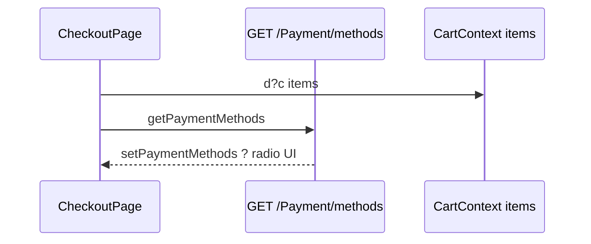

---

## UT-ORD-02 — Nút "Áp d?ng" mã gi?m giá

#### 1. Giao di?n nút b?m ? dâu?

| M?c | Giá tr? |
|-----|---------|
| **Route** | `/checkout` |
| **Page** | `CheckoutPage.tsx` |
| **Nhãn nút** | `"Áp d?ng"` trong modal mã gi?m giá (~807) |
| **Lo?i control** | `<Button onClick={handleApplyCode}>` |
| **Ði?u ki?n** | Modal m?; có `formData.discountCode` |

#### 2. B?m xong ch?y d?n dâu? (Frontend)

```text
handleApplyCode (L262–285)
  ? discountService.applyDiscount({ code, restaurantId, cartAmount: checkoutTotal })
  ? httpClient.post('/Discount/apply', ...)
```

#### 3. Backend ch?y do?n nào?

```text
POST /api/Discount/apply
  ? DiscountController ? ApplyDiscountHandler
  ? Check active/expiry/usage/min order
```

#### 4. D? li?u tr? v? ? dâu?

```json
{
  "error": false,
  "data": {
    "discountId": "...",
    "code": "SALE10",
    "discountAmount": 10000
  }
}
```

#### 5. Làm sao hi?n th? ra?

| Nhánh | Hành vi UI |
|-------|------------|
| OK | `toast.success('Áp d?ng mã gi?m giá thành công')`; `setSelectedDiscount(...)`; dóng modal; `finalTotal` gi?m |
| Fail | `toast.error(res.message \|\| 'Mã gi?m giá không h?p l?')` |
| G? mã | Nút g? ? `toast.success('Ðã g? mã gi?m giá')`; clear selectedDiscount |

#### 6. So d? nhanh

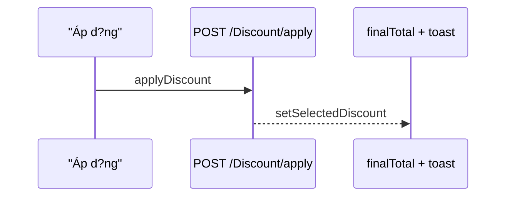

---

## UT-ORD-03 — Nút "V? trí hi?n t?i" (GPS)

#### 1. Giao di?n nút b?m ? dâu?

| M?c | Giá tr? |
|-----|---------|
| **Page** | `CheckoutPage.tsx` map panel (~515–517) |
| **Nhãn nút** | `"V? trí hi?n t?i"` + icon MapPin |
| **Lo?i control** | `<Button type="button" onClick={handleGetLocation}>` |

#### 2. B?m xong ch?y d?n dâu? (Frontend)

```text
handleGetLocation (~330–351)
  ? navigator.geolocation.getCurrentPosition
  ? setFormData({ deliveryLatitude, deliveryLongitude })
  ? fetchAddressFromCoordinates (Nominatim OpenStreetMap — không qua ShoppingFood API)
  ? toast.success('Ðã l?y v? trí hi?n t?i')
```

#### 3. Backend ch?y do?n nào?

Không g?i API UniEats. G?i ngoài: `nominatim.openstreetmap.org/reverse`.

#### 4. D? li?u tr? v? ? dâu?

Nominatim `display_name` ? ghi vào `formData.deliveryAddress`.

#### 5. Làm sao hi?n th? ra?

| Nhánh | Hành vi UI |
|-------|------------|
| OK | Marker map c?p nh?t; ô d?a ch? fill; toast success |
| Deny GPS | `toast.error('Không th? l?y v? trí...')` |
| No API | `toast.error('Trình duy?t... không h? tr? d?nh v?.')` |

#### 6. So d? nhanh

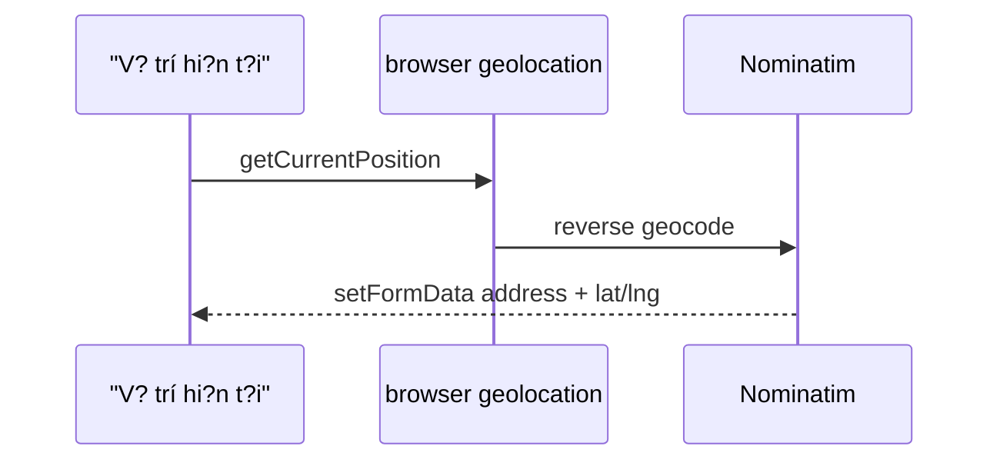

---

## UT-ORD-04 — "Ti?p t?c" / "Ð?t hàng ngay" (step 1)

#### 1. Giao di?n nút b?m ? dâu?

| M?c | Giá tr? |
|-----|---------|
| **Page** | `CheckoutPage.tsx` ~630–634 |
| **Nhãn nút** | Guest: `"Ti?p t?c"` · Auth: `"Ð?t hàng ngay"` |
| **Lo?i control** | `onClick={handleNextStep}` |
| **Ði?u ki?n** | `step === 1` |

#### 2. B?m xong ch?y d?n dâu? (Frontend)

```text
handleNextStep (L233–260)
  ? Validate contactName/phone/deliveryAddress/contactEmail
       fail ? toast.error('Vui lòng di?n d?y d? thông tin giao hàng')
  ? Guest:
       orderService.sendCheckoutOtp({ fullName, phone, email, deliveryAddress, guestUserId })
       ? POST /Order/checkout/sent-otp
       toast.success OTP g?i email ? setStep(2)
  ? Auth:
       handleCheckout()  // UT-ORD-06
```

#### 3. Backend ch?y do?n nào? (Guest)

```text
POST /api/Order/checkout/sent-otp
  ? OrderController.SendCheckoutOtp
  ? SendCheckoutOtpCommand handler
  ? T?o/g?i OTP email (OtpRecord)
```

#### 4. D? li?u tr? v? ? dâu?

Success message OTP dã g?i; error trong `error.response.data.message`.

#### 5. Làm sao hi?n th? ra?

| Nhánh | Hành vi UI |
|-------|------------|
| Guest OK | `setStep(2)` hi?n ô OTP + nút "Xác nh?n Ð?t hàng" |
| Auth | Nh?y th?ng checkout |
| Validate | Toast d?, ? step 1 |

#### 6. So d? nhanh

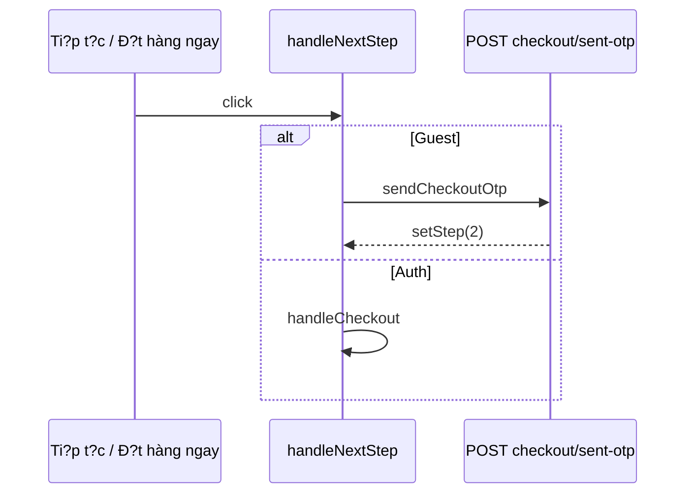

---

## UT-ORD-05 — Guest: "Xác nh?n Ð?t hàng" (nh?p OTP step 2)

#### 1. Giao di?n nút b?m ? dâu?

| M?c | Giá tr? |
|-----|---------|
| **Nhãn nút** | `"Xác nh?n Ð?t hàng"` (~670–674) |
| **Ði?u ki?n** | `step === 2` (guest) |
| **Input kèm** | `otpCode` state |

#### 2. B?m xong ch?y d?n dâu? (Frontend)

```text
onClick={handleCheckout}
  ? if !isAuthenticated && !otpCode ? toast.error('Vui lòng nh?p mã OTP')
  ? ti?p UT-ORD-06
```

#### 3–6. Xem UT-ORD-06

---

## UT-ORD-06 — Ð?t hàng (checkout API) — nhánh COD / Wallet / SePay / stub

#### 1. Giao di?n nút b?m ? dâu?

| M?c | Giá tr? |
|-----|---------|
| **Nhãn** | Auth step1: `"Ð?t hàng ngay"` · Guest step2: `"Xác nh?n Ð?t hàng"` |
| **Hàm** | `handleCheckout` (CheckoutPage L365–417) |

#### 2. B?m xong ch?y d?n dâu? (Frontend)

```text
handleCheckout
  ? setIsSubmitting(true)
  ? orderService.checkout(checkoutPayload)
       payload: formData + otpCode + guestUserId + discountCode + paymentMethod + card/eWallet fields
  ? POST /api/Order/checkout
  ? Ð?c res.data:
       orderId, paymentSessionId
       requiresSepayRedirect, requiresPaymentConfirmation
```

#### 3. Backend ch?y do?n nào?

```text
POST /api/Order/checkout
  ? OrderController.Checkout (L79–85)
  ? CheckoutHandler
       CalculateTotalAmountAsync (ship + shipper income)
       T?o Order + OrderItems
       PaymentSettlementService.ProcessCheckoutPaymentAsync
       Clear cart phía BE (theo handler)
  ? Response flags requiresSepayRedirect / requiresPaymentConfirmation
```

#### 4. D? li?u tr? v? ? dâu?

```json
{
  "error": false,
  "data": {
    "orderId": "guid",
    "paymentSessionId": "guid|null",
    "requiresSepayRedirect": true,
    "requiresPaymentConfirmation": false,
    "totalAmount": 115000,
    "shippingFee": 15000
  }
}
```

(Tên field có th? PascalCase — FE d?c c? hai.)

#### 5. Làm sao hi?n th? ra?

| Nhánh | Hành vi UI |
|-------|------------|
| **SePay** | `setSepaySessionId` + `setIsSepayModalOpen(true)`; toast `"Ðon hàng dã t?o. Quét mã QR..."`; **chua** clearCart / navigate (d?i paid) |
| **requiresConfirm** (Card/EWallet stub) | `paymentService.confirmPayment(sessionId)` r?i clearCart + toast success + navigate `/?track=true&orderId=` |
| **COD / SystemWallet** | `clearCart()`; toast mã don; `navigate(HOME?track=true&orderId=)` |
| **onPaid SePay modal** | `clearCart()`; dóng modal; navigate track (xem CheckoutPage ~861–870) |
| Error | `toast.error(error.response?.data?.message \|\| 'L?i khi d?t hàng')` |

#### 6. So d? nhanh

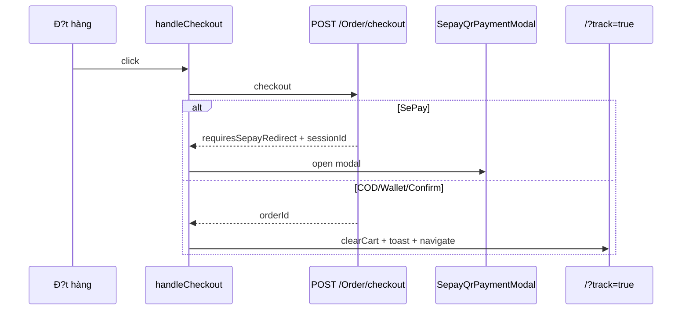

---

## UT-ORD-07 — Customer: H?y don (ConfirmModal)

#### 1. Giao di?n nút b?m ? dâu?

| M?c | Giá tr? |
|-----|---------|
| **Component** | `components/order/CustomerOrderDetailModal.tsx` |
| **M? modal t?** | `ShoppingDrawer` tab Ðon hàng ? click don ? `detailModal` |
| **Nhãn** | Nút h?y ? m? `ConfirmModal` (`cancelConfirmModal`) |
| **Confirm title** | H?y don hàng (ConfirmModal common) |

#### 2. B?m xong ch?y d?n dâu? (Frontend)

```text
confirmCancelOrder (L81–91)
  ? orderService.cancelOrder({ orderId })
  ? PUT /api/Order/cancel
  ? toast.success('H?y don hàng thành công')
  ? setCancelConfirmModal(false)
  ? loadOrderDetails()  // GET details/{id}
```

#### 3. Backend ch?y do?n nào?

```text
PUT /api/Order/cancel
  ? OrderController ? CancelOrderHandler
  ? (Refund ví n?u dã Paid online)
```

#### 4. D? li?u tr? v? ? dâu?

ApiResponse success/error message.

#### 5. Làm sao hi?n th? ra?

| Nhánh | Hành vi UI |
|-------|------------|
| OK | Toast; `setOrderData` status m?i (Cancelled); badge màu d?i |
| Fail | `toast.error(msg)` |
| Realtime | SignalR notification `targetId===orderId` ? `loadOrderDetails` l?i |

#### 6. So d? nhanh

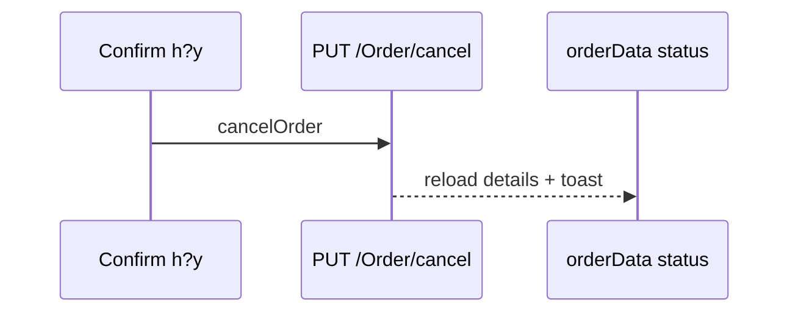

---

## UT-ORD-08 — Customer: Ð?t l?i (Reorder)

#### 1. Giao di?n nút b?m ? dâu?

| M?c | Giá tr? |
|-----|---------|
| **Component** | `CustomerOrderDetailModal.tsx` |
| **Nhãn** | Nút d?t l?i / reorder (g?i `handleReorder`) |
| **Icon** | `RefreshCw` trong imports |

#### 2. B?m xong ch?y d?n dâu? (Frontend)

```text
handleReorder (L93–104)
  ? orderService.reorder({ orderId })
  ? POST /api/Order/reorder
  ? refreshCart()  // CartContext.fetchCart ? GET /Cart
  ? window.dispatchEvent('openCartTab')
  ? toast.success('Ðã thêm l?i các món vào gi? hàng')
  ? onClose()
```

#### 3. Backend ch?y do?n nào?

```text
POST /api/Order/reorder ? ReorderHandler
  (fail n?u không còn món available)
```

#### 4. D? li?u tr? v? ? dâu?

Success ho?c `"None of the items... available for reorder"`.

#### 5. Làm sao hi?n th? ra?

| Nhánh | Hành vi UI |
|-------|------------|
| OK | Modal dóng; Drawer m? tab gi? (`openCartTab` listener trong ShoppingDrawer L112–114); items m?i trong Context |
| Fail | toast.error |

#### 6. So d? nhanh

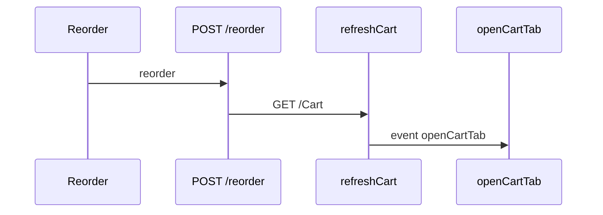

---

## UT-ORD-09 — Seller: Ch?p nh?n don

#### 1. Giao di?n nút b?m ? dâu?

| M?c | Giá tr? |
|-----|---------|
| **Route** | `/seller/orders` |
| **Page** | `pages/seller/SellerOrdersPage.tsx` |
| **Nhãn** | Nút ch?p nh?n (g?i `handleAccept(orderId)`) — status Pending |
| **Loading toast** | `'Ðang ch?p nh?n don hàng...'` |

#### 2. B?m xong ch?y d?n dâu? (Frontend)

```text
handleAccept (L145–161)
  ? orderService.acceptOrder({ orderId })
  ? POST /api/Order/accept
  ? toast.success('Ðã ch?p nh?n don hàng!')
  ? fetchOrders()  // GET RestaurantOrders
  ? setSelectedOrder status 'Confirmed' n?u dang m?
```

#### 3. Backend ch?y do?n nào?

```text
POST /api/Order/accept ? AcceptOrderHandler
  Pending ? Confirmed (ch? owner restaurant)
```

#### 4. D? li?u tr? v? ? dâu?

ApiResponse; list orders refresh.

#### 5. Làm sao hi?n th? ra?

Badge status ? `"Ðã xác nh?n"` (blue); list re-fetch; toast thay loading.

#### 6. So d? nhanh

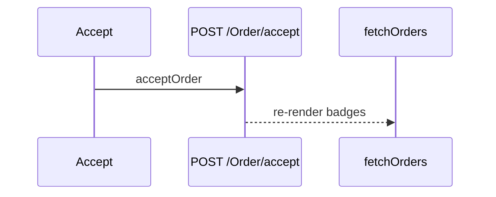

---

## UT-ORD-10 — Seller: Chu?n b? (Prepare)

#### 1. Giao di?n

`SellerOrdersPage` — khi status Confirmed ? `handlePrepare`.

#### 2. Frontend

```text
handlePrepare ? orderService.prepareOrder ? POST /Order/prepare
toast: 'Ðang th?c hi?n n?u món!'
setSelectedOrder status Preparing
```

#### 3. Backend

`PrepareOrderHandler` — Confirmed ? Preparing.

#### 4–5. Response + UI

Badge `"Ðang chu?n b?"` (yellow); `fetchOrders()`.

#### 6. Mermaid

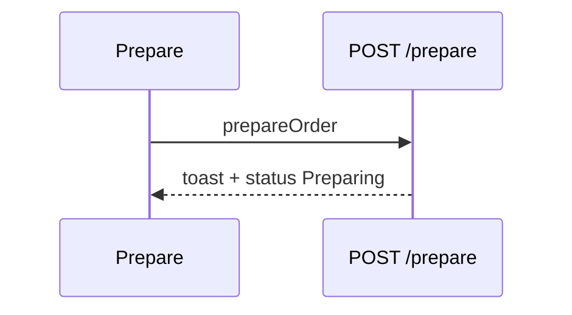

---

## UT-ORD-11 — Seller: Ch? tài x? (WaitingForShipper)

#### 1. Giao di?n

Nút ch? shipper khi Preparing (platform delivery).

#### 2. Frontend

```text
handleWaitingForShipper ? POST /Order/waiting-for-shipper
toast: 'Chu?n b? xong! Ðang ch? tài x? d?n l?y...'
status ? WaitingForShipper
```

#### 3. Backend

Handler chuy?n WaitingForShipper — s?n sàng dispatch.

#### 4–5. UI

Badge purple `"Ch? tài x?"`; coordinator board có th? th?y don.

#### 6. Mermaid

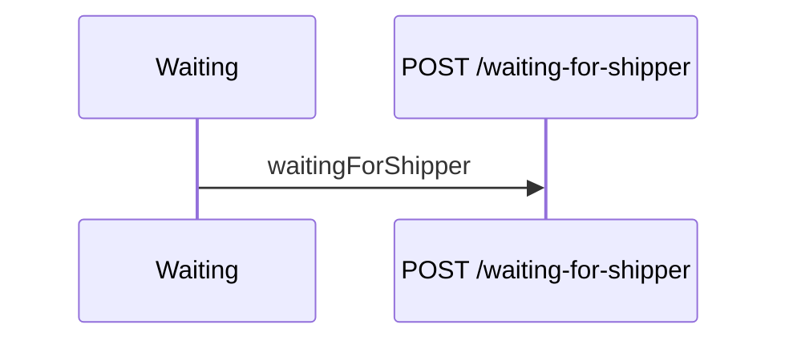

---

## UT-ORD-12 — Seller: T? ch?i don (PromptModal lý do)

#### 1. Giao di?n nút b?m ? dâu?

| M?c | Giá tr? |
|-----|---------|
| **Page** | `SellerOrdersPage.tsx` |
| **Modal** | Reject modal / Prompt — state `isRejectModalOpen`, `rejectReason` |
| **Confirm action** | `handleReject` |

#### 2. B?m xong ch?y d?n dâu? (Frontend)

```text
handleReject (L199–222)
  ? if !rejectReason.trim() ? toast.error('Vui lòng nh?p lý do t? ch?i')
  ? orderService.rejectOrder({ orderId, rejectReason })
  ? POST /api/Order/reject
  ? dóng modal, clear selectedOrder, fetchOrders
  ? toast.success('Ðã t? ch?i don hàng thành công')
```

#### 3. Backend

`RejectOrderHandler` — ch? Pending; ghi lý do.

#### 4–5. Response + UI

Ðon bi?n m?t kh?i Pending list / status Cancelled-Rejected; toast.

#### 6. Mermaid

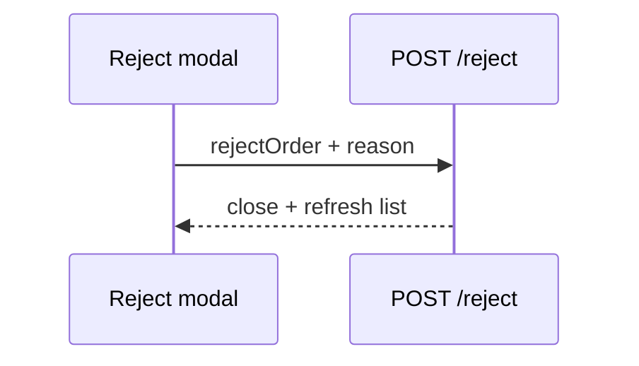

---

## UT-ORD-13 — Seller: H?y don (PromptModal)

#### 1. Giao di?n

`handleSellerCancelClick` ? `PromptModal` (`isCancelModalOpen`) nh?p lý do ? `handleSellerCancelConfirm(reason)`.

#### 2. Frontend

```text
orderService.sellerCancelOrder({ orderId, reason })
? POST /api/Order/seller-cancel
toast success 'Ðã h?y don hàng thành công'
```

#### 3. Backend

Seller-cancel handler + refund rules n?u c?n.

#### 4–5. UI

List refresh; selectedOrder null.

#### 6. Mermaid

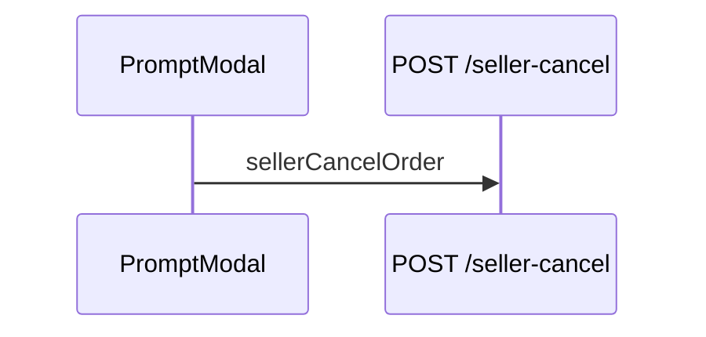

---

## UT-ORD-14 — Seller: Xác nh?n t? giao thành công

#### 1. Giao di?n

Khi don self-delivery ? tr?ng thái phù h?p — `handleConfirmSelfDelivery(orderId)`.

#### 2. Frontend

```text
orderService.confirmSelfDelivery(orderId)
? POST /api/Order/{id}/self-delivery/confirm-success
toast: 'Xác nh?n giao hàng thành công!'
status ? Delivered
```

#### 3. Backend

```text
? SettleSelfDeliveryOrderAsync (chia ti?n Seller + Commission)
```

#### 4–5. UI

Badge Delivered; ví seller c?p nh?t (không hi?n ngay trên page orders — xem wallet).

#### 6. Mermaid

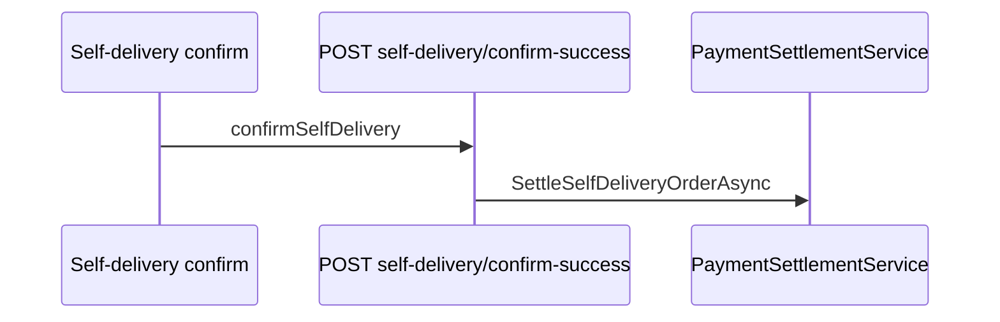

---

## Tóm t?t Order UI files

| File | Vai trò |
|------|---------|
| `CheckoutPage.tsx` | UT-ORD-01…06 |
| `CustomerOrderDetailModal.tsx` | UT-ORD-07…08 |
| `SellerOrdersPage.tsx` | UT-ORD-09…14 |
| `OrderService.ts` | HTTP wrapper |
| `OrderController.cs` + `Features/Orders/**` | BE |
| `ShoppingDrawer.tsx` | M? detail / track tab |

**Payment chi ti?t sau checkout SePay:** [06_Payment_UI_Trace.md](./06_Payment_UI_Trace.md).


---

## Ph?n B — Workflow nghi?p v? & Backend (chi ti?t lu?ng)
## 1. Lu?ng T?ng Quan (Checkout)

1. **Yêu c?u:** User (dã login ho?c Guest) m? `/checkout` v?i món trong gi? cùng m?t quán.
2. **Nh?p thông tin:** Ði?n d?a ch? giao, liên h?, ch?n phuong th?c TT, (tu? ch?n) mã gi?m giá / GPS.
3. **Guest OTP (n?u chua login):** B?m ti?p ? `POST /api/Order/checkout/sent-otp` ? nh?p OTP (Bu?c 2 UI).
4. **G?i checkout:** `POST /api/Order/checkout` v?i payload giao hàng + `paymentMethod` (+ OTP/guestUserId n?u guest).
5. **Backend:** `OrderController.Checkout` ? MediatR `CheckoutHandler`.
6. **Validate:** User/Guest, OTP (guest), gi? không r?ng, t?n kho, gi?m giá, tính phí ship.
7. **T?o Order:** `Status = Pending`, insert `ORDER` + `ORDER_ITEM`, g?i `PaymentSettlementService.ProcessCheckoutPaymentAsync`.
8. **Xóa gi?:** Clear cart items, commit transaction; COD ? notify Seller.
9. **Response flags:** `requiresSepayRedirect` / `requiresPaymentConfirmation` / thành công ngay (COD, SystemWallet).
10. **FE:** Toast + m? QR SePay / confirm payment / clear cart — theo flags (chi ti?t Payment docs).

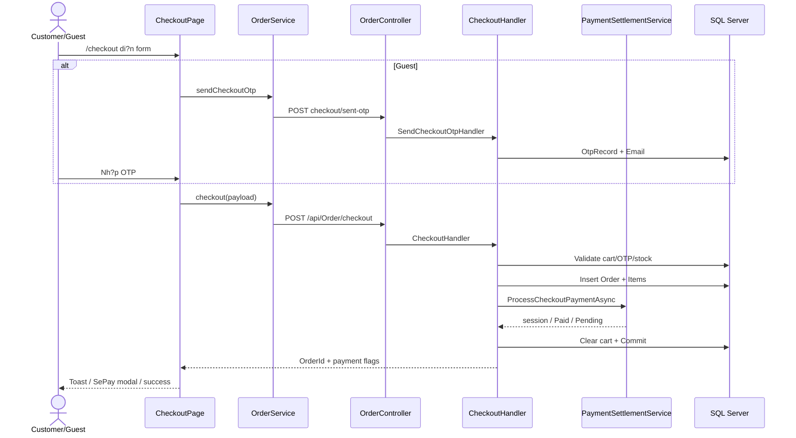

### OrderStatus (vòng d?i)

```text
Pending ? Confirmed ? Preparing ? WaitingForShipper ? Shipping ? Delivered
                ? Cancelled (m?i nhánh h?y h?p l?)
```

Enum: `src/ShoppingFood.Domain/Enums/Enums.cs` — `OrderStatus` (lines 56–65).

---

## Bu?c 1: M? trang Checkout (Frontend)

**Thông tin:**
- **URL (FE):** `/checkout`
- **Page:** `ShoppingFood.FE/src/pages/CheckoutPage.tsx`
- **Guest ID:** `localStorage` key `sf_guest_id` n?u chua authenticated

**Logic chính (`CheckoutPage.tsx`):**
- L?c `checkoutItems` theo `restaurantId`
- Form: d?a ch?, tên, SÐT, email, `paymentMethod` (m?c d?nh `COD`)
- `step`: `1` (info) | `2` (OTP guest)
- Load `paymentService.getPaymentMethods()`, phí ship theo GPS / freeship / min order

**Toast validate:**
- `Vui lòng di?n d?y d? thông tin giao hàng`
- `Vui lòng nh?p mã OTP`

---

## Bu?c 2: G?i OTP checkout (Guest)

**Thông tin:**
- **URL:** `/api/Order/checkout/sent-otp`
- **HTTP Method:** POST
- **Auth:** Public / guest-friendly

### 2.1. Frontend

**File:** `ShoppingFood.FE/src/services/OrderService.ts`

```typescript
public async sendCheckoutOtp(data: ISendCheckoutOtpRequest): Promise<IApiResponse<any>> {
  return httpClient.post<IApiResponse<any>>(API_ENDPOINTS.ORDER.CHECKOUT_SEND_OTP, data);
}
```

**CheckoutPage** (guest path):

```typescript
await orderService.sendCheckoutOtp({ /* contact + guestUserId */ });
toast.success('Mã OTP dã du?c g?i d?n email c?a b?n');
setStep(2);
```

### 2.2. Controller

**File:** `src/ShoppingFood.API/Controllers/OrderController.cs` — Lines 87–92

```csharp
[HttpPost("checkout/sent-otp")]
public async Task<IActionResult> SendCheckoutOtp([FromBody] SendCheckoutOtpCommand command)
{
    var respone = await _mediator.Send(command);
    return StatusCode(respone.Code, respone);
}
```

### 2.3. Handler

**File:** `src/ShoppingFood.Application/Features/Orders/Commands/SendCheckoutOtpHandler.cs`  
**Class:** `SendCheckoutOtpHandler`  
**Method:** `Handle`

- Khóa theo IP n?u `RetriesCount >= 3` trong 15 phút
- Rate limit guest orders (cùng logic checkout)
- T?o `OtpRecord` + g?i email qua `IEmailService`

---

## Bu?c 3: Checkout API

**Thông tin:**
- **URL:** `/api/Order/checkout`
- **HTTP Method:** POST
- **Auth:** JWT **ho?c** Guest (`guestUserId` + OTP)

**Request (chính)** — `CheckoutCommand`:

```csharp
// src/.../Orders/Commands/CheckoutCommand.cs
public string DeliveryAddress { get; set; }
public string ContactName { get; set; }
public string ContactPhone { get; set; }
public string ContactEmail { get; set; }
public string OtpCode { get; set; }
public string? DiscountCode { get; set; }
public PaymentMethod PaymentMethod { get; set; } = PaymentMethod.COD;
public Guid? GuestUserId { get; set; }
public double? DeliveryLatitude { get; set; }
public double? DeliveryLongitude { get; set; }
```

### 3.1. Frontend g?i API

**File:** `OrderService.ts`

```typescript
public async checkout(data: ICheckoutRequest): Promise<IApiResponse<any>> {
  return httpClient.post<IApiResponse<any>>(API_ENDPOINTS.ORDER.CHECKOUT, data);
}
```

**CheckoutPage** — sau response:

```typescript
const requiresSepay = res.data?.requiresSepayRedirect === true;
if (requiresSepay && sessionId) {
  toast.success('Ðon hàng dã t?o. Quét mã QR bên du?i d? thanh toán.');
  // m? SepayQrPaymentModal — xem Payment_Checkout_Workflow / Payment_Sepay_Workflow
} else {
  toast.success(`Ð?t hàng thành công! Mã don hàng c?a b?n là: ...`);
}
```

### 3.2. Controller

**File:** `OrderController.cs` — Lines 79–85

```csharp
[HttpPost("checkout")]
public async Task<IActionResult> Checkout([FromBody] CheckoutCommand command)
{
    var response = await _mediator.Send(command);
    return StatusCode(response.Code, response);
}
```

### 3.3. Handler — lõi nghi?p v?

**File:** `src/ShoppingFood.Application/Features/Orders/Commands/CheckoutHandler.cs`  
**Class:** `CheckoutHandler`  
**Method:** `Handle` (t? line ~81)

**Tóm t?t x? lý:**

| # | Vi?c | Ghi chú |
|---|------|---------|
| 1 | B?t bu?c `CurrentUserId` **ho?c** `GuestUserId` | 401 n?u thi?u |
| 2 | Guest: lock OTP / max **3 don/24h** theo IP | 403 / 429 |
| 3 | Guest: validate OTP email, max 3 retries | Ðánh `IsUsed` khi dúng |
| 4 | Load cart + sync flash sale price | Gi? r?ng ? 400 |
| 5 | Validate stock | Out of stock ? 400 |
| 6 | Tính total + shipping + shipper income | Theo lat/lng |
| 7 | Apply voucher + member tier discount | Tier b? qua n?u có flash sale item |
| 8 | `CreateOrderEntity` ? `Status = Pending` | + OrderItems |
| 9 | `ProcessCheckoutPaymentAsync` | **? Payment docs** |
| 10 | Clear cart, commit; COD notify seller | Notification |

**Ðo?n payment + response flags** (lines ~183–232):

```csharp
var paymentError = await _paymentSettlementService.ProcessCheckoutPaymentAsync(
    order, request.CurrentUserId, request.CardLastFour, request.CardBrand, request.EWalletProvider);
if (paymentError != null)
{
    await transaction.RollbackAsync(cancellationToken);
    return ApiResponse.Failure(400, paymentError);
}
// ... clear cart, commit, COD notification ...

var responseData = new
{
    OrderId = order.Id,
    totalAmount = order.TotalAmount,
    paymentSessionId = order.PaymentSessionId,
    requiresPaymentConfirmation = order.PaymentSessionId.HasValue
        && order.PaymentMethod != PaymentMethod.Sepay,
    requiresSepayRedirect = order.PaymentMethod == PaymentMethod.Sepay
        && order.PaymentSessionId.HasValue
};
return ApiResponse.Success(responseData, "Checkout successful.");
```

### 3.4. Database lúc checkout

| B?ng | Vi?c |
|------|------|
| `CART` / `CART_ITEM` | Ð?c + xóa items |
| `ORDER` / `ORDER_ITEM` | Insert |
| `OTP_RECORD` | Guest: dánh d?u dùng |
| `GUEST_USER` | C?p nh?t contact |
| `DISCOUNT` / `CUSTOMER_DISCOUNT` | Apply usage |
| `PAYMENT_SESSION` / `WALLET` / … | Theo payment method — xem Payment docs |
| `NOTIFICATION` | COD ? Seller |

---

## Bu?c 4: Nhánh thanh toán (tóm t?t + link)

| Method | Sau checkout | Ð?c ti?p |
|--------|--------------|----------|
| **COD** | `PaymentStatus=Pending`, toast thành công | [Payment_Requirements.md](./Payment_Requirements.md) § COD settle khi giao |
| **SystemWallet** | Tr? ví ngay ? `Paid` | Payment_Checkout_Workflow |
| **Sepay** | T?o session 10 phút ? QR modal | Payment_Sepay_Workflow |
| **CreditCard / EWallet** | Session stub ? FE `POST /Payment/confirm` | Payment_Checkout_Workflow (fallback) |

---

## Ph? l?c A — Vòng d?i don (Seller / Customer)

### A.1. Seller Accept

| M?c | Chi ti?t |
|-----|----------|
| **API** | `POST /api/Order/accept` |
| **Controller** | `OrderController.AcceptOrder` (L126–135) |
| **Handler** | `AcceptOrderHandler.cs` |
| **Rule** | Ch? `Pending` ? `Confirmed`; verify ownership quán |
| **FE** | `SellerOrdersPage.tsx` ? `orderService.acceptOrder` |
| **Noti** | Customer: *"Ðon hàng dã du?c xác nh?n"* |

```csharp
if(order.Status != OrderStatus.Pending) return ApiResponse.Failure(400, "Only pending orders can be accepted.");
order.Status = OrderStatus.Confirmed;
```

### A.2. Seller Reject

| M?c | Chi ti?t |
|-----|----------|
| **API** | `POST /api/Order/reject` |
| **Handler** | `RejectOrderHandler.cs` |
| **FE** | Prompt lý do ? `orderService.rejectOrder` |
| **K?t qu?** | Thu?ng ? `Cancelled` + refund n?u dã Paid (Payment) |

### A.3. Seller Prepare

| M?c | Chi ti?t |
|-----|----------|
| **API** | `POST /api/Order/prepare` |
| **Handler** | `PrepareOrderHandler.cs` |
| **Rule** | `Confirmed` ? `Preparing` |

### A.4. Waiting for Shipper (ho?c Self-delivery)

| M?c | Chi ti?t |
|-----|----------|
| **API** | `POST /api/Order/waiting-for-shipper` |
| **Handler** | `WaitingShipperOrderHandler.cs` |
| **Rule** | T? `Preparing`: Platform delivery ? `WaitingForShipper`; Self-delivery có th? gán th?ng `Shipping` |

### A.5. Customer Cancel

| M?c | Chi ti?t |
|-----|----------|
| **API** | `PUT /api/Order/cancel` |
| **Handler** | `CancelOrderHandler.cs` |
| **FE** | `CustomerOrderDetailModal` + `ConfirmModal` |
| **Rule** | Thu?ng ch? h?y khi còn `Pending` (sau Confirm b? h?n ch? — xem message noti accept) |

### A.6. Seller Cancel

| M?c | Chi ti?t |
|-----|----------|
| **API** | `POST /api/Order/seller-cancel` |
| **Handler** | `SellerCancelOrderHandler.cs` |
| **FE** | `SellerOrdersPage` |

### A.7. Reorder

| M?c | Chi ti?t |
|-----|----------|
| **API** | `POST /api/Order/reorder` |
| **Handler** | `ReorderHandler` / `ReorderCommand` |
| **FE** | Order history ? thêm l?i món vào cart |

### A.8. Self-delivery confirm success

| M?c | Chi ti?t |
|-----|----------|
| **API** | `POST /api/Order/{id}/self-delivery/confirm-success` |
| **Handler** | `ConfirmSelfDeliverySuccessHandler.cs` |
| **FE** | `orderService.confirmSelfDelivery(orderId)` |
| **Finance** | `SettleSelfDeliveryOrderAsync` — xem Payment_Requirements |

### A.9. Query don

| API | M?c dích | FE |
|-----|----------|-----|
| `GET /api/Order/MyOrders` | Ðon user | Profile / order list |
| `GET /api/Order/GuestOrders/{guestUserId}` | Ðon guest | Guest history |
| `GET /api/Order/details/{idOrCode}` | Chi ti?t | Modal detail |
| `GET /api/Order/RestaurantOrders` | Ðon quán | SellerOrdersPage |
| `GET /api/Order/recent-items` | Món g?n dây | Home / Profile |

---

## So d? file di qua (Checkout call chain)

```text
CheckoutPage.tsx
  ?
OrderService.ts  (sendCheckoutOtp / checkout)
  ?
HttpClient.ts
  ?
OrderController.cs  (checkout / checkout/sent-otp)
  ?
SendCheckoutOtpHandler.cs  |  CheckoutHandler.cs
  ?
PaymentSettlementService.ProcessCheckoutPaymentAsync  ?  [Payment_* docs]
  ?
ShoppingFoodContext ? ORDER, ORDER_ITEM, CART_ITEM, OTP_RECORD, NOTIFICATION, …
```

| Vai trò | Ðu?ng d?n |
|---------|-----------|
| FE Page | `ShoppingFood.FE/src/pages/CheckoutPage.tsx` |
| FE Service | `ShoppingFood.FE/src/services/OrderService.ts` |
| Controller | `src/ShoppingFood.API/Controllers/OrderController.cs` |
| Checkout | `.../Features/Orders/Commands/CheckoutHandler.cs` |
| OTP Guest | `.../Features/Orders/Commands/SendCheckoutOtpHandler.cs` |
| Command | `.../CheckoutCommand.cs` |
| Payment | `.../Services/PaymentSettlementService.cs` |
| Seller UI | `ShoppingFood.FE/src/pages/seller/SellerOrdersPage.tsx` |

---

## Các thông báo (Toast / Message)

| Message | Noi | Trigger |
|---------|-----|---------|
| Mã OTP dã du?c g?i d?n email c?a b?n | CheckoutPage | sendCheckoutOtp OK |
| Ðon hàng dã t?o. Quét mã QR… | CheckoutPage | Sepay redirect |
| Ð?t hàng thành công! Mã don… | CheckoutPage | COD/Wallet/after confirm |
| L?i khi d?t hàng / Invalid OTP… | CheckoutPage | API error |
| Áp d?ng mã gi?m giá thành công | CheckoutPage | apply discount |
| (Seller) toast nh?n/t? ch?i/chu?n b? | SellerOrdersPage | lifecycle APIs |

---

## Các co ch? b?o m?t / ràng bu?c quan tr?ng

1. **Guest OTP b?t bu?c** tru?c khi t?o don; OTP one-time; max **3 retries** ? lock 15 phút theo IP.
2. **Rate limit guest:** t?i da **3 don / 24 gi? / IP**.
3. **Gi? ph?i cùng quán** (FE filter `restaurantId`); stock check tru?c khi t?o order.
4. **Transaction DB** b?c checkout; payment fail ? rollback.
5. **Seller ownership** verify trên m?i action accept/reject/prepare…
6. **Payment online** yêu c?u login (Guest th?c t? ch? COD) — chi ti?t Payment_Requirements.
7. Sau **Confirmed**, customer b? h?n ch? t? h?y (noti hu?ng d?n chat seller).

---

## Checklist t? test (Screen Run)

- [ ] Login Customer: thêm gi? ? `/checkout` ? COD ? don `Pending`, seller nh?n noti
- [ ] Guest: OTP email ? checkout COD thành công; sai OTP 3 l?n ? b? khóa
- [ ] Guest quá 3 don/ngày ? 429
- [ ] SystemWallet d?/thi?u s? du
- [ ] Sepay: flags `requiresSepayRedirect` + modal QR (theo Payment docs)
- [ ] Seller: Accept ? Prepare ? WaitingForShipper
- [ ] Customer cancel khi Pending; seller-cancel; reorder
- [ ] Self-delivery confirm-success

---

## Tóm t?t

Checkout t?o don `Pending` qua `CheckoutHandler`, g?n payment qua `PaymentSettlementService`, r?i Seller d?y tr?ng thái t?i `WaitingForShipper` / self-delivery. **Chi ti?t ti?n** ? b? tài li?u Payment; **giao hàng** ? Shipper / Coordinator workflows.

> [INDEX](../ONBOARDING_INDEX.md) · [Payment_Requirements](./Payment_Requirements.md) · [Shipper_Delivery](./Shipper_Delivery_Workflow.md) · [Coordinator_Dispatch](./Coordinator_Dispatch_Workflow.md)
