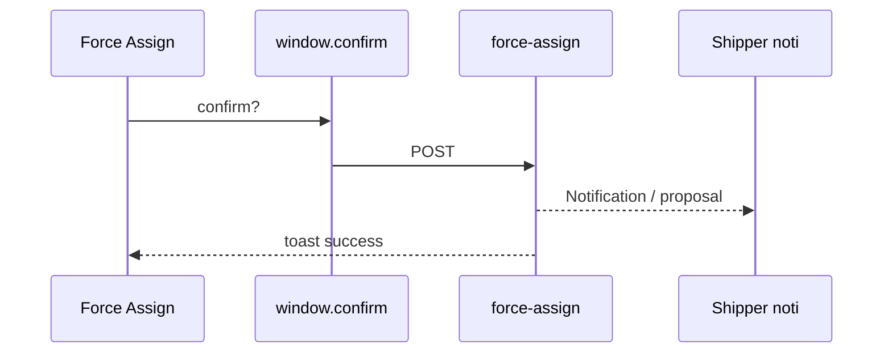
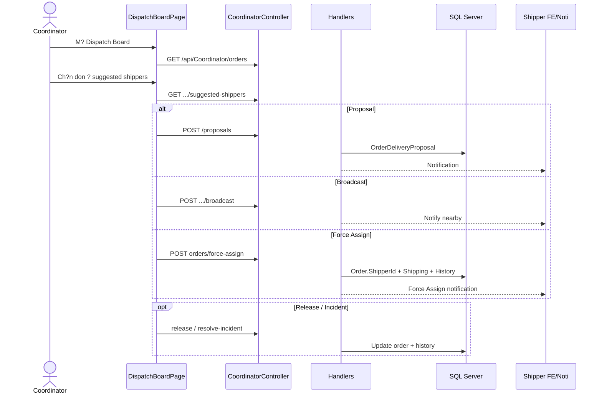

# Tài li?u Quy trình: Ði?u ph?i don (Coordinator Dispatch)

Tài li?u mô t? lu?ng **di?u ph?i viên** gán / broadcast / thu h?i shipper, giám sát và x? lý s? c? trên **UniEats**.

> Ðon n?n: Seller dã chuy?n sang `WaitingForShipper` (ho?c escalate).  
> Shipper side: [Shipper_Delivery_Workflow.md](./Shipper_Delivery_Workflow.md) · Ð?t hàng: [Checkout_Order_Workflow.md](./Checkout_Order_Workflow.md).

---


---

## Ph?n A — UI Interaction Trace (Nút b?m ? Code ? Data ? Hi?n th?)

> UI Trace — Coordinator  
> M?i thao tác tr? l?i: **nút ? dâu** · **b?m ch?y file/hàm nào** · **API/BE dâu** · **data tr? v?** · **hi?n th? th? nào**.


---

### UT-COO-01 — M? g?i ý shipper + G?i d? xu?t

#### 1. Giao di?n

| M?c | Giá tr? |
|-----|---------|
| **Route** | `/coordinator` / dispatch |
| **Page** | `pages/coordinator/DispatchBoardPage.tsx` |
| **Nút trên order** | M? suggest ? `handleOpenSuggestModal(order)` |
| **Trong modal** | `"G?i d? xu?t"` ? `handleSendProposal(shipperId)` |

#### 2. Frontend

```text
handleOpenSuggestModal
  ? GET /Coordinator/orders/{orderId}/suggested-shippers
  ? set list vào modal
handleSendProposal
  ? POST /Coordinator/proposals { orderId, shipperId }
```

#### 5. Hi?n th?

toast `Ðã g?i d? xu?t d?n shipper thành công!`; l?i toast API/m?ng; Shipper nh?n popup/noti.

---

### UT-COO-02 — Force-assign (`window.confirm`)

#### 1. Giao di?n

Nút gán b?t bu?c trong suggest modal ? `handleForceAssign(shipperId)`.

#### 2. Frontend

```text
window.confirm('B?n có ch?c ch?n mu?n gán b?t bu?c...')
  ? n?u OK: POST /Coordinator/orders/force-assign
  ? toast success / error
```

#### 5. Hi?n th?

| Confirm Cancel | Không g?i API |
| Success | toast `Ðã gán don hàng thành công!` + dóng modal + refresh board |
| Shipper side | SignalR/notification force-assign (xem UT-SHP-02) |

---

### UT-COO-03 — Broadcast g?n khu v?c

#### 1. Giao di?n

Nút broadcast trên order ? `handleBroadcastOrder(order)`.

#### 2. Frontend

```text
window.confirm(`B?n có mu?n g?i thông báo cho t?t c? tài x? g?n don...`)
  ? POST /Coordinator/orders/{orderId}/broadcast
  ? toast.success(res.message)  // có th? "Ðã g?i... N tài x?" ho?c "Không có tài x?..."
```

---

### UT-COO-04 — Thu h?i / Release don

#### 1. Giao di?n

`handleOpenReleaseModal` ? modal nh?p lý do (+ optional reassign) ? `handleReleaseOrder`.

#### 2. Frontend

```text
validate reason không r?ng
  ? POST /Coordinator/orders/{orderId}/release
  ? toast thu h?i / gán shipper m?i
```

Validate fail: toast `Vui lòng nh?p lý do gi?i phóng don`.

---

### UT-COO-05 — Resolve incident

#### 1. Giao di?n

`handleOpenIncidentModal` ? nh?p chi ti?t ? `handleResolveIncident`.

#### 2–3.

```text
POST /Coordinator/orders/{orderId}/resolve-incident
(ho?c complaint resolve tùy flow)
```

#### 5. Hi?n th?

toast `Ðã gi?i quy?t s? c? don hàng thành công!`; validate chi ti?t b?t bu?c.

---

### UT-COO-06 — Monitor: Suspend shipper

#### 1. Giao di?n

| M?c | Giá tr? |
|-----|---------|
| **Page** | `MonitorShippersPage.tsx` |
| **Confirm** | `window.confirm` khóa vô th?i h?n / m? khóa |

#### 2–3.

```text
POST /Coordinator/shippers/{shipperId}/suspend
```

#### 5. Hi?n th?

toast t?m khóa X phút / khóa-m? tài kho?n.

---

### UT-COO-07 — AdjustReputationModal

#### 1. Giao di?n

Modal ch?nh di?m ? submit.

#### 2–3.

```text
POST /Coordinator/shippers/{id}/adjust-reputation
  ? ShipperReputationHistory
```

#### 5. Hi?n th?

toast `Ðã thay d?i di?m uy tín thành công`.

---

### UT-COO-08 — Tabs board

Click tab WaitingForShipper / Shipping / incident / … ? `setActiveTab` + `setPage(1)` ? re-fetch `GET /Coordinator/orders`.

---

## So d? Force-assign




---

## Ph?n B — Workflow nghi?p v? & Backend (chi ti?t lu?ng)
## 1. Lu?ng T?ng Quan (Workflow)

1. **M? board:** Coordinator vào `/coordinator` ho?c `/coordinator/dispatch` ? `GET /api/Coordinator/orders`.
2. **Ch?n don:** Xem don ch? shipper / escalated.
3. **G?i ý shipper:** `GET /api/Coordinator/orders/{orderId}/suggested-shippers`.
4. **G?i d? xu?t 1 shipper:** `POST /api/Coordinator/proposals` ? t?o/c?p nh?t `OrderDeliveryProposal` + noti.
5. **Broadcast g?n:** `POST .../broadcast` ? thông báo nhi?u shipper online g?n don.
6. **Force-assign:** Confirm UI ? `POST /api/Coordinator/orders/force-assign` ? gán b?t bu?c, `Shipping`, history `ManualAssigned`.
7. **Release / reassign:** `POST .../release` kèm lý do (+ optional shipper m?i).
8. **Resolve incident:** `POST .../resolve-incident` khi don s? c?.
9. **Monitor shippers:** `GET /shippers/monitoring` ? suspend / adjust reputation.
10. **Audit:** `dispatch-history`, `incidents`, `complaints/orders`.



---

## Bu?c 1: Dispatch Board (danh sách don)

**Thông tin:**
- **URL (FE):** `/coordinator` / dispatch route trong `routeConfig`
- **Page:** `ShoppingFood.FE/src/pages/coordinator/DispatchBoardPage.tsx`
- **API:** `GET /api/Coordinator/orders?status=&skip=&take=&isEscalated=`
- **Auth:** Role **Coordinator** ho?c **Admin**

### 1.1. Frontend

**File:** `ShoppingFood.FE/src/services/CoordinatorService.ts`

```typescript
async getDispatchBoard(status?: string, skip = 0, take = 50, isEscalated?: boolean) {
  const params: Record<string, any> = { skip, take };
  if (status) params.status = status;
  if (isEscalated !== undefined) params.isEscalated = isEscalated;
  return httpClient.get(API_ENDPOINTS.COORDINATOR.ORDERS, { params });
}
```

**Toast l?i t?i board:** `T?i danh sách don hàng di?u ph?i th?t b?i do l?i k?t n?i m?ng.`

### 1.2. Controller

**File:** `src/ShoppingFood.API/Controllers/CoordinatorController.cs` — Lines 15–33

```csharp
[HttpGet("orders")]
public async Task<ActionResult> GetDispatchBoardOrder(
    [FromQuery] string? status, [FromQuery] int skip = 0, [FromQuery] int take = 50, [FromQuery] bool? isEscalated = null)
{
    var query = new GetDispatchBoardQuery { Status = status, Skip = skip, Take = take, IsEscalated = isEscalated };
    if (userDto != null) query.CurrentUserId = userDto.Id;
    var response = await _mediator.Send(query);
    return StatusCode(response.Code, response);
}
```

### 1.3. Handler

**File:** `src/ShoppingFood.Application/Features/Coordinator/Queries/GetDispatchBoardHandler.cs`  
L?c don c?n di?u ph?i (thu?ng `WaitingForShipper`, flag escalate, phân trang).

---

## Bu?c 2: Suggested shippers

**API:** `GET /api/Coordinator/orders/{orderId}/suggested-shippers`  
**Controller:** L35–50  
**Query handler:** `GetSuggestedShippersHandler.cs`  
**FE:** `coordinatorService.getSuggestedShippers(orderId)`

**Toast l?i:** `T?i danh sách shipper g?i ý th?t b?i do l?i k?t n?i m?ng.`

G?i ý d?a trên online, kho?ng cách, reputation, tr?ng thái Active (chi ti?t trong handler).

---

## Bu?c 3: G?i d? xu?t (Proposal) t?i 1 shipper

**API:** `POST /api/Coordinator/proposals`  
**Body:** `SendProposalCommand` (orderId, shipperId, …)  
**Controller:** L65–75  
**Handler:** `SendProposalHandler.cs`

**FE:**

```typescript
async sendProposal(data: ISendProposalRequest) {
  return httpClient.post(API_ENDPOINTS.COORDINATOR.SEND_PROPOSAL, data);
}
```

**Toast:** `Ðã g?i d? xu?t d?n shipper thành công!` / `L?i g?i d? xu?t`

**DB:** `ORDER_DELIVERY_PROPOSAL` Status `Pending` + Notification t?i shipper.

---

## Bu?c 4: Broadcast g?n

**API:** `POST /api/Coordinator/orders/{orderId}/broadcast`  
**Controller:** L52–63  
**Handler:** `BroadcastOrderToNearbyShippersHandler.cs`

**FE (`DispatchBoardPage`):**

```typescript
if (!window.confirm(`B?n có mu?n g?i thông báo cho t?t c? tài x? g?n don hàng ${order.id.substring(0, 8)}?`)) return;
const res = await coordinatorService.broadcastOrder(orderId);
toast.success(res.message || 'Ðã g?i thông báo d?n các tài x? thành công!');
```

Shipper online trong bán kính nh?n notification ? m? proposed offer.

---

## Bu?c 5: Force Assign (gán b?t bu?c)

**Thông tin:**
- **URL:** `/api/Coordinator/orders/force-assign`
- **HTTP Method:** POST
- **Confirm UI:** `window.confirm('B?n có ch?c ch?n mu?n gán b?t bu?c...')`

### 5.1. Frontend

```typescript
async forceAssign(data: IForceAssignRequest) {
  return httpClient.post(API_ENDPOINTS.COORDINATOR.FORCE_ASSIGN, data);
}
// toast.success('Ðã gán don hàng thành công!');
```

### 5.2. Controller

**File:** `CoordinatorController.cs` — Lines 77–87

```csharp
[HttpPost("orders/force-assign")]
public async Task<IActionResult> ForceAssign([FromBody] ForceAssignCommand command)
{
    if (userDto != null) command.CurrentUserId = userDto.Id;
    var response = await _mediator.Send(command);
    return StatusCode(response.Code, response);
}
```

### 5.3. Handler

**File:** `src/ShoppingFood.Application/Features/Coordinator/Commands/ForceAssignHandler.cs`  
**Class:** `ForceAssignHandler`  
**Method:** `Handle`

```csharp
if (order.ShipperId.HasValue || order.Status != OrderStatus.WaitingForShipper)
    return ApiResponse.Failure(400, $"Order is not eligible for assignment...");

if (!shipper.IsOnline || shipper.Status != UserStatus.Active)
    return ApiResponse.Failure(400, "Shipper ís offline or inactive.");

await InvalidatePendingProposalAsync(request.OrderId);
AssignOrder(order, shipper.Id);
await UpdateOrCreateProposalAsync(request.OrderId, request.ShipperId);

// OrderDispatchHistory: ActionType = ManualAssigned, Note = "B?t bu?c gán don (Force Assign)"
// + Notification t?i shipper (FE toast Force Assign)
```

**DB:** `ORDER` (ShipperId, Status?Shipping), `ORDER_DELIVERY_PROPOSAL`, `ORDER_DISPATCH_HISTORY`, `NOTIFICATION`.

---

## Bu?c 6: Release (thu h?i / gán l?i)

**API:** `POST /api/Coordinator/orders/{orderId}/release`  
**Body:** `ReleaseOrderCommand` (lý do, optional `reassignShipperId`)  
**Handler:** `ReleaseOrderHandler.cs`

**FE:**

```typescript
if (!reason) { toast.error('Vui lòng nh?p lý do gi?i phóng don'); return; }
const res = await coordinatorService.releaseOrder(orderId, data);
toast.success(reassignShipperId ? 'Ðã gán shipper m?i thành công!' : 'Ðã thu h?i don hàng thành công!');
```

**Hi?u ?ng:** G? shipper hi?n t?i / tr? v? ch? gán; shipper nh?n noti thu h?i (`Ðon hàng dã b? thu h?i!` trên ShipperDashboard).

---

## Bu?c 7: Resolve incident

**API:** `POST /api/Coordinator/orders/{orderId}/resolve-incident`  
**Handler:** `ResolveIncidentHandler.cs`  
**FE:** b?t bu?c nh?p chi ti?t x? lý

```typescript
toast.error('Vui lòng nh?p chi ti?t x? lý s? c?'); // validate
toast.success('Ðã gi?i quy?t s? c? don hàng thành công!');
```

**Danh sách s? c?:** `GET /api/Coordinator/incidents` — page `CoordinatorIncidentsPage.tsx`  
**Khi?u n?i don:** `GET /complaints/orders` + `POST /complaint/{reportId}/resolve` (`ResolveComplaintHandler`).

---

## Bu?c 8: Monitor / Suspend / Adjust reputation

### 8.1. Monitoring

| M?c | Chi ti?t |
|-----|----------|
| **FE** | `MonitorShippersPage.tsx` |
| **API** | `GET /api/Coordinator/shippers/monitoring?isOnline=&searchName=` |
| **Handler** | `GetMonitorShipperHandler.cs` |

### 8.2. Suspend shipper

| M?c | Chi ti?t |
|-----|----------|
| **API** | `POST /api/Coordinator/shippers/{shipperId}/suspend` |
| **Handler** | `SuspendShipperHandler.cs` |
| **FE** | `window.confirm` khóa/m? |
| **DB** | `SHIPPER_PROFILE.SuspendedUntil`, `SuspendedReason` ? ch?n toggle-online |

### 8.3. Adjust reputation

| M?c | Chi ti?t |
|-----|----------|
| **API** | `POST /api/Coordinator/shippers/{shipperId}/adjust-reputation` |
| **Body** | `{ points, reason }` |
| **Handler** | `AdjustShipperReputationHandler.cs` |
| **FE** | `AdjustReputationModal.tsx` |
| **DB** | `SHIPPER_REPUTATION_HISTORY` + c?p nh?t di?m profile |

### 8.4. Dispatch history

| API | Handler | FE |
|-----|---------|-----|
| `GET /orders/{orderId}/dispatch-history` | `GetOrderDispatchHistoryHandler` | Chi ti?t 1 don |
| `GET /orders/dispatch-history` | `GetAllDispatchHistoryHandler` | `DispatchHistoryPage` |

---

## So d? file di qua (Call chain)

```text
DispatchBoardPage.tsx / MonitorShippersPage.tsx / CoordinatorIncidentsPage.tsx
  ?
CoordinatorService.ts
  ?
CoordinatorController.cs
  ?
GetDispatchBoardHandler
GetSuggestedShippersHandler
SendProposalHandler / BroadcastOrderToNearbyShippersHandler
ForceAssignHandler / ReleaseOrderHandler / ResolveIncidentHandler
GetMonitorShipperHandler / SuspendShipperHandler / AdjustShipperReputationHandler
  ?
ORDER, ORDER_DELIVERY_PROPOSAL, ORDER_DISPATCH_HISTORY,
SHIPPER_PROFILE, SHIPPER_REPUTATION_HISTORY, NOTIFICATION, SYSTEM_REPORT
  ?
ShipperDashboard (SignalR / Notification bell)
```

| Vai trò | Ðu?ng d?n |
|---------|-----------|
| FE Board | `ShoppingFood.FE/src/pages/coordinator/DispatchBoardPage.tsx` |
| FE Monitor | `.../coordinator/MonitorShippersPage.tsx` |
| FE Service | `ShoppingFood.FE/src/services/CoordinatorService.ts` |
| Controller | `src/ShoppingFood.API/Controllers/CoordinatorController.cs` |
| Force assign | `.../Coordinator/Commands/ForceAssignHandler.cs` |
| Broadcast | `.../Coordinator/Commands/BroadcastOrderToNearbyShippersHandler.cs` |
| Release | `.../Coordinator/Commands/ReleaseOrderHandler.cs` |

---

## Các thông báo (Toast / Confirm)

| Message / UI | Trigger |
|--------------|---------|
| Ðã g?i d? xu?t d?n shipper thành công! | proposals OK |
| window.confirm broadcast | Tru?c broadcast |
| Ðã g?i thông báo d?n các tài x? thành công! | broadcast OK |
| window.confirm force-assign | Tru?c gán b?t bu?c |
| Ðã gán don hàng thành công! | force-assign OK |
| Vui lòng nh?p lý do gi?i phóng don | release validate |
| Ðã thu h?i / Ðã gán shipper m?i… | release OK |
| Vui lòng nh?p chi ti?t x? lý s? c? | resolve validate |
| Ðã gi?i quy?t s? c? don hàng thành công! | resolve OK |
| (Shipper) Force Assign / thu h?i | Notification realtime |

---

## Các co ch? b?o m?t / ràng bu?c

1. Ch? **Coordinator / Admin** (RBAC `ApiEndpoint` + FE `PrivateRoute`).
2. Force-assign ch? khi don `WaitingForShipper` và **chua** có shipper; shipper ph?i **online + Active**.
3. M?i gán th? công ghi **`ORDER_DISPATCH_HISTORY`** (`ManualAssigned`, Actor = coordinator).
4. Invalidate proposal pending cu tru?c khi force-assign.
5. Suspend ngan shipper online/nh?n don (xem ToggleShipperOnlineHandler).
6. Release yêu c?u **lý do** (audit / tranh ch?p).
7. Confirm native (`window.confirm`) trên hành d?ng phá h?y tr?ng thái (force/broadcast) — tránh click nh?m.

---

## Checklist t? test

- [ ] Board load don WaitingForShipper
- [ ] Suggested shippers hi?n shipper online g?n
- [ ] Send proposal ? shipper nh?n noti / popup
- [ ] Broadcast ? nhi?u shipper du?c báo
- [ ] Force-assign ? don Shipping trên shipper; history ManualAssigned
- [ ] Force-assign shipper offline ? l?i
- [ ] Release ? shipper m?t don + toast thu h?i
- [ ] Resolve incident + xem GET incidents
- [ ] Suspend shipper ? không toggle online
- [ ] Adjust reputation ? hi?n ReputationHistory

---

## Tóm t?t

Coordinator di?u khi?n “kh?p” don–shipper trên **DispatchBoard**: proposal / broadcast / **force-assign**, thu h?i, x? lý s? c?, giám sát uy tín. M?i thao tác gán th? công du?c audit qua `ORDER_DISPATCH_HISTORY` và d?y realtime t?i Shipper.

> [Shipper_Delivery](./Shipper_Delivery_Workflow.md) · [Checkout_Order](./Checkout_Order_Workflow.md) · [Payment_Requirements](./Payment_Requirements.md) · [INDEX](../ONBOARDING_INDEX.md)
