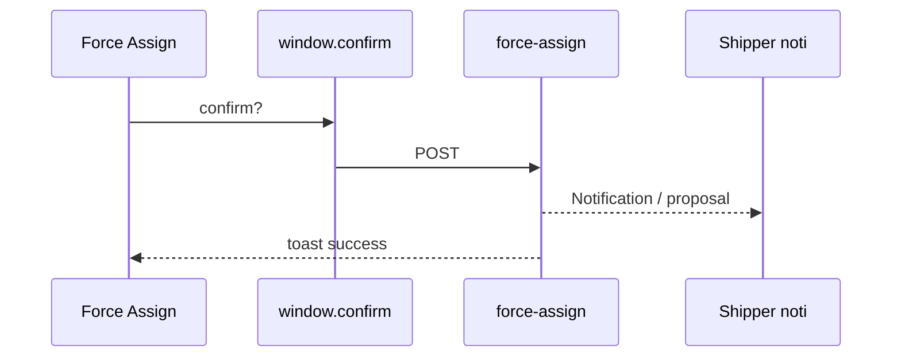
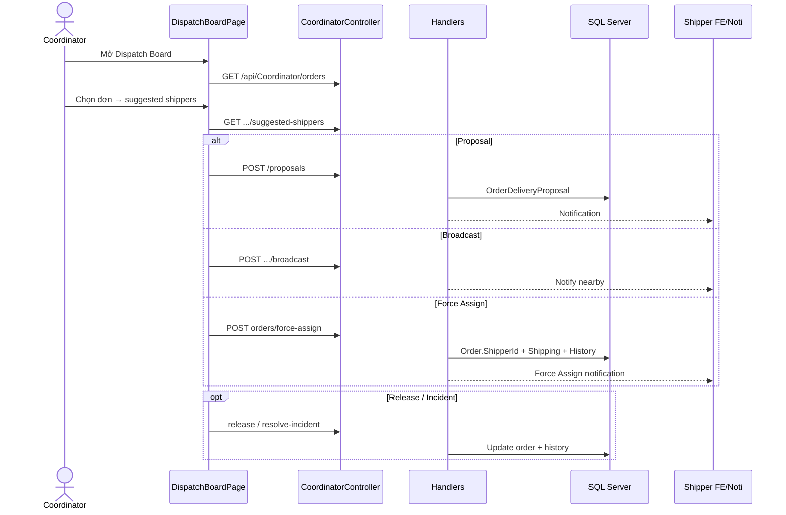

# Tài liệu Quy trình: Điều phối đơn (Coordinator Dispatch)

Tài liệu mô tả luồng **điều phối viên** gán / broadcast / thu hồi shipper, giám sát và xử lý sự cố trên **Shopping Food**.

> Đơn nền: Seller đã chuyển sang `WaitingForShipper` (hoặc escalate).  
> Shipper side: [Shipper_Delivery_Workflow.md](./Shipper_Delivery_Workflow.md) · Đặt hàng: [Checkout_Order_Workflow.md](./Checkout_Order_Workflow.md).

---


---

## Phần A — UI Interaction Trace (Nút bấm → Code → Data → Hiển thị)

> UI Trace — Coordinator  
> Mỗi thao tác trả lời: **nút ở đâu** · **bấm chạy file/hàm nào** · **API/BE đâu** · **data trả về** · **hiển thị thế nào**.


---

### UT-COO-01 — Mở gợi ý shipper + Gửi đề xuất

#### 1. Giao diện

| Mục | Giá trị |
|-----|---------|
| **Route** | `/coordinator` / dispatch |
| **Page** | `pages/coordinator/DispatchBoardPage.tsx` |
| **Nút trên order** | Mở suggest → `handleOpenSuggestModal(order)` |
| **Trong modal** | `"Gửi đề xuất"` → `handleSendProposal(shipperId)` |

#### 2. Frontend

```text
handleOpenSuggestModal
  → GET /Coordinator/orders/{orderId}/suggested-shippers
  → set list vào modal
handleSendProposal
  → POST /Coordinator/proposals { orderId, shipperId }
```

#### 5. Hiển thị

toast `Đã gửi đề xuất đến shipper thành công!`; lỗi toast API/mạng; Shipper nhận popup/noti.

---

### UT-COO-02 — Force-assign (`window.confirm`)

#### 1. Giao diện

Nút gán bắt buộc trong suggest modal → `handleForceAssign(shipperId)`.

#### 2. Frontend

```text
window.confirm('Bạn có chắc chắn muốn gán bắt buộc...')
  → nếu OK: POST /Coordinator/orders/force-assign
  → toast success / error
```

#### 5. Hiển thị

| Confirm Cancel | Không gọi API |
| Success | toast `Đã gán đơn hàng thành công!` + đóng modal + refresh board |
| Shipper side | SignalR/notification force-assign (xem UT-SHP-02) |

---

### UT-COO-03 — Broadcast gần khu vực

#### 1. Giao diện

Nút broadcast trên order → `handleBroadcastOrder(order)`.

#### 2. Frontend

```text
window.confirm(`Bạn có muốn gửi thông báo cho tất cả tài xế gần đơn...`)
  → POST /Coordinator/orders/{orderId}/broadcast
  → toast.success(res.message)  // có thể "Đã gửi... N tài xế" hoặc "Không có tài xế..."
```

---

### UT-COO-04 — Thu hồi / Release đơn

#### 1. Giao diện

`handleOpenReleaseModal` → modal nhập lý do (+ optional reassign) → `handleReleaseOrder`.

#### 2. Frontend

```text
validate reason không rỗng
  → POST /Coordinator/orders/{orderId}/release
  → toast thu hồi / gán shipper mới
```

Validate fail: toast `Vui lòng nhập lý do giải phóng đơn`.

---

### UT-COO-05 — Resolve incident

#### 1. Giao diện

`handleOpenIncidentModal` → nhập chi tiết → `handleResolveIncident`.

#### 2–3.

```text
POST /Coordinator/orders/{orderId}/resolve-incident
(hoặc complaint resolve tùy flow)
```

#### 5. Hiển thị

toast `Đã giải quyết sự cố đơn hàng thành công!`; validate chi tiết bắt buộc.

---

### UT-COO-06 — Monitor: Suspend shipper

#### 1. Giao diện

| Mục | Giá trị |
|-----|---------|
| **Page** | `MonitorShippersPage.tsx` |
| **Confirm** | `window.confirm` khóa vô thời hạn / mở khóa |

#### 2–3.

```text
POST /Coordinator/shippers/{shipperId}/suspend
```

#### 5. Hiển thị

toast tạm khóa X phút / khóa-mở tài khoản.

---

### UT-COO-07 — AdjustReputationModal

#### 1. Giao diện

Modal chỉnh điểm → submit.

#### 2–3.

```text
POST /Coordinator/shippers/{id}/adjust-reputation
  → ShipperReputationHistory
```

#### 5. Hiển thị

toast `Đã thay đổi điểm uy tín thành công`.

---

### UT-COO-08 — Tabs board

Click tab WaitingForShipper / Shipping / incident / … → `setActiveTab` + `setPage(1)` → re-fetch `GET /Coordinator/orders`.

---

## Sơ đồ Force-assign




---

## Phần B — Workflow nghiệp vụ & Backend (chi tiết luồng)
## 1. Luồng Tổng Quan (Workflow)

1. **Mở board:** Coordinator vào `/coordinator` hoặc `/coordinator/dispatch` → `GET /api/Coordinator/orders`.
2. **Chọn đơn:** Xem đơn chờ shipper / escalated.
3. **Gợi ý shipper:** `GET /api/Coordinator/orders/{orderId}/suggested-shippers`.
4. **Gửi đề xuất 1 shipper:** `POST /api/Coordinator/proposals` → tạo/cập nhật `OrderDeliveryProposal` + noti.
5. **Broadcast gần:** `POST .../broadcast` → thông báo nhiều shipper online gần đơn.
6. **Force-assign:** Confirm UI → `POST /api/Coordinator/orders/force-assign` → gán bắt buộc, `Shipping`, history `ManualAssigned`.
7. **Release / reassign:** `POST .../release` kèm lý do (+ optional shipper mới).
8. **Resolve incident:** `POST .../resolve-incident` khi đơn sự cố.
9. **Monitor shippers:** `GET /shippers/monitoring` → suspend / adjust reputation.
10. **Audit:** `dispatch-history`, `incidents`, `complaints/orders`.



---

## Bước 1: Dispatch Board (danh sách đơn)

**Thông tin:**
- **URL (FE):** `/coordinator` / dispatch route trong `routeConfig`
- **Page:** `ShoppingFood.FE/src/pages/coordinator/DispatchBoardPage.tsx`
- **API:** `GET /api/Coordinator/orders?status=&skip=&take=&isEscalated=`
- **Auth:** Role **Coordinator** hoặc **Admin**

### 1.1. Frontend

**File:** `ShoppingFood.FE/src/services/CoordinatorService.ts`

```typescript
async getDispatchBoard(status?: string, skip = 0, take = 50, isEscalated?: boolean) {
  const params: Record<string, any> = { skip, take };
  if (status) params.status = status;
  if (isEscalated !== undefined) params.isEscalated = isEscalated;
  return httpClient.get(API_ENDPOINTS.COORDINATOR.ORDERS, { params });
}
```

**Toast lỗi tải board:** `Tải danh sách đơn hàng điều phối thất bại do lỗi kết nối mạng.`

### 1.2. Controller

**File:** `src/ShoppingFood.API/Controllers/CoordinatorController.cs` — Lines 15–33

```csharp
[HttpGet("orders")]
public async Task<ActionResult> GetDispatchBoardOrder(
    [FromQuery] string? status, [FromQuery] int skip = 0, [FromQuery] int take = 50, [FromQuery] bool? isEscalated = null)
{
    var query = new GetDispatchBoardQuery { Status = status, Skip = skip, Take = take, IsEscalated = isEscalated };
    if (userDto != null) query.CurrentUserId = userDto.Id;
    var response = await _mediator.Send(query);
    return StatusCode(response.Code, response);
}
```

### 1.3. Handler

**File:** `src/ShoppingFood.Application/Features/Coordinator/Queries/GetDispatchBoardHandler.cs`  
Lọc đơn cần điều phối (thường `WaitingForShipper`, flag escalate, phân trang).

---

## Bước 2: Suggested shippers

**API:** `GET /api/Coordinator/orders/{orderId}/suggested-shippers`  
**Controller:** L35–50  
**Query handler:** `GetSuggestedShippersHandler.cs`  
**FE:** `coordinatorService.getSuggestedShippers(orderId)`

**Toast lỗi:** `Tải danh sách shipper gợi ý thất bại do lỗi kết nối mạng.`

Gợi ý dựa trên online, khoảng cách, reputation, trạng thái Active (chi tiết trong handler).

---

## Bước 3: Gửi đề xuất (Proposal) tới 1 shipper

**API:** `POST /api/Coordinator/proposals`  
**Body:** `SendProposalCommand` (orderId, shipperId, …)  
**Controller:** L65–75  
**Handler:** `SendProposalHandler.cs`

**FE:**

```typescript
async sendProposal(data: ISendProposalRequest) {
  return httpClient.post(API_ENDPOINTS.COORDINATOR.SEND_PROPOSAL, data);
}
```

**Toast:** `Đã gửi đề xuất đến shipper thành công!` / `Lỗi gửi đề xuất`

**DB:** `ORDER_DELIVERY_PROPOSAL` Status `Pending` + Notification tới shipper.

---

## Bước 4: Broadcast gần

**API:** `POST /api/Coordinator/orders/{orderId}/broadcast`  
**Controller:** L52–63  
**Handler:** `BroadcastOrderToNearbyShippersHandler.cs`

**FE (`DispatchBoardPage`):**

```typescript
if (!window.confirm(`Bạn có muốn gửi thông báo cho tất cả tài xế gần đơn hàng ${order.id.substring(0, 8)}?`)) return;
const res = await coordinatorService.broadcastOrder(orderId);
toast.success(res.message || 'Đã gửi thông báo đến các tài xế thành công!');
```

Shipper online trong bán kính nhận notification → mở proposed offer.

---

## Bước 5: Force Assign (gán bắt buộc)

**Thông tin:**
- **URL:** `/api/Coordinator/orders/force-assign`
- **HTTP Method:** POST
- **Confirm UI:** `window.confirm('Bạn có chắc chắn muốn gán bắt buộc...')`

### 5.1. Frontend

```typescript
async forceAssign(data: IForceAssignRequest) {
  return httpClient.post(API_ENDPOINTS.COORDINATOR.FORCE_ASSIGN, data);
}
// toast.success('Đã gán đơn hàng thành công!');
```

### 5.2. Controller

**File:** `CoordinatorController.cs` — Lines 77–87

```csharp
[HttpPost("orders/force-assign")]
public async Task<IActionResult> ForceAssign([FromBody] ForceAssignCommand command)
{
    if (userDto != null) command.CurrentUserId = userDto.Id;
    var response = await _mediator.Send(command);
    return StatusCode(response.Code, response);
}
```

### 5.3. Handler

**File:** `src/ShoppingFood.Application/Features/Coordinator/Commands/ForceAssignHandler.cs`  
**Class:** `ForceAssignHandler`  
**Method:** `Handle`

```csharp
if (order.ShipperId.HasValue || order.Status != OrderStatus.WaitingForShipper)
    return ApiResponse.Failure(400, $"Order is not eligible for assignment...");

if (!shipper.IsOnline || shipper.Status != UserStatus.Active)
    return ApiResponse.Failure(400, "Shipper ís offline or inactive.");

await InvalidatePendingProposalAsync(request.OrderId);
AssignOrder(order, shipper.Id);
await UpdateOrCreateProposalAsync(request.OrderId, request.ShipperId);

// OrderDispatchHistory: ActionType = ManualAssigned, Note = "Bắt buộc gán đơn (Force Assign)"
// + Notification tới shipper (FE toast Force Assign)
```

**DB:** `ORDER` (ShipperId, Status→Shipping), `ORDER_DELIVERY_PROPOSAL`, `ORDER_DISPATCH_HISTORY`, `NOTIFICATION`.

---

## Bước 6: Release (thu hồi / gán lại)

**API:** `POST /api/Coordinator/orders/{orderId}/release`  
**Body:** `ReleaseOrderCommand` (lý do, optional `reassignShipperId`)  
**Handler:** `ReleaseOrderHandler.cs`

**FE:**

```typescript
if (!reason) { toast.error('Vui lòng nhập lý do giải phóng đơn'); return; }
const res = await coordinatorService.releaseOrder(orderId, data);
toast.success(reassignShipperId ? 'Đã gán shipper mới thành công!' : 'Đã thu hồi đơn hàng thành công!');
```

**Hiệu ứng:** Gỡ shipper hiện tại / trả về chờ gán; shipper nhận noti thu hồi (`Đơn hàng đã bị thu hồi!` trên ShipperDashboard).

---

## Bước 7: Resolve incident

**API:** `POST /api/Coordinator/orders/{orderId}/resolve-incident`  
**Handler:** `ResolveIncidentHandler.cs`  
**FE:** bắt buộc nhập chi tiết xử lý

```typescript
toast.error('Vui lòng nhập chi tiết xử lý sự cố'); // validate
toast.success('Đã giải quyết sự cố đơn hàng thành công!');
```

**Danh sách sự cố:** `GET /api/Coordinator/incidents` — page `CoordinatorIncidentsPage.tsx`  
**Khiếu nại đơn:** `GET /complaints/orders` + `POST /complaint/{reportId}/resolve` (`ResolveComplaintHandler`).

---

## Bước 8: Monitor / Suspend / Adjust reputation

### 8.1. Monitoring

| Mục | Chi tiết |
|-----|----------|
| **FE** | `MonitorShippersPage.tsx` |
| **API** | `GET /api/Coordinator/shippers/monitoring?isOnline=&searchName=` |
| **Handler** | `GetMonitorShipperHandler.cs` |

### 8.2. Suspend shipper

| Mục | Chi tiết |
|-----|----------|
| **API** | `POST /api/Coordinator/shippers/{shipperId}/suspend` |
| **Handler** | `SuspendShipperHandler.cs` |
| **FE** | `window.confirm` khóa/mở |
| **DB** | `SHIPPER_PROFILE.SuspendedUntil`, `SuspendedReason` → chặn toggle-online |

### 8.3. Adjust reputation

| Mục | Chi tiết |
|-----|----------|
| **API** | `POST /api/Coordinator/shippers/{shipperId}/adjust-reputation` |
| **Body** | `{ points, reason }` |
| **Handler** | `AdjustShipperReputationHandler.cs` |
| **FE** | `AdjustReputationModal.tsx` |
| **DB** | `SHIPPER_REPUTATION_HISTORY` + cập nhật điểm profile |

### 8.4. Dispatch history

| API | Handler | FE |
|-----|---------|-----|
| `GET /orders/{orderId}/dispatch-history` | `GetOrderDispatchHistoryHandler` | Chi tiết 1 đơn |
| `GET /orders/dispatch-history` | `GetAllDispatchHistoryHandler` | `DispatchHistoryPage` |

---

## Sơ đồ file đi qua (Call chain)

```text
DispatchBoardPage.tsx / MonitorShippersPage.tsx / CoordinatorIncidentsPage.tsx
  ↓
CoordinatorService.ts
  ↓
CoordinatorController.cs
  ↓
GetDispatchBoardHandler
GetSuggestedShippersHandler
SendProposalHandler / BroadcastOrderToNearbyShippersHandler
ForceAssignHandler / ReleaseOrderHandler / ResolveIncidentHandler
GetMonitorShipperHandler / SuspendShipperHandler / AdjustShipperReputationHandler
  ↓
ORDER, ORDER_DELIVERY_PROPOSAL, ORDER_DISPATCH_HISTORY,
SHIPPER_PROFILE, SHIPPER_REPUTATION_HISTORY, NOTIFICATION, SYSTEM_REPORT
  ↓
ShipperDashboard (SignalR / Notification bell)
```

| Vai trò | Đường dẫn |
|---------|-----------|
| FE Board | `ShoppingFood.FE/src/pages/coordinator/DispatchBoardPage.tsx` |
| FE Monitor | `.../coordinator/MonitorShippersPage.tsx` |
| FE Service | `ShoppingFood.FE/src/services/CoordinatorService.ts` |
| Controller | `src/ShoppingFood.API/Controllers/CoordinatorController.cs` |
| Force assign | `.../Coordinator/Commands/ForceAssignHandler.cs` |
| Broadcast | `.../Coordinator/Commands/BroadcastOrderToNearbyShippersHandler.cs` |
| Release | `.../Coordinator/Commands/ReleaseOrderHandler.cs` |

---

## Các thông báo (Toast / Confirm)

| Message / UI | Trigger |
|--------------|---------|
| Đã gửi đề xuất đến shipper thành công! | proposals OK |
| window.confirm broadcast | Trước broadcast |
| Đã gửi thông báo đến các tài xế thành công! | broadcast OK |
| window.confirm force-assign | Trước gán bắt buộc |
| Đã gán đơn hàng thành công! | force-assign OK |
| Vui lòng nhập lý do giải phóng đơn | release validate |
| Đã thu hồi / Đã gán shipper mới… | release OK |
| Vui lòng nhập chi tiết xử lý sự cố | resolve validate |
| Đã giải quyết sự cố đơn hàng thành công! | resolve OK |
| (Shipper) Force Assign / thu hồi | Notification realtime |

---

## Các cơ chế bảo mật / ràng buộc

1. Chỉ **Coordinator / Admin** (RBAC `ApiEndpoint` + FE `PrivateRoute`).
2. Force-assign chỉ khi đơn `WaitingForShipper` và **chưa** có shipper; shipper phải **online + Active**.
3. Mọi gán thủ công ghi **`ORDER_DISPATCH_HISTORY`** (`ManualAssigned`, Actor = coordinator).
4. Invalidate proposal pending cũ trước khi force-assign.
5. Suspend ngăn shipper online/nhận đơn (xem ToggleShipperOnlineHandler).
6. Release yêu cầu **lý do** (audit / tranh chấp).
7. Confirm native (`window.confirm`) trên hành động phá hủy trạng thái (force/broadcast) — tránh click nhầm.

---

## Checklist tự test

- [ ] Board load đơn WaitingForShipper
- [ ] Suggested shippers hiện shipper online gần
- [ ] Send proposal → shipper nhận noti / popup
- [ ] Broadcast → nhiều shipper được báo
- [ ] Force-assign → đơn Shipping trên shipper; history ManualAssigned
- [ ] Force-assign shipper offline → lỗi
- [ ] Release → shipper mất đơn + toast thu hồi
- [ ] Resolve incident + xem GET incidents
- [ ] Suspend shipper → không toggle online
- [ ] Adjust reputation → hiện ReputationHistory

---

## Tóm tắt

Coordinator điều khiển “khớp” đơn–shipper trên **DispatchBoard**: proposal / broadcast / **force-assign**, thu hồi, xử lý sự cố, giám sát uy tín. Mọi thao tác gán thủ công được audit qua `ORDER_DISPATCH_HISTORY` và đẩy realtime tới Shipper.

> [Shipper_Delivery](./Shipper_Delivery_Workflow.md) · [Checkout_Order](./Checkout_Order_Workflow.md) · [Payment_Requirements](./Payment_Requirements.md) · [INDEX](../ONBOARDING_INDEX.md)
