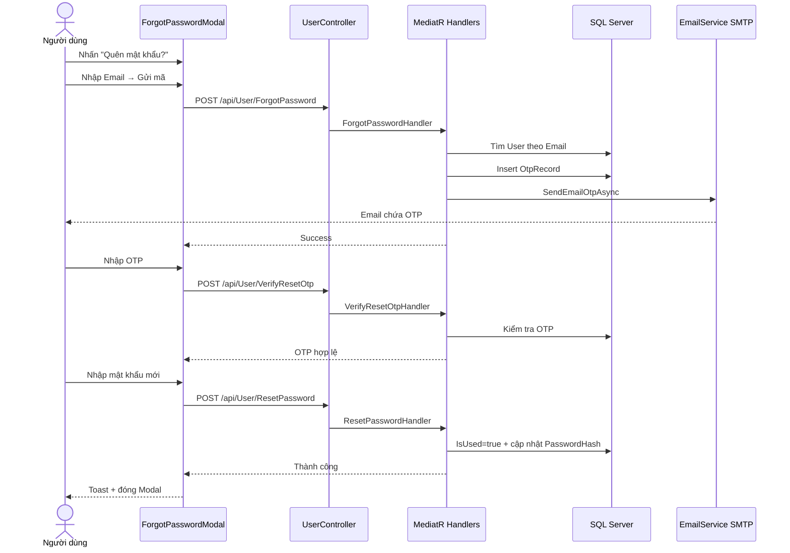

# Tài liệu Quy trình: Quên mật khẩu (Forgot Password)

Tài liệu này mô tả chi tiết luồng hoạt động của tính năng khôi phục mật khẩu khi người dùng quên thông tin đăng nhập trong hệ thống **UniEats**.

> Khác với một số hệ thống gửi **Reset Link** qua email, UniEats dùng **OTP 6 số** gửi email (hết hạn 5 phút), xác minh OTP, rồi đặt mật khẩu mới trong cùng một Modal 3 bước trên Frontend.

---

## 1. Luồng Tổng Quan (Workflow)

1. **Yêu cầu:** Người dùng mở trang Đăng nhập (`/login`) → nhấn **"Quên mật khẩu?"**.
2. **Nhập thông tin:** Modal hiện form yêu cầu nhập **Email** (Bước 1/3).
3. **Gửi yêu cầu:** Người dùng nhấn **"Gửi mã xác thực"** → Frontend gọi `POST /api/User/ForgotPassword` kèm Email.
4. **Kiểm tra hệ thống:** Backend tìm User theo Email trong Database.
5. **Tạo mã xác thực:** Nếu tồn tại, Server tạo OTP 6 số, lưu vào bảng `OTP_RECORD` (hạn 5 phút, chưa dùng).
6. **Gửi Email:** Server gửi email chứa mã OTP tới địa chỉ Email của người dùng.
7. **Nhập OTP:** Modal chuyển Bước 2/3 → người dùng nhập OTP → gọi `POST /api/User/VerifyResetOtp`.
8. **Xác thực OTP:** Server kiểm tra OTP tồn tại, chưa dùng, còn hạn.
9. **Đặt lại mật khẩu:** Modal chuyển Bước 3/3 → người dùng nhập mật khẩu mới + xác nhận → gọi `POST /api/User/ResetPassword`.
10. **Hoàn tất:** Server hash mật khẩu (SHA256), đánh dấu OTP đã dùng, cập nhật `USER_ACCOUNT` → toast thành công → đóng Modal → người dùng đăng nhập lại.



---

## Bước 1: Người dùng nhấn Quên mật khẩu

**Thông tin:**
- **URL (FE):** `/login`
- **UI:** Nút **"Quên mật khẩu?"** trên form đăng nhập
- **Component mở Modal:** `ForgotPasswordModal`

**File Frontend:**
- `ShoppingFood.FE/src/pages/LoginPage.tsx` → render `LoginForm`
- `ShoppingFood.FE/src/components/auth/LoginForm.tsx`

**Đoạn kích hoạt Modal** (`LoginForm.tsx`):

```tsx
<button
  type="button"
  onClick={() => setIsForgotModalOpen(true)}
  className="text-sm font-medium text-orange-600 ..."
>
  Quên mật khẩu?
</button>

<ForgotPasswordModal
  isOpen={isForgotModalOpen}
  onClose={() => setIsForgotModalOpen(false)}
/>
```

**File Modal:** `ShoppingFood.FE/src/components/auth/ForgotPasswordModal.tsx`  
- State `step`: `1 | 2 | 3`  
- Bước 1 = nhập Email, gọi `handleRequestOtp`

---

## Bước 2: Gửi OTP khôi phục (Backend)

**Thông tin:**
- **URL:** `/api/User/ForgotPassword`
- **HTTP Method:** POST
- **Auth:** Public (bypass trong `AuthenticationFilter`)
- **Request body:**

```json
{ "email": "user@example.com" }
```

### 2.1. Frontend gọi API

**File:** `ShoppingFood.FE/src/services/AuthService.ts`

```typescript
async forgotPassword(data: { email: string }): Promise<IApiResponse<any>> {
  return httpClient.post<IApiResponse<any>>('/User/ForgotPassword', data);
}
```

**File:** `ShoppingFood.FE/src/components/auth/ForgotPasswordModal.tsx` — method `handleRequestOtp`

```typescript
const response = await authService.forgotPassword({ email });
if (!response.error) {
  toast.success(response.message || 'Mã OTP đã được gửi đến email của bạn');
  setStep(2);
} else {
  toast.error(response.message || 'Có lỗi xảy ra');
}
```

### 2.2. Controller

**File:** `src/ShoppingFood.API/Controllers/UserController.cs`  
**Class:** `UserController`  
**Method:** `ForgotPassword`  
**Lines:** 323–329

```csharp
[HttpPost("ForgotPassword")]
public async Task<ActionResult<ApiResponse>> ForgotPassword([FromBody] ForgotPasswordCommand command)
{
    var response = await _mediator.Send(command);
    if (response.Error) return BadRequest(response);
    return Ok(response);
}
```

### 2.3. Command

**File:** `src/ShoppingFood.Application/Features/Users/Commands/ForgotPasswordCommand.cs`

```csharp
public class ForgotPasswordCommand : BaseCommand, IRequest<ApiResponse>
{
    public string Email { get; set; } = string.Empty;
}
```

### 2.4. Handler — tạo OTP + gửi email

**File:** `src/ShoppingFood.Application/Features/Users/Commands/ForgotPasswordHandler.cs`  
**Class:** `ForgotPasswordHandler`  
**Method:** `Handle`

```csharp
public async Task<ApiResponse> Handle(ForgotPasswordCommand request, CancellationToken cancellationToken)
{
    if (string.IsNullOrWhiteSpace(request.Email))
    {
        return ApiResponse.Failure(400, "Vui lòng nhập Email.");
    }

    var user = await _dbContext.Users.FirstOrDefaultAsync(u => u.Email == request.Email, cancellationToken);
    if (user == null)
    {
        // Hiện tại trả 404 (UX rõ ràng). Lưu ý: có thể bị email enumeration.
        return ApiResponse.Failure(404, "Không tìm thấy tài khoản với email này.");
    }

    // Generate 6-digit OTP
    var otpCode = new Random().Next(100000, 999999).ToString();

    var otpRecord = new OtpRecord
    {
        Id = Guid.NewGuid(),
        EmailOrPhone = request.Email,
        OtpCode = otpCode,
        ExpiryTime = DateTime.UtcNow.AddMinutes(5),
        IsUsed = false,
        CreatedAt = DateTime.UtcNow
    };

    _dbContext.OtpRecords.Add(otpRecord);
    await _dbContext.SaveChangesAsync(cancellationToken);

    var sent = await _emailService.SendEmailOtpAsync(request.Email, otpCode);
    if (!sent)
    {
        return ApiResponse.Failure(500, "Không thể gửi email OTP lúc này. Vui lòng thử lại sau.");
    }

    return ApiResponse.Success(null, "Mã xác nhận OTP đã được gửi đến email của bạn.");
}
```

### 2.5. Gửi Email SMTP

**File:** `src/ShoppingFood.Application/Services/EmailService.cs`  
**Method:** `SendEmailOtpAsync`

```csharp
Subject = "ShoppingFood - Mã OTP xác nhận của bạn",
Body = $@"
    <h3>Xin chào,</h3>
    <p>Mã OTP xác nhận của bạn là: <strong>{otpCode}</strong></p>
    <p>Mã này có hiệu lực trong vòng 5 phút. Vui lòng không chia sẻ mã này cho bất kỳ ai.</p>
    ...
"
```

Config SMTP: `appsettings.json` → section `SmtpSettings` (`Server`, `Port`, `SenderEmail`, `Username`, `Password`, `EnableSsl`).

### 2.6. Database liên quan

| Bảng | Việc xảy ra |
|------|-------------|
| `USER_ACCOUNT` | Tìm theo `Email` |
| `OTP_RECORD` | Insert: `EmailOrPhone`, `OtpCode`, `ExpiryTime` (+5 phút), `IsUsed = false` |

**Entity:** `src/ShoppingFood.Domain/Models/OtpRecord.cs`

---

## Bước 3: Xác minh OTP

**Thông tin:**
- **URL:** `/api/User/VerifyResetOtp`
- **HTTP Method:** POST
- **Auth:** Public
- **Request body:**

```json
{ "email": "user@example.com", "otpCode": "123456" }
```

### 3.1. Frontend

**File:** `AuthService.ts`

```typescript
async verifyResetOtp(data: { email: string; otpCode: string }) {
  return httpClient.post('/User/VerifyResetOtp', data);
}
```

**Modal** — `handleVerifyOtp`: nếu thành công → `setStep(3)`.

### 3.2. Controller

**File:** `UserController.cs` — Lines 331–337

```csharp
[HttpPost("VerifyResetOtp")]
public async Task<ActionResult<ApiResponse>> VerifyResetOtp([FromBody] VerifyResetOtpCommand command)
{
    var response = await _mediator.Send(command);
    if (response.Error) return BadRequest(response);
    return Ok(response);
}
```

### 3.3. Handler

**File:** `src/ShoppingFood.Application/Features/Users/Commands/VerifyResetOtpHandler.cs`

```csharp
var otpRecord = await _dbContext.OtpRecords
    .Where(o => o.EmailOrPhone == request.Email && o.OtpCode == request.OtpCode)
    .OrderByDescending(o => o.CreatedAt)
    .FirstOrDefaultAsync(cancellationToken);

if (otpRecord == null || otpRecord.IsUsed || otpRecord.ExpiryTime < DateTime.UtcNow)
{
    return ApiResponse.Failure(400, "Mã OTP không hợp lệ hoặc đã hết hạn.");
}

// OTP hợp lệ — CHƯA đánh dấu IsUsed (chỉ đánh dấu khi ResetPassword thành công)
return ApiResponse.Success(null, "Mã OTP hợp lệ.");
```

---

## Bước 4: Đặt lại mật khẩu mới

**Thông tin:**
- **URL:** `/api/User/ResetPassword`
- **HTTP Method:** POST
- **Auth:** Public
- **Request body:**

```json
{
  "email": "user@example.com",
  "otpCode": "123456",
  "newPassword": "MatKhauMoi123"
}
```

### 4.1. Frontend validation + gọi API

**File:** `ForgotPasswordModal.tsx` — `handleResetPassword`

- Mật khẩu tối thiểu 6 ký tự  
- `confirmPassword` phải khớp  
- Toast success → `handleClose()` (reset step về 1, xóa form)

**File:** `AuthService.ts`

```typescript
async resetPassword(data: { email: string; otpCode: string; newPassword: string }) {
  return httpClient.post('/User/ResetPassword', data);
}
```

### 4.2. Controller

**File:** `UserController.cs` — Lines 339–345

```csharp
[HttpPost("ResetPassword")]
public async Task<ActionResult<ApiResponse>> ResetPassword([FromBody] ResetPasswordCommand command)
{
    var response = await _mediator.Send(command);
    if (response.Error) return BadRequest(response);
    return Ok(response);
}
```

### 4.3. Handler — hash + cập nhật DB

**File:** `src/ShoppingFood.Application/Features/Users/Commands/ResetPasswordHandler.cs`  
**Class:** `ResetPasswordHandler`  
**Method:** `Handle`

```csharp
// 1. Xác thực OTP lần nữa (còn hạn, chưa dùng)
var otpRecord = await _dbContext.OtpRecords
    .Where(o => o.EmailOrPhone == request.Email && o.OtpCode == request.OtpCode)
    .OrderByDescending(o => o.CreatedAt)
    .FirstOrDefaultAsync(cancellationToken);

if (otpRecord == null || otpRecord.IsUsed || otpRecord.ExpiryTime < DateTime.UtcNow)
{
    return ApiResponse.Failure(400, "Mã OTP không hợp lệ hoặc đã hết hạn.");
}

var user = await _dbContext.Users.FirstOrDefaultAsync(u => u.Email == request.Email, cancellationToken);
if (user == null)
{
    return ApiResponse.Failure(404, "Không tìm thấy người dùng.");
}

// 2. Đánh dấu OTP đã dùng (one-time)
otpRecord.IsUsed = true;

// 3. Hash mật khẩu mới bằng SHA256 → Base64
string newPasswordHash;
using (var sha256 = SHA256.Create())
{
    var hashedBytes = sha256.ComputeHash(Encoding.UTF8.GetBytes(request.NewPassword));
    newPasswordHash = Convert.ToBase64String(hashedBytes);
}

// 4. Không cho đặt trùng mật khẩu cũ
if (user.PasswordHash == newPasswordHash)
{
    return ApiResponse.Failure(400, "Mật khẩu mới phải khác mật khẩu cũ.");
}

user.PasswordHash = newPasswordHash;
await _dbContext.SaveChangesAsync(cancellationToken);

return ApiResponse.Success(null, "Đặt lại mật khẩu thành công. Bạn có thể đăng nhập bằng mật khẩu mới.");
```

---

## Sơ đồ file đi qua (Call chain)

```text
LoginPage.tsx
  ↓
LoginForm.tsx  (nút "Quên mật khẩu?")
  ↓
ForgotPasswordModal.tsx  (step 1 → 2 → 3)
  ↓
AuthService.ts  (forgotPassword / verifyResetOtp / resetPassword)
  ↓
HttpClient.ts  →  http://localhost:5091/api/...
  ↓
AuthenticationFilter.cs  (bypass 3 route Forgot/Verify/Reset)
  ↓
UserController.cs  (ForgotPassword / VerifyResetOtp / ResetPassword)
  ↓
MediatR
  ↓
ForgotPasswordHandler.cs  →  EmailService.SendEmailOtpAsync
VerifyResetOtpHandler.cs
ResetPasswordHandler.cs
  ↓
ShoppingFoodContext  →  USER_ACCOUNT + OTP_RECORD
```

| Vai trò | Đường dẫn đầy đủ |
|---------|------------------|
| UI Modal | `ShoppingFood.FE/src/components/auth/ForgotPasswordModal.tsx` |
| UI Login | `ShoppingFood.FE/src/components/auth/LoginForm.tsx` |
| FE Service | `ShoppingFood.FE/src/services/AuthService.ts` |
| Controller | `src/ShoppingFood.API/Controllers/UserController.cs` |
| Commands | `src/ShoppingFood.Application/Features/Users/Commands/ForgotPasswordCommand.cs` (và Verify/Reset) |
| Handlers | `.../ForgotPasswordHandler.cs`, `VerifyResetOtpHandler.cs`, `ResetPasswordHandler.cs` |
| Email | `src/ShoppingFood.Application/Services/EmailService.cs` |
| Entity OTP | `src/ShoppingFood.Domain/Models/OtpRecord.cs` |
| Entity User | `src/ShoppingFood.Domain/Models/User.cs` |
| Bypass auth | `src/ShoppingFood.API/Filters/AuthenticationFilter.cs` (khoảng dòng 52–54) |

---

## Các thông báo (Toast / Message)

| Message | Nơi hiện | Trigger |
|---------|----------|---------|
| `Mã OTP đã được gửi đến email của bạn` | `toast.success` trong Modal | ForgotPassword OK |
| `Không tìm thấy tài khoản với email này.` | `toast.error` | Email không tồn tại |
| `Không thể gửi email OTP lúc này...` | `toast.error` | SMTP fail |
| `Mã OTP hợp lệ` | `toast.success` | VerifyResetOtp OK |
| `Mã OTP không hợp lệ hoặc đã hết hạn.` | `toast.error` | OTP sai/hết hạn/đã dùng |
| `Đặt lại mật khẩu thành công!` | `toast.success` | ResetPassword OK |
| `Mật khẩu mới phải khác mật khẩu cũ.` | `toast.error` | Hash trùng mật khẩu cũ |
| Validate FE: email / OTP 6 số / MK ≥ 6 / confirm khớp | `errors` trên Input | Trước khi gọi API |

---

## Các cơ chế bảo mật quan trọng

1. **OTP ngắn hạn:** Mã 6 số, hết hạn sau **5 phút** (`ExpiryTime = UtcNow.AddMinutes(5)`).
2. **One-time Use:** `IsUsed = true` ngay khi reset thành công; OTP đã dùng không tái sử dụng được.
3. **Xác thực kép:** OTP được check ở `VerifyResetOtp` **và** check lại ở `ResetPassword` trước khi đổi mật khẩu.
4. **Password Hashing:** Mật khẩu lưu dạng **SHA256 → Base64** (cùng cách hash với Login), không lưu plain text.
5. **Không cho trùng mật khẩu cũ:** So sánh hash mới với `user.PasswordHash`.
6. **Public endpoints có kiểm soát:** 3 API bypass JWT nhưng vẫn validate input + OTP.
7. **⚠️ User Enumeration:** Hiện tại nếu email không tồn tại → trả **404** rõ ràng (tiện UX, kém bảo mật hơn mẫu LaptopStore luôn trả “đã gửi email”). Có thể cải thiện sau bằng cách luôn trả success generic.
8. **⚠️ OTP entropy:** `Random().Next(100000, 999999)` đủ cho demo; production nên dùng `RandomNumberGenerator` (cryptographic).

---

## Checklist tự test (Screen Run)

- [ ] Mở `/login` → nhấn **Quên mật khẩu?** → Modal hiện Bước 1
- [ ] Email không tồn tại → toast lỗi 404
- [ ] Email hợp lệ + SMTP OK → nhận email OTP, Modal Bước 2
- [ ] OTP sai / hết hạn → lỗi, không sang Bước 3
- [ ] OTP đúng → Bước 3 nhập mật khẩu
- [ ] Confirm không khớp → lỗi FE, không gọi API
- [ ] Đặt MK mới thành công → toast → Modal đóng
- [ ] Login bằng mật khẩu mới thành công
- [ ] Dùng lại cùng OTP → bị từ chối (`IsUsed`)

---

## Tóm tắt

UniEats khôi phục mật khẩu theo mô hình **Email → OTP → Đặt lại MK** (không dùng Reset Link).  
Luồng đi qua **Modal 3 bước (FE)** → **3 API public** → **3 MediatR Handlers** → bảng **`OTP_RECORD` + `USER_ACCOUNT`**.

> Liên kết onboarding: [Part 2 Features](../ONBOARDING_PART2_FEATURES_FLOWS.md) · [Part 5 Auth](../ONBOARDING_PART5_AUTH_DI_ALERTS.md) · [INDEX](../ONBOARDING_INDEX.md)
