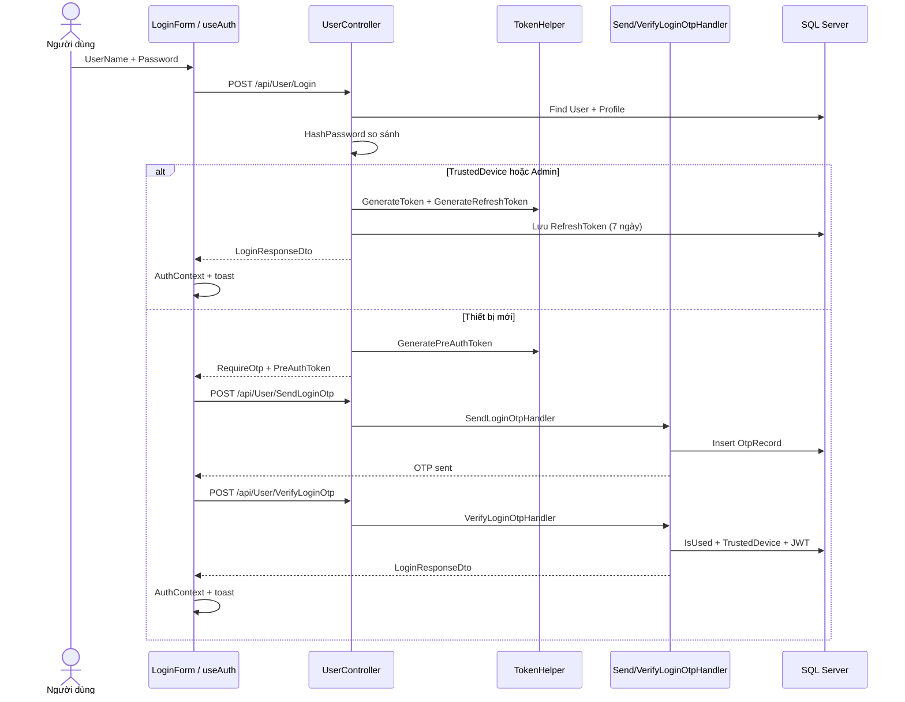

# Tài liệu Quy trình: Đăng nhập (Login)

Tài liệu này mô tả chi tiết luồng đăng nhập trong hệ thống **Shopping Food**: mật khẩu + TrustedDevice + OTP 2FA, kèm các đường đăng nhập thay thế (Google / Microsoft / Firebase Phone) và cơ chế Refresh Token phía Frontend.

> **Lưu ý kiến trúc:** `POST /api/User/Login` xử lý **inline trong Controller** (không qua MediatR). OTP 2FA dùng MediatR (`SendLoginOtp` / `VerifyLoginOtp`).

---

## 1. Luồng Tổng Quan (Workflow)

1. **Yêu cầu:** Người dùng mở `/login` → nhập UserName/Email + Password → nhấn Đăng nhập.
2. **Gửi request:** Frontend (`useAuth.login` → `AuthService.login`) gọi `POST /api/User/Login`.
3. **Xác thực mật khẩu:** `UserController.Login` tìm User, so sánh SHA256 hash, kiểm tra `Blocked` / `Inactive`.
4. **TrustedDevice / Admin:** Nếu IP đã tin cậy (còn hạn) **hoặc** Role = Admin → cấp JWT + RefreshToken ngay (`message = "Login successful"`).
5. **Require OTP:** Thiết bị mới → tạo **PreAuthToken** (10 phút) + `AvailableMethods` (`email`/`phone`) → `message = "RequireOtp"`.
6. **Gửi OTP:** FE gọi `POST /api/User/SendLoginOtp` (method email hoặc phone) → lưu `OTP_RECORD`, gửi SMTP / Stringee.
7. **Xác minh OTP:** FE gọi `POST /api/User/VerifyLoginOtp` → đánh dấu OTP đã dùng, tạo JWT + Refresh, **lưu TrustedDevice 30 ngày**.
8. **Lưu session FE:** `StorageUtil.setToken` → `getProfile` → `AuthContext.login` → toast thành công.
9. **Refresh (ngầm):** Access token hết hạn (~15 phút) → `HttpClient` 401 interceptor → `POST /api/User/RefreshToken` → cập nhật `sf_token`.



---

## Bước 1: Mở trang Đăng nhập (Frontend)

**Thông tin:**
- **URL (FE):** `/login`
- **Page:** `ShoppingFood.FE/src/pages/LoginPage.tsx`
- **Form:** `ShoppingFood.FE/src/components/auth/LoginForm.tsx`
- **Hook:** `ShoppingFood.FE/src/hooks/useAuth.ts`
- **Service:** `ShoppingFood.FE/src/services/AuthService.ts`

**Gọi API từ AuthService:**

```typescript
async login(credentials: ILoginRequest): Promise<IApiResponse<any>> {
  return httpClient.post<IApiResponse<any>>(API_ENDPOINTS.AUTH.LOGIN, credentials);
}
```

**Xử lý response trong `useAuth.login`:**

```typescript
if (response.message === "RequireOtp") {
  return { success: true, requireOtp: true, data: response.data };
}
if (response.message === "AccountLocked") {
  return { success: true, isLocked: true, requireOtp: true, data: response.data };
}
await fetchAndSetProfile(loginData);
toast.success('Đăng nhập thành công!');
```

---

## Bước 2: Xử lý Login mật khẩu (Backend — inline Controller)

**Thông tin:**
- **URL:** `/api/User/Login`
- **HTTP Method:** POST
- **Auth:** Public (bypass trong `AuthenticationFilter`)
- **Request DTO:** `src/ShoppingFood.Dto/User/Login.cs` — `{ userName, password }`

**File:** `src/ShoppingFood.API/Controllers/UserController.cs`  
**Method:** `Login` — Lines **86–180**

```csharp
[HttpPost("Login")]
public async Task<ActionResult<ApiResponse>> Login([FromBody] Login request)
{
    var user = await _dbContext.Users
        .Include(u => u.Profile)
        .FirstOrDefaultAsync(u => u.UserName == request.UserName || u.Email == request.UserName);

    if (user == null)
        return Unauthorized(ApiResponse.Failure(401, "Sai Tên đăng nhập / Email hoặc Mật khẩu."));

    var passwordHash = HashPassword(request.Password);
    if (user.PasswordHash != passwordHash)
        return Unauthorized(ApiResponse.Failure(401, "Sai Tên đăng nhập / Email hoặc Mật khẩu."));

    if (user.Status == UserStatus.Blocked)
        return Unauthorized(ApiResponse.Failure(403, "Tài khoản của bạn đã bị khóa bởi quản trị viên."));

    if (user.Status == UserStatus.Inactive)
    {
        // PreAuthToken để mở khóa tài khoản (AccountLocked)
        var unlockPreAuthToken = TokenHelper.GeneratePreAuthToken(...);
        return Ok(ApiResponse.Success(new { PreAuthToken = unlockPreAuthToken, AvailableMethods = methods }, "AccountLocked"));
    }

    // TrustedDevice theo IP hoặc Admin → JWT ngay
    var isTrusted = await _dbContext.TrustedDevices.AnyAsync(t =>
        t.UserAccountId == user.Id &&
        t.IpAddress == clientIp &&
        t.ExpiresAt > DateTime.UtcNow);

    if (isTrusted || isAdmin)
    {
        var token = TokenHelper.GenerateToken(user.UserName!, secretKey, issuer, audience);
        var refreshToken = TokenHelper.GenerateRefreshToken();
        user.RefreshToken = refreshToken;
        user.RefreshTokenExpiryTime = DateTime.UtcNow.AddDays(7);
        AppendRefreshTokenCookie(refreshToken);
        return Ok(ApiResponse.Success(loginResponse, "Login successful"));
    }

    // Thiết bị mới → RequireOtp
    var preAuthToken = TokenHelper.GeneratePreAuthToken(user.UserName!, secretKey, issuer, audience);
    return Ok(ApiResponse.Success(responseDto, "RequireOtp"));
}
```

**Hash mật khẩu** (cùng thuật toán Register) — `UserController.HashPassword` Lines **432–438**:

```csharp
private static string HashPassword(string password)
{
    using (var sha256 = SHA256.Create())
    {
        var hashedBytes = sha256.ComputeHash(Encoding.UTF8.GetBytes(password));
        return Convert.ToBase64String(hashedBytes);
    }
}
```

**Database:**
| Bảng | Việc |
|------|------|
| `USER_ACCOUNT` | Tìm theo UserName/Email; cập nhật RefreshToken |
| `USER_PROFILE` | Role, FullName, Avatar |
| `TRUSTED_DEVICE` | Check IP còn hạn |

---

## Bước 3: TokenHelper — tạo JWT / PreAuth / Refresh

**File:** `src/ShoppingFood.Core/Security/TokenHelper.cs`

| Method | Lines | Việc |
|--------|-------|------|
| `GenerateToken` | 46–64 | Access JWT HS256, default **15 phút**, claims `sub` + Name |
| `GeneratePreAuthToken` | 66–69 | Gọi GenerateToken với **10 phút** |
| `GenerateRefreshToken` | 71–77 | Random 32 bytes → Base64 |
| `GetUsernameFromToken` | 14–44 | Đọc `sub` từ JWT (dùng cho PreAuth + Filter) |

```csharp
public static string GenerateToken(string username, string secretKey, string issuer, string audience, int expiryMinutes = 15)
{
    // Claims: JwtRegisteredClaimNames.Sub, ClaimTypes.Name
    // SigningCredentials: HmacSha256Signature
}

public static string GeneratePreAuthToken(...)
{
    return GenerateToken(username, secretKey, issuer, audience, 10);
}
```

Config: `JwtSettings:Secret` / `Issuer` / `Audience` trong `appsettings.json`.

**Refresh cookie** — `AppendRefreshTokenCookie` (Lines 408–418): HttpOnly, Secure, SameSite=None, 7 ngày, tên cookie `refreshToken`.

---

## Bước 4: Gửi OTP 2FA (SendLoginOtp)

**Thông tin:**
- **URL:** `/api/User/SendLoginOtp`
- **HTTP Method:** POST
- **Auth:** Public
- **Body:** `{ preAuthToken, method }` — `method` = `"email"` hoặc `"phone"`

**Controller** — Lines **182–194**:

```csharp
[HttpPost("SendLoginOtp")]
public async Task<ActionResult<ApiResponse>> SendLoginOtp([FromBody] SendLoginOtpRequest request)
{
    var command = new SendLoginOtpCommand
    {
        PreAuthToken = request.PreAuthToken,
        Method = request.Method,
        IpAddress = HttpContext.Connection.RemoteIpAddress?.ToString()
    };
    var response = await _mediator.Send(command);
    ...
}
```

**Handler:** `src/ShoppingFood.Application/Features/Users/Commands/SendLoginOtpHandler.cs`

```csharp
username = TokenHelper.GetUsernameFromToken(request.PreAuthToken, _configuration);
// Rate limit: tối đa 5 OTP / 10 phút cho cùng EmailOrPhone
// Invalidate OTP cũ chưa dùng (IsUsed = true)
// OTP 6 số, ExpiryTime = UtcNow + 10 phút
// email → IEmailService.SendEmailOtpAsync
// phone → IStringeeService.SendSmsOtpAsync
```

**FE:** `useAuth.sendLoginOtp` → toast `'Mã OTP đã được gửi!'`

---

## Bước 5: Xác minh OTP + TrustedDevice (VerifyLoginOtp)

**Thông tin:**
- **URL:** `/api/User/VerifyLoginOtp`
- **HTTP Method:** POST
- **Body:** `{ preAuthToken, otpCode }`

**Handler:** `src/ShoppingFood.Application/Features/Users/Commands/VerifyLoginOtpHandler.cs`

```csharp
// Parse PreAuthToken → username → load User + Profile
// Tìm OtpRecord theo Email/Phone + OtpCode + !IsUsed
// Check ExpiryTime
otpRecord.IsUsed = true;

var token = TokenHelper.GenerateToken(...);
var refreshToken = TokenHelper.GenerateRefreshToken();
user.RefreshToken = refreshToken;
user.RefreshTokenExpiryTime = DateTime.UtcNow.AddDays(7);

// TrustedDevice theo IP — ExpiresAt = UtcNow + 30 days
_dbContext.TrustedDevices.Add(new TrustedDevice { ... });

return ApiResponse.Success(loginResponse, "Verification successful");
```

**FE:** `useAuth.verifyLoginOtp` → `fetchAndSetProfile` → toast `'Đăng nhập thành công!'`

---

## Bước 6: Lưu session Frontend (AuthContext + Storage)

**Files:**
- `ShoppingFood.FE/src/utils/storage.ts` — keys `sf_token`, `sf_user`
- `ShoppingFood.FE/src/contexts/AuthContext.tsx` — restore on mount, `login` / `logout`
- `ShoppingFood.FE/src/hooks/useAuth.ts` — `fetchAndSetProfile`

```typescript
StorageUtil.setToken(loginData.token);
const profileRes = await authService.getProfile(); // GET /api/User/Profile
ctxLogin(loginData.token, profileRes.data);
```

`GET /api/User/Profile` **cần JWT** (không bypass) — gọi sau khi đã có access token.

---

## Bước 7: Refresh Token (HttpClient)

**Thông tin:**
- **URL:** `/api/User/RefreshToken`
- **HTTP Method:** POST
- **Auth:** Public (bypass); refresh lấy từ body hoặc cookie `refreshToken`

**FE:** `ShoppingFood.FE/src/services/base/HttpClient.ts` — response interceptor khi **401**:

```typescript
const response = await authService.refreshToken(token);
if (!response.error && response.data) {
  StorageUtil.setToken(response.data.token);
  originalRequest.headers.Authorization = `Bearer ${response.data.token}`;
  // retry request
}
```

**BE:** `UserController.RefreshToken` Lines **294–314** → `RefreshTokenCommand` / Handler → JWT mới + cookie refresh.

---

## Phụ lục A: Đăng nhập Google

| Mục | Chi tiết |
|-----|----------|
| FE | `LoginForm` + `@react-oauth/google` → `useAuth.loginGoogle(credential)` |
| API | `POST /api/User/LoginGoogle` |
| Handler | `src/ShoppingFood.Application/Features/Users/Commands/LoginGoogleHandler.cs` |
| Logic | `GoogleJsonWebSignature.ValidateAsync` với `GoogleAuth:ClientId`; tìm/ tạo user theo email; cấp JWT |
| Toast | `'Đăng nhập Google thành công!'` |

```csharp
// LoginGoogleHandler — validate credential, tìm User theo payload.Email
payload = await GoogleJsonWebSignature.ValidateAsync(request.Credential, settings);
```

---

## Phụ lục B: Đăng nhập Microsoft

| Mục | Chi tiết |
|-----|----------|
| FE | Popup OAuth → `main.tsx` bắt `?code=` → `postMessage` → `useAuth.loginMicrosoft(code, redirectUri)` |
| API | `POST /api/User/LoginMicrosoft` |
| Handler | `LoginMicrosoftHandler.cs` |
| Config FE | `ShoppingFood.FE/src/config/msalConfig.ts` + client id trong `LoginForm` |
| Toast | `'Đăng nhập Microsoft thành công'` |

---

## Phụ lục C: Đăng nhập Firebase Phone

| Mục | Chi tiết |
|-----|----------|
| FE | Firebase `RecaptchaVerifier` + `signInWithPhoneNumber` → lấy `idToken` → `useAuth.loginFirebasePhone` |
| API | `POST /api/User/LoginFirebasePhone` |
| Handler | `LoginFirebasePhoneHandler.cs` — `FirebaseAuth.DefaultInstance.VerifyIdTokenAsync` |
| Toast | `'Đăng nhập bằng số điện thoại thành công!'` |

**Biến thể Stringee (cũ):** `POST /api/User/SendOtp` + `POST /api/User/LoginByPhone` (`LoginByPhoneHandler.cs`).

---

## Sơ đồ file đi qua (Call chain)

```text
LoginPage.tsx
  ↓
LoginForm.tsx
  ↓
useAuth.ts  (login / sendLoginOtp / verifyLoginOtp / loginGoogle / ...)
  ↓
AuthService.ts + HttpClient.ts
  ↓
AuthenticationFilter.cs  (bypass /api/User/Login*)
  ↓
UserController.Login  (inline)  OR  SendLoginOtp / VerifyLoginOtp → MediatR
  ↓
TokenHelper.cs
  ↓
SendLoginOtpHandler / VerifyLoginOtpHandler
  ↓
USER_ACCOUNT + USER_PROFILE + OTP_RECORD + TRUSTED_DEVICE
  ↓
AuthContext.tsx + storage.ts (sf_token / sf_user)
```

| Vai trò | Đường dẫn đầy đủ |
|---------|------------------|
| UI | `ShoppingFood.FE/src/components/auth/LoginForm.tsx` |
| Hook | `ShoppingFood.FE/src/hooks/useAuth.ts` |
| Context | `ShoppingFood.FE/src/contexts/AuthContext.tsx` |
| Storage | `ShoppingFood.FE/src/utils/storage.ts` |
| HTTP + Refresh | `ShoppingFood.FE/src/services/base/HttpClient.ts` |
| Controller | `src/ShoppingFood.API/Controllers/UserController.cs` |
| Token | `src/ShoppingFood.Core/Security/TokenHelper.cs` |
| OTP Handlers | `.../SendLoginOtpHandler.cs`, `VerifyLoginOtpHandler.cs` |
| Filter bypass | `src/ShoppingFood.API/Filters/AuthenticationFilter.cs` |

---

## Các thông báo (Toast / Message)

| Message | Nơi | Trigger |
|---------|-----|---------|
| `Đăng nhập thành công!` | `useAuth` | Login OK / VerifyLoginOtp OK |
| `RequireOtp` (message API) | FE branch | Thiết bị mới |
| `AccountLocked` (message API) | FE branch | Status Inactive |
| `Mã OTP đã được gửi!` | `sendLoginOtp` | SendLoginOtp OK |
| `Sai Tên đăng nhập / Email hoặc Mật khẩu.` | toast error | 401 Login |
| `Tài khoản của bạn đã bị khóa bởi quản trị viên.` | toast error | Status Blocked |
| `Quá nhiều yêu cầu OTP...` | toast error | Rate limit 429 |
| `Invalid OTP.` / `OTP has expired.` | toast error | Verify fail |
| `Đăng nhập Google / Microsoft / SĐT thành công` | useAuth | OAuth paths |
| `Vui lòng đăng nhập lại` | HttpClient translate | 401 sau khi refresh fail |

---

## Các cơ chế bảo mật quan trọng

1. **Password hashing:** SHA256 → Base64 (không lưu plain text).
2. **TrustedDevice:** IP + ExpiresAt 30 ngày; Admin bỏ qua OTP.
3. **PreAuthToken:** JWT ngắn (10 phút) chỉ để gửi/xác minh OTP — chưa phải session đầy đủ.
4. **OTP one-time + rate limit:** Invalidate OTP cũ; tối đa 5 OTP / 10 phút; expiry OTP login **10 phút**.
5. **Refresh HttpOnly cookie** + refresh lưu DB 7 ngày.
6. **Access token ngắn** (~15 phút) + FE auto-refresh.
7. **Bypass list có kiểm soát** cho Login/OTP/OAuth trong `AuthenticationFilter`.
8. **⚠️** `GetUsernameFromToken` đọc claim không full ValidateToken signature trong một số path — dựa vào cấu trúc JWT.

---

## Checklist tự test

- [ ] Login đúng mật khẩu + IP lần đầu → `RequireOtp`
- [ ] SendLoginOtp email/phone → nhận OTP
- [ ] VerifyLoginOtp đúng → vào app + có `sf_token`
- [ ] Login lại cùng IP trong 30 ngày → không OTP
- [ ] Sai mật khẩu → 401
- [ ] User Blocked → 403
- [ ] Google / Microsoft / Firebase phone login thành công
- [ ] Đợi access token hết hạn → API tự refresh (không đá về login ngay)
- [ ] Logout → clear cookie/storage

---

## Tóm tắt

Login Shopping Food = **password inline trong `UserController`** + **TrustedDevice theo IP** + **OTP 2FA qua MediatR**; session FE lưu JWT localStorage; refresh qua cookie/API. OAuth (Google/MS/Firebase) là đường song song cùng cấp `LoginResponseDto`.

> Liên kết: [ForgotPassword_Workflow.md](./ForgotPassword_Workflow.md) · [Register_Workflow.md](./Register_Workflow.md) · [Part 5 Auth](../ONBOARDING_PART5_AUTH_DI_ALERTS.md) · [INDEX](../ONBOARDING_INDEX.md)
