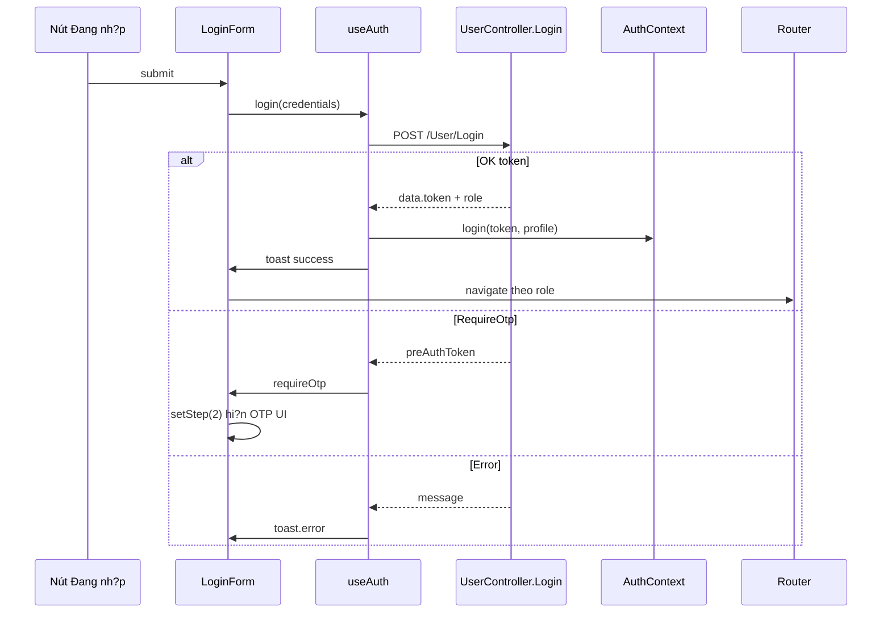

# Tài li?u Quy trình: Ðang nh?p (Login)

Tài li?u này mô t? chi ti?t lu?ng dang nh?p trong h? th?ng **UniEats**: m?t kh?u + TrustedDevice + OTP 2FA, kèm các du?ng dang nh?p thay th? (Google / Microsoft / Firebase Phone) và co ch? Refresh Token phía Frontend.

> **Luu ý ki?n trúc:** `POST /api/User/Login` x? lý **inline trong Controller** (không qua MediatR). OTP 2FA dùng MediatR (`SendLoginOtp` / `VerifyLoginOtp`).

---


---

## Ph?n A — UI Interaction Trace (Nút b?m ? Code ? Data ? Hi?n th?)

> UI Trace — Auth / Login  
> M?i thao tác tr? l?i: **nút ? dâu** · **b?m ch?y file/hàm nào** · **API/BE dâu** · **data tr? v?** · **hi?n th? th? nào**.


**Page g?c:** Route `/login` ? `pages/LoginPage.tsx` render `components/auth/LoginForm.tsx`.

---

## UT-AUTH-01 — Nút / Form **?Ðang nh?p?** (username + password)

### 1. Giao di?n nút b?m ? dâu?

| M?c | Giá tr? |
|-----|---------|
| **Route** | `/login` |
| **Page** | `ShoppingFood.FE/src/pages/LoginPage.tsx` |
| **Component** | `ShoppingFood.FE/src/components/auth/LoginForm.tsx` |
| **Nhãn** | Button `"Ðang nh?p"` (`size="lg"`, `type="submit"`) |
| **Form** | `<form onSubmit={handleLoginSubmit}>` khi `loginMethod === 'standard'` và `step === 1` |
| **Input** | Username/Email + Password (có nút hi?n/?n MK) |

### 2. B?m xong ch?y d?n dâu? (Frontend)

```text
User nh?n ?Ðang nh?p? / Enter
  ? form onSubmit
  ? LoginForm.handleLoginSubmit (LoginForm.tsx ~89+)
       · validate userName/password (setErrors n?u r?ng)
  ? useAuth().login({ userName, password })     hooks/useAuth.ts ? login()
  ? authService.login(credentials)              services/AuthService.ts ? login()
  ? httpClient.post(API_ENDPOINTS.AUTH.LOGIN, credentials)
       · services/base/HttpClient.ts
       · URL: POST {API_BASE}/User/Login
```

### 3. Backend ch?y do?n nào?

```text
POST /api/User/Login
  ? AuthenticationFilter — BYPASS (public)
  ? UserController.Login                          Controllers/UserController.cs ~86+
       · Include Profile, tìm theo UserName ho?c Email
       · So sánh PasswordHash (SHA256)
       · TrustedDevice? ? JWT d?y d?
       · Else ? PreAuthToken + message "RequireOtp"
       · Account locked ? message "AccountLocked"
  ? TokenHelper.GenerateToken / GenerateRefreshToken / GeneratePreAuthToken
       Core/Security/TokenHelper.cs
  ? return Ok(ApiResponse) ho?c BadRequest
```

### 4. D? li?u tr? v? ? dâu?

**Success (không OTP):**

```json
{
  "code": 200,
  "error": false,
  "message": "...",
  "data": {
    "token": "<JWT>",
    "refreshToken": "...",
    "username": "...",
    "fullName": "...",
    "role": "Customer|Seller|Admin|...",
    "avatarUrl": "..."
  }
}
```

**C?n OTP thi?t b? m?i:**

```json
{
  "error": false,
  "message": "RequireOtp",
  "data": { "preAuthToken": "...", "availableMethods": ["email","phone"], ... }
}
```

### 5. Làm sao hi?n th??

| Nhánh | Code FE | Hi?n th? |
|-------|---------|----------|
| Success | `fetchAndSetProfile` ? `AuthContext.login` ? `StorageUtil.setToken/setUser` ? `toast.success('Ðang nh?p thành công!')` ? `handleRedirectByRole(role)` | Ð?i route: Admin?`/admin`, Seller?`/seller`, Shipper?`/shipper`, Coordinator?dispatch, else `/` |
| RequireOtp | `setPreAuthToken`, `setStep(2)`, `setAvailableMethods` | UI d?i sang màn ch?n g?i OTP (không vào app) |
| AccountLocked | tuong t? OTP + `setIsLocked(true)` | Tiêu d? “Tài kho?n dang b? khóa” |
| Error | `toast.error(message)` | Toast d? góc ph?i (`App.tsx` Toaster) |

`handleRedirectByRole` — `LoginForm.tsx` ~67–84.

### 6. Sequence



---

## UT-AUTH-02 — Nút **?G?i OTP Email / Phone?** (sau RequireOtp)

### 1. UI ? dâu?

| M?c | Giá tr? |
|-----|---------|
| **Khi nào hi?n** | `step === 2` trong `LoginForm.tsx` |
| **Nút** | `"G?i mã qua Email"` / `"G?i mã qua SÐT"` (`handleSendOtp('email'|'phone')`) |

### 2. FE ch?y dâu?

```text
onClick ? handleSendOtp(method)
  ? useAuth().sendLoginOtp({ preAuthToken, method })
  ? authService.sendLoginOtp(...)
  ? POST /api/User/SendLoginOtp
```

### 3. Backend

```text
UserController.SendLoginOtp ? SendLoginOtpCommand ? Handler
  ? G?i email/SMS OTP g?n PreAuth
  ? ApiResponse success/fail
```

### 4–5. Data & hi?n th?

- Success: `toast.success('Mã OTP dã du?c g?i!')` ? thu?ng chuy?n `setStep(3)` nh?p OTP (theo logic form)
- Fail: `toast.error(...)`

---

## UT-AUTH-03 — Form **?Xác nh?n OTP?** (Verify Login / Unlock)

### 1. UI

- `step` nh?p OTP 6 s? + Button submit `"Xác nh?n"`
- `onSubmit={isLocked ? ... : handleVerifyOtp}`

### 2. FE

```text
handleVerifyOtp
  ? n?u isLocked: verifyUnlockAccount(preAuthToken, otpCode)
  ? else: verifyLoginOtp(preAuthToken, otpCode)
  ? authService.verifyLoginOtp / VerifyUnlockAccount
  ? POST /User/VerifyLoginOtp  ho?c  /User/VerifyUnlockAccount
```

### 3. BE

```text
VerifyLoginOtpHandler / VerifyUnlock...
  ? Check OTP + PreAuth
  ? Generate JWT + Refresh
  ? (Unlock) d?i UserStatus Active
```

### 4–5. Data & hi?n th?

- `data` gi?ng login success (token, role…)
- `fetchAndSetProfile` + toast success + `handleRedirectByRole`

---

## UT-AUTH-04 — Nút **Google Login**

### 1. UI

- `LoginForm.tsx` — component `@react-oauth/google` `GoogleLogin` (onSuccess / onError)

### 2. FE

```text
handleGoogleSuccess(credentialResponse)
  ? useAuth().loginGoogle(credentialResponse.credential)
  ? authService.loginGoogle({ credential })
  ? POST /api/User/LoginGoogle
```

### 3. BE

`UserController.LoginGoogle` ? `LoginGoogleHandler` (verify Google token ? tìm/t?o user ? JWT)

### 4–5. Hi?n th?

- Success: toast Google thành công + redirect theo role  
- Fail: `toast.error('Ðang nh?p Google th?t b?i')` (`handleGoogleError` ho?c hook)

---

## UT-AUTH-05 — Nút **Microsoft Login**

### 1. UI

- Button Microsoft trên `LoginForm` ? `onClick={handleMicrosoftLogin}`

### 2. FE

```text
handleMicrosoftLogin
  ? window.open(Microsoft authorize URL)  // popup
  ? popup nh?n ?code= ? main.tsx postMessage { type: 'microsoft-auth-code', code }
  ? LoginForm useEffect listener
  ? loginMicrosoft(code, redirectUri)
  ? POST /api/User/LoginMicrosoft
```

**Entry popup handler:** `ShoppingFood.FE/src/main.tsx` (tru?c khi render App).

### 3–5. BE / hi?n th?

- `LoginMicrosoftHandler` ? JWT  
- toast + `handleRedirectByRole`

---

## UT-AUTH-06 — Tab **Ðang nh?p SÐT** + Firebase OTP

### 1. UI

- Tab `"S? di?n tho?i"` ? `setLoginMethod('phone')`
- Form submit `handlePhoneLoginSubmit` ? Firebase `signInWithPhoneNumber`
- Step OTP: `handleVerifyPhoneLoginOtp`

### 2. FE

```text
confirmationResult.confirm(otpCode)
  ? idToken = user.getIdToken()
  ? loginFirebasePhone(idToken)
  ? POST /api/User/LoginFirebasePhone
```

### 3–5

- BE verify Firebase token ? JWT  
- Toast / redirect nhu login thu?ng  
- L?i: `toast.error('Mã OTP không h?p l?')`

---

## UT-AUTH-07 — Link **?Quên m?t kh?u??**

### 1. UI

| M?c | Giá tr? |
|-----|---------|
| **Nút** | `<button>Quên m?t kh?u?</button>` trong LoginForm (~352) |
| **onClick** | `setIsForgotModalOpen(true)` |
| **Modal** | `ForgotPasswordModal` (`isOpen`, `onClose`) |

### 2–5. Ba bu?c trong Modal (chi ti?t workflow)

| Bu?c UI | Hàm FE | API | Hi?n th? sau success |
|---------|--------|-----|----------------------|
| 1 G?i mã | `handleRequestOtp` ? `authService.forgotPassword` | `POST /User/ForgotPassword` | toast + `setStep(2)` |
| 2 Xác nh?n OTP | `handleVerifyOtp` ? `verifyResetOtp` | `POST /User/VerifyResetOtp` | toast + `setStep(3)` |
| 3 Ð?t MK m?i | `handleResetPassword` ? `resetPassword` | `POST /User/ResetPassword` | toast success + `handleClose()` dóng modal |

**BE:** `ForgotPasswordHandler` ? Email OTP; `VerifyResetOtpHandler`; `ResetPasswordHandler` (SHA256 + IsUsed).

**Hi?n th? l?i:** `toast.error` + `setErrors` trên Input.

? Xem thêm: [../workflows/ForgotPassword_Workflow.md](../workflows/ForgotPassword_Workflow.md)

---

## UT-AUTH-08 — Ðang xu?t (Header / Layout)

### 1. UI

- Thu?ng trong Header user menu / Dashboard layout — g?i `useAuth().logout`

### 2. FE

```text
logout()
  ? authService.logout() ? POST /User/Logout (optional)
  ? AuthContext.logout() ? clear token/user storage
  ? toast.success('Ðã dang xu?t')
  ? navigate('/login') (tùy ch? g?i)
```

### 3–5

- BE invalidate refresh token  
- UI: m?t session ? PrivateRoute d?y v? login n?u vào trang b?o v?

---

## UT-AUTH-09 — T? d?ng Refresh Token (không ph?i nút)

### 1. “UI” / di?m kích ho?t

- M?i request Axios 401 trong `HttpClient.ts` interceptor

### 2–5

```text
401 ? authService.refreshToken(token)
  ? POST /User/RefreshToken
  ? n?u OK: setToken m?i, retry request g?c
  ? n?u fail: clearAuth + window.location = /login
```

**Hi?n th?:** thu?ng không toast; user th?y b? dua v? `/login`.

---

## B?ng tóm t?t Auth

| ID | Nhãn / S? ki?n | Component | FE hàm | API | Hi?n th? k?t qu? |
|----|----------------|-----------|--------|-----|------------------|
| UT-AUTH-01 | Ðang nh?p | LoginForm | handleLoginSubmit ? useAuth.login | POST /User/Login | toast + navigate / OTP UI |
| UT-AUTH-02 | G?i OTP | LoginForm step2 | handleSendOtp | SendLoginOtp | toast |
| UT-AUTH-03 | Xác nh?n OTP | LoginForm | handleVerifyOtp | VerifyLoginOtp | toast + navigate |
| UT-AUTH-04 | Google | LoginForm | handleGoogleSuccess | LoginGoogle | toast + navigate |
| UT-AUTH-05 | Microsoft | LoginForm + main.tsx | handleMicrosoftLogin | LoginMicrosoft | toast + navigate |
| UT-AUTH-06 | SÐT Firebase | LoginForm | handleVerifyPhoneLoginOtp | LoginFirebasePhone | toast + navigate |
| UT-AUTH-07 | Quên MK | ForgotPasswordModal | 3 handlers | Forgot/Verify/Reset | toast + dóng modal |
| UT-AUTH-08 | Ðang xu?t | Header/Layout | useAuth.logout | Logout | clear + login |
| UT-AUTH-09 | Auto refresh | HttpClient | interceptor | RefreshToken | retry / redirect |

---

## File neo Auth

| T?ng | Path |
|------|------|
| Page | `ShoppingFood.FE/src/pages/LoginPage.tsx` |
| Form | `.../components/auth/LoginForm.tsx` |
| Forgot Modal | `.../components/auth/ForgotPasswordModal.tsx` |
| Hook | `.../hooks/useAuth.ts` |
| Context | `.../contexts/AuthContext.tsx` |
| Storage | `.../utils/storage.ts` (`sf_token`, `sf_user`) |
| Service | `.../services/AuthService.ts` |
| HTTP | `.../services/base/HttpClient.ts` |
| Toaster host | `.../App.tsx` |
| Controller | `src/ShoppingFood.API/Controllers/UserController.cs` |
| Token | `src/ShoppingFood.Core/Security/TokenHelper.cs` |


---

## Ph?n B — Workflow nghi?p v? & Backend (chi ti?t lu?ng)
## 1. Lu?ng T?ng Quan (Workflow)

1. **Yêu c?u:** Ngu?i dùng m? `/login` ? nh?p UserName/Email + Password ? nh?n Ðang nh?p.
2. **G?i request:** Frontend (`useAuth.login` ? `AuthService.login`) g?i `POST /api/User/Login`.
3. **Xác th?c m?t kh?u:** `UserController.Login` tìm User, so sánh SHA256 hash, ki?m tra `Blocked` / `Inactive`.
4. **TrustedDevice / Admin:** N?u IP dã tin c?y (còn h?n) **ho?c** Role = Admin ? c?p JWT + RefreshToken ngay (`message = "Login successful"`).
5. **Require OTP:** Thi?t b? m?i ? t?o **PreAuthToken** (10 phút) + `AvailableMethods` (`email`/`phone`) ? `message = "RequireOtp"`.
6. **G?i OTP:** FE g?i `POST /api/User/SendLoginOtp` (method email ho?c phone) ? luu `OTP_RECORD`, g?i SMTP / Stringee.
7. **Xác minh OTP:** FE g?i `POST /api/User/VerifyLoginOtp` ? dánh d?u OTP dã dùng, t?o JWT + Refresh, **luu TrustedDevice 30 ngày**.
8. **Luu session FE:** `StorageUtil.setToken` ? `getProfile` ? `AuthContext.login` ? toast thành công.
9. **Refresh (ng?m):** Access token h?t h?n (~15 phút) ? `HttpClient` 401 interceptor ? `POST /api/User/RefreshToken` ? c?p nh?t `sf_token`.


---

## Bu?c 1: M? trang Ðang nh?p (Frontend)

**Thông tin:**
- **URL (FE):** `/login`
- **Page:** `ShoppingFood.FE/src/pages/LoginPage.tsx`
- **Form:** `ShoppingFood.FE/src/components/auth/LoginForm.tsx`
- **Hook:** `ShoppingFood.FE/src/hooks/useAuth.ts`
- **Service:** `ShoppingFood.FE/src/services/AuthService.ts`

**G?i API t? AuthService:**

```typescript
async login(credentials: ILoginRequest): Promise<IApiResponse<any>> {
  return httpClient.post<IApiResponse<any>>(API_ENDPOINTS.AUTH.LOGIN, credentials);
}
```

**X? lý response trong `useAuth.login`:**

```typescript
if (response.message === "RequireOtp") {
  return { success: true, requireOtp: true, data: response.data };
}
if (response.message === "AccountLocked") {
  return { success: true, isLocked: true, requireOtp: true, data: response.data };
}
await fetchAndSetProfile(loginData);
toast.success('Ðang nh?p thành công!');
```

---

## Bu?c 2: X? lý Login m?t kh?u (Backend — inline Controller)

**Thông tin:**
- **URL:** `/api/User/Login`
- **HTTP Method:** POST
- **Auth:** Public (bypass trong `AuthenticationFilter`)
- **Request DTO:** `src/ShoppingFood.Dto/User/Login.cs` — `{ userName, password }`

**File:** `src/ShoppingFood.API/Controllers/UserController.cs`  
**Method:** `Login` — Lines **86–180**

```csharp
[HttpPost("Login")]
public async Task<ActionResult<ApiResponse>> Login([FromBody] Login request)
{
    var user = await _dbContext.Users
        .Include(u => u.Profile)
        .FirstOrDefaultAsync(u => u.UserName == request.UserName || u.Email == request.UserName);

    if (user == null)
        return Unauthorized(ApiResponse.Failure(401, "Sai Tên dang nh?p / Email ho?c M?t kh?u."));

    var passwordHash = HashPassword(request.Password);
    if (user.PasswordHash != passwordHash)
        return Unauthorized(ApiResponse.Failure(401, "Sai Tên dang nh?p / Email ho?c M?t kh?u."));

    if (user.Status == UserStatus.Blocked)
        return Unauthorized(ApiResponse.Failure(403, "Tài kho?n c?a b?n dã b? khóa b?i qu?n tr? viên."));

    if (user.Status == UserStatus.Inactive)
    {
        // PreAuthToken d? m? khóa tài kho?n (AccountLocked)
        var unlockPreAuthToken = TokenHelper.GeneratePreAuthToken(...);
        return Ok(ApiResponse.Success(new { PreAuthToken = unlockPreAuthToken, AvailableMethods = methods }, "AccountLocked"));
    }

    // TrustedDevice theo IP ho?c Admin ? JWT ngay
    var isTrusted = await _dbContext.TrustedDevices.AnyAsync(t =>
        t.UserAccountId == user.Id &&
        t.IpAddress == clientIp &&
        t.ExpiresAt > DateTime.UtcNow);

    if (isTrusted || isAdmin)
    {
        var token = TokenHelper.GenerateToken(user.UserName!, secretKey, issuer, audience);
        var refreshToken = TokenHelper.GenerateRefreshToken();
        user.RefreshToken = refreshToken;
        user.RefreshTokenExpiryTime = DateTime.UtcNow.AddDays(7);
        AppendRefreshTokenCookie(refreshToken);
        return Ok(ApiResponse.Success(loginResponse, "Login successful"));
    }

    // Thi?t b? m?i ? RequireOtp
    var preAuthToken = TokenHelper.GeneratePreAuthToken(user.UserName!, secretKey, issuer, audience);
    return Ok(ApiResponse.Success(responseDto, "RequireOtp"));
}
```

**Hash m?t kh?u** (cùng thu?t toán Register) — `UserController.HashPassword` Lines **432–438**:

```csharp
private static string HashPassword(string password)
{
    using (var sha256 = SHA256.Create())
    {
        var hashedBytes = sha256.ComputeHash(Encoding.UTF8.GetBytes(password));
        return Convert.ToBase64String(hashedBytes);
    }
}
```

**Database:**
| B?ng | Vi?c |
|------|------|
| `USER_ACCOUNT` | Tìm theo UserName/Email; c?p nh?t RefreshToken |
| `USER_PROFILE` | Role, FullName, Avatar |
| `TRUSTED_DEVICE` | Check IP còn h?n |

---

## Bu?c 3: TokenHelper — t?o JWT / PreAuth / Refresh

**File:** `src/ShoppingFood.Core/Security/TokenHelper.cs`

| Method | Lines | Vi?c |
|--------|-------|------|
| `GenerateToken` | 46–64 | Access JWT HS256, default **15 phút**, claims `sub` + Name |
| `GeneratePreAuthToken` | 66–69 | G?i GenerateToken v?i **10 phút** |
| `GenerateRefreshToken` | 71–77 | Random 32 bytes ? Base64 |
| `GetUsernameFromToken` | 14–44 | Ð?c `sub` t? JWT (dùng cho PreAuth + Filter) |

```csharp
public static string GenerateToken(string username, string secretKey, string issuer, string audience, int expiryMinutes = 15)
{
    // Claims: JwtRegisteredClaimNames.Sub, ClaimTypes.Name
    // SigningCredentials: HmacSha256Signature
}

public static string GeneratePreAuthToken(...)
{
    return GenerateToken(username, secretKey, issuer, audience, 10);
}
```

Config: `JwtSettings:Secret` / `Issuer` / `Audience` trong `appsettings.json`.

**Refresh cookie** — `AppendRefreshTokenCookie` (Lines 408–418): HttpOnly, Secure, SameSite=None, 7 ngày, tên cookie `refreshToken`.

---

## Bu?c 4: G?i OTP 2FA (SendLoginOtp)

**Thông tin:**
- **URL:** `/api/User/SendLoginOtp`
- **HTTP Method:** POST
- **Auth:** Public
- **Body:** `{ preAuthToken, method }` — `method` = `"email"` ho?c `"phone"`

**Controller** — Lines **182–194**:

```csharp
[HttpPost("SendLoginOtp")]
public async Task<ActionResult<ApiResponse>> SendLoginOtp([FromBody] SendLoginOtpRequest request)
{
    var command = new SendLoginOtpCommand
    {
        PreAuthToken = request.PreAuthToken,
        Method = request.Method,
        IpAddress = HttpContext.Connection.RemoteIpAddress?.ToString()
    };
    var response = await _mediator.Send(command);
    ...
}
```

**Handler:** `src/ShoppingFood.Application/Features/Users/Commands/SendLoginOtpHandler.cs`

```csharp
username = TokenHelper.GetUsernameFromToken(request.PreAuthToken, _configuration);
// Rate limit: t?i da 5 OTP / 10 phút cho cùng EmailOrPhone
// Invalidate OTP cu chua dùng (IsUsed = true)
// OTP 6 s?, ExpiryTime = UtcNow + 10 phút
// email ? IEmailService.SendEmailOtpAsync
// phone ? IStringeeService.SendSmsOtpAsync
```

**FE:** `useAuth.sendLoginOtp` ? toast `'Mã OTP dã du?c g?i!'`

---

## Bu?c 5: Xác minh OTP + TrustedDevice (VerifyLoginOtp)

**Thông tin:**
- **URL:** `/api/User/VerifyLoginOtp`
- **HTTP Method:** POST
- **Body:** `{ preAuthToken, otpCode }`

**Handler:** `src/ShoppingFood.Application/Features/Users/Commands/VerifyLoginOtpHandler.cs`

```csharp
// Parse PreAuthToken ? username ? load User + Profile
// Tìm OtpRecord theo Email/Phone + OtpCode + !IsUsed
// Check ExpiryTime
otpRecord.IsUsed = true;

var token = TokenHelper.GenerateToken(...);
var refreshToken = TokenHelper.GenerateRefreshToken();
user.RefreshToken = refreshToken;
user.RefreshTokenExpiryTime = DateTime.UtcNow.AddDays(7);

// TrustedDevice theo IP — ExpiresAt = UtcNow + 30 days
_dbContext.TrustedDevices.Add(new TrustedDevice { ... });

return ApiResponse.Success(loginResponse, "Verification successful");
```

**FE:** `useAuth.verifyLoginOtp` ? `fetchAndSetProfile` ? toast `'Ðang nh?p thành công!'`

---

## Bu?c 6: Luu session Frontend (AuthContext + Storage)

**Files:**
- `ShoppingFood.FE/src/utils/storage.ts` — keys `sf_token`, `sf_user`
- `ShoppingFood.FE/src/contexts/AuthContext.tsx` — restore on mount, `login` / `logout`
- `ShoppingFood.FE/src/hooks/useAuth.ts` — `fetchAndSetProfile`

```typescript
StorageUtil.setToken(loginData.token);
const profileRes = await authService.getProfile(); // GET /api/User/Profile
ctxLogin(loginData.token, profileRes.data);
```

`GET /api/User/Profile` **c?n JWT** (không bypass) — g?i sau khi dã có access token.

---

## Bu?c 7: Refresh Token (HttpClient)

**Thông tin:**
- **URL:** `/api/User/RefreshToken`
- **HTTP Method:** POST
- **Auth:** Public (bypass); refresh l?y t? body ho?c cookie `refreshToken`

**FE:** `ShoppingFood.FE/src/services/base/HttpClient.ts` — response interceptor khi **401**:

```typescript
const response = await authService.refreshToken(token);
if (!response.error && response.data) {
  StorageUtil.setToken(response.data.token);
  originalRequest.headers.Authorization = `Bearer ${response.data.token}`;
  // retry request
}
```

**BE:** `UserController.RefreshToken` Lines **294–314** ? `RefreshTokenCommand` / Handler ? JWT m?i + cookie refresh.

---

## Ph? l?c A: Ðang nh?p Google

| M?c | Chi ti?t |
|-----|----------|
| FE | `LoginForm` + `@react-oauth/google` ? `useAuth.loginGoogle(credential)` |
| API | `POST /api/User/LoginGoogle` |
| Handler | `src/ShoppingFood.Application/Features/Users/Commands/LoginGoogleHandler.cs` |
| Logic | `GoogleJsonWebSignature.ValidateAsync` v?i `GoogleAuth:ClientId`; tìm/ t?o user theo email; c?p JWT |
| Toast | `'Ðang nh?p Google thành công!'` |

```csharp
// LoginGoogleHandler — validate credential, tìm User theo payload.Email
payload = await GoogleJsonWebSignature.ValidateAsync(request.Credential, settings);
```

---

## Ph? l?c B: Ðang nh?p Microsoft

| M?c | Chi ti?t |
|-----|----------|
| FE | Popup OAuth ? `main.tsx` b?t `?code=` ? `postMessage` ? `useAuth.loginMicrosoft(code, redirectUri)` |
| API | `POST /api/User/LoginMicrosoft` |
| Handler | `LoginMicrosoftHandler.cs` |
| Config FE | `ShoppingFood.FE/src/config/msalConfig.ts` + client id trong `LoginForm` |
| Toast | `'Ðang nh?p Microsoft thành công'` |

---

## Ph? l?c C: Ðang nh?p Firebase Phone

| M?c | Chi ti?t |
|-----|----------|
| FE | Firebase `RecaptchaVerifier` + `signInWithPhoneNumber` ? l?y `idToken` ? `useAuth.loginFirebasePhone` |
| API | `POST /api/User/LoginFirebasePhone` |
| Handler | `LoginFirebasePhoneHandler.cs` — `FirebaseAuth.DefaultInstance.VerifyIdTokenAsync` |
| Toast | `'Ðang nh?p b?ng s? di?n tho?i thành công!'` |

**Bi?n th? Stringee (cu):** `POST /api/User/SendOtp` + `POST /api/User/LoginByPhone` (`LoginByPhoneHandler.cs`).

---

## So d? file di qua (Call chain)

```text
LoginPage.tsx
  ?
LoginForm.tsx
  ?
useAuth.ts  (login / sendLoginOtp / verifyLoginOtp / loginGoogle / ...)
  ?
AuthService.ts + HttpClient.ts
  ?
AuthenticationFilter.cs  (bypass /api/User/Login*)
  ?
UserController.Login  (inline)  OR  SendLoginOtp / VerifyLoginOtp ? MediatR
  ?
TokenHelper.cs
  ?
SendLoginOtpHandler / VerifyLoginOtpHandler
  ?
USER_ACCOUNT + USER_PROFILE + OTP_RECORD + TRUSTED_DEVICE
  ?
AuthContext.tsx + storage.ts (sf_token / sf_user)
```

| Vai trò | Ðu?ng d?n d?y d? |
|---------|------------------|
| UI | `ShoppingFood.FE/src/components/auth/LoginForm.tsx` |
| Hook | `ShoppingFood.FE/src/hooks/useAuth.ts` |
| Context | `ShoppingFood.FE/src/contexts/AuthContext.tsx` |
| Storage | `ShoppingFood.FE/src/utils/storage.ts` |
| HTTP + Refresh | `ShoppingFood.FE/src/services/base/HttpClient.ts` |
| Controller | `src/ShoppingFood.API/Controllers/UserController.cs` |
| Token | `src/ShoppingFood.Core/Security/TokenHelper.cs` |
| OTP Handlers | `.../SendLoginOtpHandler.cs`, `VerifyLoginOtpHandler.cs` |
| Filter bypass | `src/ShoppingFood.API/Filters/AuthenticationFilter.cs` |

---

## Các thông báo (Toast / Message)

| Message | Noi | Trigger |
|---------|-----|---------|
| `Ðang nh?p thành công!` | `useAuth` | Login OK / VerifyLoginOtp OK |
| `RequireOtp` (message API) | FE branch | Thi?t b? m?i |
| `AccountLocked` (message API) | FE branch | Status Inactive |
| `Mã OTP dã du?c g?i!` | `sendLoginOtp` | SendLoginOtp OK |
| `Sai Tên dang nh?p / Email ho?c M?t kh?u.` | toast error | 401 Login |
| `Tài kho?n c?a b?n dã b? khóa b?i qu?n tr? viên.` | toast error | Status Blocked |
| `Quá nhi?u yêu c?u OTP...` | toast error | Rate limit 429 |
| `Invalid OTP.` / `OTP has expired.` | toast error | Verify fail |
| `Ðang nh?p Google / Microsoft / SÐT thành công` | useAuth | OAuth paths |
| `Vui lòng dang nh?p l?i` | HttpClient translate | 401 sau khi refresh fail |

---

## Các co ch? b?o m?t quan tr?ng

1. **Password hashing:** SHA256 ? Base64 (không luu plain text).
2. **TrustedDevice:** IP + ExpiresAt 30 ngày; Admin b? qua OTP.
3. **PreAuthToken:** JWT ng?n (10 phút) ch? d? g?i/xác minh OTP — chua ph?i session d?y d?.
4. **OTP one-time + rate limit:** Invalidate OTP cu; t?i da 5 OTP / 10 phút; expiry OTP login **10 phút**.
5. **Refresh HttpOnly cookie** + refresh luu DB 7 ngày.
6. **Access token ng?n** (~15 phút) + FE auto-refresh.
7. **Bypass list có ki?m soát** cho Login/OTP/OAuth trong `AuthenticationFilter`.
8. **??** `GetUsernameFromToken` d?c claim không full ValidateToken signature trong m?t s? path — d?a vào c?u trúc JWT.

---

## Checklist t? test

- [ ] Login dúng m?t kh?u + IP l?n d?u ? `RequireOtp`
- [ ] SendLoginOtp email/phone ? nh?n OTP
- [ ] VerifyLoginOtp dúng ? vào app + có `sf_token`
- [ ] Login l?i cùng IP trong 30 ngày ? không OTP
- [ ] Sai m?t kh?u ? 401
- [ ] User Blocked ? 403
- [ ] Google / Microsoft / Firebase phone login thành công
- [ ] Ð?i access token h?t h?n ? API t? refresh (không dá v? login ngay)
- [ ] Logout ? clear cookie/storage

---

## Tóm t?t

Login UniEats = **password inline trong `UserController`** + **TrustedDevice theo IP** + **OTP 2FA qua MediatR**; session FE luu JWT localStorage; refresh qua cookie/API. OAuth (Google/MS/Firebase) là du?ng song song cùng c?p `LoginResponseDto`.

> Liên k?t: [ForgotPassword_Workflow.md](./ForgotPassword_Workflow.md) · [Register_Workflow.md](./Register_Workflow.md) · [Part 5 Auth](../ONBOARDING_PART5_AUTH_DI_ALERTS.md) · [INDEX](../ONBOARDING_INDEX.md)
