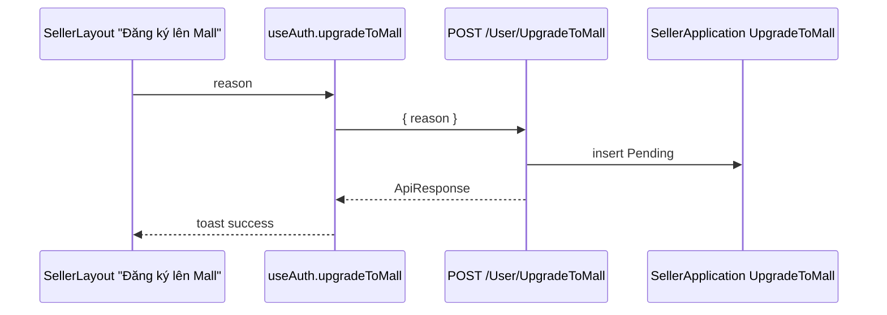
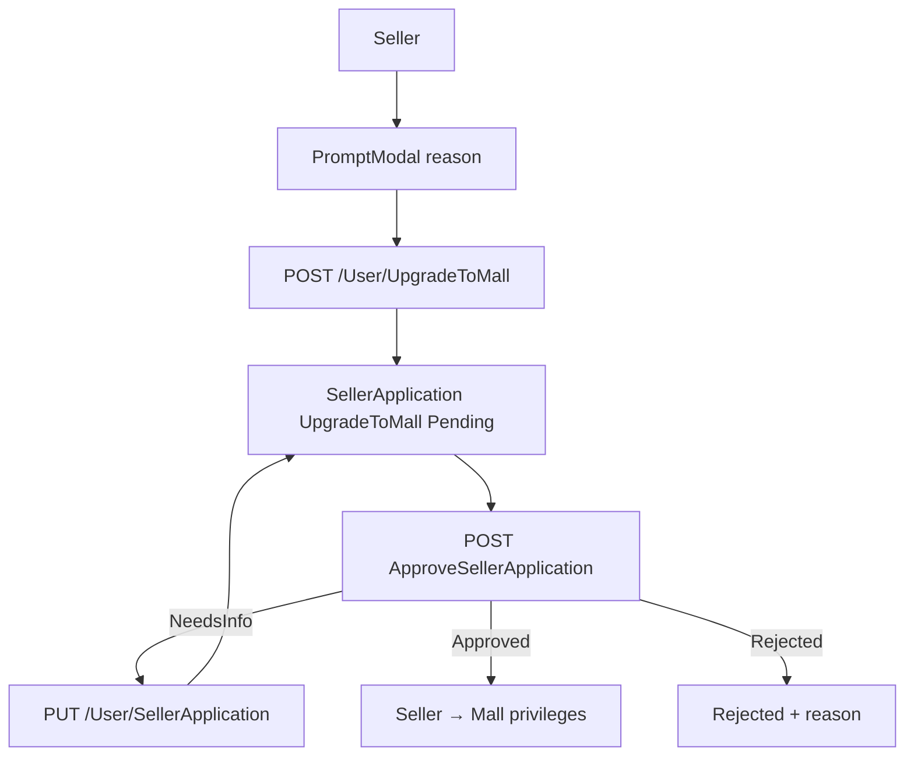

# Tài liệu Quy trình: Nâng cấp Mall (Upgrade to Mall)

Seller gửi **đơn UpgradeToMall**, theo dõi / bổ sung hồ sơ trên **SellerMallApplicationPage**; Admin duyệt trên **AdminApprovalsPage** (tab Cửa hàng).

> Admin duyệt chung: [Admin_Main_Workflow.md](./Admin_Main_Workflow.md) · Register seller gốc: [Register_Workflow.md](./Register_Workflow.md)

---

## Phần A — UI Interaction Trace

---

## UT-MALL-01 — **SellerLayout**: PromptModal 「Đăng ký lên Mall」

### 1. Giao diện

| Mục | Giá trị |
|-----|---------|
| **Layout** | `components/layout/seller/SellerLayout.tsx` |
| **Nút mở** | **"Đăng ký lên Mall"** (sidebar/header seller, khi chưa Mall) |
| **Modal** | `PromptModal` — title `"Đăng ký lên Mall"`, placeholder lý do, confirm `"Gửi yêu cầu"` |

### 2. FE

```text
Click "Đăng ký lên Mall" → setIsMallModalOpen(true)
PromptModal onConfirm(reason)
  → setIsMallModalOpen(false)
  → useAuth().upgradeToMall(reason)   // hooks/useAuth.ts
       → authService.upgradeToMall(reason)
       → POST /api/User/UpgradeToMall { reason }
       → toast.success(response.message || 'Yêu cầu lên Mall đã được gửi thành công.')
       → fail → toast.error
```

### 3. BE

```text
UserController [HttpPost("UpgradeToMall")]
  → UpgradeToMallCommand / UpgradeToMallHandler
  → Kiểm tra user là Seller (đã có Profile/Restaurant)
  → Chặn nếu đã có đơn UpgradeToMall Status=Pending
  → Tạo SellerApplication:
       Type = ApplicationType.UpgradeToMall
       Status = Pending
       (reason / business fields theo handler)
  → ApiResponse success
```

### 4. Response

`ApiResponse` message thành công; `data` có thể null/application id.

### 5. Hiển thị

- Toast success  
- Đơn xuất hiện trong lịch sử `SellerMallApplicationPage` (filter `type === 'UpgradeToMall'`)  
- Admin thấy trong Pending SellerApplications  



---

## UT-MALL-02 — Load **SellerMallApplicationPage**

### 1. UI

| Mục | Giá trị |
|-----|---------|
| **Route** | `/seller/mall-application` |
| **Page** | `pages/seller/SellerMallApplicationPage.tsx` |
| **Trigger** | Mount + SignalR notification refetch |

### 2–5

```text
fetchApplications
  → userService.getMyApplications()
  → GET /api/User/my-applications
  → filter sellerApplications where type === 'UpgradeToMall'
  → setMallApps → list + badge status:
       Pending | NeedsInfo | Approved | Rejected
Fail → toast.error('Không thể lấy thông tin đăng ký lên Mall')
notificationRealtimeService.onNotification → refetch (khi Admin duyệt/yêu cầu bổ sung)
```

---

## UT-MALL-03 — **Cập nhật / gửi lại đơn** (NeedsInfo / Rejected)

### 1. UI

- Nút mở form update trên card đơn (khi được phép sửa)  
- Modal: businessName, address, contactInfo, upload license + shop image  
- Submit cập nhật  

### 2. FE

```text
openUpdateModal(app) → prefill fields
handleUploadImage(type license|shop)
  → authService.uploadImage(file) → POST /api/User/UploadImage
  → setBusinessLicenseUrl | setShopImageUrl + toast.success
handleUpdateSubmit
  → validate đủ field + ảnh
  → userService.updateSellerApplication({
       id, businessName, businessAddress, contactInfo,
       businessLicenseUrl, shopImageUrl
     })
  → PUT /api/User/SellerApplication
  → toast.success('Cập nhật và gửi lại đơn thành công!')
  → đóng modal + fetchApplications
```

### 3. BE

```text
UserController [HttpPut("SellerApplication")]
  → Update seller application handler
  → Cho phép sửa khi Status phù hợp (NeedsInfo / Pending tùy rule)
  → Có thể reset Status → Pending sau resubmit
```

### 4–5

- Toast + list refresh; status có thể về "Đang chờ duyệt"  

---

## UT-MALL-04 — **Admin duyệt đơn Mall** (cross-link Approvals)

### 1. UI

| Mục | Giá trị |
|-----|---------|
| **Page** | `AdminApprovalsPage.tsx` tab **Cửa hàng** |
| **IDs** | Cùng UT-ADM-01 — đơn Mall là SellerApplication `Type=UpgradeToMall` |

### 2–5

```text
GET /api/Admin/SellerApplications?status=Pending
  → gồm cả đơn seller mới và UpgradeToMall
Approve / Reject / NeedsInfo
  → POST /api/Admin/ApproveSellerApplication
       { applicationId, action: Approve|Reject|NeedsInfo, rejectionReason? }
  → ApproveApplicationCommand:
       nếu UpgradeToMall + Approve → nâng role/user flag Mall, cập nhật restaurant
       NeedsInfo → seller thấy badge Cần bổ sung → UT-MALL-03
  → toast Admin: 'Đã phê duyệt thành công!' | ...
  → SignalR notify seller → SellerMallApplicationPage refetch
```

Chi tiết UI Approvals: [Admin_Main_Workflow.md](./Admin_Main_Workflow.md#ut-adm-01--load--duyệt-adminapprovalspage).

---

## Phần B — Workflow nghiệp vụ & Backend

### 1. Luồng tổng quan

1. Seller bấm Đăng ký lên Mall → nhập reason → tạo application Pending.  
2. (Tuỳ handler) bổ sung hồ sơ kinh doanh / ảnh trên Mall Application page.  
3. Admin Approvals → Approve / Reject / NeedsInfo.  
4. NeedsInfo → Seller update + resubmit.  
5. Approved → quyền/feature Mall (role Mall / package).  



### 2. API

| Method | Route | Việc |
|--------|-------|------|
| POST | `/api/User/UpgradeToMall` | Tạo đơn nâng Mall `{ reason }` |
| GET | `/api/User/my-applications` | Lịch sử đơn (filter UpgradeToMall FE) |
| PUT | `/api/User/SellerApplication` | Cập nhật/resubmit hồ sơ |
| POST | `/api/User/UploadImage` | Ảnh GPKD / shop |
| GET | `/api/Admin/SellerApplications` | Admin list Pending |
| POST | `/api/Admin/ApproveSellerApplication` | Approve / Reject / NeedsInfo |

### 3. Bảo mật

- Chỉ Seller đã có hồ sơ quán được UpgradeToMall.  
- Không tạo trùng Pending.  
- Admin-only approve.  
- Upload ảnh cần auth.  

### 4. Checklist

- [ ] PromptModal gửi reason → toast success  
- [ ] Không tạo được 2 Pending cùng lúc  
- [ ] Mall page chỉ hiện type UpgradeToMall  
- [ ] NeedsInfo → update form + resubmit  
- [ ] Admin Approve → seller nhận notify + status Approved  
- [ ] Reject hiện lý do trên UI seller  

### 5. File neo

| FE | BE |
|----|-----|
| `SellerLayout.tsx` + `PromptModal` | `UserController.UpgradeToMall` |
| `useAuth.ts` → `upgradeToMall` | `UpgradeToMallHandler.cs` |
| `SellerMallApplicationPage.tsx` | Update SellerApplication handlers |
| `AuthService.upgradeToMall` / `UserService.updateSellerApplication` | `ApproveApplicationCommand` (Admin) |
| `AdminApprovalsPage.tsx` | `AdminController.ApproveSellerApplication` |
