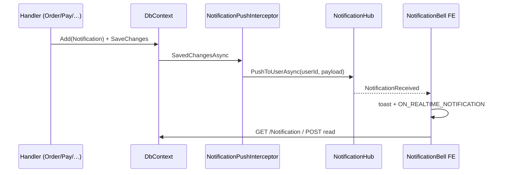

# Tài liệu Quy trình: Notification Realtime (Bell / SignalR / Interceptor / Broadcast)

Tài liệu mô tả luồng **thông báo realtime** trong **UniEats**: chuông đọc/đọc-all, SignalR `JoinUser`, EF `NotificationPushInterceptor`, Admin broadcast Flash Sale.

> Chat widget + ChatHub: [Chat_Notification_Workflow.md](./Chat_Notification_Workflow.md)  
> SePay dùng cùng event `ON_REALTIME_NOTIFICATION`: [Payment_Sepay_Workflow.md](./Payment_Sepay_Workflow.md)

---

## Phần A — UI Interaction Trace (Nút bấm → Code → Data → Hiển thị)

---

### UT-NOT-01 — Mở chuông thông báo (NotificationBell)

#### 1. Giao diện

| Mục | Giá trị |
|-----|---------|
| **Component** | `components/layout/NotificationBell.tsx` |
| **Gắn layout** | `Header.tsx`, `DashboardLayout.tsx` |
| **Nút** | Icon Bell → `handleToggle` |

#### 2. FE

```text
handleToggle → setIsOpen(true) → fetchNotifications()
  → notificationService.getAll()
  → GET /api/Notification
```

Mount cũng gọi `fetchNotifications` + start SignalR (UT-NOT-04).

#### 5. Hiển thị

| Có unread | Badge số (max `99+`) trên Bell |
| List | Dropdown title/message/time; unread nền cam + chấm |
| Empty | “Không có thông báo nào” |
| Loading | Spinner |

---

### UT-NOT-02 — Đọc một thông báo

#### 1. Giao diện

Click item trong dropdown → `handleNotificationClick(n)`.

#### 2–3

```text
if (!n.isRead) handleMarkAsRead(n.id)
  → optimistic: isRead=true, unreadCount--
  → notificationService.markAsRead(id)
  → POST /api/Notification/{id}/read
  → MarkNotificationReadCommand
setSelectedNotification(n)  // luôn mở Modal chi tiết
```

#### 5. Hiển thị

Modal “Chi tiết thông báo” (title + message).  
Nút **Đi đến trang** → `handleNavigateFromModal` (route theo `notificationType` + role, hoặc event `openOrdersTabWithDetail` cho Customer Order/Delivery).

Lỗi mark-read → `fetchNotifications()` revert.

---

### UT-NOT-03 — Đọc tất cả

#### 1. Giao diện

| Mục | Giá trị |
|-----|---------|
| **Nút** | Header dropdown “Đọc tất cả” (khi `unreadCount > 0`) |
| **Hàm** | `handleMarkAllAsRead` |

#### 2–5

```text
Optimistic: mọi n.isRead = true, unreadCount = 0
→ notificationService.markAllAsRead()
→ POST /api/Notification/read-all
```

| OK | `toast.success('Đã đọc toàn bộ thông báo')` |
| Fail | `fetchNotifications()` reload |

---

### UT-NOT-04 — SignalR join + nhận push

#### 1–2. Khi nào chạy?

`NotificationBell` `useEffect([user.id, token])`:

```text
notificationRealtimeService.onNotification(onRealtime)
notificationRealtimeService.startConnection(token, user.id)
  → HubConnection → {API_BASE}/hubs/notifications (JWT)
  → start() → invoke('JoinUser', userId)
  → hub.on('NotificationReceived', ...)
```

**File FE:** `services/NotificationRealtimeService.ts`

#### 3. Khi nhận realtime

```text
onRealtime(n)
  → prepend list + unreadCount++
  → toast(n.title, { icon: '🔔' })
  → window.dispatchEvent(new CustomEvent('ON_REALTIME_NOTIFICATION', { detail: n }))
```

Nhiều page listen event này (Checkout SePay modal, Profile, SellerOrders, ShipperDashboard, …) để refresh UI.

Cleanup: `offNotification` + `stopConnection`.

---

### UT-NOT-05 — Đường push từ BE (Interceptor) — không có nút UI

Luồng hệ thống khi bất kỳ handler nào `Add(Notification)` + `SaveChanges`:

```text
DbContext SaveChanges
  → NotificationPushInterceptor.SavingChangesAsync (capture Added Notification)
  → SavedChangesAsync
  → INotificationPushService.PushToUserAsync(userId, payload)
  → SignalR group user → clients 'NotificationReceived'
  → FE UT-NOT-04
```

**File:** `src/ShoppingFood.Repository/Interceptors/NotificationPushInterceptor.cs`

Payload: `{ id, title, message, notificationType, targetId, isRead, createAt }`.

---

### UT-NOT-06 — Admin broadcast thông báo Flash Sale

#### 1. Giao diện

| Mục | Giá trị |
|-----|---------|
| **Route** | Admin notifications / truyền thông Flash Sale |
| **Page** | `pages/admin/AdminNotificationsPage.tsx` |
| **Form** | flashSaleId, customMessage, targetAudience, targetTier?, targetUserIds? |
| **Nút** | Submit → `handleSubmit` |

#### 2–3

```text
adminService.broadcastNotification({ ... })
  → POST /api/Admin/notifications/broadcast
  → BroadcastNotificationCommand
  → Insert Notification(s) → Interceptor push (UT-NOT-05)
```

#### 5. Hiển thị

| OK | `toast.success('Gửi thông báo thành công')` + clear message/userIds |
| Validate thiếu User ID | `toast.error('Vui lòng nhập ít nhất 1 User ID')` |
| Fail | `toast.error(res.message \|\| 'Lỗi khi gửi thông báo')` |

> Broadcast **order tới shipper gần** là luồng Coordinator (`POST /Coordinator/orders/{id}/broadcast`) — xem [Coordinator_Dispatch_Workflow.md](./Coordinator_Dispatch_Workflow.md), không phải page này.

---

### Bảng tóm tắt Phần A

| ID | Thao tác | FE | API / Hub |
|----|----------|-----|-----------|
| UT-NOT-01 | Mở Bell | NotificationBell | GET `/Notification` |
| UT-NOT-02 | Đọc 1 | markAsRead + Modal | POST `/{id}/read` |
| UT-NOT-03 | Đọc tất cả | markAllAsRead | POST `/read-all` |
| UT-NOT-04 | SignalR join | NotificationRealtimeService | `/hubs/notifications` `JoinUser` |
| UT-NOT-05 | Push path | — | NotificationPushInterceptor |
| UT-NOT-06 | Admin broadcast | AdminNotificationsPage | POST `/Admin/notifications/broadcast` |

---

## Phần B — Workflow nghiệp vụ & Backend

### 1. Luồng tổng quan

1. Handler nghiệp vụ tạo `Notification` (Order, Payment, Review, System, …).
2. `SaveChanges` → Interceptor push SignalR tới user group.
3. FE Bell đã `JoinUser` → nhận `NotificationReceived` → toast + list + `ON_REALTIME_NOTIFICATION`.
4. User mở Bell / mark read / navigate theo type.
5. Admin có thể broadcast Flash Sale tới audience (all / tier / userIds).



### 2. REST APIs

| Method | Route | Việc |
|--------|-------|------|
| GET | `/api/Notification` | List của user hiện tại |
| POST | `/api/Notification/{id}/read` | Đánh dấu đã đọc |
| POST | `/api/Notification/read-all` | Đọc hết |
| POST | `/api/Admin/notifications/broadcast` | Admin broadcast FS |

**Controller:** `NotificationController.cs`, `AdminController.BroadcastNotification`.

### 3. SignalR Hub

| Mục | Giá trị |
|-----|---------|
| Hub path | `/hubs/notifications` |
| Client invoke | `JoinUser(userId)` |
| Server event | `NotificationReceived` |
| Auth | JWT `accessTokenFactory` |

### 4. Entity / type

`NOTIFICATION`: UserId, Title, Message, NotificationType (`System` | `Order` | `Delivery` | `Review` | `Loyalty` | `Payment`…), TargetId, IsRead, CreateAt.

### 5. Bảo mật

1. Mark-read chỉ owner (`CurrentUserId`).
2. Broadcast chỉ Admin + RBAC.
3. Hub JWT; JoinUser nên khớp user token (tránh join group người khác).
4. Interceptor fail push **không** rollback DB (catch log).

### 6. Checklist

- [ ] Login → Bell badge load đúng unread
- [ ] Tạo order/payment → toast Bell + list tăng
- [ ] Đọc 1 / đọc all → badge giảm
- [ ] Modal navigate đúng role (Seller orders, Admin incidents, …)
- [ ] Admin broadcast → khách nhận realtime
- [ ] Sepay modal vẫn nhận `ON_REALTIME_NOTIFICATION` Payment

### 7. File neo

| Tầng | Path |
|------|------|
| FE Bell | `ShoppingFood.FE/src/components/layout/NotificationBell.tsx` |
| FE Hub client | `.../services/NotificationRealtimeService.ts` |
| FE Admin | `.../pages/admin/AdminNotificationsPage.tsx` |
| Interceptor | `src/ShoppingFood.Repository/Interceptors/NotificationPushInterceptor.cs` |
| API | `NotificationController`, `AdminController` |

---

**Tóm tắt:** Notification realtime = **Bell CRUD đọc + SignalR JoinUser + Interceptor push + Admin broadcast**. UT-NOT-01…06 ở Phần A.
