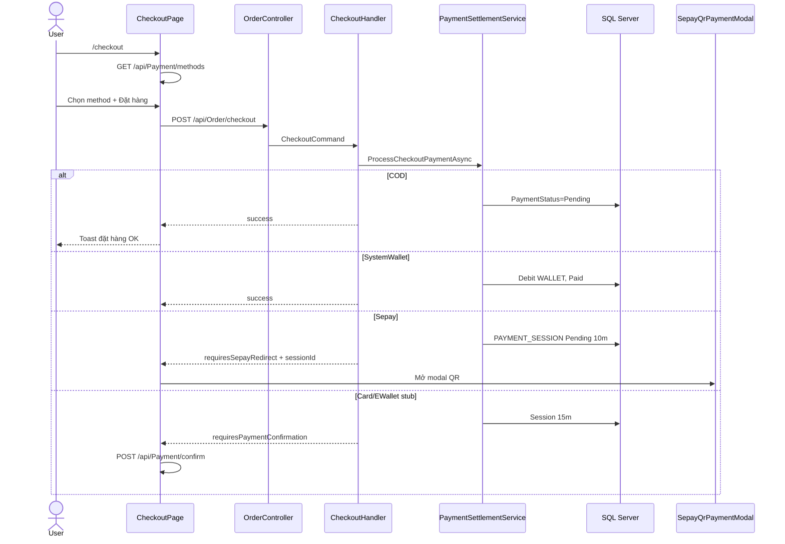

# Tài liệu Quy trình: Thanh toán khi Checkout (Payment Checkout)

Tài liệu mô tả chi tiết luồng **chọn phương thức thanh toán và settle** ngay khi đặt hàng trong hệ thống **Shopping Food**.

> **Đọc trước:** [Payment_Requirements.md](./Payment_Requirements.md) (FR/NFR, state machine, acceptance criteria)  
> SePay chi tiết: [Payment_Sepay_Workflow.md](./Payment_Sepay_Workflow.md)  
> Ví / rút / COD debt: [Payment_Wallet_Withdraw_Workflow.md](./Payment_Wallet_Withdraw_Workflow.md)  
> Đặt hàng tổng thể: [Checkout_Order_Workflow.md](./Checkout_Order_Workflow.md)

---

## 1. Luồng Tổng Quan (Workflow)

1. **Yêu cầu:** User vào `/checkout` với giỏ hàng hợp lệ.
2. **Load methods:** FE gọi `GET /api/Payment/methods` → hiển thị COD / SystemWallet / Sepay (hoặc stub Card/EWallet).
3. **Chọn method:** User chọn phương thức (+ địa chỉ, ghi chú…).
4. **Checkout:** `POST /api/Order/checkout` → `CheckoutHandler` tạo Order → gọi `PaymentSettlementService.ProcessCheckoutPaymentAsync`.
5. **Theo method:**
   - **COD:** `PaymentStatus=Pending`, không session → toast thành công.
   - **SystemWallet:** trừ ví → `Paid` ngay (hoặc lỗi thiếu tiền).
   - **Sepay:** tạo `PaymentSession` 10 phút → response `requiresSepayRedirect` → mở `SepayQrPaymentModal`.
   - **CreditCard/EWallet stub:** session 15 phút → `requiresPaymentConfirmation` → FE gọi `POST /api/Payment/confirm`.
6. **Sau giao hàng:** settle hoa hồng / seller / shipper / COD debt → `Settled` + `IsFinancialSettled`.



---

## Bước 1: Người dùng vào Checkout & load methods

**Thông tin:**
- **URL (FE):** `/checkout`
- **API:** `GET /api/Payment/methods`
- **HTTP Method:** GET
- **Auth:** Public

**File FE:** `ShoppingFood.FE/src/pages/CheckoutPage.tsx`  
**File Service:** `ShoppingFood.FE/src/services/PaymentService.ts`  
**Handler:** `src/ShoppingFood.Application/Features/Payments/Queries/GetPaymentMethodsHandler.cs`

| Method code | Khi hiện | requiresAuth | Ghi chú |
|-------------|----------|--------------|---------|
| `COD` | Luôn | false | Guest OK |
| `SystemWallet` | Luôn | true | Hiện số dư ví |
| `Sepay` | SePay enabled **và** resolve được bank | true | Ưu tiên online |
| `CreditCard` / `EWallet` | Khi **không** có SePay | true | **Stub** — không phải PSP thật |

---

## Bước 2: Gửi Checkout

**Thông tin:**
- **URL:** `/api/Order/checkout`
- **HTTP Method:** POST
- **Controller:** `OrderController.Checkout`

```csharp
[HttpPost("checkout")]
public async Task<IActionResult> Checkout([FromBody] CheckoutCommand command)
{
    var response = await _mediator.Send(command);
    return StatusCode(response.Code, response);
}
```

**FE** (`CheckoutPage.tsx` — sau khi nhận response):

```typescript
const requiresSepay = res.data?.requiresSepayRedirect === true;
const requiresConfirm = res.data?.requiresPaymentConfirmation === true;

if (requiresSepay && sessionId) {
  // mở SepayQrPaymentModal + toast quét QR
}
if (requiresConfirm && sessionId) {
  await paymentService.confirmPayment(sessionId);
}
```

---

## Bước 3: Backend settle theo PaymentMethod

**File:** `src/ShoppingFood.Application/Services/PaymentSettlementService.cs`  
**Method:** `ProcessCheckoutPaymentAsync`  
**Lines:** ~120–214

Trước switch: tính split hoa hồng từ `PlatformFinanceConfig.CommissionRate` (default 10%):

```csharp
var config = await GetConfigAsync();
var split = CalculateSplit(order.TotalAmount, order.ShippingFee, order.ShipperIncome, config.CommissionRate);
order.ItemsSubtotal = split.ItemsSubtotal;
order.PlatformCommission = split.PlatformCommission;
order.SellerPayout = split.SellerPayout;
```

### 3.1. COD

```csharp
case PaymentMethod.COD:
    order.PaymentStatus = PaymentStatus.Pending;
    return null; // không tạo session
```

**Kết quả:** Order tạo xong, chờ seller/shipper; tiền thu khi giao.

### 3.2. SystemWallet

```csharp
case PaymentMethod.SystemWallet:
    if (!userId.HasValue)
        return "Ví hệ thống chỉ dành cho khách hàng đã đăng nhập.";
    var customerWallet = await GetOrCreateWalletAsync(WalletOwnerType.Customer, userId.Value);
    if (customerWallet.Balance < order.TotalAmount)
        return "Số dư ví không đủ. Vui lòng nạp thêm tiền.";
    await RecordTransactionAsync(customerWallet, FinancialTransactionType.Payment, -order.TotalAmount,
        $"Thanh toán đơn hàng #{order.Id}", order.Id, "Order");
    order.PaymentStatus = PaymentStatus.Paid;
    return null;
```

**DB:** `WALLET`, `FINANCIAL_TRANSACTION` (type Payment, số âm).

### 3.3. Sepay

```csharp
case PaymentMethod.Sepay:
    if (!_sepayService.IsEnabled)
        return "Cổng thanh toán SePay chưa được cấu hình.";
    if (!userId.HasValue)
        return "Thanh toán online SePay yêu cầu đăng nhập.";
    var bank = await _bankAccountResolver.ResolveAsync();
    if (bank == null)
        return "Chưa cấu hình tài khoản ngân hàng SePay...";
    // Tạo PaymentSession: InvoiceNumber, ExpiresAt = UtcNow.AddMinutes(10)
    // order.PaymentSessionId = session.Id; PaymentStatus = Pending
```

**FE:** mở QR — chi tiết [Payment_Sepay_Workflow.md](./Payment_Sepay_Workflow.md).  
**Cấm:** `POST /Payment/confirm` với Sepay.

### 3.4. CreditCard / EWallet (stub)

```csharp
case PaymentMethod.CreditCard:
case PaymentMethod.EWallet:
    // PaymentSession Status=Pending, ExpiresAt = UtcNow.AddMinutes(15)
    order.PaymentSessionId = session.Id;
    order.PaymentStatus = PaymentStatus.Pending;
```

**FE ngay sau checkout:**

```typescript
await paymentService.confirmPayment(sessionId); // POST /api/Payment/confirm
```

→ Handler đánh dấu session Completed + Order Paid (**không gọi cổng thẻ thật**).

---

## Bước 4: Confirm session (chỉ non-Sepay)

**Thông tin:**
- **URL:** `/api/Payment/confirm`
- **HTTP Method:** POST
- **File:** `PaymentController.cs` + `PaymentCommandHandlers.cs` (`ConfirmPaymentSessionHandler`)

**Rule quan trọng:** Nếu method = Sepay → **reject** (không cho FE tự confirm).

---

## Bước 5: Settle khi giao hàng thành công

Khi shipper `confirm-delivered` hoặc seller self-delivery confirm:

| Tình huống | Việc xảy ra |
|------------|-------------|
| COD + platform delivery | Tăng `ShipperProfile.CodCollectedAmount`; credit seller/platform; `PaymentStatus=Settled` |
| Đã Paid (Wallet/Sepay/Card) | Split seller/shipper/platform; `Settled` |
| Self-delivery | `SettleSelfDeliveryOrderAsync` |
| Guard | `IsFinancialSettled` → không settle 2 lần |

**File:** `PaymentSettlementService.SettleOrderOnDeliveryAsync` / `SettleSelfDeliveryOrderAsync`.

**Hủy đơn đã Paid online:** `ProcessRefundAsync` → hoàn tiền ví Customer.

---

## Sơ đồ file đi qua (Call chain)

```text
CheckoutPage.tsx
  → PaymentService.getPaymentMethods()
  → OrderService.checkout()
  → (optional) PaymentService.confirmPayment()
  → (optional) SepayQrPaymentModal.tsx
       ↓
OrderController.Checkout / PaymentController.*
       ↓
CheckoutHandler
       ↓
PaymentSettlementService.ProcessCheckoutPaymentAsync
       ↓
ORDER + WALLET + FINANCIAL_TRANSACTION + PAYMENT_SESSION
```

| Vai trò | Đường dẫn |
|---------|-----------|
| FE Checkout | `ShoppingFood.FE/src/pages/CheckoutPage.tsx` |
| FE Payment API | `ShoppingFood.FE/src/services/PaymentService.ts` |
| FE QR Modal | `ShoppingFood.FE/src/components/payment/SepayQrPaymentModal.tsx` |
| Order API | `src/ShoppingFood.API/Controllers/OrderController.cs` |
| Payment API | `src/ShoppingFood.API/Controllers/PaymentController.cs` |
| Checkout logic | `src/ShoppingFood.Application/Features/Orders/Commands/CheckoutHandler.cs` |
| Settle logic | `src/ShoppingFood.Application/Services/PaymentSettlementService.cs` |
| Methods query | `.../Features/Payments/Queries/GetPaymentMethodsHandler.cs` |
| Requirements | `docs/workflows/Payment_Requirements.md` |

---

## Các thông báo (Toast / Message)

| Message | Nơi | Trigger |
|---------|-----|---------|
| Đặt hàng thành công! Mã đơn… | CheckoutPage | COD / Wallet / sau confirm stub |
| Đơn hàng đã tạo. Quét mã QR… | CheckoutPage | Sepay + mở modal |
| Số dư ví không đủ. Vui lòng nạp thêm tiền. | API → toast | SystemWallet fail |
| Ví hệ thống chỉ dành cho khách đã đăng nhập | API | Guest chọn Wallet |
| Cổng thanh toán SePay chưa được cấu hình | API | Sepay off |

---

## Các cơ chế bảo mật / nghiệp vụ quan trọng

1. **Guest thực tế chỉ COD** — online methods `requiresAuth`.
2. **Sepay không confirm tay** — chống giả Paid.
3. **Số dư ví** kiểm tra trước khi debit.
4. **Hoa hồng** từ `PLATFORM_FINANCE_CONFIG` (default 10%).
5. **Settle idempotent** qua `IsFinancialSettled`.
6. **CreditCard/EWallet = stub** — không dùng như PSP production.

---

## Checklist tự test

- [ ] `GET /methods` đúng khi SePay on vs off
- [ ] COD → Order Pending, không QR, không trừ ví
- [ ] SystemWallet đủ tiền → Paid + balance giảm đúng `TotalAmount`
- [ ] SystemWallet thiếu tiền → lỗi, không tạo Paid
- [ ] Sepay → QR modal, **không** gọi `/confirm`
- [ ] Card stub (khi không SePay) → `/confirm` → Paid
- [ ] Giao hàng → Settled + split đúng; COD tăng debt shipper
- [ ] Hủy đơn đã Paid online → hoàn ví

---

## Tóm tắt

Checkout payment = **methods → `ProcessCheckoutPaymentAsync` → (COD | Wallet | Sepay | stub) → (QR/confirm) → settle khi giao**.  
Mọi rule số tiền / expiry / commission: xem [Payment_Requirements.md](./Payment_Requirements.md).

> Liên kết: [Payment_Sepay_Workflow.md](./Payment_Sepay_Workflow.md) · [README workflows](./README.md)
