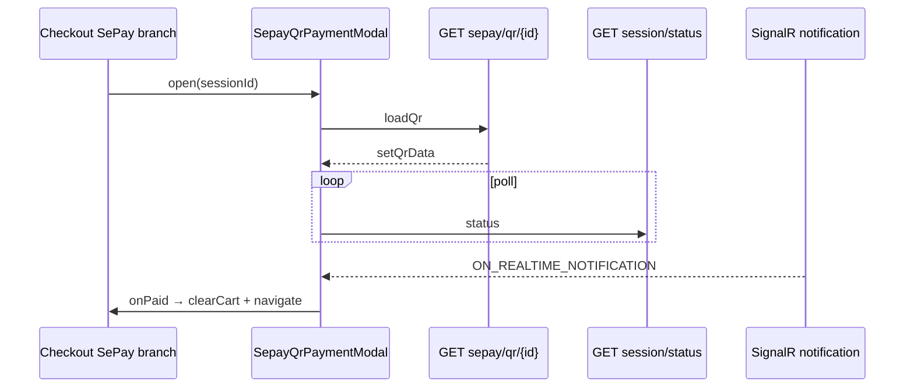
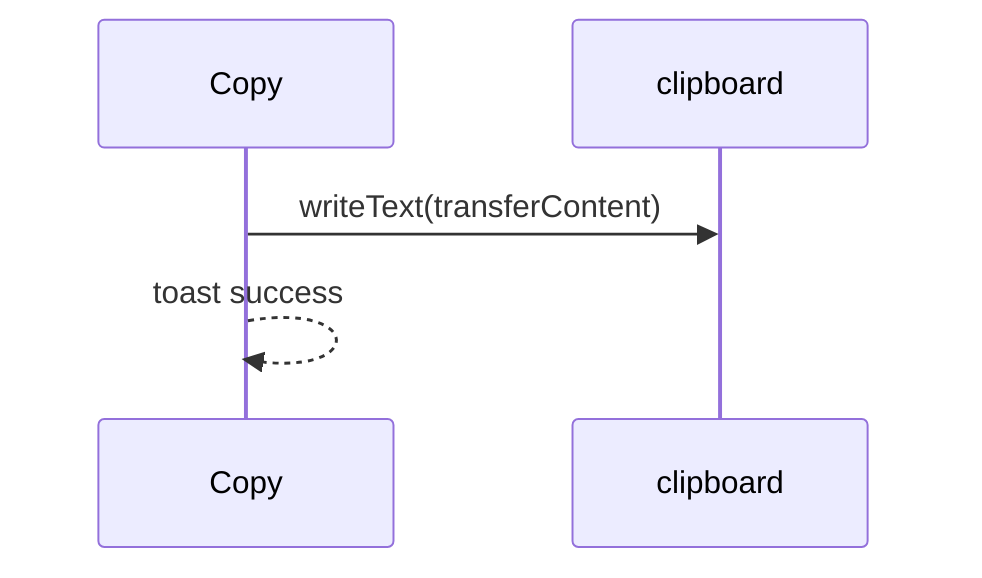
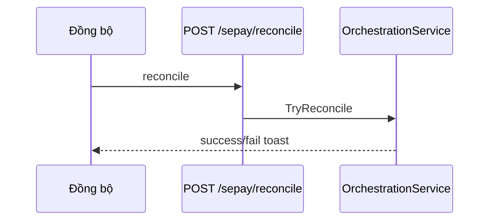
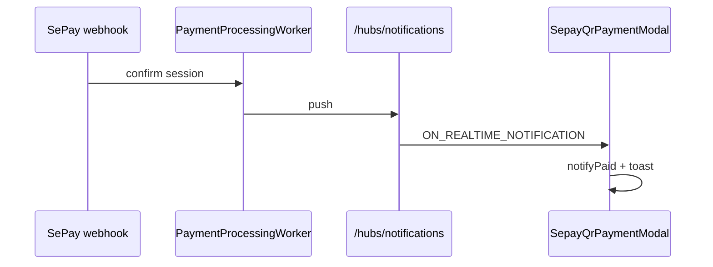
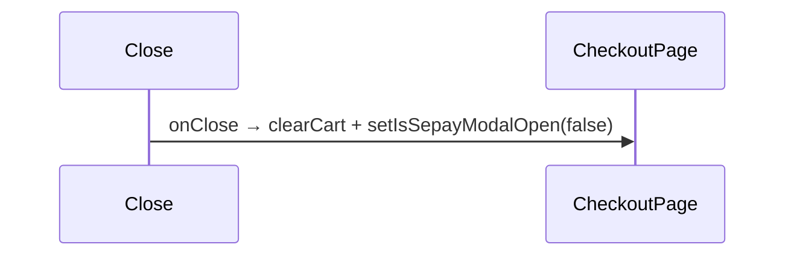
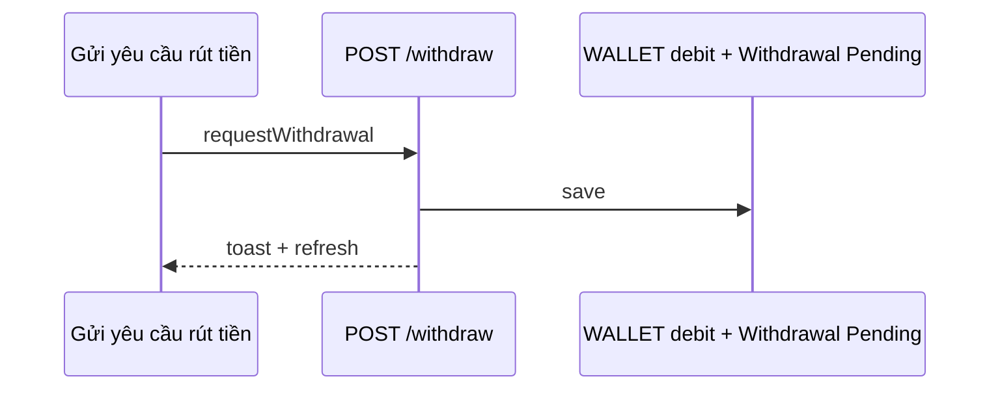
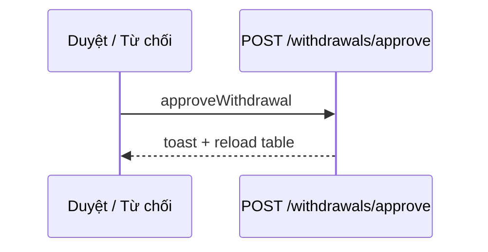
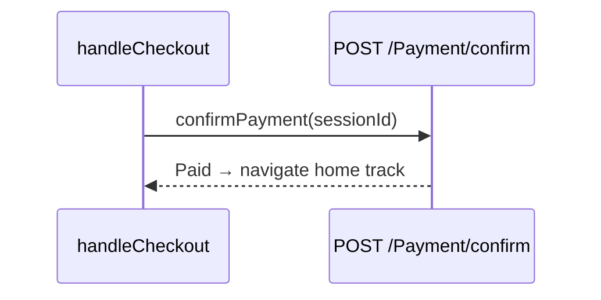
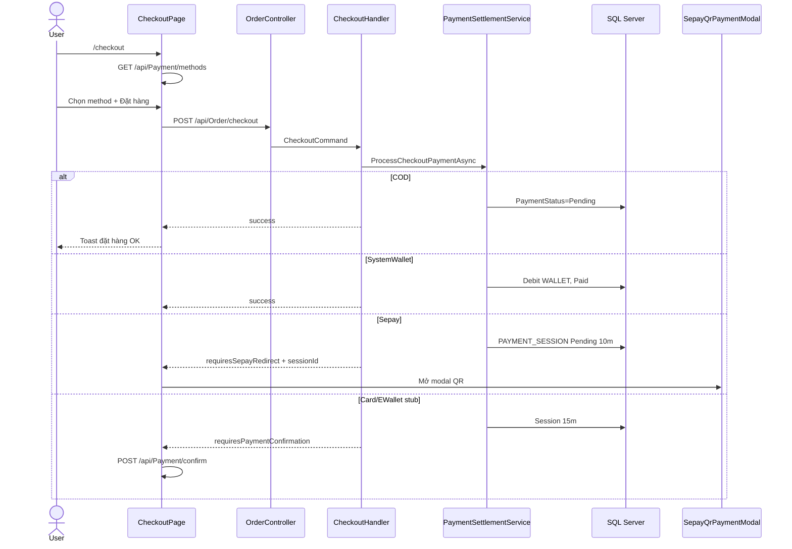

# Tài liệu Quy trình: Thanh toán khi Checkout (Payment Checkout)

Tài liệu mô tả chi tiết luồng **chọn phương thức thanh toán và settle** ngay khi đặt hàng trong hệ thống **Shopping Food**.

> **Đọc trước:** [Payment_Requirements.md](./Payment_Requirements.md) (FR/NFR, state machine, acceptance criteria)  
> SePay chi tiết: [Payment_Sepay_Workflow.md](./Payment_Sepay_Workflow.md)  
> Ví / rút / COD debt: [Payment_Wallet_Withdraw_Workflow.md](./Payment_Wallet_Withdraw_Workflow.md)  
> Đặt hàng tổng thể: [Checkout_Order_Workflow.md](./Checkout_Order_Workflow.md)

---


---

## Phần A — UI Interaction Trace (Nút bấm → Code → Data → Hiển thị)

> UI Trace — Payment (gộp vào file này; SePay/Wallet xem thêm file Payment_* )  
> Mỗi thao tác trả lời: **nút ở đâu** · **bấm chạy file/hàm nào** · **API/BE đâu** · **data trả về** · **hiển thị thế nào**.


> Checkout gắn session: [05_Checkout_Order_UI_Trace.md](./05_Checkout_Order_UI_Trace.md) UT-ORD-06

---

## UT-PAY-01 — Chọn phương thức thanh toán (radio trên Checkout)

#### 1. Giao diện nút bấm ở đâu?

| Mục | Giá trị |
|-----|---------|
| **Route** | `/checkout` |
| **Page** | `pages/CheckoutPage.tsx` |
| **Nhãn** | Radio theo `paymentMethods`: COD, SystemWallet, Sepay, (CreditCard/EWallet stub) |
| **Loại control** | `<input type="radio" name="paymentMethod" ... onChange={handleInputChange}>` (~598–601) |
| **Điều kiện** | List từ `GET /Payment/methods`; fallback hardcode nếu API trống |

#### 2. Bấm xong chạy đến đâu? (Frontend)

```text
handleInputChange
  → setFormData(prev => ({ ...prev, paymentMethod: method.code }))
  → Không gọi API ngay
  → Nếu SystemWallet: hiện "Số dư ví: {formatCurrency(walletBalance)}"
  → Nếu EWallet: hiện chọn Momo/ZaloPay/VNPay
  → Nếu CreditCard: hiện cardBrand + cardLastFour inputs
```

Load methods lúc mount:

```text
paymentService.getPaymentMethods() → GET /api/Payment/methods
→ setPaymentMethods(res.data)
```

#### 3. Backend chạy đoạn nào?

```text
GET /api/Payment/methods
  → GetPaymentMethodsHandler
  → COD + SystemWallet luôn; Sepay nếu enabled+bank; else Card/EWallet stub
```

#### 4. Dữ liệu trả về ở đâu?

```json
{
  "data": [
    { "code": "COD", "name": "Tiền mặt", "requiresAuth": false },
    { "code": "SystemWallet", "name": "...", "requiresAuth": true },
    { "code": "Sepay", "name": "...", "requiresAuth": true }
  ]
}
```

#### 5. Làm sao hiển thị ra?

| Nhánh | Hành vi UI |
|-------|------------|
| Chọn radio | Border cam + ring; `formData.paymentMethod` dùng lúc `handleCheckout` |
| SystemWallet | Hiện số dư (đã `getWallet` lúc load) |
| Value gửi checkout | `paymentMethod` trong payload UT-ORD-06 |

#### 6. Sơ đồ nhanh


---

## UT-PAY-02 — Mở SepayQrPaymentModal + load QR

#### 1. Giao diện nút bấm ở đâu?

| Mục | Giá trị |
|-----|---------|
| **Không phải nút riêng** | Tự mở sau checkout SePay (UT-ORD-06) |
| **Component** | `components/payment/SepayQrPaymentModal.tsx` |
| **Trigger** | `CheckoutPage`: `setIsSepayModalOpen(true)` + `sessionId` |
| **Cũng mở từ** | `SepayRedirectPage` `/payment/sepay?sessionId=`; Order detail thanh toán lại |

#### 2. Bấm xong chạy đến đâu? (Frontend)

```text
Modal isOpen + sessionId
  → useEffect → loadQr() (L98–142)
  → paymentService.getSepayQr(sessionId)
  → GET /api/Payment/sepay/qr/{sessionId}
  → setQrData({ qrImageUrl, invoiceNumber, transferContent, amount, remainingSeconds, bankName, ... })
  → Poll: getPaymentSessionStatus (interval) → applySessionStatus
  → Listen window event ON_REALTIME_NOTIFICATION → nếu payment paid → notifyPaid
```

#### 3. Backend chạy đoạn nào?

```text
GET /api/Payment/sepay/qr/{sessionId}
  → SepayController.GetQr → GetSepayQrHandler
  → Build VietQR URL, transfer content, remainingSeconds

GET /api/Payment/sepay/session/status?sessionId=
  → GetPaymentSessionStatusHandler
```

#### 4. Dữ liệu trả về ở đâu?

**QR (`ISepayQrDto` / data):**

| Field | Hiển thị |
|-------|----------|
| `qrImageUrl` | `` |
| `transferContent` / `invoiceNumber` | Text nội dung CK + nút copy |
| `amount` | Số tiền |
| `itemsSubtotal`, `shippingFee` | Breakdown nếu có |
| `remainingSeconds` | Countdown `m:ss` |
| `bankName`, `bankAccountNumber`, `accountHolder` | Thông tin TK nhận |
| `isPaid`, `displayStatus`, `statusLabel` | Badge trạng thái |
| code **410** | `setError('Mã QR đã hết hạn (10 phút)...')` |

#### 5. Làm sao hiển thị ra?

| Nhánh | Hành vi UI |
|-------|------------|
| Loading | Spinner trong Modal |
| OK | Ảnh QR + số tiền + countdown + bank info |
| Paid | `markPaid()` → badge "Đã thanh toán"; `toast.success('SePay đã xác nhận...')`; `onPaid(invoice)` |
| Checkout `onPaid` | `clearCart()`; đóng modal; navigate track (CheckoutPage) |
| Expired poll | `toast.error('Mã QR đã hết hạn')` |

#### 6. Sơ đồ nhanh



---

## UT-PAY-03 — Copy nội dung chuyển khoản

#### 1. Giao diện nút bấm ở đâu?

| Mục | Giá trị |
|-----|---------|
| **Component** | `SepayQrPaymentModal.tsx` ~357 |
| **Nhãn** | Nút copy cạnh `transferContent` |
| **Hàm** | `copyTransferContent` (L205–210) |

#### 2. Bấm xong chạy đến đâu? (Frontend)

```text
copyTransferContent()
  → navigator.clipboard.writeText(qrData.transferContent)
  → toast.success('Đã sao chép nội dung chuyển khoản')
```

**Không** gọi API.

#### 3. Backend

N/A.

#### 4. Dữ liệu

Dùng `qrData.transferContent` đã load từ QR API.

#### 5. Hiển thị

Toast success; clipboard OS.

#### 6. Mermaid



---

## UT-PAY-04 — Nút đồng bộ / Reconcile thủ công

#### 1. Giao diện nút bấm ở đâu?

| Mục | Giá trị |
|-----|---------|
| **Component** | `SepayQrPaymentModal.tsx` — nút đồng bộ SePay |
| **Hàm** | `handleManualReconcile` (L212–230) |
| **Cũng có** | `PaymentResultPages.tsx` nút reconcile |

#### 2. Bấm xong chạy đến đâu? (Frontend)

```text
handleManualReconcile
  → toast.loading('Đang đồng bộ từ SePay...')
  → paymentService.reconcileSepayPayment({ sessionId })
  → POST /api/Payment/sepay/reconcile
  → nếu success: applySessionStatus(paid) + toast.success
  → else toast.error('Chưa thấy giao dịch...')
```

#### 3. Backend chạy đoạn nào?

```text
POST /api/Payment/sepay/reconcile
  → SepayController.Reconcile
  → ReconcileSepayPaymentHandler
  → PaymentOrchestrationService.TryReconcileSessionAsync
  → (cooldown 30s; query SePay API; ConfirmPaymentSessionByInvoiceAsync)
```

#### 4. Dữ liệu trả về ở đâu?

```json
{
  "error": false,
  "data": {
    "success": true,
    "message": "..."
  }
}
```

#### 5. Làm sao hiển thị ra?

| Nhánh | Hành vi UI |
|-------|------------|
| success | UI chuyển paid + toast + `onPaid` path |
| fail | toast.error; QR vẫn awaiting |
| loading | toast.loading rồi dismiss |

#### 6. Mermaid



---

## UT-PAY-05 — SignalR / notification xác nhận thanh toán

#### 1. Giao diện

Không nút — listener trong modal.

#### 2. Frontend

```text
window.addEventListener('ON_REALTIME_NOTIFICATION', handleNotification)
  → NotificationBell / NotificationRealtimeService phát event khi Hub nhận
  → Nếu payload liên quan payment/session → notifyPaid / applySessionStatus
  → toast 'SePay đã xác nhận thanh toán qua webhook!'
```

Hub phía BE: `/hubs/notifications` sau khi webhook worker confirm → insert Notification → Interceptor push.

#### 3. Backend

```text
SePay Webhook/IPN → queue → PaymentProcessingWorker
  → ConfirmPaymentSessionByInvoiceAsync
  → Order Paid + Notification entity
  → NotificationPushInterceptor → NotificationHub
```

#### 4. Dữ liệu

Notification DTO: `title`, `message`, `type`, `targetId` (order/session).

#### 5. Hiển thị

Modal paid state + toast; Checkout `onPaid` clearCart + navigate.

#### 6. Mermaid



---

## UT-PAY-06 — Đóng modal QR

#### 1. Giao diện

Nút đóng Modal (`onClose`) / X — SepayQrPaymentModal ~303; props từ CheckoutPage.

#### 2. Frontend

```text
CheckoutPage onClose:
  setIsSepayModalOpen(false)
  clearCart()   // chú ý: clear cả khi chưa chắc paid — theo code hiện tại L865–866
```

#### 3–4. Backend / data

N/A (local UI). Session vẫn Pending trên server đến khi expire/webhook.

#### 5. Hiển thị

Modal đóng; giỏ cleared; user có thể track đơn qua `?track=true` nếu đã navigate trước đó — nếu chỉ đóng sớm, đơn vẫn tồn tại chờ thanh toán.

#### 6. Mermaid



---

## UT-PAY-07 — Customer nạp ví (Top-up)

#### 1. Giao diện nút bấm ở đâu?

| Mục | Giá trị |
|-----|---------|
| **Route** | Profile tab wallet / `CustomerWalletPage` (thường `/profile` tab) |
| **Page** | `pages/payment/CustomerWalletPage.tsx` |
| **Nhãn nút** | `"Nạp tiền"` (~171–175) |
| **Input** | `topUpAmount` (default `'100000'`); chip số nhanh `onClick={() => setTopUpAmount(String(v))}` |

#### 2. Bấm xong chạy đến đâu? (Frontend)

```text
handleTopUp (L63–83)
  → validate amount >= 10000 else toast.error('Số tiền nạp tối thiểu 10.000đ')
  → paymentService.topUpWallet(amount)
  → POST /api/Payment/wallet/top-up { amount }
  → toast.success('Đang chuyển hướng sang trang thanh toán...')
  → navigate(`/payment/sepay?sessionId=${res.data.sessionId}&returnUrl=...profile?tab=wallet`)
  → SepayRedirectPage / SepayQrPaymentModal flow (UT-PAY-02)
```

#### 3. Backend chạy đoạn nào?

```text
POST /api/Payment/wallet/top-up
  → TopUpWalletHandler
  → CreateTopUpSessionAsync (PaymentSession OrderId=null, expiry 10p)
  → trả sessionId
```

Confirm tiền vào ví: webhook → `ConfirmPaymentSessionByInvoiceAsync` nhánh TopUp → `FinancialTransactionType.TopUp`.

#### 4. Dữ liệu trả về ở đâu?

```json
{
  "error": false,
  "data": { "sessionId": "guid" }
}
```

#### 5. Làm sao hiển thị ra?

| Nhánh | Hành vi UI |
|-------|------------|
| OK | Navigate SePay page; sau paid quay `returnUrl` wallet; `loadData` lại thấy balance tăng |
| Validate | toast min 10k |
| API error | toast.error |

#### 6. Mermaid


---

## UT-PAY-08 — Seller/Shipper rút tiền (Withdraw)

#### 1. Giao diện nút bấm ở đâu?

| Mục | Giá trị |
|-----|---------|
| **Page** | `pages/payment/PartnerWalletPages.tsx` (SellerWalletPage / ShipperWalletPage) |
| **Nhãn nút** | `"Gửi yêu cầu rút tiền"` (~263–267, ~517–521) |
| **Form** | amount, bankName, bankAccountNumber, bankAccountHolder |

#### 2. Bấm xong chạy đến đâu? (Frontend)

```text
handleWithdraw
  → validate đủ field; amount >= 50000 (Seller page) → toast lỗi nếu sai
  → paymentService.requestWithdrawal({ amount, bankName, bankAccountNumber, bankAccountHolder })
  → POST /api/Payment/withdraw
  → toast.success('Yêu cầu rút tiền đã được gửi')
  → refresh wallet/transactions
```

#### 3. Backend chạy đoạn nào?

```text
POST /api/Payment/withdraw
  → RequestWithdrawalHandler
  → Chỉ Seller/Shipper (Customer 403)
  → Debit ví ngay + WithdrawalRequest Pending
```

#### 4. Dữ liệu trả về ở đâu?

```json
{
  "data": { "withdrawalId": "...", "status": "Pending" }
}
```

Balance mới phản ánh qua `GET /Payment/wallet`.

#### 5. Làm sao hiển thị ra?

| Nhánh | Hành vi UI |
|-------|------------|
| OK | Toast; số dư giảm; form có thể reset; danh sách GD cập nhật |
| Validate | toast thiếu info / min 50k |
| 403 Customer | toast message API |

#### 6. Mermaid



---

## UT-PAY-09 — Shipper nộp công nợ COD

#### 1. Giao diện nút bấm ở đâu?

| Mục | Giá trị |
|-----|---------|
| **Page** | `PartnerWalletPages.tsx` (Shipper section) |
| **Nhãn nút** | `"Nộp tiền"` (~468–472) |
| **Input** | `repayAmount`; chip max `setRepayAmount(String(codCollected))` |

#### 2. Bấm xong chạy đến đâu? (Frontend)

```text
handleRepay
  → parseFloat(repayAmount) > 0
  → paymentService.repayShipperDebt(amount)
  → POST /api/Payment/shipper/repay-debt
  → toast.success(`Đã nộp ${formatCurrency(res.data?.repaid || amount)} công nợ COD`)
  → reload wallet (codCollected giảm)
```

#### 3. Backend

```text
POST /api/Payment/shipper/repay-debt
  → giảm CodCollectedAmount / ghi txn CodRemittance
```

#### 4. Dữ liệu

`data.repaid` (số đã nộp) nếu có.

#### 5. Hiển thị

Toast + UI công nợ cập nhật sau `loadData`.

#### 6. Mermaid


---

## UT-PAY-10 — Admin duyệt / từ chối rút tiền

#### 1. Giao diện nút bấm ở đâu?

| Mục | Giá trị |
|-----|---------|
| **Route** | Admin finance (vd `/admin/finance` — `AdminFinancePage.tsx`) |
| **Nhãn nút** | `"Duyệt"` / `"Từ chối"` (~84–88) |
| **Hàm** | `handleApprove(w.id, true\|false)` |

#### 2. Bấm xong chạy đến đâu? (Frontend)

```text
handleApprove(id, approve)
  → paymentService.approveWithdrawal(id, approve)
  → POST /api/Payment/withdrawals/approve { withdrawalId, approve, rejectReason? }
  → toast.success(approve ? 'Đã duyệt' : 'Đã từ chối')
  → reload withdrawals list
```

#### 3. Backend

```text
ApproveWithdrawal handler
  → Approve: status Approved/Completed
  → Reject: status Rejected + Refund txn hoàn ví
```

#### 4. Dữ liệu

ApiResponse; list `GET /Payment/withdrawals` refresh.

#### 5. Hiển thị

Toast; hàng Pending biến mất / đổi status trên bảng Admin.

#### 6. Mermaid



---

## UT-PAY-11 — Confirm payment stub (Card/EWallet) từ Checkout

#### 1. Giao diện

Không nút riêng — tự gọi trong `handleCheckout` khi `requiresPaymentConfirmation`.

#### 2. Frontend

```text
await paymentService.confirmPayment(sessionId)
→ POST /api/Payment/confirm
→ rồi clearCart + toast đặt hàng thành công + navigate
```

#### 3. Backend

`ConfirmPaymentSessionHandler` — **reject nếu method = Sepay**.

#### 4–5. Data + UI

Session Completed; Order Paid; UI như COD success path.

#### 6. Mermaid



---

## Bảng field hiển thị quan trọng

| Nguồn | Field | UI |
|-------|-------|-----|
| Checkout response | `paymentSessionId` | Truyền vào Modal |
| Checkout response | `requiresSepayRedirect` | Mở QR |
| QR API | `qrImageUrl` | `` |
| QR API | `transferContent` | Text + copy |
| QR API | `remainingSeconds` | Countdown |
| Top-up | `sessionId` | Query `/payment/sepay` |
| Wallet GET | `balance`, `codCollected` | Card số dư / nợ |
| Withdraw | `withdrawalId`, `status` | Admin table / history |

---

## File neo Payment UI

| File | UT |
|------|-----|
| `CheckoutPage.tsx` | PAY-01, ORD-06 gắn SePay |
| `SepayQrPaymentModal.tsx` | PAY-02…06 |
| `CustomerWalletPage.tsx` | PAY-07 |
| `PartnerWalletPages.tsx` | PAY-08, PAY-09 |
| `AdminFinancePage.tsx` | PAY-10 |
| `PaymentService.ts` | Tất cả HTTP |
| `SepayController.cs` / `PaymentController.cs` | BE |
| Workers `Payment*` / `Sepay*` | Background confirm |

**Chia tiền sau giao:** [../requirements/Revenue_Split_Requirements.md](../requirements/Revenue_Split_Requirements.md).


---

## Phần B — Workflow nghiệp vụ & Backend (chi tiết luồng)
## 1. Luồng Tổng Quan (Workflow)

1. **Yêu cầu:** User vào `/checkout` với giỏ hàng hợp lệ.
2. **Load methods:** FE gọi `GET /api/Payment/methods` → hiển thị COD / SystemWallet / Sepay (hoặc stub Card/EWallet).
3. **Chọn method:** User chọn phương thức (+ địa chỉ, ghi chú…).
4. **Checkout:** `POST /api/Order/checkout` → `CheckoutHandler` tạo Order → gọi `PaymentSettlementService.ProcessCheckoutPaymentAsync`.
5. **Theo method:**
   - **COD:** `PaymentStatus=Pending`, không session → toast thành công.
   - **SystemWallet:** trừ ví → `Paid` ngay (hoặc lỗi thiếu tiền).
   - **Sepay:** tạo `PaymentSession` 10 phút → response `requiresSepayRedirect` → mở `SepayQrPaymentModal`.
   - **CreditCard/EWallet stub:** session 15 phút → `requiresPaymentConfirmation` → FE gọi `POST /api/Payment/confirm`.
6. **Sau giao hàng:** settle hoa hồng / seller / shipper / COD debt → `Settled` + `IsFinancialSettled`.



---

## Bước 1: Người dùng vào Checkout & load methods

**Thông tin:**
- **URL (FE):** `/checkout`
- **API:** `GET /api/Payment/methods`
- **HTTP Method:** GET
- **Auth:** Public

**File FE:** `ShoppingFood.FE/src/pages/CheckoutPage.tsx`  
**File Service:** `ShoppingFood.FE/src/services/PaymentService.ts`  
**Handler:** `src/ShoppingFood.Application/Features/Payments/Queries/GetPaymentMethodsHandler.cs`

| Method code | Khi hiện | requiresAuth | Ghi chú |
|-------------|----------|--------------|---------|
| `COD` | Luôn | false | Guest OK |
| `SystemWallet` | Luôn | true | Hiện số dư ví |
| `Sepay` | SePay enabled **và** resolve được bank | true | Ưu tiên online |
| `CreditCard` / `EWallet` | Khi **không** có SePay | true | **Stub** — không phải PSP thật |

---

## Bước 2: Gửi Checkout

**Thông tin:**
- **URL:** `/api/Order/checkout`
- **HTTP Method:** POST
- **Controller:** `OrderController.Checkout`

```csharp
[HttpPost("checkout")]
public async Task<IActionResult> Checkout([FromBody] CheckoutCommand command)
{
    var response = await _mediator.Send(command);
    return StatusCode(response.Code, response);
}
```

**FE** (`CheckoutPage.tsx` — sau khi nhận response):

```typescript
const requiresSepay = res.data?.requiresSepayRedirect === true;
const requiresConfirm = res.data?.requiresPaymentConfirmation === true;

if (requiresSepay && sessionId) {
  // mở SepayQrPaymentModal + toast quét QR
}
if (requiresConfirm && sessionId) {
  await paymentService.confirmPayment(sessionId);
}
```

---

## Bước 3: Backend settle theo PaymentMethod

**File:** `src/ShoppingFood.Application/Services/PaymentSettlementService.cs`  
**Method:** `ProcessCheckoutPaymentAsync`  
**Lines:** ~120–214

Trước switch: tính split hoa hồng từ `PlatformFinanceConfig.CommissionRate` (default 10%):

```csharp
var config = await GetConfigAsync();
var split = CalculateSplit(order.TotalAmount, order.ShippingFee, order.ShipperIncome, config.CommissionRate);
order.ItemsSubtotal = split.ItemsSubtotal;
order.PlatformCommission = split.PlatformCommission;
order.SellerPayout = split.SellerPayout;
```

### 3.1. COD

```csharp
case PaymentMethod.COD:
    order.PaymentStatus = PaymentStatus.Pending;
    return null; // không tạo session
```

**Kết quả:** Order tạo xong, chờ seller/shipper; tiền thu khi giao.

### 3.2. SystemWallet

```csharp
case PaymentMethod.SystemWallet:
    if (!userId.HasValue)
        return "Ví hệ thống chỉ dành cho khách hàng đã đăng nhập.";
    var customerWallet = await GetOrCreateWalletAsync(WalletOwnerType.Customer, userId.Value);
    if (customerWallet.Balance < order.TotalAmount)
        return "Số dư ví không đủ. Vui lòng nạp thêm tiền.";
    await RecordTransactionAsync(customerWallet, FinancialTransactionType.Payment, -order.TotalAmount,
        $"Thanh toán đơn hàng #{order.Id}", order.Id, "Order");
    order.PaymentStatus = PaymentStatus.Paid;
    return null;
```

**DB:** `WALLET`, `FINANCIAL_TRANSACTION` (type Payment, số âm).

### 3.3. Sepay

```csharp
case PaymentMethod.Sepay:
    if (!_sepayService.IsEnabled)
        return "Cổng thanh toán SePay chưa được cấu hình.";
    if (!userId.HasValue)
        return "Thanh toán online SePay yêu cầu đăng nhập.";
    var bank = await _bankAccountResolver.ResolveAsync();
    if (bank == null)
        return "Chưa cấu hình tài khoản ngân hàng SePay...";
    // Tạo PaymentSession: InvoiceNumber, ExpiresAt = UtcNow.AddMinutes(10)
    // order.PaymentSessionId = session.Id; PaymentStatus = Pending
```

**FE:** mở QR — chi tiết [Payment_Sepay_Workflow.md](./Payment_Sepay_Workflow.md).  
**Cấm:** `POST /Payment/confirm` với Sepay.

### 3.4. CreditCard / EWallet (stub)

```csharp
case PaymentMethod.CreditCard:
case PaymentMethod.EWallet:
    // PaymentSession Status=Pending, ExpiresAt = UtcNow.AddMinutes(15)
    order.PaymentSessionId = session.Id;
    order.PaymentStatus = PaymentStatus.Pending;
```

**FE ngay sau checkout:**

```typescript
await paymentService.confirmPayment(sessionId); // POST /api/Payment/confirm
```

→ Handler đánh dấu session Completed + Order Paid (**không gọi cổng thẻ thật**).

---

## Bước 4: Confirm session (chỉ non-Sepay)

**Thông tin:**
- **URL:** `/api/Payment/confirm`
- **HTTP Method:** POST
- **File:** `PaymentController.cs` + `PaymentCommandHandlers.cs` (`ConfirmPaymentSessionHandler`)

**Rule quan trọng:** Nếu method = Sepay → **reject** (không cho FE tự confirm).

---

## Bước 5: Settle khi giao hàng thành công

Khi shipper `confirm-delivered` hoặc seller self-delivery confirm:

| Tình huống | Việc xảy ra |
|------------|-------------|
| COD + platform delivery | Tăng `ShipperProfile.CodCollectedAmount`; credit seller/platform; `PaymentStatus=Settled` |
| Đã Paid (Wallet/Sepay/Card) | Split seller/shipper/platform; `Settled` |
| Self-delivery | `SettleSelfDeliveryOrderAsync` |
| Guard | `IsFinancialSettled` → không settle 2 lần |

**File:** `PaymentSettlementService.SettleOrderOnDeliveryAsync` / `SettleSelfDeliveryOrderAsync`.

**Hủy đơn đã Paid online:** `ProcessRefundAsync` → hoàn tiền ví Customer.

---

## Sơ đồ file đi qua (Call chain)

```text
CheckoutPage.tsx
  → PaymentService.getPaymentMethods()
  → OrderService.checkout()
  → (optional) PaymentService.confirmPayment()
  → (optional) SepayQrPaymentModal.tsx
       ↓
OrderController.Checkout / PaymentController.*
       ↓
CheckoutHandler
       ↓
PaymentSettlementService.ProcessCheckoutPaymentAsync
       ↓
ORDER + WALLET + FINANCIAL_TRANSACTION + PAYMENT_SESSION
```

| Vai trò | Đường dẫn |
|---------|-----------|
| FE Checkout | `ShoppingFood.FE/src/pages/CheckoutPage.tsx` |
| FE Payment API | `ShoppingFood.FE/src/services/PaymentService.ts` |
| FE QR Modal | `ShoppingFood.FE/src/components/payment/SepayQrPaymentModal.tsx` |
| Order API | `src/ShoppingFood.API/Controllers/OrderController.cs` |
| Payment API | `src/ShoppingFood.API/Controllers/PaymentController.cs` |
| Checkout logic | `src/ShoppingFood.Application/Features/Orders/Commands/CheckoutHandler.cs` |
| Settle logic | `src/ShoppingFood.Application/Services/PaymentSettlementService.cs` |
| Methods query | `.../Features/Payments/Queries/GetPaymentMethodsHandler.cs` |
| Requirements | `docs/workflows/Payment_Requirements.md` |

---

## Các thông báo (Toast / Message)

| Message | Nơi | Trigger |
|---------|-----|---------|
| Đặt hàng thành công! Mã đơn… | CheckoutPage | COD / Wallet / sau confirm stub |
| Đơn hàng đã tạo. Quét mã QR… | CheckoutPage | Sepay + mở modal |
| Số dư ví không đủ. Vui lòng nạp thêm tiền. | API → toast | SystemWallet fail |
| Ví hệ thống chỉ dành cho khách đã đăng nhập | API | Guest chọn Wallet |
| Cổng thanh toán SePay chưa được cấu hình | API | Sepay off |

---

## Các cơ chế bảo mật / nghiệp vụ quan trọng

1. **Guest thực tế chỉ COD** — online methods `requiresAuth`.
2. **Sepay không confirm tay** — chống giả Paid.
3. **Số dư ví** kiểm tra trước khi debit.
4. **Hoa hồng** từ `PLATFORM_FINANCE_CONFIG` (default 10%).
5. **Settle idempotent** qua `IsFinancialSettled`.
6. **CreditCard/EWallet = stub** — không dùng như PSP production.

---

## Checklist tự test

- [ ] `GET /methods` đúng khi SePay on vs off
- [ ] COD → Order Pending, không QR, không trừ ví
- [ ] SystemWallet đủ tiền → Paid + balance giảm đúng `TotalAmount`
- [ ] SystemWallet thiếu tiền → lỗi, không tạo Paid
- [ ] Sepay → QR modal, **không** gọi `/confirm`
- [ ] Card stub (khi không SePay) → `/confirm` → Paid
- [ ] Giao hàng → Settled + split đúng; COD tăng debt shipper
- [ ] Hủy đơn đã Paid online → hoàn ví

---

## Tóm tắt

Checkout payment = **methods → `ProcessCheckoutPaymentAsync` → (COD | Wallet | Sepay | stub) → (QR/confirm) → settle khi giao**.  
Mọi rule số tiền / expiry / commission: xem [Payment_Requirements.md](./Payment_Requirements.md).

> Liên kết: [Payment_Sepay_Workflow.md](./Payment_Sepay_Workflow.md) · [README workflows](./README.md)
