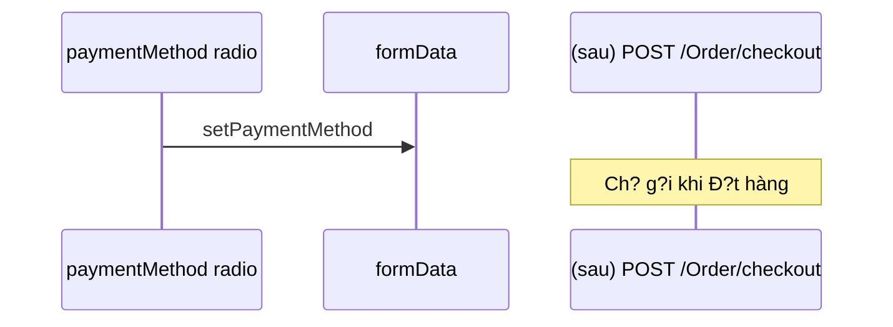
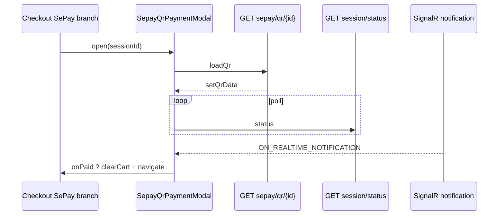
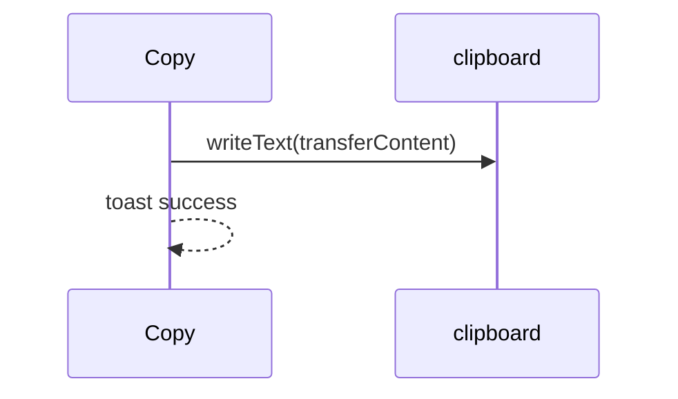
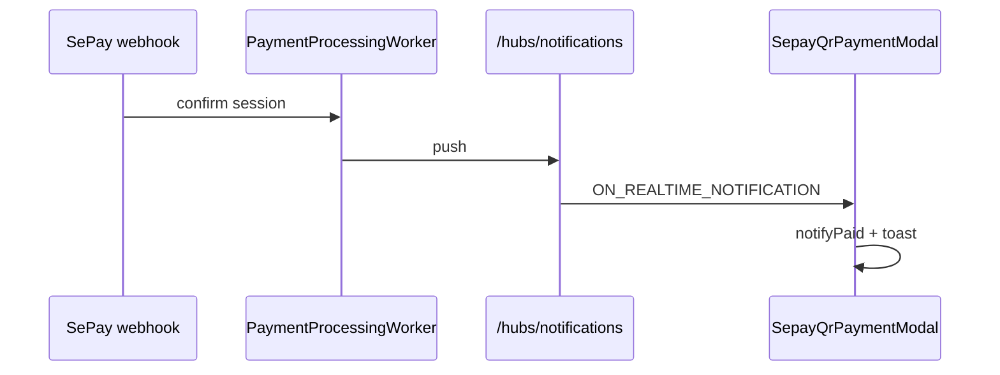
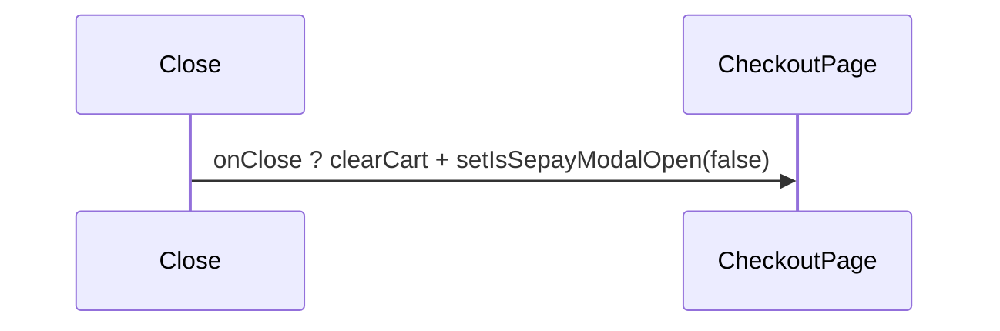
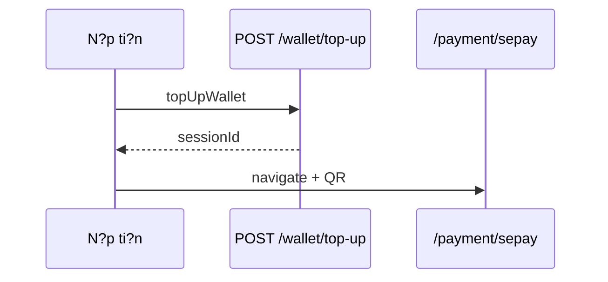
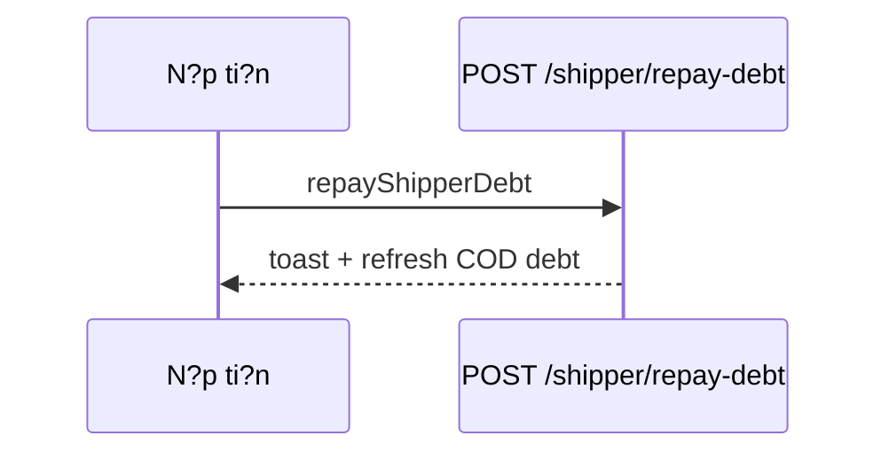
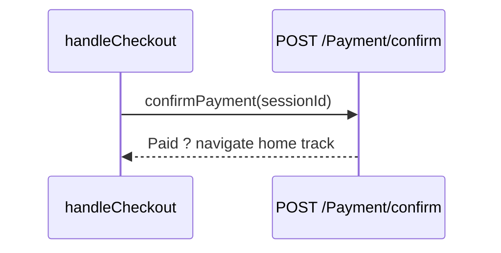
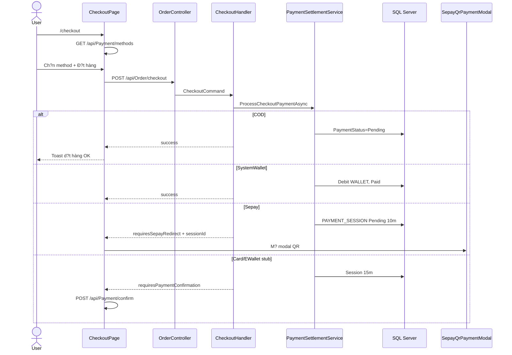

# Tài li?u Quy trình: Thanh toán khi Checkout (Payment Checkout)

Tài li?u mô t? chi ti?t lu?ng **ch?n phuong th?c thanh toán và settle** ngay khi d?t hàng trong h? th?ng **UniEats**.

> **Ð?c tru?c:** [Payment_Requirements.md](./Payment_Requirements.md) (FR/NFR, state machine, acceptance criteria)  
> SePay chi ti?t: [Payment_Sepay_Workflow.md](./Payment_Sepay_Workflow.md)  
> Ví / rút / COD debt: [Payment_Wallet_Withdraw_Workflow.md](./Payment_Wallet_Withdraw_Workflow.md)  
> Ð?t hàng t?ng th?: [Checkout_Order_Workflow.md](./Checkout_Order_Workflow.md)

---


---

## Ph?n A — UI Interaction Trace (Nút b?m ? Code ? Data ? Hi?n th?)

> UI Trace — Payment (g?p vào file này; SePay/Wallet xem thêm file Payment_* )  
> M?i thao tác tr? l?i: **nút ? dâu** · **b?m ch?y file/hàm nào** · **API/BE dâu** · **data tr? v?** · **hi?n th? th? nào**.


> Checkout g?n session: [05_Checkout_Order_UI_Trace.md](./05_Checkout_Order_UI_Trace.md) UT-ORD-06

---

## UT-PAY-01 — Ch?n phuong th?c thanh toán (radio trên Checkout)

#### 1. Giao di?n nút b?m ? dâu?

| M?c | Giá tr? |
|-----|---------|
| **Route** | `/checkout` |
| **Page** | `pages/CheckoutPage.tsx` |
| **Nhãn** | Radio theo `paymentMethods`: COD, SystemWallet, Sepay, (CreditCard/EWallet stub) |
| **Lo?i control** | `<input type="radio" name="paymentMethod" ... onChange={handleInputChange}>` (~598–601) |
| **Ði?u ki?n** | List t? `GET /Payment/methods`; fallback hardcode n?u API tr?ng |

#### 2. B?m xong ch?y d?n dâu? (Frontend)

```text
handleInputChange
  ? setFormData(prev => ({ ...prev, paymentMethod: method.code }))
  ? Không g?i API ngay
  ? N?u SystemWallet: hi?n "S? du ví: {formatCurrency(walletBalance)}"
  ? N?u EWallet: hi?n ch?n Momo/ZaloPay/VNPay
  ? N?u CreditCard: hi?n cardBrand + cardLastFour inputs
```

Load methods lúc mount:

```text
paymentService.getPaymentMethods() ? GET /api/Payment/methods
? setPaymentMethods(res.data)
```

#### 3. Backend ch?y do?n nào?

```text
GET /api/Payment/methods
  ? GetPaymentMethodsHandler
  ? COD + SystemWallet luôn; Sepay n?u enabled+bank; else Card/EWallet stub
```

#### 4. D? li?u tr? v? ? dâu?

```json
{
  "data": [
    { "code": "COD", "name": "Ti?n m?t", "requiresAuth": false },
    { "code": "SystemWallet", "name": "...", "requiresAuth": true },
    { "code": "Sepay", "name": "...", "requiresAuth": true }
  ]
}
```

#### 5. Làm sao hi?n th? ra?

| Nhánh | Hành vi UI |
|-------|------------|
| Ch?n radio | Border cam + ring; `formData.paymentMethod` dùng lúc `handleCheckout` |
| SystemWallet | Hi?n s? du (dã `getWallet` lúc load) |
| Value g?i checkout | `paymentMethod` trong payload UT-ORD-06 |

#### 6. So d? nhanh



---

## UT-PAY-02 — M? SepayQrPaymentModal + load QR

#### 1. Giao di?n nút b?m ? dâu?

| M?c | Giá tr? |
|-----|---------|
| **Không ph?i nút riêng** | T? m? sau checkout SePay (UT-ORD-06) |
| **Component** | `components/payment/SepayQrPaymentModal.tsx` |
| **Trigger** | `CheckoutPage`: `setIsSepayModalOpen(true)` + `sessionId` |
| **Cung m? t?** | `SepayRedirectPage` `/payment/sepay?sessionId=`; Order detail thanh toán l?i |

#### 2. B?m xong ch?y d?n dâu? (Frontend)

```text
Modal isOpen + sessionId
  ? useEffect ? loadQr() (L98–142)
  ? paymentService.getSepayQr(sessionId)
  ? GET /api/Payment/sepay/qr/{sessionId}
  ? setQrData({ qrImageUrl, invoiceNumber, transferContent, amount, remainingSeconds, bankName, ... })
  ? Poll: getPaymentSessionStatus (interval) ? applySessionStatus
  ? Listen window event ON_REALTIME_NOTIFICATION ? n?u payment paid ? notifyPaid
```

#### 3. Backend ch?y do?n nào?

```text
GET /api/Payment/sepay/qr/{sessionId}
  ? SepayController.GetQr ? GetSepayQrHandler
  ? Build VietQR URL, transfer content, remainingSeconds

GET /api/Payment/sepay/session/status?sessionId=
  ? GetPaymentSessionStatusHandler
```

#### 4. D? li?u tr? v? ? dâu?

**QR (`ISepayQrDto` / data):**

| Field | Hi?n th? |
|-------|----------|
| `qrImageUrl` | `` |
| `transferContent` / `invoiceNumber` | Text n?i dung CK + nút copy |
| `amount` | S? ti?n |
| `itemsSubtotal`, `shippingFee` | Breakdown n?u có |
| `remainingSeconds` | Countdown `m:ss` |
| `bankName`, `bankAccountNumber`, `accountHolder` | Thông tin TK nh?n |
| `isPaid`, `displayStatus`, `statusLabel` | Badge tr?ng thái |
| code **410** | `setError('Mã QR dã h?t h?n (10 phút)...')` |

#### 5. Làm sao hi?n th? ra?

| Nhánh | Hành vi UI |
|-------|------------|
| Loading | Spinner trong Modal |
| OK | ?nh QR + s? ti?n + countdown + bank info |
| Paid | `markPaid()` ? badge "Ðã thanh toán"; `toast.success('SePay dã xác nh?n...')`; `onPaid(invoice)` |
| Checkout `onPaid` | `clearCart()`; dóng modal; navigate track (CheckoutPage) |
| Expired poll | `toast.error('Mã QR dã h?t h?n')` |

#### 6. So d? nhanh



---

## UT-PAY-03 — Copy n?i dung chuy?n kho?n

#### 1. Giao di?n nút b?m ? dâu?

| M?c | Giá tr? |
|-----|---------|
| **Component** | `SepayQrPaymentModal.tsx` ~357 |
| **Nhãn** | Nút copy c?nh `transferContent` |
| **Hàm** | `copyTransferContent` (L205–210) |

#### 2. B?m xong ch?y d?n dâu? (Frontend)

```text
copyTransferContent()
  ? navigator.clipboard.writeText(qrData.transferContent)
  ? toast.success('Ðã sao chép n?i dung chuy?n kho?n')
```

**Không** g?i API.

#### 3. Backend

N/A.

#### 4. D? li?u

Dùng `qrData.transferContent` dã load t? QR API.

#### 5. Hi?n th?

Toast success; clipboard OS.

#### 6. Mermaid



---

## UT-PAY-04 — Nút d?ng b? / Reconcile th? công

#### 1. Giao di?n nút b?m ? dâu?

| M?c | Giá tr? |
|-----|---------|
| **Component** | `SepayQrPaymentModal.tsx` — nút d?ng b? SePay |
| **Hàm** | `handleManualReconcile` (L212–230) |
| **Cung có** | `PaymentResultPages.tsx` nút reconcile |

#### 2. B?m xong ch?y d?n dâu? (Frontend)

```text
handleManualReconcile
  ? toast.loading('Ðang d?ng b? t? SePay...')
  ? paymentService.reconcileSepayPayment({ sessionId })
  ? POST /api/Payment/sepay/reconcile
  ? n?u success: applySessionStatus(paid) + toast.success
  ? else toast.error('Chua th?y giao d?ch...')
```

#### 3. Backend ch?y do?n nào?

```text
POST /api/Payment/sepay/reconcile
  ? SepayController.Reconcile
  ? ReconcileSepayPaymentHandler
  ? PaymentOrchestrationService.TryReconcileSessionAsync
  ? (cooldown 30s; query SePay API; ConfirmPaymentSessionByInvoiceAsync)
```

#### 4. D? li?u tr? v? ? dâu?

```json
{
  "error": false,
  "data": {
    "success": true,
    "message": "..."
  }
}
```

#### 5. Làm sao hi?n th? ra?

| Nhánh | Hành vi UI |
|-------|------------|
| success | UI chuy?n paid + toast + `onPaid` path |
| fail | toast.error; QR v?n awaiting |
| loading | toast.loading r?i dismiss |

#### 6. Mermaid


---

## UT-PAY-05 — SignalR / notification xác nh?n thanh toán

#### 1. Giao di?n

Không nút — listener trong modal.

#### 2. Frontend

```text
window.addEventListener('ON_REALTIME_NOTIFICATION', handleNotification)
  ? NotificationBell / NotificationRealtimeService phát event khi Hub nh?n
  ? N?u payload liên quan payment/session ? notifyPaid / applySessionStatus
  ? toast 'SePay dã xác nh?n thanh toán qua webhook!'
```

Hub phía BE: `/hubs/notifications` sau khi webhook worker confirm ? insert Notification ? Interceptor push.

#### 3. Backend

```text
SePay Webhook/IPN ? queue ? PaymentProcessingWorker
  ? ConfirmPaymentSessionByInvoiceAsync
  ? Order Paid + Notification entity
  ? NotificationPushInterceptor ? NotificationHub
```

#### 4. D? li?u

Notification DTO: `title`, `message`, `type`, `targetId` (order/session).

#### 5. Hi?n th?

Modal paid state + toast; Checkout `onPaid` clearCart + navigate.

#### 6. Mermaid



---

## UT-PAY-06 — Ðóng modal QR

#### 1. Giao di?n

Nút dóng Modal (`onClose`) / X — SepayQrPaymentModal ~303; props t? CheckoutPage.

#### 2. Frontend

```text
CheckoutPage onClose:
  setIsSepayModalOpen(false)
  clearCart()   // chú ý: clear c? khi chua ch?c paid — theo code hi?n t?i L865–866
```

#### 3–4. Backend / data

N/A (local UI). Session v?n Pending trên server d?n khi expire/webhook.

#### 5. Hi?n th?

Modal dóng; gi? cleared; user có th? track don qua `?track=true` n?u dã navigate tru?c dó — n?u ch? dóng s?m, don v?n t?n t?i ch? thanh toán.

#### 6. Mermaid



---

## UT-PAY-07 — Customer n?p ví (Top-up)

#### 1. Giao di?n nút b?m ? dâu?

| M?c | Giá tr? |
|-----|---------|
| **Route** | Profile tab wallet / `CustomerWalletPage` (thu?ng `/profile` tab) |
| **Page** | `pages/payment/CustomerWalletPage.tsx` |
| **Nhãn nút** | `"N?p ti?n"` (~171–175) |
| **Input** | `topUpAmount` (default `'100000'`); chip s? nhanh `onClick={() => setTopUpAmount(String(v))}` |

#### 2. B?m xong ch?y d?n dâu? (Frontend)

```text
handleTopUp (L63–83)
  ? validate amount >= 10000 else toast.error('S? ti?n n?p t?i thi?u 10.000d')
  ? paymentService.topUpWallet(amount)
  ? POST /api/Payment/wallet/top-up { amount }
  ? toast.success('Ðang chuy?n hu?ng sang trang thanh toán...')
  ? navigate(`/payment/sepay?sessionId=${res.data.sessionId}&returnUrl=...profile?tab=wallet`)
  ? SepayRedirectPage / SepayQrPaymentModal flow (UT-PAY-02)
```

#### 3. Backend ch?y do?n nào?

```text
POST /api/Payment/wallet/top-up
  ? TopUpWalletHandler
  ? CreateTopUpSessionAsync (PaymentSession OrderId=null, expiry 10p)
  ? tr? sessionId
```

Confirm ti?n vào ví: webhook ? `ConfirmPaymentSessionByInvoiceAsync` nhánh TopUp ? `FinancialTransactionType.TopUp`.

#### 4. D? li?u tr? v? ? dâu?

```json
{
  "error": false,
  "data": { "sessionId": "guid" }
}
```

#### 5. Làm sao hi?n th? ra?

| Nhánh | Hành vi UI |
|-------|------------|
| OK | Navigate SePay page; sau paid quay `returnUrl` wallet; `loadData` l?i th?y balance tang |
| Validate | toast min 10k |
| API error | toast.error |

#### 6. Mermaid



---

## UT-PAY-08 — Seller/Shipper rút ti?n (Withdraw)

#### 1. Giao di?n nút b?m ? dâu?

| M?c | Giá tr? |
|-----|---------|
| **Page** | `pages/payment/PartnerWalletPages.tsx` (SellerWalletPage / ShipperWalletPage) |
| **Nhãn nút** | `"G?i yêu c?u rút ti?n"` (~263–267, ~517–521) |
| **Form** | amount, bankName, bankAccountNumber, bankAccountHolder |

#### 2. B?m xong ch?y d?n dâu? (Frontend)

```text
handleWithdraw
  ? validate d? field; amount >= 50000 (Seller page) ? toast l?i n?u sai
  ? paymentService.requestWithdrawal({ amount, bankName, bankAccountNumber, bankAccountHolder })
  ? POST /api/Payment/withdraw
  ? toast.success('Yêu c?u rút ti?n dã du?c g?i')
  ? refresh wallet/transactions
```

#### 3. Backend ch?y do?n nào?

```text
POST /api/Payment/withdraw
  ? RequestWithdrawalHandler
  ? Ch? Seller/Shipper (Customer 403)
  ? Debit ví ngay + WithdrawalRequest Pending
```

#### 4. D? li?u tr? v? ? dâu?

```json
{
  "data": { "withdrawalId": "...", "status": "Pending" }
}
```

Balance m?i ph?n ánh qua `GET /Payment/wallet`.

#### 5. Làm sao hi?n th? ra?

| Nhánh | Hành vi UI |
|-------|------------|
| OK | Toast; s? du gi?m; form có th? reset; danh sách GD c?p nh?t |
| Validate | toast thi?u info / min 50k |
| 403 Customer | toast message API |

#### 6. Mermaid


---

## UT-PAY-09 — Shipper n?p công n? COD

#### 1. Giao di?n nút b?m ? dâu?

| M?c | Giá tr? |
|-----|---------|
| **Page** | `PartnerWalletPages.tsx` (Shipper section) |
| **Nhãn nút** | `"N?p ti?n"` (~468–472) |
| **Input** | `repayAmount`; chip max `setRepayAmount(String(codCollected))` |

#### 2. B?m xong ch?y d?n dâu? (Frontend)

```text
handleRepay
  ? parseFloat(repayAmount) > 0
  ? paymentService.repayShipperDebt(amount)
  ? POST /api/Payment/shipper/repay-debt
  ? toast.success(`Ðã n?p ${formatCurrency(res.data?.repaid || amount)} công n? COD`)
  ? reload wallet (codCollected gi?m)
```

#### 3. Backend

```text
POST /api/Payment/shipper/repay-debt
  ? gi?m CodCollectedAmount / ghi txn CodRemittance
```

#### 4. D? li?u

`data.repaid` (s? dã n?p) n?u có.

#### 5. Hi?n th?

Toast + UI công n? c?p nh?t sau `loadData`.

#### 6. Mermaid



---

## UT-PAY-10 — Admin duy?t / t? ch?i rút ti?n

#### 1. Giao di?n nút b?m ? dâu?

| M?c | Giá tr? |
|-----|---------|
| **Route** | Admin finance (vd `/admin/finance` — `AdminFinancePage.tsx`) |
| **Nhãn nút** | `"Duy?t"` / `"T? ch?i"` (~84–88) |
| **Hàm** | `handleApprove(w.id, true\|false)` |

#### 2. B?m xong ch?y d?n dâu? (Frontend)

```text
handleApprove(id, approve)
  ? paymentService.approveWithdrawal(id, approve)
  ? POST /api/Payment/withdrawals/approve { withdrawalId, approve, rejectReason? }
  ? toast.success(approve ? 'Ðã duy?t' : 'Ðã t? ch?i')
  ? reload withdrawals list
```

#### 3. Backend

```text
ApproveWithdrawal handler
  ? Approve: status Approved/Completed
  ? Reject: status Rejected + Refund txn hoàn ví
```

#### 4. D? li?u

ApiResponse; list `GET /Payment/withdrawals` refresh.

#### 5. Hi?n th?

Toast; hàng Pending bi?n m?t / d?i status trên b?ng Admin.

#### 6. Mermaid


---

## UT-PAY-11 — Confirm payment stub (Card/EWallet) t? Checkout

#### 1. Giao di?n

Không nút riêng — t? g?i trong `handleCheckout` khi `requiresPaymentConfirmation`.

#### 2. Frontend

```text
await paymentService.confirmPayment(sessionId)
? POST /api/Payment/confirm
? r?i clearCart + toast d?t hàng thành công + navigate
```

#### 3. Backend

`ConfirmPaymentSessionHandler` — **reject n?u method = Sepay**.

#### 4–5. Data + UI

Session Completed; Order Paid; UI nhu COD success path.

#### 6. Mermaid



---

## B?ng field hi?n th? quan tr?ng

| Ngu?n | Field | UI |
|-------|-------|-----|
| Checkout response | `paymentSessionId` | Truy?n vào Modal |
| Checkout response | `requiresSepayRedirect` | M? QR |
| QR API | `qrImageUrl` | `` |
| QR API | `transferContent` | Text + copy |
| QR API | `remainingSeconds` | Countdown |
| Top-up | `sessionId` | Query `/payment/sepay` |
| Wallet GET | `balance`, `codCollected` | Card s? du / n? |
| Withdraw | `withdrawalId`, `status` | Admin table / history |

---

## File neo Payment UI

| File | UT |
|------|-----|
| `CheckoutPage.tsx` | PAY-01, ORD-06 g?n SePay |
| `SepayQrPaymentModal.tsx` | PAY-02…06 |
| `CustomerWalletPage.tsx` | PAY-07 |
| `PartnerWalletPages.tsx` | PAY-08, PAY-09 |
| `AdminFinancePage.tsx` | PAY-10 |
| `PaymentService.ts` | T?t c? HTTP |
| `SepayController.cs` / `PaymentController.cs` | BE |
| Workers `Payment*` / `Sepay*` | Background confirm |

**Chia ti?n sau giao:** [../requirements/Revenue_Split_Requirements.md](../requirements/Revenue_Split_Requirements.md).


---

## Ph?n B — Workflow nghi?p v? & Backend (chi ti?t lu?ng)
## 1. Lu?ng T?ng Quan (Workflow)

1. **Yêu c?u:** User vào `/checkout` v?i gi? hàng h?p l?.
2. **Load methods:** FE g?i `GET /api/Payment/methods` ? hi?n th? COD / SystemWallet / Sepay (ho?c stub Card/EWallet).
3. **Ch?n method:** User ch?n phuong th?c (+ d?a ch?, ghi chú…).
4. **Checkout:** `POST /api/Order/checkout` ? `CheckoutHandler` t?o Order ? g?i `PaymentSettlementService.ProcessCheckoutPaymentAsync`.
5. **Theo method:**
   - **COD:** `PaymentStatus=Pending`, không session ? toast thành công.
   - **SystemWallet:** tr? ví ? `Paid` ngay (ho?c l?i thi?u ti?n).
   - **Sepay:** t?o `PaymentSession` 10 phút ? response `requiresSepayRedirect` ? m? `SepayQrPaymentModal`.
   - **CreditCard/EWallet stub:** session 15 phút ? `requiresPaymentConfirmation` ? FE g?i `POST /api/Payment/confirm`.
6. **Sau giao hàng:** settle hoa h?ng / seller / shipper / COD debt ? `Settled` + `IsFinancialSettled`.



---

## Bu?c 1: Ngu?i dùng vào Checkout & load methods

**Thông tin:**
- **URL (FE):** `/checkout`
- **API:** `GET /api/Payment/methods`
- **HTTP Method:** GET
- **Auth:** Public

**File FE:** `ShoppingFood.FE/src/pages/CheckoutPage.tsx`  
**File Service:** `ShoppingFood.FE/src/services/PaymentService.ts`  
**Handler:** `src/ShoppingFood.Application/Features/Payments/Queries/GetPaymentMethodsHandler.cs`

| Method code | Khi hi?n | requiresAuth | Ghi chú |
|-------------|----------|--------------|---------|
| `COD` | Luôn | false | Guest OK |
| `SystemWallet` | Luôn | true | Hi?n s? du ví |
| `Sepay` | SePay enabled **và** resolve du?c bank | true | Uu tiên online |
| `CreditCard` / `EWallet` | Khi **không** có SePay | true | **Stub** — không ph?i PSP th?t |

---

## Bu?c 2: G?i Checkout

**Thông tin:**
- **URL:** `/api/Order/checkout`
- **HTTP Method:** POST
- **Controller:** `OrderController.Checkout`

```csharp
[HttpPost("checkout")]
public async Task<IActionResult> Checkout([FromBody] CheckoutCommand command)
{
    var response = await _mediator.Send(command);
    return StatusCode(response.Code, response);
}
```

**FE** (`CheckoutPage.tsx` — sau khi nh?n response):

```typescript
const requiresSepay = res.data?.requiresSepayRedirect === true;
const requiresConfirm = res.data?.requiresPaymentConfirmation === true;

if (requiresSepay && sessionId) {
  // m? SepayQrPaymentModal + toast quét QR
}
if (requiresConfirm && sessionId) {
  await paymentService.confirmPayment(sessionId);
}
```

---

## Bu?c 3: Backend settle theo PaymentMethod

**File:** `src/ShoppingFood.Application/Services/PaymentSettlementService.cs`  
**Method:** `ProcessCheckoutPaymentAsync`  
**Lines:** ~120–214

Tru?c switch: tính split hoa h?ng t? `PlatformFinanceConfig.CommissionRate` (default 10%):

```csharp
var config = await GetConfigAsync();
var split = CalculateSplit(order.TotalAmount, order.ShippingFee, order.ShipperIncome, config.CommissionRate);
order.ItemsSubtotal = split.ItemsSubtotal;
order.PlatformCommission = split.PlatformCommission;
order.SellerPayout = split.SellerPayout;
```

### 3.1. COD

```csharp
case PaymentMethod.COD:
    order.PaymentStatus = PaymentStatus.Pending;
    return null; // không t?o session
```

**K?t qu?:** Order t?o xong, ch? seller/shipper; ti?n thu khi giao.

### 3.2. SystemWallet

```csharp
case PaymentMethod.SystemWallet:
    if (!userId.HasValue)
        return "Ví h? th?ng ch? dành cho khách hàng dã dang nh?p.";
    var customerWallet = await GetOrCreateWalletAsync(WalletOwnerType.Customer, userId.Value);
    if (customerWallet.Balance < order.TotalAmount)
        return "S? du ví không d?. Vui lòng n?p thêm ti?n.";
    await RecordTransactionAsync(customerWallet, FinancialTransactionType.Payment, -order.TotalAmount,
        $"Thanh toán don hàng #{order.Id}", order.Id, "Order");
    order.PaymentStatus = PaymentStatus.Paid;
    return null;
```

**DB:** `WALLET`, `FINANCIAL_TRANSACTION` (type Payment, s? âm).

### 3.3. Sepay

```csharp
case PaymentMethod.Sepay:
    if (!_sepayService.IsEnabled)
        return "C?ng thanh toán SePay chua du?c c?u hình.";
    if (!userId.HasValue)
        return "Thanh toán online SePay yêu c?u dang nh?p.";
    var bank = await _bankAccountResolver.ResolveAsync();
    if (bank == null)
        return "Chua c?u hình tài kho?n ngân hàng SePay...";
    // T?o PaymentSession: InvoiceNumber, ExpiresAt = UtcNow.AddMinutes(10)
    // order.PaymentSessionId = session.Id; PaymentStatus = Pending
```

**FE:** m? QR — chi ti?t [Payment_Sepay_Workflow.md](./Payment_Sepay_Workflow.md).  
**C?m:** `POST /Payment/confirm` v?i Sepay.

### 3.4. CreditCard / EWallet (stub)

```csharp
case PaymentMethod.CreditCard:
case PaymentMethod.EWallet:
    // PaymentSession Status=Pending, ExpiresAt = UtcNow.AddMinutes(15)
    order.PaymentSessionId = session.Id;
    order.PaymentStatus = PaymentStatus.Pending;
```

**FE ngay sau checkout:**

```typescript
await paymentService.confirmPayment(sessionId); // POST /api/Payment/confirm
```

? Handler dánh d?u session Completed + Order Paid (**không g?i c?ng th? th?t**).

---

## Bu?c 4: Confirm session (ch? non-Sepay)

**Thông tin:**
- **URL:** `/api/Payment/confirm`
- **HTTP Method:** POST
- **File:** `PaymentController.cs` + `PaymentCommandHandlers.cs` (`ConfirmPaymentSessionHandler`)

**Rule quan tr?ng:** N?u method = Sepay ? **reject** (không cho FE t? confirm).

---

## Bu?c 5: Settle khi giao hàng thành công

Khi shipper `confirm-delivered` ho?c seller self-delivery confirm:

| Tình hu?ng | Vi?c x?y ra |
|------------|-------------|
| COD + platform delivery | Tang `ShipperProfile.CodCollectedAmount`; credit seller/platform; `PaymentStatus=Settled` |
| Ðã Paid (Wallet/Sepay/Card) | Split seller/shipper/platform; `Settled` |
| Self-delivery | `SettleSelfDeliveryOrderAsync` |
| Guard | `IsFinancialSettled` ? không settle 2 l?n |

**File:** `PaymentSettlementService.SettleOrderOnDeliveryAsync` / `SettleSelfDeliveryOrderAsync`.

**H?y don dã Paid online:** `ProcessRefundAsync` ? hoàn ti?n ví Customer.

---

## So d? file di qua (Call chain)

```text
CheckoutPage.tsx
  ? PaymentService.getPaymentMethods()
  ? OrderService.checkout()
  ? (optional) PaymentService.confirmPayment()
  ? (optional) SepayQrPaymentModal.tsx
       ?
OrderController.Checkout / PaymentController.*
       ?
CheckoutHandler
       ?
PaymentSettlementService.ProcessCheckoutPaymentAsync
       ?
ORDER + WALLET + FINANCIAL_TRANSACTION + PAYMENT_SESSION
```

| Vai trò | Ðu?ng d?n |
|---------|-----------|
| FE Checkout | `ShoppingFood.FE/src/pages/CheckoutPage.tsx` |
| FE Payment API | `ShoppingFood.FE/src/services/PaymentService.ts` |
| FE QR Modal | `ShoppingFood.FE/src/components/payment/SepayQrPaymentModal.tsx` |
| Order API | `src/ShoppingFood.API/Controllers/OrderController.cs` |
| Payment API | `src/ShoppingFood.API/Controllers/PaymentController.cs` |
| Checkout logic | `src/ShoppingFood.Application/Features/Orders/Commands/CheckoutHandler.cs` |
| Settle logic | `src/ShoppingFood.Application/Services/PaymentSettlementService.cs` |
| Methods query | `.../Features/Payments/Queries/GetPaymentMethodsHandler.cs` |
| Requirements | `docs/workflows/Payment_Requirements.md` |

---

## Các thông báo (Toast / Message)

| Message | Noi | Trigger |
|---------|-----|---------|
| Ð?t hàng thành công! Mã don… | CheckoutPage | COD / Wallet / sau confirm stub |
| Ðon hàng dã t?o. Quét mã QR… | CheckoutPage | Sepay + m? modal |
| S? du ví không d?. Vui lòng n?p thêm ti?n. | API ? toast | SystemWallet fail |
| Ví h? th?ng ch? dành cho khách dã dang nh?p | API | Guest ch?n Wallet |
| C?ng thanh toán SePay chua du?c c?u hình | API | Sepay off |

---

## Các co ch? b?o m?t / nghi?p v? quan tr?ng

1. **Guest th?c t? ch? COD** — online methods `requiresAuth`.
2. **Sepay không confirm tay** — ch?ng gi? Paid.
3. **S? du ví** ki?m tra tru?c khi debit.
4. **Hoa h?ng** t? `PLATFORM_FINANCE_CONFIG` (default 10%).
5. **Settle idempotent** qua `IsFinancialSettled`.
6. **CreditCard/EWallet = stub** — không dùng nhu PSP production.

---

## Checklist t? test

- [ ] `GET /methods` dúng khi SePay on vs off
- [ ] COD ? Order Pending, không QR, không tr? ví
- [ ] SystemWallet d? ti?n ? Paid + balance gi?m dúng `TotalAmount`
- [ ] SystemWallet thi?u ti?n ? l?i, không t?o Paid
- [ ] Sepay ? QR modal, **không** g?i `/confirm`
- [ ] Card stub (khi không SePay) ? `/confirm` ? Paid
- [ ] Giao hàng ? Settled + split dúng; COD tang debt shipper
- [ ] H?y don dã Paid online ? hoàn ví

---

## Tóm t?t

Checkout payment = **methods ? `ProcessCheckoutPaymentAsync` ? (COD | Wallet | Sepay | stub) ? (QR/confirm) ? settle khi giao**.  
M?i rule s? ti?n / expiry / commission: xem [Payment_Requirements.md](./Payment_Requirements.md).

> Liên k?t: [Payment_Sepay_Workflow.md](./Payment_Sepay_Workflow.md) · [README workflows](./README.md)
