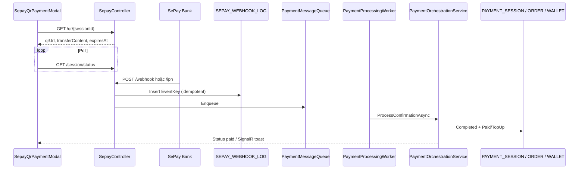

# Tài liệu Quy trình: SePay VietQR (QR / Webhook / IPN / Reconcile / Expiry)

Tài liệu mô tả chi tiết luồng thanh toán **SePay** trong hệ thống **Shopping Food**: tạo QR, nhận webhook/IPN, đối soát, hết hạn phiên.

> **Requirements:** [Payment_Requirements.md](./Payment_Requirements.md)  
> Gắn session từ checkout/top-up: [Payment_Checkout_Workflow.md](./Payment_Checkout_Workflow.md), [Payment_Wallet_Withdraw_Workflow.md](./Payment_Wallet_Withdraw_Workflow.md)

---

## 1. Luồng Tổng Quan (Workflow)

1. **Tạo session:** Checkout hoặc Top-up tạo `PaymentSession` (`Pending`, invoice `SF…`, **expiry 10 phút**).
2. **Hiển thị QR:** FE gọi `GET /api/Payment/sepay/qr/{sessionId}` → ảnh VietQR + nội dung chuyển khoản.
3. **Theo dõi:** FE poll `GET /api/Payment/sepay/session/status` + lắng nghe SignalR notification thanh toán.
4. **User chuyển khoản** đúng số tiền + nội dung CK.
5. **SePay gọi** `POST /api/Payment/sepay/webhook` và/hoặc `POST .../ipn` (public).
6. **Verify secret** → ghi `SEPAY_WEBHOOK_LOG` (EventKey unique) → đưa vào queue in-memory.
7. **PaymentProcessingWorker** → `ProcessConfirmationAsync` → khớp invoice + amount **±1₫** → session `Completed`, Order `Paid` (hoặc TopUp ví).
8. **ExpiryWorker** (mỗi 1 phút): Pending quá hạn → `Expired`.
9. **ReconciliationWorker** (mỗi 2 phút) hoặc nút FE `POST /reconcile`: hỏi API SePay, cửa sổ 24h, cooldown 30s/session.



---

## Bước 1: Lấy QR (Frontend + API)

**Thông tin:**
- **URL:** `/api/Payment/sepay/qr/{sessionId}`
- **HTTP Method:** GET
- **Auth:** JWT (user sở hữu session)
- **Controller:** `SepayController.GetQr`

**File:** `src/ShoppingFood.API/Controllers/SepayController.cs` — Lines 35–45

```csharp
[HttpGet("qr/{sessionId:guid}")]
public async Task<IActionResult> GetQr(Guid sessionId)
{
    var userId = (User as MyPrincipal)?.UserDto?.Id;
    var response = await _mediator.Send(new GetSepayQrQuery
    {
        SessionId = sessionId,
        CurrentUserId = userId
    });
    return StatusCode(response.Code, response);
}
```

**FE:** `ShoppingFood.FE/src/components/payment/SepayQrPaymentModal.tsx`  
- Load QR khi mở modal  
- Copy transfer content → toast “Đã sao chép…”  
- Deep link: `SepayRedirectPage.tsx` (`/payment/sepay?sessionId=…`)

**Tạo session (nhắc lại):** `PaymentSettlementService` — `ExpiresAt = DateTime.UtcNow.AddMinutes(10)`.

---

## Bước 2: Poll trạng thái phiên

**Thông tin:**
- **URL:** `/api/Payment/sepay/session/status?sessionId=` hoặc `invoiceNumber=`
- **HTTP Method:** GET
- **Auth:** Public bypass trong `AuthenticationFilter` (vẫn có thể gắn user nếu có token)

```csharp
[HttpGet("session/status")]
public async Task<IActionResult> GetSessionStatus(
    [FromQuery] Guid? sessionId,
    [FromQuery] string? invoiceNumber)
```

Display status helper: `paid` | `awaiting_payment` | `expired` | `failed` | …  
(“Paid SePay” = Completed **và** có `ExternalTransactionId` hoặc `SepayOrderId`).

---

## Bước 3: IPN từ SePay

**Thông tin:**
- **URL:** `/api/Payment/sepay/ipn`
- **HTTP Method:** POST (GET/HEAD = health check)
- **Auth:** Public + header `X-Secret-Key`

```csharp
[HttpPost("ipn")]
public async Task<IActionResult> Ipn()
{
    using var reader = new StreamReader(Request.Body, Encoding.UTF8);
    var body = await reader.ReadToEndAsync();
    var response = await _mediator.Send(new ProcessSepayIpnCommand
    {
        RawBody = body,
        SecretHeader = Request.Headers["X-Secret-Key"].FirstOrDefault()
    });
    if (response.Code is 200 or 201) return Ok(new { success = true });
    return StatusCode(response.Code, response);
}
```

**Handler:** `ProcessSepayIpnHandler` trong `Features/Payments/Commands/SepayHandlers.cs`  
**Verify:** `SepayService.VerifyIpnSecret`  

> ⚠️ Nếu `IpnSecretKey` **rỗng** → verify trả `true` (mở endpoint). **Bắt buộc set secret trên production.**

---

## Bước 4: Bank Webhook

**Thông tin:**
- **URL:** `/api/Payment/sepay/webhook`
- **HTTP Method:** POST
- **Auth:** `Authorization: Apikey {WebhookApiKey}` **hoặc** HMAC-SHA256 `sha256=` (timestamp skew ≤ 300s)

**Handler:** `ProcessSepayBankWebhookHandler`  
**Idempotency:** EventKey dạng `wh:{sepayTransactionId}` — trùng → success, không enqueue lại.

**Orchestration:** `PaymentOrchestrationService.PersistWebhookAndEnqueueAsync`

---

## Bước 5: Worker xử lý xác nhận

**File:** `src/ShoppingFood.API/Workers/PaymentProcessingWorker.cs`

| Việc | Chi tiết |
|------|----------|
| Boot | `ReplayUnprocessedWebhooksAsync` + reconcile pending |
| Loop | Consume `IPaymentMessageQueue` → `ProcessConfirmationAsync` |

**Confirm:** `PaymentSettlementService.ConfirmPaymentSessionByInvoiceAsync`

```text
Match InvoiceNumber
  → |paidAmount − session.Amount| ≤ 1  (VND)
  → Session Completed + gắn ExternalTransactionId
  → Nếu có OrderId: Order.PaymentStatus = Paid + notify seller
  → Nếu top-up (OrderId null): credit WALLET type TopUp
```

---

## Bước 6: Hết hạn phiên (Expiry)

**File:** `src/ShoppingFood.API/Workers/PaymentExpiryWorker.cs`  
**Interval:** mỗi **1 phút**  
**Call:** `ExpireStaleSessionsAsync` — `Pending` và `ExpiresAt < now` → `Expired`

**FE:** khi status expired → toast/UI “Mã QR đã hết hạn”.

---

## Bước 7: Đối soát (Reconcile)

### Tự động
**File:** `SepayReconciliationWorker.cs` — delay ~15s lúc boot, sau đó mỗi **2 phút**  
→ `ReconcileAllPendingSepaySessionsAsync` (Pending/Expired trong **24h**)

### Thủ công (FE / API)
- **URL:** `POST /api/Payment/sepay/reconcile`
- **Auth:** JWT
- Cooldown **30 giây**/session
- Có thể `allowExpired: true` cho late payment

**FE toasts:** “Đang đồng bộ từ SePay…” / “Đã xác nhận…” / “Chưa thấy giao dịch…”  
**Result pages:** `/payment/success|error|cancel` có thể gọi reconcile.

---

## Bước 8: Chặn confirm tay với Sepay

**API:** `POST /api/Payment/confirm`  
Trong `ConfirmPaymentSessionHandler`: nếu session method = Sepay → **Failure** (chỉ webhook/IPN/reconcile được phép).

---

## Sơ đồ file đi qua (Call chain)

```text
CheckoutHandler / TopUpWalletHandler
  → PaymentSettlementService (tạo PaymentSession 10p)
  → SepayQrPaymentModal / SepayRedirectPage
  → SepayController (qr, status, reconcile)
  → SePay Bank → webhook / ipn
  → SepayHandlers (verify + EventKey)
  → PaymentOrchestrationService
  → PaymentMessageQueue
  → PaymentProcessingWorker
  → ConfirmPaymentSessionByInvoiceAsync
  → ORDER Paid | WALLET TopUp + Notification (+ SignalR)
Song song:
  PaymentExpiryWorker (1p)
  SepayReconciliationWorker (2p)
```

| Vai trò | Đường dẫn đầy đủ |
|---------|------------------|
| Controller | `src/ShoppingFood.API/Controllers/SepayController.cs` |
| Handlers | `src/ShoppingFood.Application/Features/Payments/Commands/SepayHandlers.cs` |
| Orchestration | `src/ShoppingFood.Application/Services/PaymentOrchestrationService.cs` |
| Settlement confirm | `src/ShoppingFood.Application/Services/PaymentSettlementService.cs` |
| SePay client | `src/ShoppingFood.Application/Services/SepayService.cs` |
| Options | `src/ShoppingFood.Application/Options/SepayOptions.cs` |
| Workers | `src/ShoppingFood.API/Workers/PaymentProcessingWorker.cs`, `PaymentExpiryWorker.cs`, `SepayReconciliationWorker.cs` |
| FE Modal | `ShoppingFood.FE/src/components/payment/SepayQrPaymentModal.tsx` |
| FE Service | `ShoppingFood.FE/src/services/PaymentService.ts` |
| Entity | `Domain/Models/PaymentSession.cs`, `SepayWebhookLog.cs` |

---

## Các thông báo (Toast / Message)

| Message | File | Trigger |
|---------|------|---------|
| Đơn hàng đã tạo. Quét mã QR… | CheckoutPage | Sau checkout Sepay |
| SePay đã xác nhận thanh toán qua webhook! | SepayQrPaymentModal | SignalR / status paid |
| Mã QR đã hết hạn | SepayQrPaymentModal | Expired |
| Đã sao chép nội dung chuyển khoản | SepayQrPaymentModal | Copy |
| Đang đồng bộ từ SePay… | SepayQrPaymentModal | Reconcile |
| Đã đồng bộ thanh toán từ SePay | PaymentResultPages | Reconcile OK |
| Thiếu mã phiên thanh toán | SepayRedirectPage | Missing sessionId |

---

## Các cơ chế bảo mật quan trọng

1. **IPN secret** (`X-Secret-Key`) — không để trống production.
2. **Webhook** Apikey hoặc HMAC-SHA256 + skew 300s.
3. **Idempotent EventKey** — chống double credit.
4. **Amount binding ±1₫** — chống khớp nhầm giao dịch.
5. **Không confirm tay** cho Sepay.
6. **Public bypass** chỉ `/ipn`, `/webhook`, `/session/status`.
7. **Queue in-memory** — restart dựa `ReplayUnprocessedWebhooksAsync`.
8. Diagnostics endpoint chỉ dành Admin/RBAC.

---

## Checklist tự test

- [ ] QR đúng amount + transfer content + countdown ~10 phút
- [ ] Webhook hợp lệ → Order Paid trong vài giây + toast
- [ ] Gửi lại cùng EventKey → không cộng tiền 2 lần
- [ ] Sai số tiền (>1₫) → không Completed
- [ ] Hết hạn → Expired trên UI; worker đánh dấu DB
- [ ] Nút đồng bộ / worker reconcile cứu được giao dịch late trong 24h
- [ ] `POST /Payment/confirm` với session Sepay → lỗi
- [ ] Top-up cùng pipeline → credit ví sau webhook

---

## Tóm tắt

SePay = **PaymentSession 10 phút + VietQR + Webhook/IPN idempotent + Workers (process/expiry/reconcile)**.  
Đây là cổng online **chính** của Shopping Food; Card/EWallet chỉ là stub khi SePay tắt.

> Liên kết: [Payment_Requirements.md](./Payment_Requirements.md) · [Payment_Checkout_Workflow.md](./Payment_Checkout_Workflow.md) · [README](./README.md)
