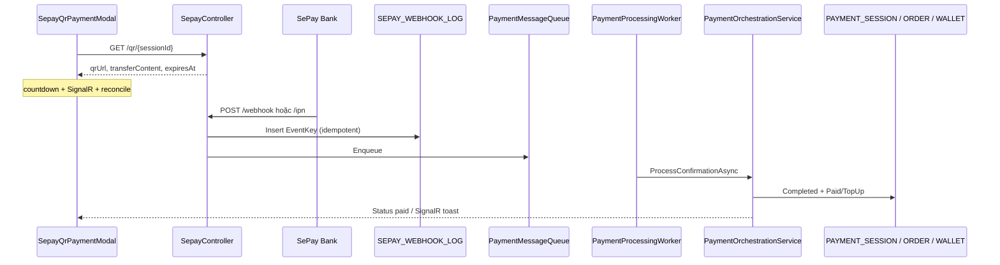

# Tài liệu Quy trình: SePay VietQR (QR / Webhook / IPN / Reconcile / Expiry)

Tài liệu mô tả chi tiết luồng thanh toán **SePay** trong hệ thống **UniEats**: tạo QR, nhận webhook/IPN, đối soát, hết hạn phiên — gồm **Phần A (UI Trace)** và **Phần B (nghiệp vụ/backend)**.

> **Requirements:** [Payment_Requirements.md](./Payment_Requirements.md)  
> Gắn session từ checkout/top-up: [Payment_Checkout_Workflow.md](./Payment_Checkout_Workflow.md), [Payment_Wallet_Withdraw_Workflow.md](./Payment_Wallet_Withdraw_Workflow.md)

---

## Phần A — UI Interaction Trace (Nút bấm → Code → Data → Hiển thị)

Mỗi thao tác: **nút ở đâu** · **bấm chạy file/hàm nào** · **API/BE** · **data trả về** · **hiển thị thế nào**.

---

### UT-SEP-01 — Mở SepayQrPaymentModal từ Checkout / Order detail

#### 1. Giao diện

| Mục | Giá trị |
|-----|---------|
| **Entry Checkout** | `pages/CheckoutPage.tsx` — sau đặt đơn method Sepay → `setSepaySessionId` + mở modal |
| **Entry Order** | `components/order/CustomerOrderDetailModal.tsx` — nút thanh toán lại Sepay |
| **Component** | `components/payment/SepayQrPaymentModal.tsx` |
| **Props** | `isOpen`, `sessionId`, `onClose`, `onPaid` |

#### 2. FE khi mở

```text
useEffect([isOpen, sessionId]) → loadQr()
  → paymentService.getSepayQr(sessionId)
  → GET /api/Payment/sepay/qr/{sessionId}
```

#### 3–5. Data & hiển thị

| Case | UI |
|------|-----|
| Loading | Spinner “Đang tạo mã QR...” |
| 410 Expired | `error = 'Mã QR đã hết hạn (10 phút)...'` + nút Thử lại |
| OK | Ảnh VietQR + bảng STK/số tiền/nội dung CK + countdown |
| Fail | `res.message` / “Không thể tạo mã QR thanh toán.” |

Checkout toast trước khi mở (thường): “Đơn hàng đã tạo. Quét mã QR…”

---

### UT-SEP-02 — Sao chép nội dung chuyển khoản

#### 1–2

| Mục | Giá trị |
|-----|---------|
| **Nút** | Click nội dung CK (icon Copy) trong modal |
| **Hàm** | `copyTransferContent()` |

```text
navigator.clipboard.writeText(qrData.transferContent)
→ toast.success('Đã sao chép nội dung chuyển khoản')
```

Không gọi API. Nội dung CK = `transferContent` (thường trùng invoice `SF…`) — giữ nguyên để webhook khớp.

---

### UT-SEP-03 — Poll / cập nhật trạng thái (SignalR + status API)

Modal **không** setInterval poll status cố định; cập nhật qua:

1. **Countdown local** mỗi 1s (`remainingSeconds`)
2. **SignalR path:** `ON_REALTIME_NOTIFICATION` (Payment / `targetId === sessionId`) → `getPaymentSessionStatus`
3. **Reconcile thủ công** (UT-SEP-04)

```text
window.addEventListener('ON_REALTIME_NOTIFICATION', ...)
  → paymentService.getPaymentSessionStatus({ sessionId })
  → GET /api/Payment/sepay/session/status
  → applySessionStatus → nếu isPaid → notifyPaid
```

#### Hiển thị khi paid

```text
notifyPaid(invoiceNumber)
  → toast.success('SePay đã xác nhận thanh toán qua webhook!')
  → UI “Thanh toán thành công” + nút Xong
  → onPaid(invoiceNumber)
```

> Status helper: `paid` | `awaiting_payment` | `processing` | `expired` | …

---

### UT-SEP-04 — Nút đối soát thủ công (Reconcile)

#### 1. Giao diện

| Mục | Giá trị |
|-----|---------|
| **Nút** | “Đã chuyển khoản? Kiểm tra lại từ SePay” |
| **Hàm** | `handleManualReconcile` |

#### 2–5

```text
toast.loading('Đang đồng bộ từ SePay...')
→ paymentService.reconcileSepayPayment({ sessionId })
→ POST /api/Payment/sepay/reconcile
```

| OK (`data.success`) | `toast.success(...)` + UI paid |
| Chưa khớp | `toast.error('Chưa thấy giao dịch khớp trên SePay')` |

Cooldown BE **30s**/session.

---

### UT-SEP-05 — Hết hạn QR (countdown FE + API 410)

| Nguồn | Hiển thị |
|-------|----------|
| Countdown `remainingSeconds → 0` | `toast.error('Mã QR đã hết hạn')` + badge expired + “Vui lòng tạo đơn mới” |
| GET QR `code === 410` | Error text hết hạn 10 phút |
| Worker BE | `PaymentExpiryWorker` → session `Expired` (Phần B) |

---

### UT-SEP-06 — SepayRedirectPage (deep link)

#### 1. Giao diện

| Mục | Giá trị |
|-----|---------|
| **Route** | `/payment/sepay?sessionId=…&returnUrl=…` |
| **Page** | `pages/payment/SepayRedirectPage.tsx` |

#### 2–5

```text
Thiếu sessionId → toast.error('Thiếu mã phiên thanh toán') → navigate HOME
Có sessionId → mở SepayQrPaymentModal
onClose → navigate(returnUrl ?? ORDERS)
onPaid → giữ modal success (không auto redirect)
```

Top-up từ ví cũng navigate tới route này (xem Wallet workflow).

---

### UT-SEP-07 — PaymentResultPages (success / timeout + reconcile)

#### 1. Giao diện

| Mục | Giá trị |
|-----|---------|
| **Pages** | `pages/payment/PaymentResultPages.tsx` — `PaymentSuccessPage` (+ error/cancel nếu có) |
| **Query** | `?invoice=` và/hoặc `?sessionId=` |

#### 2. FE

```text
Mount → getPaymentSessionStatus
Listen ON_REALTIME_NOTIFICATION (Payment / targetId / invoice in message)
Fallback 30s → pageState = 'timeout'
Nút đồng bộ → handleReconcile → POST /sepay/reconcile
```

#### 5. Hiển thị

| confirming | Spinner “Đang xác nhận thanh toán” |
| success | UI thành công |
| timeout | “Chưa nhận được xác nhận” + nút đồng bộ SePay |
| Reconcile OK | `toast.success('Đã đồng bộ thanh toán từ SePay')` |

---

### Bảng tóm tắt Phần A

| ID | Thao tác | FE | API |
|----|----------|-----|-----|
| UT-SEP-01 | Mở QR modal | Checkout / OrderDetail → SepayQrPaymentModal | GET `/sepay/qr/{id}` |
| UT-SEP-02 | Copy CK | `copyTransferContent` | — |
| UT-SEP-03 | Paid realtime | SignalR → status | GET `/sepay/session/status` |
| UT-SEP-04 | Reconcile | `handleManualReconcile` | POST `/sepay/reconcile` |
| UT-SEP-05 | Expiry UI | countdown / 410 | ExpiryWorker |
| UT-SEP-06 | Deep link | SepayRedirectPage | (reuse modal) |
| UT-SEP-07 | Result pages | PaymentResultPages | status + reconcile |

---

## Phần B — Workflow nghiệp vụ & Backend

### 1. Luồng Tổng Quan (Workflow)

1. **Tạo session:** Checkout hoặc Top-up tạo `PaymentSession` (`Pending`, invoice `SF…`, **expiry 10 phút**).
2. **Hiển thị QR:** FE gọi `GET /api/Payment/sepay/qr/{sessionId}` → ảnh VietQR + nội dung chuyển khoản.
3. **Theo dõi:** FE countdown + SignalR notification thanh toán + (tuỳ) status API; nút reconcile.
4. **User chuyển khoản** đúng số tiền + nội dung CK.
5. **SePay gọi** `POST /api/Payment/sepay/webhook` và/hoặc `POST .../ipn` (public).
6. **Verify secret** → ghi `SEPAY_WEBHOOK_LOG` (EventKey unique) → đưa vào queue in-memory.
7. **PaymentProcessingWorker** → `ProcessConfirmationAsync` → khớp invoice + amount **±1₫** → session `Completed`, Order `Paid` (hoặc TopUp ví).
8. **ExpiryWorker** (mỗi 1 phút): Pending quá hạn → `Expired`.
9. **ReconciliationWorker** (mỗi 2 phút) hoặc nút FE `POST /reconcile`: hỏi API SePay, cửa sổ 24h, cooldown 30s/session.



---

### Bước 1: Lấy QR (Frontend + API)

**Thông tin:**
- **URL:** `/api/Payment/sepay/qr/{sessionId}`
- **HTTP Method:** GET
- **Auth:** JWT (user sở hữu session)
- **Controller:** `SepayController.GetQr`

**File:** `src/ShoppingFood.API/Controllers/SepayController.cs`

```csharp
[HttpGet("qr/{sessionId:guid}")]
public async Task<IActionResult> GetQr(Guid sessionId)
{
    var userId = (User as MyPrincipal)?.UserDto?.Id;
    var response = await _mediator.Send(new GetSepayQrQuery
    {
        SessionId = sessionId,
        CurrentUserId = userId
    });
    return StatusCode(response.Code, response);
}
```

**FE:** `SepayQrPaymentModal.tsx` — load QR khi mở; Copy; deep link `SepayRedirectPage.tsx`.  
**Tạo session:** `PaymentSettlementService` — `ExpiresAt = DateTime.UtcNow.AddMinutes(10)`.

---

### Bước 2: Poll / trạng thái phiên

- **URL:** `/api/Payment/sepay/session/status?sessionId=` hoặc `invoiceNumber=`
- **HTTP Method:** GET
- **Auth:** Public bypass trong `AuthenticationFilter`

```csharp
[HttpGet("session/status")]
public async Task<IActionResult> GetSessionStatus(
    [FromQuery] Guid? sessionId,
    [FromQuery] string? invoiceNumber)
```

Display status: `paid` | `awaiting_payment` | `expired` | `failed` | …  
(“Paid SePay” = Completed **và** có `ExternalTransactionId` hoặc `SepayOrderId`).

---

### Bước 3: IPN từ SePay

- **URL:** `/api/Payment/sepay/ipn`
- **HTTP Method:** POST (GET/HEAD = health check)
- **Auth:** Public + header `X-Secret-Key`
- **Handler:** `ProcessSepayIpnHandler` — `SepayService.VerifyIpnSecret`

> ⚠️ Nếu `IpnSecretKey` **rỗng** → verify trả `true`. **Bắt buộc set secret trên production.**

---

### Bước 4: Bank Webhook

- **URL:** `/api/Payment/sepay/webhook`
- **Auth:** `Authorization: Apikey {WebhookApiKey}` **hoặc** HMAC-SHA256 `sha256=` (timestamp skew ≤ 300s)
- **Handler:** `ProcessSepayBankWebhookHandler`
- **Idempotency:** EventKey `wh:{sepayTransactionId}` — trùng → success, không enqueue lại
- **Orchestration:** `PaymentOrchestrationService.PersistWebhookAndEnqueueAsync`

---

### Bước 5: Worker xử lý xác nhận

**File:** `PaymentProcessingWorker.cs`

| Việc | Chi tiết |
|------|----------|
| Boot | `ReplayUnprocessedWebhooksAsync` + reconcile pending |
| Loop | Consume `IPaymentMessageQueue` → `ProcessConfirmationAsync` |

**Confirm:** `PaymentSettlementService.ConfirmPaymentSessionByInvoiceAsync`

```text
Match InvoiceNumber
  → |paidAmount − session.Amount| ≤ 1  (VND)
  → Session Completed + gắn ExternalTransactionId
  → Có OrderId: Order.PaymentStatus = Paid + notify
  → Top-up (OrderId null): credit WALLET type TopUp
```

---

### Bước 6: Hết hạn phiên (Expiry)

**File:** `PaymentExpiryWorker.cs` — mỗi **1 phút** → `ExpireStaleSessionsAsync`  
Pending + `ExpiresAt < now` → `Expired`. FE: UT-SEP-05.

---

### Bước 7: Đối soát (Reconcile)

**Tự động:** `SepayReconciliationWorker` — ~15s boot, rồi mỗi **2 phút** → Pending/Expired trong **24h**.  
**Thủ công:** `POST /api/Payment/sepay/reconcile` — JWT, cooldown **30s**, có thể `allowExpired: true`.

---

### Bước 8: Chặn confirm tay với Sepay

`POST /api/Payment/confirm` — nếu method = Sepay → **Failure** (chỉ webhook/IPN/reconcile).

---

### Sơ đồ file đi qua (Call chain)

```text
CheckoutHandler / TopUpWalletHandler
  → PaymentSettlementService (PaymentSession 10p)
  → SepayQrPaymentModal / SepayRedirectPage / PaymentResultPages
  → SepayController (qr, status, reconcile)
  → SePay Bank → webhook / ipn
  → SepayHandlers → PaymentOrchestrationService → Queue
  → PaymentProcessingWorker → ConfirmPaymentSessionByInvoiceAsync
  → ORDER Paid | WALLET TopUp + Notification (+ SignalR)
Song song: PaymentExpiryWorker (1p) · SepayReconciliationWorker (2p)
```

| Vai trò | Đường dẫn |
|---------|-----------|
| Controller | `src/ShoppingFood.API/Controllers/SepayController.cs` |
| Handlers | `.../Features/Payments/Commands/SepayHandlers.cs` |
| Orchestration | `.../Services/PaymentOrchestrationService.cs` |
| Settlement | `.../Services/PaymentSettlementService.cs` |
| SePay client | `.../Services/SepayService.cs` |
| Workers | `PaymentProcessingWorker`, `PaymentExpiryWorker`, `SepayReconciliationWorker` |
| FE Modal | `ShoppingFood.FE/src/components/payment/SepayQrPaymentModal.tsx` |
| FE Service | `ShoppingFood.FE/src/services/PaymentService.ts` |

---

### Các thông báo (Toast / Message)

| Message | File | Trigger |
|---------|------|---------|
| Đơn hàng đã tạo. Quét mã QR… | CheckoutPage | Sau checkout Sepay |
| SePay đã xác nhận thanh toán qua webhook! | SepayQrPaymentModal | SignalR / status paid |
| Mã QR đã hết hạn | SepayQrPaymentModal | Countdown / expired |
| Đã sao chép nội dung chuyển khoản | SepayQrPaymentModal | Copy |
| Đang đồng bộ từ SePay… | SepayQrPaymentModal | Reconcile loading |
| Đã đồng bộ thanh toán từ SePay | PaymentResultPages | Reconcile OK |
| Thiếu mã phiên thanh toán | SepayRedirectPage | Missing sessionId |

---

### Các cơ chế bảo mật quan trọng

1. **IPN secret** (`X-Secret-Key`) — không để trống production.
2. **Webhook** Apikey hoặc HMAC-SHA256 + skew 300s.
3. **Idempotent EventKey** — chống double credit.
4. **Amount binding ±1₫**.
5. **Không confirm tay** cho Sepay.
6. **Public bypass** chỉ `/ipn`, `/webhook`, `/session/status`.
7. **Queue in-memory** — restart dựa `ReplayUnprocessedWebhooksAsync`.
8. Diagnostics chỉ Admin/RBAC.

---

### Checklist tự test

- [ ] QR đúng amount + transfer content + countdown ~10 phút
- [ ] Webhook hợp lệ → Order Paid + toast SignalR
- [ ] Gửi lại cùng EventKey → không cộng tiền 2 lần
- [ ] Sai số tiền (>1₫) → không Completed
- [ ] Hết hạn → Expired UI + worker DB
- [ ] Nút đồng bộ / worker reconcile cứu late payment 24h
- [ ] `POST /Payment/confirm` Sepay → lỗi
- [ ] Top-up cùng pipeline → credit ví sau webhook
- [ ] Deep link `/payment/sepay?sessionId=` mở modal đúng

---

### Tóm tắt

SePay = **PaymentSession 10 phút + VietQR + Webhook/IPN idempotent + Workers**. UI Trace **UT-SEP-01…07** ở Phần A; rule backend ở Phần B.

> Liên kết: [Payment_Requirements.md](./Payment_Requirements.md) · [Payment_Checkout_Workflow.md](./Payment_Checkout_Workflow.md) · [README](./README.md)
