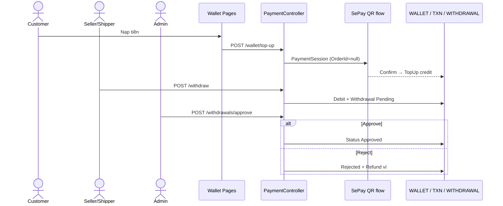

# Tài liệu Quy trình: Ví, Nạp tiền, Rút tiền & Công nợ COD

Tài liệu mô tả chi tiết luồng **ví đa chủ sở hữu**, **nạp tiền (Top-up)**, **rút tiền (Withdraw)**, và **công nợ COD shipper** — gồm **Phần A (UI Trace)** và **Phần B (nghiệp vụ/backend)**.

> **Requirements:** [Payment_Requirements.md](./Payment_Requirements.md)  
> Top-up dùng SePay: [Payment_Sepay_Workflow.md](./Payment_Sepay_Workflow.md)  
> Trừ ví khi checkout: [Payment_Checkout_Workflow.md](./Payment_Checkout_Workflow.md)

---

## Phần A — UI Interaction Trace (Nút bấm → Code → Data → Hiển thị)

Mỗi thao tác: **nút ở đâu** · **bấm chạy file/hàm nào** · **API/BE** · **data trả về** · **hiển thị thế nào**.

---

### UT-WAL-01 — CustomerWalletPage — Nạp tiền (Top-up)

#### 1. Giao diện

| Mục | Giá trị |
|-----|---------|
| **Route / Tab** | Profile ví hoặc `/payment/wallet` — `pages/payment/CustomerWalletPage.tsx` |
| **Input** | Số tiền nạp (`topUpAmount`) |
| **Nút** | Nạp tiền → `onClick={handleTopUp}` |

#### 2. FE

```text
handleTopUp
  → validate amount >= 10000
  → paymentService.topUpWallet(amount)
  → POST /api/Payment/wallet/top-up
```

#### 3. BE

`TopUpWalletHandler` → `CreateTopUpSessionAsync` → `PaymentSession` Sepay, `OrderId = null`, expiry 10 phút.

#### 4–5. Data & hiển thị

| Validate &lt; 10k | `toast.error('Số tiền nạp tối thiểu 10.000đ')` |
| OK | `toast.success('Đang chuyển hướng sang trang thanh toán...')` → `navigate(/payment/sepay?sessionId=…&returnUrl=…wallet)` |
| Fail | `toast.error(res.message \|\| 'Lỗi nạp tiền')` |

Sau đó UI QR: [Payment_Sepay_Workflow.md](./Payment_Sepay_Workflow.md) UT-SEP-*.

---

### UT-WAL-02 — PartnerWalletPages — Rút tiền (Seller / Shipper)

#### 1. Giao diện

| Mục | Giá trị |
|-----|---------|
| **Page** | `pages/payment/PartnerWalletPages.tsx` (Seller wallet + Shipper wallet) |
| **Form** | amount, bankName, bankAccountNumber, bankAccountHolder |
| **Nút** | Rút tiền → `handleWithdraw` |

#### 2–3

```text
handleWithdraw
  → validate đầy đủ + amount >= 50000 (Seller path)
  → paymentService.requestWithdrawal({ amount, bank* })
  → POST /api/Payment/withdraw
  → RequestWithdrawalHandler: Debit ví ngay + WithdrawalRequest Pending
```

#### 5. Hiển thị

| Thiếu form | `toast.error('Vui lòng điền đầy đủ thông tin')` |
| Min 50k | `toast.error('Số tiền rút tối thiểu 50.000đ')` (Seller) |
| OK | `toast.success('Yêu cầu rút tiền đã được gửi')` / `'đã gửi'` + `loadData()` (số dư giảm) |
| Fail / 403 Customer | toast.error message API |

---

### UT-WAL-03 — PartnerWalletPages — Shipper nộp công nợ COD

#### 1. Giao diện

| Mục | Giá trị |
|-----|---------|
| **Section** | Shipper wallet — input `repayAmount` |
| **Nút** | **Nộp tiền** → `handleRepay` |

#### 2–3

```text
handleRepay
  → paymentService.repayShipperDebt(amount)
  → POST /api/Payment/shipper/repay-debt
```

#### 5. Hiển thị

| Invalid | `toast.error('Nhập số tiền hợp lệ')` |
| OK | `toast.success('Đã nộp {amount} công nợ COD')` + reload |
| Fail | `toast.error('Lỗi nộp tiền')` |

---

### UT-WAL-04 — AdminFinancePage — Duyệt / từ chối rút tiền

#### 1. Giao diện

| Mục | Giá trị |
|-----|---------|
| **Page** | `pages/admin/AdminFinancePage.tsx` |
| **Section** | “Yêu cầu rút tiền chờ duyệt” |
| **Nút** | Duyệt → `handleApprove(id, true)`; Từ chối → `handleApprove(id, false)` |

#### 2–3

```text
paymentService.approveWithdrawal(id, approve)
  → POST /api/Payment/withdrawals/approve
  → Approve: Status Approved
  → Reject: Rejected + Refund txn hoàn ví
```

#### 5. Hiển thị

| Approve | `toast.success('Đã duyệt')` + reload list |
| Reject | `toast.success('Đã từ chối')` + reload |
| Fail | `toast.error(res.message \|\| 'Lỗi')` |

---

### Bảng tóm tắt Phần A

| ID | Thao tác | FE | API |
|----|----------|-----|-----|
| UT-WAL-01 | Top-up | CustomerWalletPage | POST `/wallet/top-up` |
| UT-WAL-02 | Withdraw | PartnerWalletPages | POST `/withdraw` |
| UT-WAL-03 | Repay COD debt | PartnerWalletPages (Shipper) | POST `/shipper/repay-debt` |
| UT-WAL-04 | Approve withdraw | AdminFinancePage | POST `/withdrawals/approve` |

---

## Phần B — Workflow nghiệp vụ & Backend

### 1. Luồng Tổng Quan (Workflow)

1. **Xem ví:** `GET /api/Payment/wallet` (Customer / Seller / Shipper / theo OwnerType).
2. **Customer nạp tiền:** ≥ **10.000₫** → `POST /wallet/top-up` → `PaymentSession` SePay → QR → webhook → credit `TopUp`.
3. **Seller/Shipper rút tiền:** ≥ **50.000₫** → `POST /withdraw` → **debit ví ngay** + `WithdrawalRequest` Pending.
4. **Admin duyệt rút:** `POST /withdrawals/approve` → Approved **hoặc** Rejected (+ Refund).
5. **Shipper nợ COD:** Tăng khi settle giao COD; nộp `POST /shipper/repay-debt`; Admin `PUT .../debt-limit`.
6. **Báo cáo:** transactions / history / withdrawals / Admin dashboard & reconciliation.



---

### Bước 1: Xem ví & lịch sử giao dịch

| Method | Route | Actor | Mục đích |
|--------|-------|-------|----------|
| GET | `/wallet` | Auth | Số dư + thông tin ví |
| GET | `/transactions` | Auth | Biến động `FINANCIAL_TRANSACTION` |
| GET | `/history` | Auth | Lịch sử phiên TT |
| GET | `/withdrawals` | Auth/Admin | DS yêu cầu rút |
| GET | `/dashboard` | Admin | Tổng quan tài chính |
| GET | `/reconciliation` | Admin | Đối soát |

**FE:** `CustomerWalletPage.tsx`, `PartnerWalletPages.tsx`, `PaymentHistoryPage.tsx`, `AdminFinancePage.tsx` / dashboard.

**Model ví:** `WALLET` — khóa `(OwnerType, OwnerId)` với `OwnerType ∈ { Customer, Seller, Shipper, Platform }` — polymorphic, không FK User.

---

### Bước 2: Nạp tiền (Top-up) — Customer

- **URL:** `POST /api/Payment/wallet/top-up`
- **Request:** `{ "amount": 50000 }`
- **Handler:** `TopUpWalletHandler` — `Amount < 10_000` → Failure
- **Session:** OrderId null, Sepay, ExpiresAt +10 phút
- **Confirm:** nhánh TopUp trong `ConfirmPaymentSessionByInvoiceAsync`

> Top-up **phụ thuộc SePay enabled**.

---

### Bước 3: Rút tiền (Withdraw) — Seller / Shipper

- **URL:** `POST /api/Payment/withdraw`
- **Auth:** Seller hoặc Shipper (**Customer → 403**)

| Rule | Giá trị |
|------|---------|
| Min amount | `MinWithdrawalAmount` default **50.000₫** |
| Khi request | **Debit ngay** + Pending |
| Large threshold | **5.000.000₫** (policy/reporting) |

**Handler:** `RequestWithdrawalHandler`.

---

### Bước 4: Admin duyệt rút tiền

- **URL:** `POST /api/Payment/withdrawals/approve`
- Approve → Approved; Reject → Rejected + **Refund** txn.

---

### Bước 5: Công nợ COD Shipper

**Nợ tăng:** `SettleOrderOnDeliveryAsync` (COD platform delivery) → `CodCollectedAmount += …`  
**Nộp nợ:** `POST /api/Payment/shipper/repay-debt`  
**Hạn mức:** `PUT /api/Payment/shipper/debt-limit` — default **5.000.000₫**

---

### Bước 6: E-Invoice (phụ)

`POST /api/Payment/invoice` → `E_INVOICE_REQUEST` gắn Order.

---

### Sơ đồ file đi qua

```text
CustomerWalletPage → topUpWallet → TopUpWalletHandler → SePay QR → TopUp credit
PartnerWalletPages → withdraw → RequestWithdrawalHandler → Debit + Pending
AdminFinancePage → approveWithdrawal → Approve/Reject (+ Refund)
Shipper → repayShipperDebt → giảm CodCollectedAmount
```

| Vai trò | Đường dẫn |
|---------|-----------|
| Controller | `PaymentController.cs` |
| Handlers | `PaymentCommandHandlers.cs` |
| Settlement | `PaymentSettlementService.cs` |
| FE | `CustomerWalletPage`, `PartnerWalletPages`, `AdminFinancePage` |

---

### Các thông báo (Toast / Message)

| Message | Nơi | Trigger |
|---------|-----|---------|
| Số tiền nạp tối thiểu 10.000đ | CustomerWalletPage | Validation FE |
| Đang chuyển hướng sang trang thanh toán… | CustomerWalletPage | Top-up OK |
| Yêu cầu rút tiền đã được gửi | PartnerWalletPages | Withdraw OK |
| Số tiền rút tối thiểu 50.000đ | PartnerWalletPages | Validation FE |
| Đã nộp … công nợ COD | PartnerWalletPages | Repay OK |
| Đã duyệt / Đã từ chối | AdminFinancePage | Approve API |
| 403 | API | Customer gọi withdraw |

---

### Các cơ chế bảo mật / nghiệp vụ quan trọng

1. Chỉ Seller/Shipper rút; Customer chặn.
2. Debit ngay khi request — Reject **bắt buộc** Refund.
3. Top-up min 10k / Withdraw min 50k — FE + BE.
4. Top-up phụ thuộc SePay secrets.
5. COD debt limit Admin.
6. Mọi biến động ví có `FINANCIAL_TRANSACTION`.
7. RBAC Admin cho approve / debt-limit / dashboard.

---

### Checklist tự test

- [ ] GET wallet đúng số dư theo role
- [ ] Top-up &lt; 10.000 → lỗi; ≥ 10k → QR → balance tăng
- [ ] Customer withdraw → 403
- [ ] Seller withdraw → balance giảm, Pending
- [ ] Admin reject → hoàn ví; approve → Approved
- [ ] Sau giao COD → CodCollectedAmount tăng; repay giảm đúng
- [ ] Admin đổi debt-limit có hiệu lực

---

### Tóm tắt

| Luồng | Ai | Cổng | Min |
|-------|-----|------|-----|
| Top-up | Customer | SePay QR | 10.000₫ |
| Pay order bằng ví | Customer | Debit checkout | = TotalAmount |
| Withdraw | Seller/Shipper | Debit + Admin | 50.000₫ |
| COD debt | Shipper | Settle + repay | Limit 5M mặc định |

UI Trace **UT-WAL-01…04** ở Phần A.

> Liên kết: [Payment_Requirements.md](./Payment_Requirements.md) · [Payment_Sepay_Workflow.md](./Payment_Sepay_Workflow.md) · [README](./README.md)
