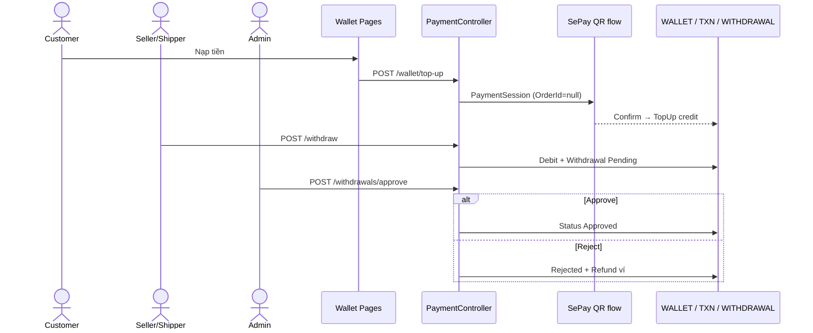

# Tài liệu Quy trình: Ví, Nạp tiền, Rút tiền & Công nợ COD

Tài liệu mô tả chi tiết luồng **ví đa chủ sở hữu**, **nạp tiền (Top-up)**, **rút tiền (Withdraw)**, và **công nợ COD shipper** trong hệ thống **Shopping Food**.

> **Requirements:** [Payment_Requirements.md](./Payment_Requirements.md)  
> Top-up dùng SePay: [Payment_Sepay_Workflow.md](./Payment_Sepay_Workflow.md)  
> Trừ ví khi checkout: [Payment_Checkout_Workflow.md](./Payment_Checkout_Workflow.md)

---

## 1. Luồng Tổng Quan (Workflow)

1. **Xem ví:** User gọi `GET /api/Payment/wallet` (Customer / Seller / Shipper / theo OwnerType).
2. **Customer nạp tiền:** Nhập số tiền ≥ **10.000₫** → `POST /api/Payment/wallet/top-up` → tạo `PaymentSession` SePay (không gắn Order) → QR → webhook → credit `TopUp`.
3. **Seller/Shipper rút tiền:** Số tiền ≥ **50.000₫** (config) → `POST /api/Payment/withdraw` → **debit ví ngay** + tạo `WithdrawalRequest` Pending.
4. **Admin duyệt rút:** `POST /api/Payment/withdrawals/approve` → Approved **hoặc** Rejected (+ Refund hoàn ví).
5. **Shipper nợ COD:** Tăng khi settle giao COD; nộp nợ `POST /api/Payment/shipper/repay-debt`; Admin set hạn mức `PUT .../debt-limit`.
6. **Báo cáo:** transactions / history / withdrawals / Admin dashboard & reconciliation.



---

## Bước 1: Xem ví & lịch sử giao dịch

**Thông tin APIs** (`PaymentController` — prefix `api/Payment`):

| Method | Route | Actor | Mục đích |
|--------|-------|-------|----------|
| GET | `/wallet` | Auth | Số dư + thông tin ví |
| GET | `/transactions` | Auth | Biến động `FINANCIAL_TRANSACTION` |
| GET | `/history` | Auth | Lịch sử phiên TT |
| GET | `/withdrawals` | Auth/Admin | DS yêu cầu rút |
| GET | `/dashboard` | Admin | Tổng quan tài chính |
| GET | `/reconciliation` | Admin | Đối soát |

**FE:**
- Customer: `ShoppingFood.FE/src/pages/payment/CustomerWalletPage.tsx`
- Seller/Shipper: `PartnerWalletPages.tsx`
- History: `PaymentHistoryPage.tsx`
- Admin: `AdminPaymentDashboardPage.tsx`, finance pages

**Model ví:** `WALLET` — khóa logic `(OwnerType, OwnerId)` với `OwnerType ∈ { Customer, Seller, Shipper, Platform }`  
**Không FK** tới User — polymorphic.

---

## Bước 2: Nạp tiền (Top-up) — Customer

**Thông tin:**
- **URL:** `/api/Payment/wallet/top-up`
- **HTTP Method:** POST
- **Auth:** Customer (JWT)
- **Request:** `{ "amount": 50000 }` (ví dụ)

### 2.1. Frontend

**File:** `CustomerWalletPage.tsx`

- Validate min **10.000₫** → toast `Số tiền nạp tối thiểu 10.000đ`
- Gọi API thành công → toast chuyển hướng → `/payment/sepay?sessionId=…`

### 2.2. Backend

**Handler:** `TopUpWalletHandler` (trong `PaymentCommandHandlers.cs`)  
**Rule:** `Amount < 10_000` → Failure  
**Tạo session:** `PaymentSettlementService.CreateTopUpSessionAsync`

| Field session | Giá trị |
|---------------|---------|
| OrderId | `null` (phân biệt với checkout) |
| Amount | số nạp |
| PaymentMethod | Sepay |
| ExpiresAt | now + **10 phút** |
| Status | Pending |

**Confirm sau webhook:** nhánh top-up trong `ConfirmPaymentSessionByInvoiceAsync` → `RecordTransactionAsync(..., TopUp, +amount)` vào ví Customer.

> Top-up **phụ thuộc SePay enabled**. Nếu SePay tắt → không nạp được qua QR.

---

## Bước 3: Rút tiền (Withdraw) — Seller / Shipper

**Thông tin:**
- **URL:** `/api/Payment/withdraw`
- **HTTP Method:** POST
- **Auth:** Seller hoặc Shipper (**Customer → 403**)

### 3.1. Rules

| Rule | Giá trị |
|------|---------|
| Ai được rút | Seller (ví quán), Shipper |
| Min amount | `PlatformFinanceConfig.MinWithdrawalAmount` (default **50.000₫**) |
| Khi request | **Debit ví ngay** + `WithdrawalRequest.Status = Pending` |
| Large threshold | **5.000.000₫** (policy/reporting) |

### 3.2. Frontend

**File:** `PartnerWalletPages.tsx`  
- Toast validate min 50k  
- Success: `Yêu cầu rút tiền đã được gửi`

### 3.3. Handler

**File:** `RequestWithdrawalHandler` trong `PaymentCommandHandlers.cs`  
Tạo `WITHDRAWAL_REQUEST` + `FINANCIAL_TRANSACTION` type `Withdrawal` (số âm).

---

## Bước 4: Admin duyệt rút tiền

**Thông tin:**
- **URL:** `/api/Payment/withdrawals/approve`
- **HTTP Method:** POST
- **Auth:** Admin

| Quyết định | Hành vi |
|------------|---------|
| Approve | `WithdrawalStatus → Approved` / Completed (theo handler) |
| Reject | Status Rejected + **Refund** txn hoàn lại số đã debit |

**FE Admin:** trang finance / withdrawals approve UI.

---

## Bước 5: Công nợ COD Shipper

### 5.1. Nợ tăng khi nào?

Khi **settle đơn COD** giao platform delivery thành công (`SettleOrderOnDeliveryAsync`):

- Tăng `ShipperProfile.CodCollectedAmount`
- Shipper giữ tiền mặt thu hộ → phải nộp về sàn

### 5.2. Nộp nợ

**URL:** `POST /api/Payment/shipper/repay-debt`  
**Auth:** Shipper  
**FE:** Partner wallet — toast `Đã nộp … công nợ COD`

### 5.3. Hạn mức nợ

**URL:** `PUT /api/Payment/shipper/debt-limit`  
**Auth:** Admin  
**Default:** `DefaultShipperDebtLimit` = **5.000.000₫** trên `PLATFORM_FINANCE_CONFIG`

---

## Bước 6: E-Invoice (phụ)

**URL:** `POST /api/Payment/invoice`  
Tạo `E_INVOICE_REQUEST` gắn Order (Customer xin hóa đơn).

---

## Sơ đồ file đi qua (Call chain)

### Top-up

```text
CustomerWalletPage.tsx
  → PaymentService.topUpWallet(amount)
  → PaymentController POST /wallet/top-up
  → TopUpWalletHandler
  → CreateTopUpSessionAsync
  → [SePay QR workflow]
  → ConfirmPaymentSessionByInvoiceAsync (TopUp branch)
  → WALLET + FINANCIAL_TRANSACTION
```

### Withdraw

```text
PartnerWalletPages.tsx
  → PaymentService.withdraw(...)
  → PaymentController POST /withdraw
  → RequestWithdrawalHandler
  → Debit WALLET + INSERT WITHDRAWAL_REQUEST
       ↓
Admin FE
  → POST /withdrawals/approve
  → Approve/Reject (+ Refund nếu reject)
```

| Vai trò | Đường dẫn |
|---------|-----------|
| Controller | `src/ShoppingFood.API/Controllers/PaymentController.cs` |
| Handlers | `src/ShoppingFood.Application/Features/Payments/Commands/PaymentCommandHandlers.cs` |
| Settlement | `src/ShoppingFood.Application/Services/PaymentSettlementService.cs` |
| Config | `Domain/Models/PlatformFinanceConfig.cs` |
| Entities | `Wallet.cs`, `FinancialTransaction.cs`, `WithdrawalRequest.cs`, `EInvoiceRequest.cs` |
| FE Customer | `ShoppingFood.FE/src/pages/payment/CustomerWalletPage.tsx` |
| FE Partner | `ShoppingFood.FE/src/pages/payment/PartnerWalletPages.tsx` |
| FE Service | `ShoppingFood.FE/src/services/PaymentService.ts` |

---

## Các thông báo (Toast / Message)

| Message | Nơi | Trigger |
|---------|-----|---------|
| Số tiền nạp tối thiểu 10.000đ | CustomerWalletPage | Validation FE |
| Đang chuyển hướng sang trang thanh toán… | CustomerWalletPage | Top-up OK |
| Yêu cầu rút tiền đã được gửi | PartnerWalletPages | Withdraw OK |
| Số tiền rút tối thiểu 50.000đ | PartnerWalletPages | Validation FE |
| Đã nộp … công nợ COD | PartnerWalletPages | Repay debt OK |
| 403 / không có quyền rút | API | Customer gọi withdraw |

---

## Các cơ chế bảo mật / nghiệp vụ quan trọng

1. **Phân quyền rút:** chỉ Seller/Shipper; Customer bị chặn.
2. **Debit ngay khi request rút** — Reject **bắt buộc** Refund để không mất tiền user.
3. **Top-up min 10k / Withdraw min 50k** — FE + BE nên đồng nhất.
4. **Top-up phụ thuộc SePay secrets** — xem Sepay workflow.
5. **COD debt limit** — Admin cấu hình; tránh shipper nợ vượt ngưỡng.
6. **Mọi biến động ví** phải có `FINANCIAL_TRANSACTION` (audit).
7. RBAC Admin cho approve / debt-limit / dashboard / reconciliation.

---

## Checklist tự test

- [ ] GET wallet đúng số dư theo role
- [ ] Top-up &lt; 10.000 → lỗi
- [ ] Top-up ≥ 10.000 → QR → sau webhook balance tăng đúng
- [ ] Customer gọi withdraw → 403
- [ ] Seller withdraw → balance giảm ngay, request Pending
- [ ] Admin reject → balance hoàn lại
- [ ] Admin approve → request Approved
- [ ] Sau giao COD → CodCollectedAmount tăng
- [ ] Repay-debt → giảm đúng số nộp
- [ ] Admin đổi debt-limit có hiệu lực

---

## Tóm tắt

| Luồng | Ai | Cổng / Cơ chế | Min |
|-------|-----|---------------|-----|
| Top-up | Customer | SePay QR session | 10.000₫ |
| Pay order bằng ví | Customer | Debit ngay lúc checkout | = TotalAmount |
| Withdraw | Seller/Shipper | Debit + Admin duyệt | 50.000₫ |
| COD debt | Shipper | Settle delivery + repay | Limit 5.000.000₫ mặc định |

> Liên kết: [Payment_Requirements.md](./Payment_Requirements.md) · [Payment_Sepay_Workflow.md](./Payment_Sepay_Workflow.md) · [README](./README.md)
