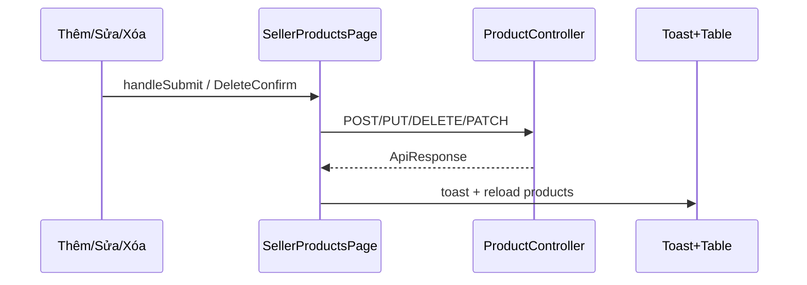

# Tài liệu Quy trình: Catalog sản phẩm (Product Catalog)

Tài liệu mô tả luồng **khách duyệt / tìm / xem / đánh giá món** và **Seller CRUD món** (stock, visibility, khung giờ), kèm **Admin duyệt sản phẩm** trong hệ thống **Shopping Food**.

---


---

## Phần A — UI Interaction Trace (Nút bấm → Code → Data → Hiển thị)

> UI Trace — Product  
> Mỗi thao tác trả lời: **nút ở đâu** · **bấm chạy file/hàm nào** · **API/BE đâu** · **data trả về** · **hiển thị thế nào**.


---

### UT-PRD-01 — Tìm kiếm / lọc trên ProductsPage

#### 1. Giao diện

| Mục | Giá trị |
|-----|---------|
| **Route** | `/products` |
| **Page** | `pages/ProductsPage.tsx` |
| **Control** | Ô search, filter category, nút lấy vị trí |

#### 2. Frontend

```text
Search / filter change
  → productService.search / get list (query params)
  → GET /Product/Search hoặc GET /Product
GPS filter → toast loading/success vị trí → gửi lat/lng query
```

#### 5. Hiển thị

Grid/list `ProductCard` từ `res.data`; toast lỗi mạng; toast vị trí.

---

### UT-PRD-02 — Chi tiết SP: Thêm vào giỏ

#### 1. Giao diện

| Mục | Giá trị |
|-----|---------|
| **Route** | `/products/:id` |
| **Page** | `ProductDetailPage.tsx` |
| **Nhãn** | `"Thêm vào giỏ"` (hoặc tương đương) |

#### 2. Frontend

```text
onClick add
  → useCart() / CartContext.addItem({ productId, quantity, size, toppings })
  → cartService.add → POST /Cart
  (+ guestUserId nếu chưa login)
```

#### 3. Backend

```text
CartController POST → AddCartItemHandler → CART / CART_ITEM
```

#### 5. Hiển thị

`toast.success('Đã thêm vào giỏ: {name}')` (CartContext); lỗi conflict 1 quán → toast error API.

**Chi tiết cart:** [04_Cart_UI_Trace.md](./04_Cart_UI_Trace.md) (nếu có) / workflow Cart.

---

### UT-PRD-03 — Báo cáo sản phẩm / Viết đánh giá

#### 1. Giao diện

`ProductDetailPage` / `ProductReviews.tsx` — nút Báo cáo, form đánh giá.

#### 2–3.

```text
Report  → POST /Product/Report → SystemReport
Review  → POST /Product/review → ProductReview
Reply   → POST /Product/review/{id}/reply (Seller)
Report review → POST /Product/review/{id}/report
```

#### 5. Hiển thị

toast success từng action; list reviews re-fetch `GET /Product/{id}/reviews`.

---

### UT-PRD-04 — Seller: Thêm sản phẩm (`"Thêm sản phẩm"`)

#### 1. Giao diện

| Mục | Giá trị |
|-----|---------|
| **Route** | `/seller/products` |
| **Page** | `pages/seller/SellerProductsPage.tsx` |
| **Mở form** | `handleAdd` → modal form |
| **Submit** | `ProductForm` `onSubmit={handleSubmit}` |

#### 2. Frontend

```text
handleUploadImage → authService.uploadImage → POST /User/UploadImage → imageUrls[]
handleSubmit
  → validate name, price>0, category
  → productService.create(...) → POST /Product
  → (edit) productService.update → PUT /Product/{id}
```

Có thể qua `useProducts` hook (toast chuẩn).

#### 3. Backend

```text
AddProductHandler
  → Product Status=Pending, gắn Restaurant của seller
  → Images / Sizes / Toppings
```

#### 4–5. Hiển thị

| Create OK | toast `Thêm sản phẩm thành công!` + đóng modal + reload list |
| Update OK | toast `Cập nhật sản phẩm thành công!` |
| Validate | toast tên/giá/danh mục |
| Upload | toast.loading → success/error |

---

### UT-PRD-05 — Seller: Ẩn/hiện & Còn/hết hàng

#### 1. Giao diện

Icon/button trên từng row product: `handleToggleVisibility` / `handleToggleStock`.

#### 2–3.

```text
PATCH /Product/Visibility/{id}
PATCH /Product/StockStatus/{id}
```

#### 5. Hiển thị

toast `Đã hiện/ẩn sản phẩm` / `Đã mở bán lại` / `Đã đánh dấu hết hàng`; cập nhật state row.

---

### UT-PRD-06 — Seller: Xóa sản phẩm

#### 1. Giao diện

| Mục | Giá trị |
|-----|---------|
| **Mở** | `handleDeleteClick` → `DeleteConfirmModal` |
| **Nhãn confirm** | `"Xóa"` `onClick={onConfirm}` → `handleDeleteConfirm` |

#### 2–3.

```text
DELETE /Product/{id} → soft-delete IsDeleted
```

#### 5. Hiển thị

toast xóa thành công; đóng modal; remove khỏi list.

---

### UT-PRD-07 — Admin: Duyệt / Từ chối sản phẩm

#### 1. Giao diện

| Mục | Giá trị |
|-----|---------|
| **Route** | `/admin/approvals` tab products |
| **Page** | `AdminApprovalsPage.tsx` |
| **Nút** | Duyệt / Từ chối → `openActionModal` → Modal confirm `handleActionSubmit` |

#### 2–3.

```text
adminService.approveProduct({ productId, isApproved, rejectionReason? })
  → POST /Admin/ApproveProduct
```

#### 5. Hiển thị

toast `Đã phê duyệt thành công!` / `Đã từ chối...`; bắt buộc lý do khi reject; reload danh sách Pending.

---

## Sơ đồ Seller CRUD




---

## Phần B — Workflow nghiệp vụ & Backend (chi tiết luồng)
## 1. Luồng Tổng Quan (Workflow)

### A. Customer browse

1. **Yêu cầu:** Khách mở `/products` hoặc Home → xem list / best sellers / recommendations.
2. **Tìm kiếm:** Gọi `GET /api/Product/Search` với filter.
3. **Chi tiết:** Mở `/products/:id` → `GET /api/Product/{id}`.
4. **Đánh giá:** Xem `GET /api/Product/{productId}/reviews`; viết review `POST /api/Product/review` (đã login).
5. **Báo cáo:** `POST /api/Product/Report` hoặc report review.

### B. Seller quản lý món

1. Seller vào `/seller/products` → list món quán (`GET /api/Product` với user seller).
2. Tạo món → `POST /api/Product` → Status = **Pending**.
3. Sửa / xóa / đổi stock / ẩn hiện / khung giờ bán qua các PATCH/PUT/DELETE.
4. Admin duyệt → `POST /api/Admin/ApproveProduct` → Status **Approved** (món mới hiện public đúng rule).


---

## Bước 1: Customer — List / Search / Detail

**Thông tin FE:**
- **URL:** `/products`, `/products/:id`, Home
- **Pages:** `ShoppingFood.FE/src/pages/ProductsPage.tsx`, `ProductDetailPage.tsx`
- **Service:** `ShoppingFood.FE/src/services/ProductService.ts`

**API:**

| Method | Route | Auth | Business |
|--------|-------|------|----------|
| GET | `/api/Product` | Public / Auth | List (seller thấy món quán mình) |
| GET | `/api/Product/{id}` | Public | Chi tiết |
| GET | `/api/Product/Search` | Public | Tìm kiếm |
| GET | `/api/Product/BestSellers` | Public | Bán chạy |
| GET | `/api/Product/recommendations` | Public/Auth | Gợi ý |
| GET | `/api/Product/Categories` | Public | Categories |

**Controller** — `src/ShoppingFood.API/Controllers/ProductController.cs`:

```csharp
[HttpGet("Search")]
public async Task<ActionResult<ApiResponse>> Search([FromQuery] SearchProductQuery query)
{
    if (userDto != null) query.CurrentUserId = userDto.Id;
    var response = await _mediator.Send(query);
    return Ok(response);
}

[HttpGet("{id}")]
public async Task<ActionResult<ApiResponse>> GetById(Guid id)
{
    var query = new GetProductDetailQuery(id);
    if (userDto != null) query.CurrentUserId = userDto.Id;
    var response = await _mediator.Send(query);
    return Ok(response);
}
```

**FE Service:**

```typescript
async search(query: ISearchProductQuery): Promise<IApiResponse<IProductDto[]>> {
  return httpClient.get(API_ENDPOINTS.PRODUCT.SEARCH, { params: query });
}
```

**Handlers:** `Application/Features/Products/Queries/` — `SearchProductQuery`, `GetProductDetailQuery`, `GetBestSellersQuery`, `GetRecommendationsQuery`.

**DB:** `PRODUCT`, `PRODUCT_IMAGE`, `PRODUCT_SIZE`, `PRODUCT_TOPPING`, `MENU_CATEGORY` (query filter `!IsDeleted`).

---

## Bước 2: Customer — Reviews

| Method | Route | Auth |
|--------|-------|------|
| GET | `/api/Product/{productId}/reviews` | Public |
| POST | `/api/Product/review` | Auth Customer |
| POST | `/api/Product/review/{reviewId}/reply` | Seller |
| POST | `/api/Product/review/{reviewId}/report` | Auth |
| GET | `/api/Product/seller/reviews` | Seller |
| POST | `/api/Product/Report` | Auth |

**FE:** `components/product/ProductReviews.tsx`, `pages/seller/SellerReviewsPage.tsx`.

**DB:** `PRODUCT_REVIEW`, `SYSTEM_REPORT` (khi report).

---

## Bước 3: Seller — Tạo món (Pending)

**Thông tin:**
- **URL (FE):** `/seller/products`
- **Page:** `SellerProductsPage.tsx`
- **Hook (thường):** `hooks/useProducts.ts` + toast
- **API:** `POST /api/Product`
- **Auth:** Seller / Mall + RBAC

**Controller:**

```csharp
[HttpPost]
public async Task<ActionResult<ApiResponse>> Create([FromBody] AddProductCommand command)
{
    if (userDto != null) command.CurrentUserId = userDto.Id;
    var response = await _mediator.Send(command);
    return Ok(response);
}
```

**Handler** — `AddProductHandler.cs`:

```csharp
private void InitializeProduct(Product product)
{
    if(product.Id == Guid.Empty) product.Id = Guid.NewGuid();
    product.CreatedAt = DateTime.UtcNow;
    product.UpdatedAt = DateTime.UtcNow;
    product.Status = ProductStatus.Pending; // Chờ Admin duyệt
}
```

**Models:** `Product`, `ProductImage`, `ProductSize`, `ProductTopping`.

---

## Bước 4: Seller — Cập nhật vận hành món

| Method | Route | Command | Việc |
|--------|-------|---------|------|
| PUT | `/api/Product/{id}` | `UpdateProductCommand` | Sửa thông tin |
| DELETE | `/api/Product/{id}` | `DeleteProductCommand` | Soft-delete |
| PATCH | `/api/Product/StockStatus/{id}` | `UpdateProductStockCommand` | Còn/hết hàng |
| PATCH | `/api/Product/Visibility/{id}` | `ToggleProductVisibilityCommand` | Ẩn/hiện |
| PATCH | `/api/Product/TimeAvailability/{id}` | `UpdateProductAvailabilityCommand` | Khung giờ bán |

**Controller ví dụ:**

```csharp
[HttpPatch("StockStatus/{id}")]
public async Task<ActionResult<ApiResponse>> UpdateStockStatus(Guid id, [FromBody] UpdateProductStockCommand command)
{
    command.Id = id;
    if (userDto != null) command.CurrentUserId = userDto.Id;
    var response = await _mediator.Send(command);
    return Ok(response);
}
```

**FE Service:**

```typescript
async updateStockStatus(data: IUpdateStockStatusRequest): Promise<IApiResponse<IProductDto>> { ... }
async updateAvailability(data: IUpdateAvailabilityRequest): Promise<IApiResponse<IProductDto>> { ... }
```

> Seller bị **Suspended** → `CheckSellerSuspensionAttribute` chặn mutating verbs.

---

## Bước 5: Admin — Duyệt sản phẩm

**Thông tin:**
- **URL (FE):** `/admin/approvals` (hoặc trang approvals sản phẩm)
- **API:** `POST /api/Admin/ApproveProduct`
- **Auth:** Admin

**Controller** — `AdminController.cs`:

```csharp
[HttpPost("ApproveProduct")]
public async Task<ActionResult<ApiResponse>> ApproveProduct([FromBody] ApproveProductCommand command)
{
    var response = await _mediator.Send(command);
    return Ok(response);
}
```

**FE:** `AdminService.approveProduct` → `POST /Admin/ApproveProduct`.

**Enum:** `ProductStatus`: Pending → Approved | Rejected.

---

## Sơ đồ file đi qua (Call chain)

```text
ProductsPage / ProductDetailPage / SellerProductsPage
  ↓
ProductService.ts / useProducts.ts
  ↓
HttpClient + Bearer
  ↓
ProductController / AdminController.ApproveProduct
  ↓
MediatR → Features/Products/(Commands|Queries) / Admin ApproveProduct
  ↓
ProductRepository / ShoppingFoodContext
  ↓
PRODUCT (+ Images, Sizes, Toppings, Reviews)
```

| Vai trò | Đường dẫn |
|---------|-----------|
| Controller | `src/ShoppingFood.API/Controllers/ProductController.cs` |
| Approve | `src/ShoppingFood.API/Controllers/AdminController.cs` |
| Add handler | `src/ShoppingFood.Application/Features/Products/Commands/AddProductHandler.cs` |
| FE Service | `ShoppingFood.FE/src/services/ProductService.ts` |
| FE Seller UI | `ShoppingFood.FE/src/pages/seller/SellerProductsPage.tsx` |
| FE Browse | `ShoppingFood.FE/src/pages/ProductsPage.tsx` |
| Entity | `src/ShoppingFood.Domain/Models/Product.cs` |

---

## Các thông báo (Toast / Message)

| Message / hành vi | Nơi | Trigger |
|-------------------|-----|---------|
| Toast tạo/sửa/xóa món | `useProducts.ts` / SellerProductsPage | CRUD OK/fail |
| Toast duyệt món | `useAdmin.ts` / AdminApprovals | ApproveProduct |
| ApiResponse.Message | Mọi API | Error từ handler |
| Confirm xóa | `DeleteConfirmModal` trên SellerProductsPage | Trước DELETE |

---

## Các cơ chế bảo mật / nghiệp vụ quan trọng

1. **Pending trước khi public:** món mới `ProductStatus.Pending` — Admin duyệt mới Approved.
2. **Soft-delete:** `IsDeleted` + global query filter trên Product và quan hệ.
3. **Seller ownership:** Handler gắn `CurrentUserId` → chỉ sửa món quán mình.
4. **Seller suspension filter:** chặn write khi quán Suspended.
5. **RBAC:** endpoint Product/Admin qua `AuthenticationFilter` + RolePermission.

---

## Checklist tự test

- [ ] Guest xem list + search + detail
- [ ] Seller tạo món → Status Pending, khách chưa thấy như Approved
- [ ] Admin ApproveProduct → món hiện đúng
- [ ] StockStatus / Visibility / TimeAvailability cập nhật OK
- [ ] Soft-delete không còn trong list public
- [ ] Review + seller reply hoạt động
- [ ] Seller Suspended không POST/PUT được

---

## Tóm tắt

Catalog = **browse public** + **Seller CRUD với Pending** + **Admin Approve**. Entry API: `ProductController` + `Admin/ApproveProduct`.

> Liên kết: [Restaurant_Seller_Workflow.md](./Restaurant_Seller_Workflow.md) · [README](./README.md)
