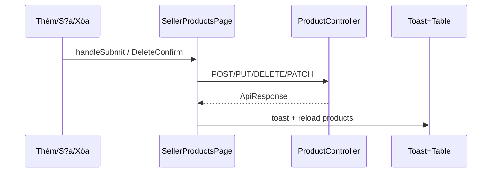
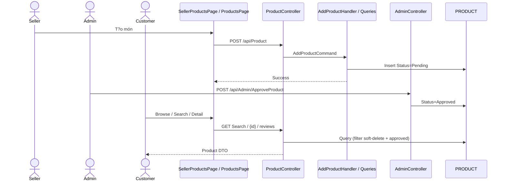

# Tài li?u Quy trình: Catalog s?n ph?m (Product Catalog)

Tài li?u mô t? lu?ng **khách duy?t / tìm / xem / dánh giá món** và **Seller CRUD món** (stock, visibility, khung gi?), kèm **Admin duy?t s?n ph?m** trong h? th?ng **UniEats**.

---


---

## Ph?n A — UI Interaction Trace (Nút b?m ? Code ? Data ? Hi?n th?)

> UI Trace — Product  
> M?i thao tác tr? l?i: **nút ? dâu** · **b?m ch?y file/hàm nào** · **API/BE dâu** · **data tr? v?** · **hi?n th? th? nào**.


---

### UT-PRD-01 — Tìm ki?m / l?c trên ProductsPage

#### 1. Giao di?n

| M?c | Giá tr? |
|-----|---------|
| **Route** | `/products` |
| **Page** | `pages/ProductsPage.tsx` |
| **Control** | Ô search, filter category, nút l?y v? trí |

#### 2. Frontend

```text
Search / filter change
  ? productService.search / get list (query params)
  ? GET /Product/Search ho?c GET /Product
GPS filter ? toast loading/success v? trí ? g?i lat/lng query
```

#### 5. Hi?n th?

Grid/list `ProductCard` t? `res.data`; toast l?i m?ng; toast v? trí.

---

### UT-PRD-02 — Chi ti?t SP: Thêm vào gi?

#### 1. Giao di?n

| M?c | Giá tr? |
|-----|---------|
| **Route** | `/products/:id` |
| **Page** | `ProductDetailPage.tsx` |
| **Nhãn** | `"Thêm vào gi?"` (ho?c tuong duong) |

#### 2. Frontend

```text
onClick add
  ? useCart() / CartContext.addItem({ productId, quantity, size, toppings })
  ? cartService.add ? POST /Cart
  (+ guestUserId n?u chua login)
```

#### 3. Backend

```text
CartController POST ? AddCartItemHandler ? CART / CART_ITEM
```

#### 5. Hi?n th?

`toast.success('Ðã thêm vào gi?: {name}')` (CartContext); l?i conflict 1 quán ? toast error API.

**Chi ti?t cart:** [04_Cart_UI_Trace.md](./04_Cart_UI_Trace.md) (n?u có) / workflow Cart.

---

### UT-PRD-03 — Báo cáo s?n ph?m / Vi?t dánh giá

#### 1. Giao di?n

`ProductDetailPage` / `ProductReviews.tsx` — nút Báo cáo, form dánh giá.

#### 2–3.

```text
Report  ? POST /Product/Report ? SystemReport
Review  ? POST /Product/review ? ProductReview
Reply   ? POST /Product/review/{id}/reply (Seller)
Report review ? POST /Product/review/{id}/report
```

#### 5. Hi?n th?

toast success t?ng action; list reviews re-fetch `GET /Product/{id}/reviews`.

---

### UT-PRD-04 — Seller: Thêm s?n ph?m (`"Thêm s?n ph?m"`)

#### 1. Giao di?n

| M?c | Giá tr? |
|-----|---------|
| **Route** | `/seller/products` |
| **Page** | `pages/seller/SellerProductsPage.tsx` |
| **M? form** | `handleAdd` ? modal form |
| **Submit** | `ProductForm` `onSubmit={handleSubmit}` |

#### 2. Frontend

```text
handleUploadImage ? authService.uploadImage ? POST /User/UploadImage ? imageUrls[]
handleSubmit
  ? validate name, price>0, category
  ? productService.create(...) ? POST /Product
  ? (edit) productService.update ? PUT /Product/{id}
```

Có th? qua `useProducts` hook (toast chu?n).

#### 3. Backend

```text
AddProductHandler
  ? Product Status=Pending, g?n Restaurant c?a seller
  ? Images / Sizes / Toppings
```

#### 4–5. Hi?n th?

| Create OK | toast `Thêm s?n ph?m thành công!` + dóng modal + reload list |
| Update OK | toast `C?p nh?t s?n ph?m thành công!` |
| Validate | toast tên/giá/danh m?c |
| Upload | toast.loading ? success/error |

---

### UT-PRD-05 — Seller: ?n/hi?n & Còn/h?t hàng

#### 1. Giao di?n

Icon/button trên t?ng row product: `handleToggleVisibility` / `handleToggleStock`.

#### 2–3.

```text
PATCH /Product/Visibility/{id}
PATCH /Product/StockStatus/{id}
```

#### 5. Hi?n th?

toast `Ðã hi?n/?n s?n ph?m` / `Ðã m? bán l?i` / `Ðã dánh d?u h?t hàng`; c?p nh?t state row.

---

### UT-PRD-06 — Seller: Xóa s?n ph?m

#### 1. Giao di?n

| M?c | Giá tr? |
|-----|---------|
| **M?** | `handleDeleteClick` ? `DeleteConfirmModal` |
| **Nhãn confirm** | `"Xóa"` `onClick={onConfirm}` ? `handleDeleteConfirm` |

#### 2–3.

```text
DELETE /Product/{id} ? soft-delete IsDeleted
```

#### 5. Hi?n th?

toast xóa thành công; dóng modal; remove kh?i list.

---

### UT-PRD-07 — Admin: Duy?t / T? ch?i s?n ph?m

#### 1. Giao di?n

| M?c | Giá tr? |
|-----|---------|
| **Route** | `/admin/approvals` tab products |
| **Page** | `AdminApprovalsPage.tsx` |
| **Nút** | Duy?t / T? ch?i ? `openActionModal` ? Modal confirm `handleActionSubmit` |

#### 2–3.

```text
adminService.approveProduct({ productId, isApproved, rejectionReason? })
  ? POST /Admin/ApproveProduct
```

#### 5. Hi?n th?

toast `Ðã phê duy?t thành công!` / `Ðã t? ch?i...`; b?t bu?c lý do khi reject; reload danh sách Pending.

---

## So d? Seller CRUD




---

## Ph?n B — Workflow nghi?p v? & Backend (chi ti?t lu?ng)
## 1. Lu?ng T?ng Quan (Workflow)

### A. Customer browse

1. **Yêu c?u:** Khách m? `/products` ho?c Home ? xem list / best sellers / recommendations.
2. **Tìm ki?m:** G?i `GET /api/Product/Search` v?i filter.
3. **Chi ti?t:** M? `/products/:id` ? `GET /api/Product/{id}`.
4. **Ðánh giá:** Xem `GET /api/Product/{productId}/reviews`; vi?t review `POST /api/Product/review` (dã login).
5. **Báo cáo:** `POST /api/Product/Report` ho?c report review.

### B. Seller qu?n lý món

1. Seller vào `/seller/products` ? list món quán (`GET /api/Product` v?i user seller).
2. T?o món ? `POST /api/Product` ? Status = **Pending**.
3. S?a / xóa / d?i stock / ?n hi?n / khung gi? bán qua các PATCH/PUT/DELETE.
4. Admin duy?t ? `POST /api/Admin/ApproveProduct` ? Status **Approved** (món m?i hi?n public dúng rule).



---

## Bu?c 1: Customer — List / Search / Detail

**Thông tin FE:**
- **URL:** `/products`, `/products/:id`, Home
- **Pages:** `ShoppingFood.FE/src/pages/ProductsPage.tsx`, `ProductDetailPage.tsx`
- **Service:** `ShoppingFood.FE/src/services/ProductService.ts`

**API:**

| Method | Route | Auth | Business |
|--------|-------|------|----------|
| GET | `/api/Product` | Public / Auth | List (seller th?y món quán mình) |
| GET | `/api/Product/{id}` | Public | Chi ti?t |
| GET | `/api/Product/Search` | Public | Tìm ki?m |
| GET | `/api/Product/BestSellers` | Public | Bán ch?y |
| GET | `/api/Product/recommendations` | Public/Auth | G?i ý |
| GET | `/api/Product/Categories` | Public | Categories |

**Controller** — `src/ShoppingFood.API/Controllers/ProductController.cs`:

```csharp
[HttpGet("Search")]
public async Task<ActionResult<ApiResponse>> Search([FromQuery] SearchProductQuery query)
{
    if (userDto != null) query.CurrentUserId = userDto.Id;
    var response = await _mediator.Send(query);
    return Ok(response);
}

[HttpGet("{id}")]
public async Task<ActionResult<ApiResponse>> GetById(Guid id)
{
    var query = new GetProductDetailQuery(id);
    if (userDto != null) query.CurrentUserId = userDto.Id;
    var response = await _mediator.Send(query);
    return Ok(response);
}
```

**FE Service:**

```typescript
async search(query: ISearchProductQuery): Promise<IApiResponse<IProductDto[]>> {
  return httpClient.get(API_ENDPOINTS.PRODUCT.SEARCH, { params: query });
}
```

**Handlers:** `Application/Features/Products/Queries/` — `SearchProductQuery`, `GetProductDetailQuery`, `GetBestSellersQuery`, `GetRecommendationsQuery`.

**DB:** `PRODUCT`, `PRODUCT_IMAGE`, `PRODUCT_SIZE`, `PRODUCT_TOPPING`, `MENU_CATEGORY` (query filter `!IsDeleted`).

---

## Bu?c 2: Customer — Reviews

| Method | Route | Auth |
|--------|-------|------|
| GET | `/api/Product/{productId}/reviews` | Public |
| POST | `/api/Product/review` | Auth Customer |
| POST | `/api/Product/review/{reviewId}/reply` | Seller |
| POST | `/api/Product/review/{reviewId}/report` | Auth |
| GET | `/api/Product/seller/reviews` | Seller |
| POST | `/api/Product/Report` | Auth |

**FE:** `components/product/ProductReviews.tsx`, `pages/seller/SellerReviewsPage.tsx`.

**DB:** `PRODUCT_REVIEW`, `SYSTEM_REPORT` (khi report).

---

## Bu?c 3: Seller — T?o món (Pending)

**Thông tin:**
- **URL (FE):** `/seller/products`
- **Page:** `SellerProductsPage.tsx`
- **Hook (thu?ng):** `hooks/useProducts.ts` + toast
- **API:** `POST /api/Product`
- **Auth:** Seller / Mall + RBAC

**Controller:**

```csharp
[HttpPost]
public async Task<ActionResult<ApiResponse>> Create([FromBody] AddProductCommand command)
{
    if (userDto != null) command.CurrentUserId = userDto.Id;
    var response = await _mediator.Send(command);
    return Ok(response);
}
```

**Handler** — `AddProductHandler.cs`:

```csharp
private void InitializeProduct(Product product)
{
    if(product.Id == Guid.Empty) product.Id = Guid.NewGuid();
    product.CreatedAt = DateTime.UtcNow;
    product.UpdatedAt = DateTime.UtcNow;
    product.Status = ProductStatus.Pending; // Ch? Admin duy?t
}
```

**Models:** `Product`, `ProductImage`, `ProductSize`, `ProductTopping`.

---

## Bu?c 4: Seller — C?p nh?t v?n hành món

| Method | Route | Command | Vi?c |
|--------|-------|---------|------|
| PUT | `/api/Product/{id}` | `UpdateProductCommand` | S?a thông tin |
| DELETE | `/api/Product/{id}` | `DeleteProductCommand` | Soft-delete |
| PATCH | `/api/Product/StockStatus/{id}` | `UpdateProductStockCommand` | Còn/h?t hàng |
| PATCH | `/api/Product/Visibility/{id}` | `ToggleProductVisibilityCommand` | ?n/hi?n |
| PATCH | `/api/Product/TimeAvailability/{id}` | `UpdateProductAvailabilityCommand` | Khung gi? bán |

**Controller ví d?:**

```csharp
[HttpPatch("StockStatus/{id}")]
public async Task<ActionResult<ApiResponse>> UpdateStockStatus(Guid id, [FromBody] UpdateProductStockCommand command)
{
    command.Id = id;
    if (userDto != null) command.CurrentUserId = userDto.Id;
    var response = await _mediator.Send(command);
    return Ok(response);
}
```

**FE Service:**

```typescript
async updateStockStatus(data: IUpdateStockStatusRequest): Promise<IApiResponse<IProductDto>> { ... }
async updateAvailability(data: IUpdateAvailabilityRequest): Promise<IApiResponse<IProductDto>> { ... }
```

> Seller b? **Suspended** ? `CheckSellerSuspensionAttribute` ch?n mutating verbs.

---

## Bu?c 5: Admin — Duy?t s?n ph?m

**Thông tin:**
- **URL (FE):** `/admin/approvals` (ho?c trang approvals s?n ph?m)
- **API:** `POST /api/Admin/ApproveProduct`
- **Auth:** Admin

**Controller** — `AdminController.cs`:

```csharp
[HttpPost("ApproveProduct")]
public async Task<ActionResult<ApiResponse>> ApproveProduct([FromBody] ApproveProductCommand command)
{
    var response = await _mediator.Send(command);
    return Ok(response);
}
```

**FE:** `AdminService.approveProduct` ? `POST /Admin/ApproveProduct`.

**Enum:** `ProductStatus`: Pending ? Approved | Rejected.

---

## So d? file di qua (Call chain)

```text
ProductsPage / ProductDetailPage / SellerProductsPage
  ?
ProductService.ts / useProducts.ts
  ?
HttpClient + Bearer
  ?
ProductController / AdminController.ApproveProduct
  ?
MediatR ? Features/Products/(Commands|Queries) / Admin ApproveProduct
  ?
ProductRepository / ShoppingFoodContext
  ?
PRODUCT (+ Images, Sizes, Toppings, Reviews)
```

| Vai trò | Ðu?ng d?n |
|---------|-----------|
| Controller | `src/ShoppingFood.API/Controllers/ProductController.cs` |
| Approve | `src/ShoppingFood.API/Controllers/AdminController.cs` |
| Add handler | `src/ShoppingFood.Application/Features/Products/Commands/AddProductHandler.cs` |
| FE Service | `ShoppingFood.FE/src/services/ProductService.ts` |
| FE Seller UI | `ShoppingFood.FE/src/pages/seller/SellerProductsPage.tsx` |
| FE Browse | `ShoppingFood.FE/src/pages/ProductsPage.tsx` |
| Entity | `src/ShoppingFood.Domain/Models/Product.cs` |

---

## Các thông báo (Toast / Message)

| Message / hành vi | Noi | Trigger |
|-------------------|-----|---------|
| Toast t?o/s?a/xóa món | `useProducts.ts` / SellerProductsPage | CRUD OK/fail |
| Toast duy?t món | `useAdmin.ts` / AdminApprovals | ApproveProduct |
| ApiResponse.Message | M?i API | Error t? handler |
| Confirm xóa | `DeleteConfirmModal` trên SellerProductsPage | Tru?c DELETE |

---

## Các co ch? b?o m?t / nghi?p v? quan tr?ng

1. **Pending tru?c khi public:** món m?i `ProductStatus.Pending` — Admin duy?t m?i Approved.
2. **Soft-delete:** `IsDeleted` + global query filter trên Product và quan h?.
3. **Seller ownership:** Handler g?n `CurrentUserId` ? ch? s?a món quán mình.
4. **Seller suspension filter:** ch?n write khi quán Suspended.
5. **RBAC:** endpoint Product/Admin qua `AuthenticationFilter` + RolePermission.

---

## Checklist t? test

- [ ] Guest xem list + search + detail
- [ ] Seller t?o món ? Status Pending, khách chua th?y nhu Approved
- [ ] Admin ApproveProduct ? món hi?n dúng
- [ ] StockStatus / Visibility / TimeAvailability c?p nh?t OK
- [ ] Soft-delete không còn trong list public
- [ ] Review + seller reply ho?t d?ng
- [ ] Seller Suspended không POST/PUT du?c

---

## Tóm t?t

Catalog = **browse public** + **Seller CRUD v?i Pending** + **Admin Approve**. Entry API: `ProductController` + `Admin/ApproveProduct`.

> Liên k?t: [Restaurant_Seller_Workflow.md](./Restaurant_Seller_Workflow.md) · [README](./README.md)
