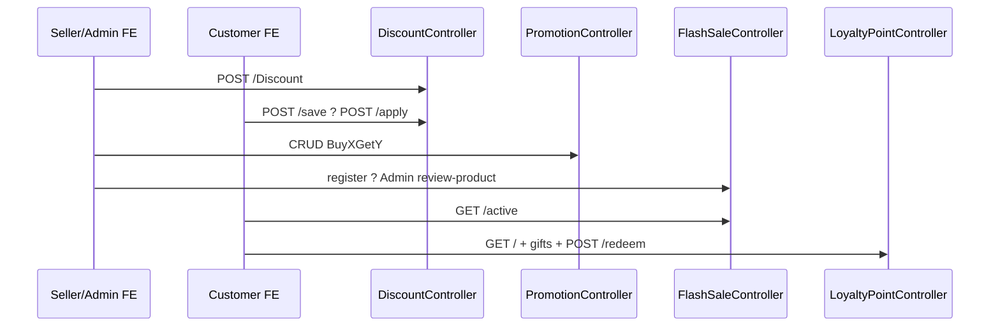

# Tài li?u Quy trình: Khuy?n mãi & Loyalty (Promotion / Loyalty)

Tài li?u mô t? **Discount (voucher)**, **Buy X Get Y**, **Flash Sale**, và **Loyalty di?m / d?i quà / h?ng** trong **UniEats** — g?m **Ph?n A (UI Trace)** và **Ph?n B (nghi?p v?/backend)**.

> Requirements: [../requirements/Promotion_Loyalty_Requirements.md](../requirements/Promotion_Loyalty_Requirements.md) · Alerts: [../requirements/alerts/Promotion_Loyalty_Alerts.md](../requirements/alerts/Promotion_Loyalty_Alerts.md)  
> Checkout apply voucher: [Checkout_Order_Workflow.md](./Checkout_Order_Workflow.md)

---

## Ph?n A — UI Interaction Trace (Nút b?m ? Code ? Data ? Hi?n th?)

M?i thao tác: **nút ? dâu** · **b?m ch?y file/hàm nào** · **API/BE** · **data tr? v?** · **hi?n th? th? nào**.

---

### UT-PRO-01 — Customer browse Flash Sale / BuyXGetY / Promotions

#### 1. Giao di?n

| M?c | Giá tr? |
|-----|---------|
| **Routes** | `/flash-sale`, `/buy-x-get-y`, `/promotions` |
| **Pages** | `pages/FlashSalePage.tsx`, `BuyXGetYPage.tsx`, `PromotionsPage.tsx` |
| **Sections** | `components/promotions/FlashSaleSection.tsx`, `BuyXGetYSection.tsx` |
| **Nút / entry** | Nav / Home section ? navigate; load data trên `useEffect` (không submit form) |

#### 2. FE ch?y dâu?

```text
FlashSalePage mount
  ? flashSaleService.getActiveFlashSales()
  ? flashSaleService.getFlashSaleProducts(saleId, skip, pageSize)
BuyXGetYPage / PromotionsPage
  ? promotionService.list / GET public promotions
  ? render cards ? click product ? /products/:id
```

#### 3. Backend

```text
GET /api/FlashSale/active ? list FlashSale Active
GET /api/FlashSale/flash-sales/{id}/products ? FlashSaleProduct Approved
GET /api/Promotion ? BuyXGetY list
```

#### 4–5. Data & hi?n th?

- `data`: danh sách sale/products/promos ? grid cards, giá flash, countdown n?u có  
- L?i m?ng: `toast.error` trên m?t s? page; ph?n browse thu?ng fail silently / empty state  

---

### UT-PRO-02 — Áp mã gi?m giá t?i Checkout

#### 1. Giao di?n

| M?c | Giá tr? |
|-----|---------|
| **Route** | `/checkout` |
| **Page** | `pages/CheckoutPage.tsx` |
| **Nút** | M? modal mã ? nh?p code ? **Áp d?ng** ? `handleApplyCode` |
| **G? mã** | Nút g? ? clear `selectedDiscount` |

#### 2. FE

```text
handleApplyCode
  ? discountService.applyDiscount({ code, restaurantId?, cartAmount: checkoutTotal })
  ? POST /api/Discount/apply
```

#### 3. BE

`DiscountController` ? `ApplyDiscountHandler` — check Active, h?n, min order, usage limit.

#### 4. Data tr? v?

```json
{ "discountId": "...", "code": "SALE10", "discountAmount": 15000, ... }
```

#### 5. Hi?n th?

| OK | `toast.success('Áp d?ng mã gi?m giá thành công')` + `setSelectedDiscount` ? `finalTotal` gi?m |
| Fail | `toast.error(res.message \|\| 'Mã gi?m giá không h?p l?')` |
| G? | `toast.success('Ðã g? mã gi?m giá')` |

> Chi ti?t checkout d?y d?: [Checkout_Order_Workflow.md](./Checkout_Order_Workflow.md).

---

### UT-PRO-03 — Luu voucher vào ví (`CustomerVouchers`)

#### 1. Giao di?n

| M?c | Giá tr? |
|-----|---------|
| **Noi** | Profile ? tab vouchers — `components/profile/CustomerVouchers.tsx` |
| **Nút** | **Luu mã** trên voucher kh? d?ng ? `onClick={() => handleSaveVoucher(voucher.id)}` |

#### 2–3

```text
handleSaveVoucher(discountId)
  ? discountService.saveDiscount({ discountId })
  ? POST /api/Discount/save
  ? Insert CUSTOMER_DISCOUNT
```

#### 5. Hi?n th?

| OK | `toast.success('Ðã luu mã gi?m giá vào ví!')` + reload list dã luu |
| Ðã luu / l?i | `toast.error(res.message \|\| 'B?n dã luu mã này r?i...')` |

---

### UT-PRO-04 — Ð?i di?m l?y quà (`CustomerLoyalty`)

#### 1. Giao di?n

| M?c | Giá tr? |
|-----|---------|
| **Component** | `components/profile/CustomerLoyalty.tsx` |
| **Nút** | **Ð?i quà** trên gift card ? `handleRedeemGift(gift.id)` ? ConfirmModal ? `confirmRedeem` |

#### 2–3

```text
confirmRedeem
  ? loyaltyPointService.redeemGift({ pointGiftConfigId })
  ? POST /api/LoyaltyPoint/redeem
  ? RedeemPointGiftHandler: tr? di?m, t?o CustomerDiscount t? PointGiftConfig.DiscountId
```

#### 5. Hi?n th?

| OK | `toast.success('Ð?i quà thành công! Mã gi?m giá dã du?c thêm vào ví.')` + refresh di?m/quà |
| Thi?u di?m | toast `Insufficient points balance.` (ho?c message VI t? API) |
| H?y confirm | không g?i API |

---

### UT-PRO-05 — SellerDiscountsPage — CRUD + xóa/khóa

#### 1. Giao di?n

| M?c | Giá tr? |
|-----|---------|
| **Route** | `/seller/discounts` |
| **Page** | `pages/seller/SellerDiscountsPage.tsx` |
| **Nút** | **T?o mã** ? m? modal; **S?a** / **Xóa** trên t?ng row; form `onSubmit={handleSubmit}` |

#### 2. FE

```text
handleSubmit
  ? create: discountService.create(...) ? POST /api/Discount
  ? update: discountService.update(id, ...) ? POST /api/Discount/{id}
handleDelete ? ConfirmModal ? DELETE /api/Discount/{id}
handleShowStats ? GET /api/Discount/stats
```

#### 5. Hi?n th?

| T?o | `toast.success('Ðã t?o mã gi?m giá m?i')` + dóng modal + `fetchDiscounts` |
| S?a | `toast.success('Ðã c?p nh?t mã gi?m giá')` |
| Xóa | `toast.success('Ðã xóa mã gi?m giá')` |
| Fail | toast.error message / m?ng |

---

### UT-PRO-06 — SellerPromotionsPage — Buy X Get Y CRUD

#### 1. Giao di?n

| M?c | Giá tr? |
|-----|---------|
| **Route** | `/seller/promotions` |
| **Page** | `pages/seller/SellerPromotionsPage.tsx` |
| **Nút** | T?o / S?a / Xóa; form ch?n TriggerProduct + GiftProduct |

#### 2–3

```text
handleSubmit ? POST /api/Promotion  ho?c  POST /api/Promotion/{id}
handleDelete ? DELETE /api/Promotion/{id}
```

#### 5. Hi?n th?

`toast.success('Ðã t?o/c?p nh?t/xóa khuy?n mãi')` + reload table.

---

### UT-PRO-07 — SellerFlashSalesPage — Ðang ký s?n ph?m Flash Sale

#### 1. Giao di?n

| M?c | Giá tr? |
|-----|---------|
| **Route** | `/seller/flash-sales` |
| **Page** | `pages/seller/SellerFlashSalesPage.tsx` |
| **Nút** | **Xem SP dã dang ký** ? `handleViewProducts`; **Ðang ký** ? `handleRegisterClick` ? modal ? `handleSubmit` |

#### 2–3

```text
handleSubmit
  ? flashSaleService.register({ flashSaleId, productId, flashSalePrice, stockLimit? })
  ? POST /api/FlashSale/register
  ? RegisterFlashSaleHandler (ch? FlashSale Pending; giá < giá g?c; SP Approved c?a quán mình)
```

#### 5. Hi?n th?

| OK | `toast.success('Ðang ký s?n ph?m thành công!')` + dóng modal |
| Validate | `toast.error('Vui lòng nh?p thông tin h?p l?')` |
| BE fail | giá = g?c / already registered / status không Pending ? toast.error(res.message) |

---

### UT-PRO-08 — AdminFlashSalePage — T?o chuong trình + duy?t SP

#### 1. Giao di?n

| M?c | Giá tr? |
|-----|---------|
| **Route** | `/admin/flash-sales` |
| **Page** | `pages/admin/AdminFlashSalePage.tsx` |
| **Nút** | T?o/S?a (`handleSubmit`); Xóa (`window.confirm` ? `handleDelete`); **Duy?t SP** (`handleOpenReviewModal`) ? Duy?t / T? ch?i (PromptModal lý do) |

#### 2–3

```text
create/update ? POST /api/FlashSale/flash-sales  |  POST .../flash-sales/{id}
delete ? DELETE /api/FlashSale/flash-sales/{id}
review ? flashSaleService.reviewFlashSaleProduct ? POST /api/FlashSale/review-product
```

#### 5. Hi?n th?

| T?o/S?a | toast thành công |
| Duy?t | `toast.success('Ðã duy?t s?n ph?m')` |
| T? ch?i | `toast.success('Ðã t? ch?i s?n ph?m')` + reason |
| Xóa | `window.confirm` r?i toast |

---

### UT-PRO-09 — AdminDiscountsPage + AdminLoyaltyConfigPage

#### Admin Discounts (`AdminDiscountsPage.tsx`)

```text
CRUD gi?ng Seller (POST/DELETE /Discount)
Khóa: Confirm ? discountService.lockDiscount(id) ? PATCH /api/Discount/{id}/lock
  ? toast.success('Ðã khóa mã gi?m giá')
```

#### Admin Loyalty (`AdminLoyaltyConfigPage.tsx`)

| Tab | Nút / Submit | API |
|-----|--------------|-----|
| gifts | T?o/s?a PointGiftConfig | Admin `point-gift-config` APIs |
| tiers | Thêm/s?a m?c h?ng | `POST /LoyaltyPoint/tier-configs?tier=&minPoints=` |
| evaluate | Ch?y dánh giá | `POST /LoyaltyPoint/evaluate-tiers` |

Toast: c?p nh?t quà / tier / l?i t?i list.

---

### B?ng tóm t?t Ph?n A

| ID | Nhãn / Màn | FE chính | API |
|----|------------|----------|-----|
| UT-PRO-01 | Browse Flash/BuyXGetY | FlashSalePage… | GET active / Promotion |
| UT-PRO-02 | Áp mã checkout | CheckoutPage | POST /Discount/apply |
| UT-PRO-03 | Luu voucher | CustomerVouchers | POST /Discount/save |
| UT-PRO-04 | Ð?i quà di?m | CustomerLoyalty | POST /LoyaltyPoint/redeem |
| UT-PRO-05 | Seller Discount CRUD | SellerDiscountsPage | /Discount* |
| UT-PRO-06 | Seller BuyXGetY | SellerPromotionsPage | /Promotion* |
| UT-PRO-07 | Seller dang ký Flash | SellerFlashSalesPage | POST /FlashSale/register |
| UT-PRO-08 | Admin Flash + duy?t | AdminFlashSalePage | flash-sales + review-product |
| UT-PRO-09 | Admin Discount/Loyalty | Admin* pages | lock + gift/tier |

---

## Ph?n B — Workflow nghi?p v? & Backend

### 1. Lu?ng t?ng quan

1. **Seller/Admin t?o voucher** ? khách **luu** ? **apply** lúc checkout.  
2. **Buy X Get Y:** Seller CRUD ? khách xem `/buy-x-get-y`.  
3. **Flash Sale:** Admin t?o ? Seller register SP ? Admin duy?t ? khách `/flash-sale`.  
4. **Loyalty:** di?m + gifts + redeem; Admin gift/tier/evaluate; worker `MemberTierEvaluationWorker`.



### 2. Discount APIs

| Method | Route | Vi?c |
|--------|-------|------|
| GET/POST | `/api/Discount` | List / T?o |
| POST | `/api/Discount/save` | Customer luu |
| GET/POST/DELETE | `/api/Discount/{id}` | Get / Update / Delete |
| POST | `/api/Discount/apply` | Tính gi?m (checkout) |
| GET | `/api/Discount/stats` | Th?ng kê |
| PATCH | `/api/Discount/{id}/lock` | Khóa |

**DB:** `DISCOUNT`, `CUSTOMER_DISCOUNT`; `ORDER.AppliedDiscountId`.  
**Types:** Percentage | FixedAmount | FreeShipping.

### 3. Buy X Get Y

| Method | Route |
|--------|-------|
| GET/POST | `/api/Promotion` |
| POST/DELETE | `/api/Promotion/{id}` |

**DB:** `BUY_X_GET_Y_PROMOTION` (TriggerProductId, GiftProductId).

### 4. Flash Sale

| Method | Route |
|--------|-------|
| GET | `/active`, `/flash-sales`, `/flash-sales/{id}/products` |
| POST | `/flash-sales`, `/flash-sales/{id}`, `/register`, `/review-product` |
| DELETE | `/flash-sales/{id}` |

**DB:** `FLASH_SALE`, `FLASH_SALE_PRODUCT` (Pending/Approved/Rejected).  
**Pricing:** `IFlashSalePricingService` khi hi?n th?/checkout.

### 5. Loyalty

| Method | Route | Vi?c |
|--------|-------|------|
| GET | `/api/LoyaltyPoint` | Ði?m + tier |
| GET | `/gifts` | Quà d?i di?m |
| POST | `/redeem` | Ð?i quà ? voucher |
| POST | `/evaluate-tiers` | Admin ch?y dánh giá |
| GET/POST | `/tier-configs` | M?c h?ng (BE: **POST** query tier/minPoints) |
| PUT | `/adjust-user-tier` | Admin ch?nh h?ng |

> FE `updateTierConfig` có th? g?i PUT — c?n kh?p Controller **POST**.

**Handler redeem:** `RedeemPointGiftHandler` — check gift active, voucher còn h?n/lu?t, d? di?m, chua luu trùng.

### 6. B?o m?t / nghi?p v?

1. Apply voucher: Active, h?n, min order, usage per user/global.  
2. Flash register: ch? Pending campaign; SP Approved; giá flash &lt; giá g?c; dúng quán.  
3. Redeem: tr? di?m atomic + CustomerDiscount.  
4. Lock discount ngan apply/save ti?p.

### 7. Checklist

- [ ] Browse `/flash-sale` hi?n SP Approved  
- [ ] Apply mã checkout dúng gi?m `finalTotal`  
- [ ] Luu voucher ? hi?n trong ví  
- [ ] Redeem d? di?m ? voucher m?i; thi?u di?m ? l?i  
- [ ] Seller CRUD discount/promo; dang ký flash OK  
- [ ] Admin duy?t/t? ch?i flash product  
- [ ] Admin lock discount ? apply fail  

### 8. File neo

| T?ng | Path |
|------|------|
| Controllers | `DiscountController`, `PromotionController`, `FlashSaleController`, `LoyaltyPointController` |
| FE services | `DiscountService.ts`, `PromotionService.ts`, `FlashSaleService.ts`, `LoyaltyPointService.ts` |
| FE pages | Seller/Admin discount-promo-flash; Profile vouchers/loyalty; public Flash/BuyXGetY |

---

**Tóm t?t:** Promo = voucher + BuyXGetY + Flash + Loyalty; UI Trace UT-PRO-01…09 n?m Ph?n A; rule API/DB ? Ph?n B.
