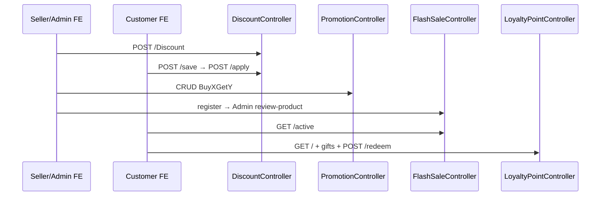

# Tài liệu Quy trình: Khuyến mãi & Loyalty (Promotion / Loyalty)

Tài liệu mô tả **Discount (voucher)**, **Buy X Get Y**, **Flash Sale**, và **Loyalty điểm / đổi quà / hạng** trong **Shopping Food** — gồm **Phần A (UI Trace)** và **Phần B (nghiệp vụ/backend)**.

> Requirements: [../requirements/Promotion_Loyalty_Requirements.md](../requirements/Promotion_Loyalty_Requirements.md) · Alerts: [../requirements/alerts/Promotion_Loyalty_Alerts.md](../requirements/alerts/Promotion_Loyalty_Alerts.md)  
> Checkout apply voucher: [Checkout_Order_Workflow.md](./Checkout_Order_Workflow.md)

---

## Phần A — UI Interaction Trace (Nút bấm → Code → Data → Hiển thị)

Mỗi thao tác: **nút ở đâu** · **bấm chạy file/hàm nào** · **API/BE** · **data trả về** · **hiển thị thế nào**.

---

### UT-PRO-01 — Customer browse Flash Sale / BuyXGetY / Promotions

#### 1. Giao diện

| Mục | Giá trị |
|-----|---------|
| **Routes** | `/flash-sale`, `/buy-x-get-y`, `/promotions` |
| **Pages** | `pages/FlashSalePage.tsx`, `BuyXGetYPage.tsx`, `PromotionsPage.tsx` |
| **Sections** | `components/promotions/FlashSaleSection.tsx`, `BuyXGetYSection.tsx` |
| **Nút / entry** | Nav / Home section → navigate; load data trên `useEffect` (không submit form) |

#### 2. FE chạy đâu?

```text
FlashSalePage mount
  → flashSaleService.getActiveFlashSales()
  → flashSaleService.getFlashSaleProducts(saleId, skip, pageSize)
BuyXGetYPage / PromotionsPage
  → promotionService.list / GET public promotions
  → render cards → click product → /products/:id
```

#### 3. Backend

```text
GET /api/FlashSale/active → list FlashSale Active
GET /api/FlashSale/flash-sales/{id}/products → FlashSaleProduct Approved
GET /api/Promotion → BuyXGetY list
```

#### 4–5. Data & hiển thị

- `data`: danh sách sale/products/promos → grid cards, giá flash, countdown nếu có  
- Lỗi mạng: `toast.error` trên một số page; phần browse thường fail silently / empty state  

---

### UT-PRO-02 — Áp mã giảm giá tại Checkout

#### 1. Giao diện

| Mục | Giá trị |
|-----|---------|
| **Route** | `/checkout` |
| **Page** | `pages/CheckoutPage.tsx` |
| **Nút** | Mở modal mã → nhập code → **Áp dụng** → `handleApplyCode` |
| **Gỡ mã** | Nút gỡ → clear `selectedDiscount` |

#### 2. FE

```text
handleApplyCode
  → discountService.applyDiscount({ code, restaurantId?, cartAmount: checkoutTotal })
  → POST /api/Discount/apply
```

#### 3. BE

`DiscountController` → `ApplyDiscountHandler` — check Active, hạn, min order, usage limit.

#### 4. Data trả về

```json
{ "discountId": "...", "code": "SALE10", "discountAmount": 15000, ... }
```

#### 5. Hiển thị

| OK | `toast.success('Áp dụng mã giảm giá thành công')` + `setSelectedDiscount` → `finalTotal` giảm |
| Fail | `toast.error(res.message \|\| 'Mã giảm giá không hợp lệ')` |
| Gỡ | `toast.success('Đã gỡ mã giảm giá')` |

> Chi tiết checkout đầy đủ: [Checkout_Order_Workflow.md](./Checkout_Order_Workflow.md).

---

### UT-PRO-03 — Lưu voucher vào ví (`CustomerVouchers`)

#### 1. Giao diện

| Mục | Giá trị |
|-----|---------|
| **Nơi** | Profile → tab vouchers — `components/profile/CustomerVouchers.tsx` |
| **Nút** | **Lưu mã** trên voucher khả dụng → `onClick={() => handleSaveVoucher(voucher.id)}` |

#### 2–3

```text
handleSaveVoucher(discountId)
  → discountService.saveDiscount({ discountId })
  → POST /api/Discount/save
  → Insert CUSTOMER_DISCOUNT
```

#### 5. Hiển thị

| OK | `toast.success('Đã lưu mã giảm giá vào ví!')` + reload list đã lưu |
| Đã lưu / lỗi | `toast.error(res.message \|\| 'Bạn đã lưu mã này rồi...')` |

---

### UT-PRO-04 — Đổi điểm lấy quà (`CustomerLoyalty`)

#### 1. Giao diện

| Mục | Giá trị |
|-----|---------|
| **Component** | `components/profile/CustomerLoyalty.tsx` |
| **Nút** | **Đổi quà** trên gift card → `handleRedeemGift(gift.id)` → ConfirmModal → `confirmRedeem` |

#### 2–3

```text
confirmRedeem
  → loyaltyPointService.redeemGift({ pointGiftConfigId })
  → POST /api/LoyaltyPoint/redeem
  → RedeemPointGiftHandler: trừ điểm, tạo CustomerDiscount từ PointGiftConfig.DiscountId
```

#### 5. Hiển thị

| OK | `toast.success('Đổi quà thành công! Mã giảm giá đã được thêm vào ví.')` + refresh điểm/quà |
| Thiếu điểm | toast `Insufficient points balance.` (hoặc message VI từ API) |
| Hủy confirm | không gọi API |

---

### UT-PRO-05 — SellerDiscountsPage — CRUD + xóa/khóa

#### 1. Giao diện

| Mục | Giá trị |
|-----|---------|
| **Route** | `/seller/discounts` |
| **Page** | `pages/seller/SellerDiscountsPage.tsx` |
| **Nút** | **Tạo mã** → mở modal; **Sửa** / **Xóa** trên từng row; form `onSubmit={handleSubmit}` |

#### 2. FE

```text
handleSubmit
  → create: discountService.create(...) → POST /api/Discount
  → update: discountService.update(id, ...) → POST /api/Discount/{id}
handleDelete → ConfirmModal → DELETE /api/Discount/{id}
handleShowStats → GET /api/Discount/stats
```

#### 5. Hiển thị

| Tạo | `toast.success('Đã tạo mã giảm giá mới')` + đóng modal + `fetchDiscounts` |
| Sửa | `toast.success('Đã cập nhật mã giảm giá')` |
| Xóa | `toast.success('Đã xóa mã giảm giá')` |
| Fail | toast.error message / mạng |

---

### UT-PRO-06 — SellerPromotionsPage — Buy X Get Y CRUD

#### 1. Giao diện

| Mục | Giá trị |
|-----|---------|
| **Route** | `/seller/promotions` |
| **Page** | `pages/seller/SellerPromotionsPage.tsx` |
| **Nút** | Tạo / Sửa / Xóa; form chọn TriggerProduct + GiftProduct |

#### 2–3

```text
handleSubmit → POST /api/Promotion  hoặc  POST /api/Promotion/{id}
handleDelete → DELETE /api/Promotion/{id}
```

#### 5. Hiển thị

`toast.success('Đã tạo/cập nhật/xóa khuyến mãi')` + reload table.

---

### UT-PRO-07 — SellerFlashSalesPage — Đăng ký sản phẩm Flash Sale

#### 1. Giao diện

| Mục | Giá trị |
|-----|---------|
| **Route** | `/seller/flash-sales` |
| **Page** | `pages/seller/SellerFlashSalesPage.tsx` |
| **Nút** | **Xem SP đã đăng ký** → `handleViewProducts`; **Đăng ký** → `handleRegisterClick` → modal → `handleSubmit` |

#### 2–3

```text
handleSubmit
  → flashSaleService.register({ flashSaleId, productId, flashSalePrice, stockLimit? })
  → POST /api/FlashSale/register
  → RegisterFlashSaleHandler (chỉ FlashSale Pending; giá < giá gốc; SP Approved của quán mình)
```

#### 5. Hiển thị

| OK | `toast.success('Đăng ký sản phẩm thành công!')` + đóng modal |
| Validate | `toast.error('Vui lòng nhập thông tin hợp lệ')` |
| BE fail | giá ≥ gốc / already registered / status không Pending → toast.error(res.message) |

---

### UT-PRO-08 — AdminFlashSalePage — Tạo chương trình + duyệt SP

#### 1. Giao diện

| Mục | Giá trị |
|-----|---------|
| **Route** | `/admin/flash-sales` |
| **Page** | `pages/admin/AdminFlashSalePage.tsx` |
| **Nút** | Tạo/Sửa (`handleSubmit`); Xóa (`window.confirm` → `handleDelete`); **Duyệt SP** (`handleOpenReviewModal`) → Duyệt / Từ chối (PromptModal lý do) |

#### 2–3

```text
create/update → POST /api/FlashSale/flash-sales  |  POST .../flash-sales/{id}
delete → DELETE /api/FlashSale/flash-sales/{id}
review → flashSaleService.reviewFlashSaleProduct → POST /api/FlashSale/review-product
```

#### 5. Hiển thị

| Tạo/Sửa | toast thành công |
| Duyệt | `toast.success('Đã duyệt sản phẩm')` |
| Từ chối | `toast.success('Đã từ chối sản phẩm')` + reason |
| Xóa | `window.confirm` rồi toast |

---

### UT-PRO-09 — AdminDiscountsPage + AdminLoyaltyConfigPage

#### Admin Discounts (`AdminDiscountsPage.tsx`)

```text
CRUD giống Seller (POST/DELETE /Discount)
Khóa: Confirm → discountService.lockDiscount(id) → PATCH /api/Discount/{id}/lock
  → toast.success('Đã khóa mã giảm giá')
```

#### Admin Loyalty (`AdminLoyaltyConfigPage.tsx`)

| Tab | Nút / Submit | API |
|-----|--------------|-----|
| gifts | Tạo/sửa PointGiftConfig | Admin `point-gift-config` APIs |
| tiers | Thêm/sửa mốc hạng | `POST /LoyaltyPoint/tier-configs?tier=&minPoints=` |
| evaluate | Chạy đánh giá | `POST /LoyaltyPoint/evaluate-tiers` |

Toast: cập nhật quà / tier / lỗi tải list.

---

### Bảng tóm tắt Phần A

| ID | Nhãn / Màn | FE chính | API |
|----|------------|----------|-----|
| UT-PRO-01 | Browse Flash/BuyXGetY | FlashSalePage… | GET active / Promotion |
| UT-PRO-02 | Áp mã checkout | CheckoutPage | POST /Discount/apply |
| UT-PRO-03 | Lưu voucher | CustomerVouchers | POST /Discount/save |
| UT-PRO-04 | Đổi quà điểm | CustomerLoyalty | POST /LoyaltyPoint/redeem |
| UT-PRO-05 | Seller Discount CRUD | SellerDiscountsPage | /Discount* |
| UT-PRO-06 | Seller BuyXGetY | SellerPromotionsPage | /Promotion* |
| UT-PRO-07 | Seller đăng ký Flash | SellerFlashSalesPage | POST /FlashSale/register |
| UT-PRO-08 | Admin Flash + duyệt | AdminFlashSalePage | flash-sales + review-product |
| UT-PRO-09 | Admin Discount/Loyalty | Admin* pages | lock + gift/tier |

---

## Phần B — Workflow nghiệp vụ & Backend

### 1. Luồng tổng quan

1. **Seller/Admin tạo voucher** → khách **lưu** → **apply** lúc checkout.  
2. **Buy X Get Y:** Seller CRUD → khách xem `/buy-x-get-y`.  
3. **Flash Sale:** Admin tạo → Seller register SP → Admin duyệt → khách `/flash-sale`.  
4. **Loyalty:** điểm + gifts + redeem; Admin gift/tier/evaluate; worker `MemberTierEvaluationWorker`.



### 2. Discount APIs

| Method | Route | Việc |
|--------|-------|------|
| GET/POST | `/api/Discount` | List / Tạo |
| POST | `/api/Discount/save` | Customer lưu |
| GET/POST/DELETE | `/api/Discount/{id}` | Get / Update / Delete |
| POST | `/api/Discount/apply` | Tính giảm (checkout) |
| GET | `/api/Discount/stats` | Thống kê |
| PATCH | `/api/Discount/{id}/lock` | Khóa |

**DB:** `DISCOUNT`, `CUSTOMER_DISCOUNT`; `ORDER.AppliedDiscountId`.  
**Types:** Percentage | FixedAmount | FreeShipping.

### 3. Buy X Get Y

| Method | Route |
|--------|-------|
| GET/POST | `/api/Promotion` |
| POST/DELETE | `/api/Promotion/{id}` |

**DB:** `BUY_X_GET_Y_PROMOTION` (TriggerProductId, GiftProductId).

### 4. Flash Sale

| Method | Route |
|--------|-------|
| GET | `/active`, `/flash-sales`, `/flash-sales/{id}/products` |
| POST | `/flash-sales`, `/flash-sales/{id}`, `/register`, `/review-product` |
| DELETE | `/flash-sales/{id}` |

**DB:** `FLASH_SALE`, `FLASH_SALE_PRODUCT` (Pending/Approved/Rejected).  
**Pricing:** `IFlashSalePricingService` khi hiển thị/checkout.

### 5. Loyalty

| Method | Route | Việc |
|--------|-------|------|
| GET | `/api/LoyaltyPoint` | Điểm + tier |
| GET | `/gifts` | Quà đổi điểm |
| POST | `/redeem` | Đổi quà → voucher |
| POST | `/evaluate-tiers` | Admin chạy đánh giá |
| GET/POST | `/tier-configs` | Mốc hạng (BE: **POST** query tier/minPoints) |
| PUT | `/adjust-user-tier` | Admin chỉnh hạng |

> FE `updateTierConfig` có thể gọi PUT — cần khớp Controller **POST**.

**Handler redeem:** `RedeemPointGiftHandler` — check gift active, voucher còn hạn/lượt, đủ điểm, chưa lưu trùng.

### 6. Bảo mật / nghiệp vụ

1. Apply voucher: Active, hạn, min order, usage per user/global.  
2. Flash register: chỉ Pending campaign; SP Approved; giá flash &lt; giá gốc; đúng quán.  
3. Redeem: trừ điểm atomic + CustomerDiscount.  
4. Lock discount ngăn apply/save tiếp.

### 7. Checklist

- [ ] Browse `/flash-sale` hiện SP Approved  
- [ ] Apply mã checkout đúng giảm `finalTotal`  
- [ ] Lưu voucher → hiện trong ví  
- [ ] Redeem đủ điểm → voucher mới; thiếu điểm → lỗi  
- [ ] Seller CRUD discount/promo; đăng ký flash OK  
- [ ] Admin duyệt/từ chối flash product  
- [ ] Admin lock discount → apply fail  

### 8. File neo

| Tầng | Path |
|------|------|
| Controllers | `DiscountController`, `PromotionController`, `FlashSaleController`, `LoyaltyPointController` |
| FE services | `DiscountService.ts`, `PromotionService.ts`, `FlashSaleService.ts`, `LoyaltyPointService.ts` |
| FE pages | Seller/Admin discount-promo-flash; Profile vouchers/loyalty; public Flash/BuyXGetY |

---

**Tóm tắt:** Promo = voucher + BuyXGetY + Flash + Loyalty; UI Trace UT-PRO-01…09 nằm Phần A; rule API/DB ở Phần B.
