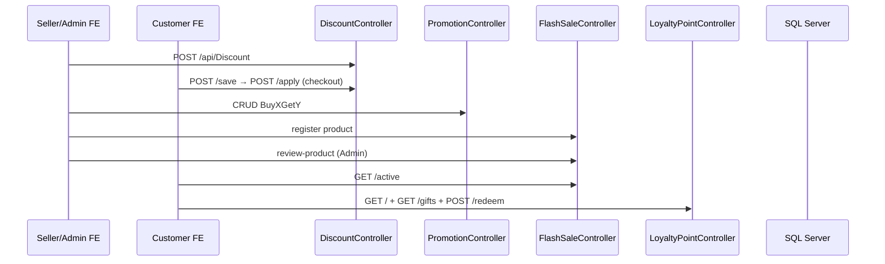

# Tài liệu Quy trình: Khuyến mãi & Loyalty (Promotion / Loyalty)

Tài liệu mô tả **Discount (voucher)**, **Buy X Get Y**, **Flash Sale**, và **Loyalty điểm / đổi quà / hạng thành viên** trong **Shopping Food**.

---

## 1. Luồng Tổng Quan (Workflow)

1. **Seller/Admin tạo voucher** → `POST /api/Discount` → khách **lưu** `POST /api/Discount/save` → **apply** lúc checkout `POST /api/Discount/apply`.
2. **Buy X Get Y:** Seller CRUD `api/Promotion` → khách xem `/buy-x-get-y`.
3. **Flash Sale:** Admin tạo chiến dịch `POST /api/FlashSale/flash-sales` → Seller `POST /register` SP → Admin `POST /review-product` → khách xem `/flash-sale` (`GET /active`).
4. **Loyalty:** Khách xem điểm `GET /api/LoyaltyPoint`, quà `GET /gifts`, đổi `POST /redeem`; Admin cấu hình tier / adjust; worker đánh giá hạng định kỳ / `POST /evaluate-tiers`.



---

## Luồng A — Discount (Voucher)

### A1. API

| Method | Route | Việc |
|--------|-------|------|
| GET | `/api/Discount` | List |
| POST | `/api/Discount` | Tạo (Seller quán / Admin platform) |
| POST | `/api/Discount/save` | Customer lưu voucher |
| GET | `/api/Discount/{id}` | Chi tiết |
| POST | `/api/Discount/{id}` | Update |
| DELETE | `/api/Discount/{id}` | Xóa |
| POST | `/api/Discount/apply` | Tính giảm giá (checkout) |
| GET | `/api/Discount/stats` | Thống kê |
| PATCH | `/api/Discount/{id}/lock` | Khóa voucher |

**Controller:** `src/ShoppingFood.API/Controllers/DiscountController.cs`  
**FE:** `DiscountService.ts`, `SellerDiscountsPage.tsx`, `AdminDiscountsPage.tsx`, `CustomerVouchers.tsx`, apply trong `CheckoutPage.tsx`.

```typescript
async createDiscount(data: ICreateDiscountRequest) { return httpClient.post(...); }
async saveDiscount(data: ISaveDiscountRequest) { ... }
async applyDiscount(data: IApplyDiscountRequest) { ... }
```

**DB:** `DISCOUNT`, `CUSTOMER_DISCOUNT` (UsageCount), gắn `ORDER.AppliedDiscountId`.

**Types:** `DiscountType` Percentage | FixedAmount | FreeShipping; `DiscountStatus` Active/Inactive/Cancelled.

---

## Luồng B — Buy X Get Y (Promotion)

| Method | Route | Việc |
|--------|-------|------|
| GET | `/api/Promotion` | List |
| POST | `/api/Promotion` | Tạo |
| POST | `/api/Promotion/{id}` | Update |
| DELETE | `/api/Promotion/{id}` | Xóa |

**Controller:** `PromotionController.cs`  
**FE:** `PromotionService.ts`, `SellerPromotionsPage.tsx`, `BuyXGetYPage.tsx`, `BuyXGetYSection.tsx`  
**DB:** `BUY_X_GET_Y_PROMOTION` (RestaurantId, TriggerProductId, GiftProductId).

---

## Luồng C — Flash Sale

| Method | Route | Việc |
|--------|-------|------|
| GET | `/api/FlashSale/active` | Flash đang chạy (public) |
| GET | `/api/FlashSale/flash-sales` | List quản trị |
| POST | `/api/FlashSale/flash-sales` | Admin tạo |
| POST | `/api/FlashSale/flash-sales/{id}` | Update |
| DELETE | `/api/FlashSale/flash-sales/{id}` | Xóa (soft) |
| POST | `/api/FlashSale/register` | Seller đăng ký SP |
| GET | `/api/FlashSale/flash-sales/{id}/products` | SP trong sale |
| POST | `/api/FlashSale/review-product` | Admin duyệt SP |

**FE:** `FlashSaleService.ts`, `AdminFlashSalePage.tsx`, `SellerFlashSalesPage.tsx`, `FlashSalePage.tsx`  
**DB:** `FLASH_SALE`, `FLASH_SALE_PRODUCT` (status Pending/Approved/Rejected)  
**Pricing:** `IFlashSalePricingService` dùng khi checkout/giá hiển thị.

```typescript
async getActiveFlashSales() { ... }
async createFlashSale(data) { ... }
// register + review-product qua cùng service
```

---

## Luồng D — Loyalty Points

| Method | Route | Auth | Việc |
|--------|-------|------|------|
| GET | `/api/LoyaltyPoint` | Customer | Điểm + tier của tôi |
| GET | `/api/LoyaltyPoint/gifts` | Public/Auth | Quà đổi điểm |
| POST | `/api/LoyaltyPoint/redeem` | Customer | Đổi quà → voucher |
| POST | `/api/LoyaltyPoint/evaluate-tiers` | Admin | Chạy đánh giá hạng |
| GET | `/api/LoyaltyPoint/tier-configs` | Auth/Admin | Mốc hạng |
| POST | `/api/LoyaltyPoint/tier-configs?tier=&minPoints=` | Admin | Add/update mốc |
| PUT | `/api/LoyaltyPoint/adjust-user-tier?userId=&newTier=` | Admin | Chỉnh hạng tay |

> **Lưu ý:** Backend dùng **POST** `tier-configs` (query `tier`, `minPoints`). FE `LoyaltyPointService.updateTierConfig` đang gọi **PUT** — khi implement/test cần khớp Method với Controller.

**Controller excerpt** — `LoyaltyPointController.cs`:

```csharp
[HttpPost("redeem")]
public async Task<ActionResult<ApiResponse>> Redeem([FromBody] RedeemPointGiftCommand command)
{
    if (userDto != null) command.CurrentUserId = userDto.Id;
    var response = await _mediator.Send(command);
    return Ok(response);
}

[HttpPost("tier-configs")]
public async Task<ActionResult<ApiResponse>> AddOrUpdateTierConfig([FromQuery] MemberTier tier, [FromQuery] int minPoints)
{ ... }

[HttpPut("adjust-user-tier")]
public async Task<ActionResult<ApiResponse>> AdjustUserTier([FromQuery] Guid userId, [FromQuery] MemberTier newTier)
{
    // cập nhật LoyaltyPoint.Tier + tạo Notification Loyalty
}
```

**FE:** `LoyaltyPointService.ts`, `CustomerLoyalty.tsx`, `AdminLoyaltyConfigPage.tsx`  
**DB:** `LOYALTY_POINT`, `LOYALTY_POINT_HISTORY`, `POINT_GIFT_CONFIG`, `MEMBER_TIER_CONFIG`  
**Worker:** `MemberTierEvaluationWorker` (đánh giá theo lịch).

**Admin point-gift-config:** CRUD qua `AdminController` (`/api/Admin/point-gift-config*`) — cấu hình quà gắn `DiscountId`.

---

## Call chain (tóm tắt)

```text
Seller/Admin/Customer Pages
  ↓
DiscountService | PromotionService | FlashSaleService | LoyaltyPointService
  ↓
DiscountController | PromotionController | FlashSaleController | LoyaltyPointController
  ↓
Features/Discounts | Promotions | FlashSales | LoyaltyPoints
  ↓
DISCOUNT / CUSTOMER_DISCOUNT / BUY_X_GET_Y / FLASH_SALE* / LOYALTY_* / POINT_GIFT_CONFIG
```

---

## Toast / Message

| Nơi | Trigger |
|-----|---------|
| SellerDiscountsPage / AdminDiscountsPage | CRUD voucher |
| CustomerVouchers | save voucher |
| CheckoutPage | apply discount fail/ok |
| FlashSale pages | create/register/review |
| CustomerLoyalty | redeem gift |
| AdminLoyaltyConfig | tier config / adjust |

---

## Bảo mật / nghiệp vụ

1. Apply discount validate hạn dùng, Audience (ByTier/Specific), UsageCount.
2. FlashSaleProduct phải **Approved** mới tính giá flash.
3. Redeem trừ điểm + tạo CustomerDiscount từ PointGiftConfig.
4. Adjust tier tạo **Notification** type Loyalty (push SignalR qua interceptor).
5. RBAC theo role trên từng endpoint.

---

## Checklist

- [ ] Tạo voucher Seller + Admin platform
- [ ] Customer save + apply đúng số tiền giảm ở checkout
- [ ] BuyXGetY CRUD + trang public
- [ ] Flash: create → register → review → active list
- [ ] Loyalty GET điểm, redeem gift, tier-configs POST
- [ ] adjust-user-tier có notification

---

## Tóm tắt

Bốn nhánh KM độc lập nhưng cùng phục vụ giảm giá / giữ chân khách: **Discount**, **BuyXGetY**, **FlashSale**, **Loyalty**.

> [Checkout_Order_Workflow.md](./Checkout_Order_Workflow.md) · [Payment_Requirements.md](./Payment_Requirements.md) · [README](./README.md)
