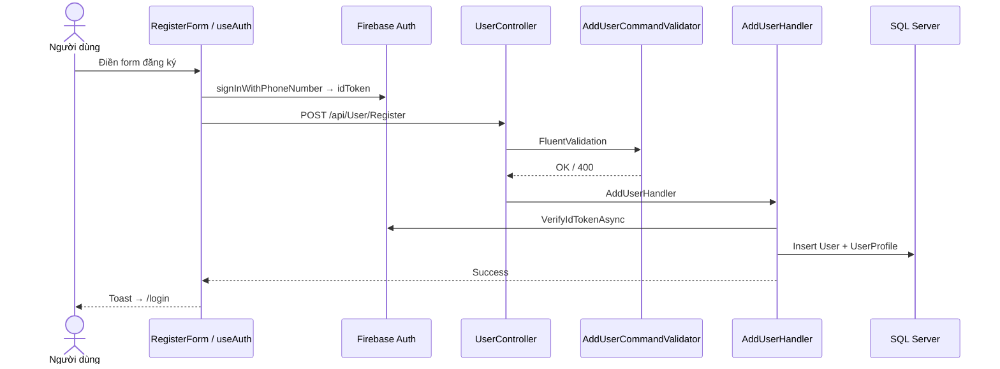

# Tài liệu Quy trình: Đăng ký tài khoản (Register)

Tài liệu này mô tả chi tiết luồng **đăng ký Customer** trong hệ thống **Shopping Food**, kèm biến thể **RegisterSeller** và **register-shipper**.

> Customer/Seller đăng ký yêu cầu xác minh số điện thoại qua **Firebase ID Token** (trừ khi `OtpCode`/`IdToken` = `"bypass"` — dùng cho test). Shipper public tạo User Role=Customer + `ShipperApplication` Pending.

---

## 1. Luồng Tổng Quan (Workflow) — Customer

1. **Yêu cầu:** Người dùng mở `/register` → điền UserName, Password, FullName, Email, Phone.
2. **Xác minh SĐT (FE):** Firebase Recaptcha + `signInWithPhoneNumber` → lấy `idToken`.
3. **Gửi đăng ký:** `useAuth.register` → `POST /api/User/Register` với body + `idToken` / `otpCode`.
4. **Validation:** `AddUserCommandValidator` (FluentValidation) — unique UserName/Email/Phone, password ≥ 6.
5. **Verify Firebase:** `AddUserHandler` verify ID token, khớp `phone_number` với `request.Phone`.
6. **Tạo tài khoản:** Hash password SHA256, tạo `USER_ACCOUNT` (Active) + `USER_PROFILE` (Role = Customer).
7. **Hoàn tất:** API success → toast `'Đăng ký thành công! Vui lòng đăng nhập.'` → chuyển `/login`.



---

## Bước 1: Mở trang Đăng ký (Frontend)

**Thông tin:**
- **URL (FE):** `/register` (Customer) · `/register/seller` (Seller variant)
- **Page:** `ShoppingFood.FE/src/pages/RegisterPage.tsx`
- **Form:** `ShoppingFood.FE/src/components/auth/RegisterForm.tsx` — prop `isSeller?: boolean`
- **Hook:** `ShoppingFood.FE/src/hooks/useAuth.ts` → `register` / `registerSeller`
- **Firebase:** `ShoppingFood.FE/src/config/firebase.ts` + Recaptcha container `recaptcha-register-container`

**Gọi API:**

```typescript
// AuthService.ts
async register(data: IRegisterRequest): Promise<IApiResponse<IUserDto>> {
  return httpClient.post<IApiResponse<IUserDto>>(API_ENDPOINTS.AUTH.REGISTER, data);
}
```

**Toast khi thành công** (`useAuth.register`):

```typescript
toast.success('Đăng ký thành công! Vui lòng đăng nhập.');
```

---

## Bước 2: API Register Customer

**Thông tin:**
- **URL:** `/api/User/Register`
- **HTTP Method:** POST
- **Auth:** Public (bypass `AuthenticationFilter` — path starts with `/api/User/Register`)

**Controller:** `src/ShoppingFood.API/Controllers/UserController.cs` — Lines **33–38**

```csharp
[HttpPost("Register")]
public async Task<ActionResult<ApiResponse>> Register([FromBody] AddUserCommand command)
{
    var response = await _mediator.Send(command);
    return Ok(response);
}
```

**Command:** `src/ShoppingFood.Application/Features/Users/Commands/AddUserCommand.cs`

```csharp
public class AddUserCommand : BaseCommand, IRequest<ApiResponse>
{
    public string UserName { get; set; } = string.Empty;
    public string Password { get; set; } = string.Empty;
    public string FullName { get; set; } = string.Empty;
    public string Email { get; set; } = string.Empty;
    public string Phone { get; set; } = string.Empty;
    public UserRole Role { get; set; } = UserRole.Customer;
    public string? AvatarUrl { get; set; }
    public string OtpCode { get; set; } = string.Empty;
    public string IdToken { get; set; } = string.Empty;
}
```

---

## Bước 3: Validation (FluentValidation)

**File:** `src/ShoppingFood.Application/Features/Users/Commands/AddUserCommandValidator.cs`

| Rule | Điều kiện |
|------|-----------|
| UserName | Required, max 50, **unique** |
| Password | Required, **min 6** |
| FullName | Required, max 100 |
| Email | Required, email format, **unique** |
| Phone | Required, regex `^\d{9,15}$`, **unique** |

Chạy qua MediatR `ValidationBehaviour` trước Handler — lỗi → HTTP 400.

---

## Bước 4: Handler — Firebase + tạo User

**File:** `src/ShoppingFood.Application/Features/Users/Commands/AddUserHandler.cs`  
**Class:** `AddUserHandler`  
**Method:** `Handle`

```csharp
var otpToken = !string.IsNullOrEmpty(request.OtpCode) ? request.OtpCode : request.IdToken;
if (otpToken != "bypass")
{
    // Bắt buộc Firebase ID Token
    decodedToken = await FirebaseAuth.DefaultInstance.VerifyIdTokenAsync(otpToken, cancellationToken);
    // Lấy phone_number từ claims, chuẩn hóa +84 → 0...
    if (phone != request.Phone)
        return ApiResponse.Failure(400, "Phone number in token does not match requested phone.");
}

var user = _mapper.Map<User>(request);
user.Id = Guid.NewGuid();
user.PasswordHash = HashPassword(request.Password); // SHA256 → Base64
user.Status = UserStatus.Active;

var profile = new UserProfile
{
    Id = Guid.NewGuid(),
    UserAccountId = user.Id,
    FullName = request.FullName,
    Role = request.Role, // mặc định Customer
    ...
};
user.Profile = profile;
_userRepository.Add(user);
await _unitOfWork.SaveChangesAsync();
return ApiResponse.Success(userDto, "User registered successfully");
```

**Database:**

| Bảng | Việc |
|------|------|
| `USER_ACCOUNT` | Insert UserName, PasswordHash, Email, Phone, Status=Active |
| `USER_PROFILE` | Insert FullName, Role=Customer, AvatarUrl |

---

## Biến thể A: RegisterSeller

**Mục đích:** Đăng ký đồng thời tài khoản + nộp **SellerApplication** (chờ Admin duyệt).

| Mục | Chi tiết |
|-----|----------|
| FE URL | `/register/seller` — `RegisterForm isSeller={true}` |
| API | `POST /api/User/RegisterSeller` |
| Controller | `UserController.RegisterSeller` Lines **40–45** |
| Command | `AddSellerCommand.cs` — thêm BusinessName, BusinessAddress, BusinessLicenseUrl, ShopImageUrl, ContactInfo |
| Handler | `AddSellerHandler.cs` — Firebase verify giống Customer; Role mặc định **Seller**; tạo `SellerApplication` Pending |
| Toast FE | `'Đăng ký cửa hàng thành công! Đang chờ duyệt.'` |

```csharp
[HttpPost("RegisterSeller")]
public async Task<ActionResult<ApiResponse>> RegisterSeller([FromBody] AddSellerCommand command)
{
    var response = await _mediator.Send(command);
    return Ok(response);
}
```

**DB thêm:** `SELLER_APPLICATION` (Status = Pending).

---

## Biến thể B: Register Shipper (public)

**Mục đích:** Form công khai đăng ký làm shipper — tạo User (Profile Role vẫn **Customer** lúc đầu) + `ShipperApplication` Pending; Admin duyệt mới lên Role Shipper / tạo ShipperProfile.

| Mục | Chi tiết |
|-----|----------|
| FE URL | `/register/shipper` — `ShipperApplyPage.tsx` |
| API | `POST /api/User/register-shipper` |
| Controller | `UserController.RegisterShipper` Lines **47–52** |
| Command/Handler | `RegisterShipperCommand.cs` / `RegisterShipperHandler.cs` |
| Message | `"Shipper registration submitted successfully. Application is pending review."` |

```csharp
[HttpPost("register-shipper")]
public async Task<ActionResult<ApiResponse>> RegisterShipper([FromBody] RegisterShipperCommand command)
{
    var response = await _mediator.Send(command);
    return Ok(response);
}
```

```csharp
// RegisterShipperHandler — Profile.Role = UserRole.Customer
// + ShipperApplication Pending
```

**DB thêm:** `SHIPPER_APPLICATION`.

> **Lưu ý bypass:** Filter bypass `/api/User/Register*` — `register-shipper` (có dấu gạch) có thể **không** match `RegisterShipper`; nếu gặp 401, kiểm tra `AuthenticationFilter` / seed RBAC endpoint public.

**Đường đăng ký shipper khi đã login:** `POST /api/User/apply-shipper` (Auth) — xem Profile / Apply flows.

---

## Sơ đồ file đi qua (Call chain)

```text
RegisterPage.tsx
  ↓
RegisterForm.tsx  (+ Firebase Recaptcha)
  ↓
useAuth.register / registerSeller
  ↓
AuthService.register / registerSeller
  ↓
UserController.Register / RegisterSeller / register-shipper
  ↓
ValidationBehaviour → AddUserCommandValidator (Customer)
  ↓
AddUserHandler / AddSellerHandler / RegisterShipperHandler
  ↓
FirebaseAdmin VerifyIdToken (Customer/Seller)
  ↓
USER_ACCOUNT + USER_PROFILE (+ SELLER_APPLICATION / SHIPPER_APPLICATION)
```

| Vai trò | Đường dẫn đầy đủ |
|---------|------------------|
| UI | `ShoppingFood.FE/src/components/auth/RegisterForm.tsx` |
| Hook | `ShoppingFood.FE/src/hooks/useAuth.ts` |
| Service | `ShoppingFood.FE/src/services/AuthService.ts` |
| Controller | `src/ShoppingFood.API/Controllers/UserController.cs` |
| Customer Handler | `.../AddUserHandler.cs` + `AddUserCommandValidator.cs` |
| Seller Handler | `.../AddSellerHandler.cs` |
| Shipper Handler | `.../RegisterShipperHandler.cs` |

---

## Các thông báo (Toast / Message)

| Message | Nơi | Trigger |
|---------|-----|---------|
| `Đăng ký thành công! Vui lòng đăng nhập.` | `useAuth.register` | Customer OK |
| `Đăng ký cửa hàng thành công! Đang chờ duyệt.` | `useAuth.registerSeller` | Seller OK |
| `User registered successfully` | API message | Handler success |
| `UserName already exists.` / Email / Phone | Validation | Trùng dữ liệu |
| `Firebase ID Token is required for registration.` | Handler | Thiếu token |
| `Invalid Firebase ID Token: ...` | Handler | Token sai |
| `Phone number in token does not match...` | Handler | SĐT không khớp |
| `Dữ liệu không hợp lệ hoặc đã tồn tại` | FE catch fallback | 400 generic |

---

## Các cơ chế bảo mật quan trọng

1. **Xác minh SĐT Firebase** trước khi tạo Customer/Seller (chống đăng ký spam số ảo nếu Firebase cấu hình đúng).
2. **Unique constraints** UserName / Email / Phone ở validator + DB filtered unique indexes.
3. **Password min 6 + SHA256 hash.**
4. **Bypass `"bypass"`** chỉ nên dùng môi trường test — không bật trên production.
5. Seller/Shipper application **Pending** — chưa có quyền bán/giao cho đến khi Admin approve.

---

## Checklist tự test

- [ ] `/register` — thiếu Firebase token → lỗi
- [ ] Đăng ký trùng UserName/Email/Phone → validation error
- [ ] Đăng ký Customer thành công → login được bằng mật khẩu
- [ ] `/register/seller` — tạo được SellerApplication Pending
- [ ] `/register/shipper` — tạo được ShipperApplication Pending
- [ ] Password < 6 ký tự → bị chặn

---

## Tóm tắt

Đăng ký Customer = **form FE + Firebase phone verify + `POST /Register` + AddUserHandler**. Seller/Shipper là biến thể tạo thêm đơn ứng tuyển chờ duyệt.

> Liên kết: [Login_Workflow.md](./Login_Workflow.md) · [ForgotPassword_Workflow.md](./ForgotPassword_Workflow.md) · [INDEX](../ONBOARDING_INDEX.md)
