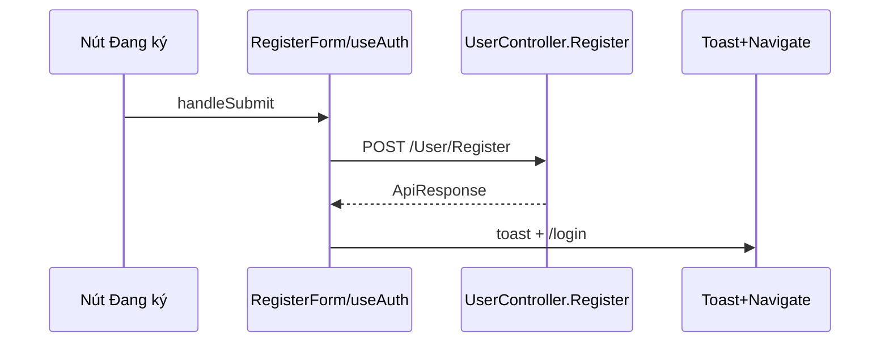
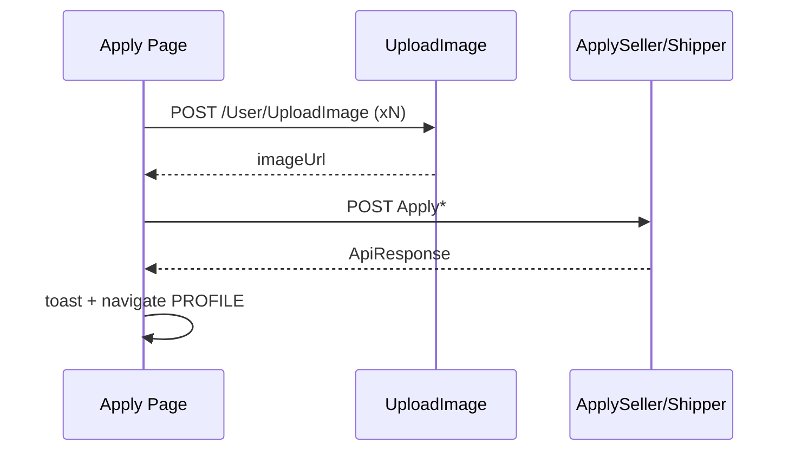
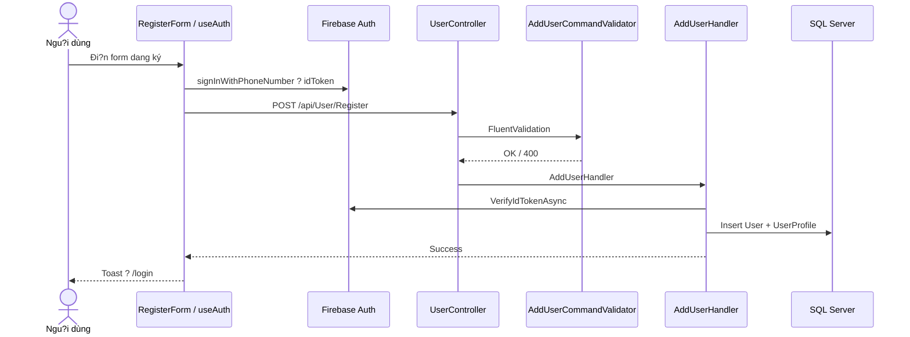

# Tài li?u Quy trình: Ðang ký tài kho?n (Register)

Tài li?u này mô t? chi ti?t lu?ng **dang ký Customer** trong h? th?ng **UniEats**, kèm bi?n th? **RegisterSeller** và **register-shipper**.

> Customer/Seller dang ký yêu c?u xác minh s? di?n tho?i qua **Firebase ID Token** (tr? khi `OtpCode`/`IdToken` = `"bypass"` — dùng cho test). Shipper public t?o User Role=Customer + `ShipperApplication` Pending.

---


---

## Ph?n A — UI Interaction Trace (Nút b?m ? Code ? Data ? Hi?n th?)

> UI Trace — Register / Apply  
> M?i thao tác tr? l?i: **nút ? dâu** · **b?m ch?y file/hàm nào** · **API/BE dâu** · **data tr? v?** · **hi?n th? th? nào**.


---

### UT-REG-01 — Ðang ký Customer (`"Ðang ký"`)

#### 1. Giao di?n nút b?m ? dâu?

| M?c | Giá tr? |
|-----|---------|
| **Route** | `/register` |
| **Page** | `pages/RegisterPage.tsx` ? render `RegisterForm` |
| **Component** | `components/auth/RegisterForm.tsx` |
| **Nhãn nút** | `"Ðang ký"` (submit) |
| **Lo?i control** | `<Button type="submit">` trong `<form onSubmit={handleSubmit}>` |
| **Ði?u ki?n hi?n** | `!isSeller` (Customer) |

#### 2. B?m xong ch?y d?n dâu? (Frontend)

```text
form onSubmit
  ? RegisterForm.handleSubmit (RegisterForm.tsx)
  ? validateStep1()
  ? useAuth().register({ userName, password, fullName, email, phone, role:'Customer', idToken:'bypass' })
       (hooks/useAuth.ts)
  ? authService.register(data) (services/AuthService.ts)
  ? httpClient.post(API_ENDPOINTS.AUTH.REGISTER, data)
```

#### 3. Backend ch?y do?n nào?

```text
POST /api/User/Register
  ? AuthenticationFilter (bypass)
  ? UserController.Register
  ? MediatR ? AddUserHandler / RegisterCommand
  ? Hash password, t?o USER_ACCOUNT + USER_PROFILE (Role=Customer)
  ? return ApiResponse
```

#### 4. D? li?u tr? v? ? dâu?

```json
{ "code": 200, "error": false, "message": "...", "data": { /* user dto */ } }
```

L?i validation thu?ng tr? `errors` dictionary theo field.

#### 5. Làm sao hi?n th? ra?

| Nhánh | Hành vi UI |
|-------|------------|
| Success | `toast.success('Ðang ký thành công! Vui lòng dang nh?p.')` ? `navigate(ROUTES.LOGIN)` |
| Error field | `setErrors(mappedErrors)` hi?n du?i Input |
| Error chung | toast t? `useAuth.register` |

#### 6. So d? nhanh



---

### UT-REG-02 — Ðang ký Seller (2 bu?c, `"Hoàn t?t dang ký"`)

#### 1. Giao di?n nút b?m ? dâu?

| M?c | Giá tr? |
|-----|---------|
| **Route** | `/register/seller` |
| **Page** | `RegisterPage` v?i `isSeller` |
| **Component** | `RegisterForm.tsx` step 2 |
| **Nhãn nút** | Submit bu?c 2 (sau `"Ti?p t?c"` ? step 1) |
| **Ði?u ki?n hi?n** | `isSeller && step === 2` |

#### 2. Frontend

```text
Step1: Button onClick={handleNext} ? validateStep1 ? setStep(2)
Step2: form submit ? handleSubmit
  ? useAuth().registerSeller({ ...account, businessName, businessAddress, businessLicenseUrl, shopImageUrl, contactInfo, idToken })
  ? authService.registerSeller ? POST /User/RegisterSeller
```

Upload gi?y phép / ?nh quán: `handleFileChange` / `handleShopFileChange` ? `authService.uploadImage` ? `POST /User/UploadImage` ? gán URL vào form.

#### 3. Backend

```text
POST /api/User/RegisterSeller
  ? RegisterSellerCommand / Handler
  ? T?o User (Seller pending) + SellerApplication + (Restaurant khi duy?t)
```

#### 4–5. Response & hi?n th?

| Success | `toast.success('Ðang ký c?a hàng thành công! Ðang ch? duy?t.')` ? `navigate(/login)` |
| Error | `setErrors` + có th? `setStep(1)` n?u l?i userName/email/phone |

Validate file: toast `File không du?c vu?t quá 5MB` / sai d?nh d?ng.

---

### UT-REG-03 — Apply Seller khi dã login (`"G?i dang ký"`)

#### 1. Giao di?n

| M?c | Giá tr? |
|-----|---------|
| **Route** | `/seller/apply` (PrivateRoute Customer) |
| **Page** | `pages/SellerApplyPage.tsx` |
| **Nhãn nút** | Submit form `"Ðang ký tr? thành Ngu?i Bán"` |

#### 2. Frontend

```text
handleSubmit
  ? validate files (license + shop image, size/type)
  ? authService.uploadImage(license) ? imageUrl
  ? authService.uploadImage(shop) ? imageUrl
  ? authService.applySeller({ businessName, businessAddress, contactInfo, businessLicenseUrl, shopImageUrl })
  ? POST /User/ApplySeller
```

#### 3. Backend

```text
POST /api/User/ApplySeller (Auth)
  ? ApplySellerHandler
  ? Insert SELLER_APPLICATION Status=Pending
```

#### 4–5. Hi?n th?

| Success | toast `Ðang ký thành công! Vui lòng ch? phê duy?t.` ? `navigate(PROFILE)` |
| Already seller | toast `B?n dã là Ngu?i Bán ho?c Mall.` |
| Pending exists | toast `B?n dang có m?t yêu c?u... ch? duy?t.` |
| Missing file | toast validate tru?c khi g?i API |

---

### UT-REG-04 — Ðang ký Shipper public (`ShipperApplyPage`)

#### 1. Giao di?n

| M?c | Giá tr? |
|-----|---------|
| **Route** | `/register/shipper` |
| **Page** | `pages/ShipperApplyPage.tsx` |
| **Nhãn** | Multi-step; cu?i form `onSubmit={handleSubmit}` nút g?i dang ký |

#### 2. Frontend

```text
handleNext / handleBack (steps)
handleFileSelect ? validate ? set file state
handleSubmit
  ? upload l?n lu?t CMND/GPLX/cavet/avatar qua authService.uploadImage
  ? authService.registerShipper({ ...account, vehicle, urls })
  ? POST /User/register-shipper
```

#### 3. Backend

```text
POST /api/User/register-shipper (Public)
  ? t?o User + ShipperApplication Pending
```

#### 4–5. Hi?n th?

| Success | toast `Ðang ký tài x? thành công! Vui lòng ch? phê duy?t.` ? `navigate(HOME)` |
| Upload fail | toast `L?i t?i lên {name}: ...` d?ng submit |
| Validation | toast / `errors` trên field |

---

### UT-REG-05 — Apply Shipper khi dã login (`"G?i yêu c?u"`)

#### 1. Giao di?n

| M?c | Giá tr? |
|-----|---------|
| **Route** | `/shipper/apply` (auth Customer/Seller/Mall) |
| **Page** | `pages/shipper/AuthShipperApplyPage.tsx` |
| **Nhãn nút** | `"G?i yêu c?u"` / `"Ðang g?i..."` |
| **Nút ph?** | `"H?y b?"` ? `navigate(-1)` |

#### 2. Frontend

```text
handleSubmit
  ? validate identityCardNumber, plate, 4 files b?t bu?c
  ? upload 4 ?nh tu?n t? (uploadImage)
  ? authService.applyShipper({ identityCardNumber, vehicleType, vehiclePlateNumber, urls... })
  ? POST /User/apply-shipper
```

#### 3. Backend

```text
POST /api/User/apply-shipper (Auth)
  ? ApplyShipperHandler ? SHIPPER_APPLICATION Pending
```

#### 4–5. Hi?n th?

| Success | toast `G?i yêu c?u dang ký tài x? thành công!...` ? `navigate(PROFILE)` |
| Missing fields | toast `Vui lòng di?n d? thông tin và t?i lên các t?p tin b?t bu?c` |
| Error API | `toast.error(res.message)` |

#### 6. So d? Apply (Seller/Shipper auth)



---

## Call chain tóm t?t

| UT | FE entry | Service | API |
|----|----------|---------|-----|
| REG-01 | `RegisterForm.handleSubmit` | `authService.register` | `POST /User/Register` |
| REG-02 | `RegisterForm.handleSubmit` | `registerSeller` | `POST /User/RegisterSeller` |
| REG-03 | `SellerApplyPage.handleSubmit` | `applySeller` | `POST /User/ApplySeller` |
| REG-04 | `ShipperApplyPage.handleSubmit` | `registerShipper` | `POST /User/register-shipper` |
| REG-05 | `AuthShipperApplyPage.handleSubmit` | `applyShipper` | `POST /User/apply-shipper` |

**Duy?t h? so:** xem [13_Admin_Support_UI_Trace.md](./13_Admin_Support_UI_Trace.md) UT-ADM-01.


---

## Ph?n B — Workflow nghi?p v? & Backend (chi ti?t lu?ng)
## 1. Lu?ng T?ng Quan (Workflow) — Customer

1. **Yêu c?u:** Ngu?i dùng m? `/register` ? di?n UserName, Password, FullName, Email, Phone.
2. **Xác minh SÐT (FE):** Firebase Recaptcha + `signInWithPhoneNumber` ? l?y `idToken`.
3. **G?i dang ký:** `useAuth.register` ? `POST /api/User/Register` v?i body + `idToken` / `otpCode`.
4. **Validation:** `AddUserCommandValidator` (FluentValidation) — unique UserName/Email/Phone, password = 6.
5. **Verify Firebase:** `AddUserHandler` verify ID token, kh?p `phone_number` v?i `request.Phone`.
6. **T?o tài kho?n:** Hash password SHA256, t?o `USER_ACCOUNT` (Active) + `USER_PROFILE` (Role = Customer).
7. **Hoàn t?t:** API success ? toast `'Ðang ký thành công! Vui lòng dang nh?p.'` ? chuy?n `/login`.



---

## Bu?c 1: M? trang Ðang ký (Frontend)

**Thông tin:**
- **URL (FE):** `/register` (Customer) · `/register/seller` (Seller variant)
- **Page:** `ShoppingFood.FE/src/pages/RegisterPage.tsx`
- **Form:** `ShoppingFood.FE/src/components/auth/RegisterForm.tsx` — prop `isSeller?: boolean`
- **Hook:** `ShoppingFood.FE/src/hooks/useAuth.ts` ? `register` / `registerSeller`
- **Firebase:** `ShoppingFood.FE/src/config/firebase.ts` + Recaptcha container `recaptcha-register-container`

**G?i API:**

```typescript
// AuthService.ts
async register(data: IRegisterRequest): Promise<IApiResponse<IUserDto>> {
  return httpClient.post<IApiResponse<IUserDto>>(API_ENDPOINTS.AUTH.REGISTER, data);
}
```

**Toast khi thành công** (`useAuth.register`):

```typescript
toast.success('Ðang ký thành công! Vui lòng dang nh?p.');
```

---

## Bu?c 2: API Register Customer

**Thông tin:**
- **URL:** `/api/User/Register`
- **HTTP Method:** POST
- **Auth:** Public (bypass `AuthenticationFilter` — path starts with `/api/User/Register`)

**Controller:** `src/ShoppingFood.API/Controllers/UserController.cs` — Lines **33–38**

```csharp
[HttpPost("Register")]
public async Task<ActionResult<ApiResponse>> Register([FromBody] AddUserCommand command)
{
    var response = await _mediator.Send(command);
    return Ok(response);
}
```

**Command:** `src/ShoppingFood.Application/Features/Users/Commands/AddUserCommand.cs`

```csharp
public class AddUserCommand : BaseCommand, IRequest<ApiResponse>
{
    public string UserName { get; set; } = string.Empty;
    public string Password { get; set; } = string.Empty;
    public string FullName { get; set; } = string.Empty;
    public string Email { get; set; } = string.Empty;
    public string Phone { get; set; } = string.Empty;
    public UserRole Role { get; set; } = UserRole.Customer;
    public string? AvatarUrl { get; set; }
    public string OtpCode { get; set; } = string.Empty;
    public string IdToken { get; set; } = string.Empty;
}
```

---

## Bu?c 3: Validation (FluentValidation)

**File:** `src/ShoppingFood.Application/Features/Users/Commands/AddUserCommandValidator.cs`

| Rule | Ði?u ki?n |
|------|-----------|
| UserName | Required, max 50, **unique** |
| Password | Required, **min 6** |
| FullName | Required, max 100 |
| Email | Required, email format, **unique** |
| Phone | Required, regex `^\d{9,15}$`, **unique** |

Ch?y qua MediatR `ValidationBehaviour` tru?c Handler — l?i ? HTTP 400.

---

## Bu?c 4: Handler — Firebase + t?o User

**File:** `src/ShoppingFood.Application/Features/Users/Commands/AddUserHandler.cs`  
**Class:** `AddUserHandler`  
**Method:** `Handle`

```csharp
var otpToken = !string.IsNullOrEmpty(request.OtpCode) ? request.OtpCode : request.IdToken;
if (otpToken != "bypass")
{
    // B?t bu?c Firebase ID Token
    decodedToken = await FirebaseAuth.DefaultInstance.VerifyIdTokenAsync(otpToken, cancellationToken);
    // L?y phone_number t? claims, chu?n hóa +84 ? 0...
    if (phone != request.Phone)
        return ApiResponse.Failure(400, "Phone number in token does not match requested phone.");
}

var user = _mapper.Map<User>(request);
user.Id = Guid.NewGuid();
user.PasswordHash = HashPassword(request.Password); // SHA256 ? Base64
user.Status = UserStatus.Active;

var profile = new UserProfile
{
    Id = Guid.NewGuid(),
    UserAccountId = user.Id,
    FullName = request.FullName,
    Role = request.Role, // m?c d?nh Customer
    ...
};
user.Profile = profile;
_userRepository.Add(user);
await _unitOfWork.SaveChangesAsync();
return ApiResponse.Success(userDto, "User registered successfully");
```

**Database:**

| B?ng | Vi?c |
|------|------|
| `USER_ACCOUNT` | Insert UserName, PasswordHash, Email, Phone, Status=Active |
| `USER_PROFILE` | Insert FullName, Role=Customer, AvatarUrl |

---

## Bi?n th? A: RegisterSeller

**M?c dích:** Ðang ký d?ng th?i tài kho?n + n?p **SellerApplication** (ch? Admin duy?t).

| M?c | Chi ti?t |
|-----|----------|
| FE URL | `/register/seller` — `RegisterForm isSeller={true}` |
| API | `POST /api/User/RegisterSeller` |
| Controller | `UserController.RegisterSeller` Lines **40–45** |
| Command | `AddSellerCommand.cs` — thêm BusinessName, BusinessAddress, BusinessLicenseUrl, ShopImageUrl, ContactInfo |
| Handler | `AddSellerHandler.cs` — Firebase verify gi?ng Customer; Role m?c d?nh **Seller**; t?o `SellerApplication` Pending |
| Toast FE | `'Ðang ký c?a hàng thành công! Ðang ch? duy?t.'` |

```csharp
[HttpPost("RegisterSeller")]
public async Task<ActionResult<ApiResponse>> RegisterSeller([FromBody] AddSellerCommand command)
{
    var response = await _mediator.Send(command);
    return Ok(response);
}
```

**DB thêm:** `SELLER_APPLICATION` (Status = Pending).

---

## Bi?n th? B: Register Shipper (public)

**M?c dích:** Form công khai dang ký làm shipper — t?o User (Profile Role v?n **Customer** lúc d?u) + `ShipperApplication` Pending; Admin duy?t m?i lên Role Shipper / t?o ShipperProfile.

| M?c | Chi ti?t |
|-----|----------|
| FE URL | `/register/shipper` — `ShipperApplyPage.tsx` |
| API | `POST /api/User/register-shipper` |
| Controller | `UserController.RegisterShipper` Lines **47–52** |
| Command/Handler | `RegisterShipperCommand.cs` / `RegisterShipperHandler.cs` |
| Message | `"Shipper registration submitted successfully. Application is pending review."` |

```csharp
[HttpPost("register-shipper")]
public async Task<ActionResult<ApiResponse>> RegisterShipper([FromBody] RegisterShipperCommand command)
{
    var response = await _mediator.Send(command);
    return Ok(response);
}
```

```csharp
// RegisterShipperHandler — Profile.Role = UserRole.Customer
// + ShipperApplication Pending
```

**DB thêm:** `SHIPPER_APPLICATION`.

> **Luu ý bypass:** Filter bypass `/api/User/Register*` — `register-shipper` (có d?u g?ch) có th? **không** match `RegisterShipper`; n?u g?p 401, ki?m tra `AuthenticationFilter` / seed RBAC endpoint public.

**Ðu?ng dang ký shipper khi dã login:** `POST /api/User/apply-shipper` (Auth) — xem Profile / Apply flows.

---

## So d? file di qua (Call chain)

```text
RegisterPage.tsx
  ?
RegisterForm.tsx  (+ Firebase Recaptcha)
  ?
useAuth.register / registerSeller
  ?
AuthService.register / registerSeller
  ?
UserController.Register / RegisterSeller / register-shipper
  ?
ValidationBehaviour ? AddUserCommandValidator (Customer)
  ?
AddUserHandler / AddSellerHandler / RegisterShipperHandler
  ?
FirebaseAdmin VerifyIdToken (Customer/Seller)
  ?
USER_ACCOUNT + USER_PROFILE (+ SELLER_APPLICATION / SHIPPER_APPLICATION)
```

| Vai trò | Ðu?ng d?n d?y d? |
|---------|------------------|
| UI | `ShoppingFood.FE/src/components/auth/RegisterForm.tsx` |
| Hook | `ShoppingFood.FE/src/hooks/useAuth.ts` |
| Service | `ShoppingFood.FE/src/services/AuthService.ts` |
| Controller | `src/ShoppingFood.API/Controllers/UserController.cs` |
| Customer Handler | `.../AddUserHandler.cs` + `AddUserCommandValidator.cs` |
| Seller Handler | `.../AddSellerHandler.cs` |
| Shipper Handler | `.../RegisterShipperHandler.cs` |

---

## Các thông báo (Toast / Message)

| Message | Noi | Trigger |
|---------|-----|---------|
| `Ðang ký thành công! Vui lòng dang nh?p.` | `useAuth.register` | Customer OK |
| `Ðang ký c?a hàng thành công! Ðang ch? duy?t.` | `useAuth.registerSeller` | Seller OK |
| `User registered successfully` | API message | Handler success |
| `UserName already exists.` / Email / Phone | Validation | Trùng d? li?u |
| `Firebase ID Token is required for registration.` | Handler | Thi?u token |
| `Invalid Firebase ID Token: ...` | Handler | Token sai |
| `Phone number in token does not match...` | Handler | SÐT không kh?p |
| `D? li?u không h?p l? ho?c dã t?n t?i` | FE catch fallback | 400 generic |

---

## Các co ch? b?o m?t quan tr?ng

1. **Xác minh SÐT Firebase** tru?c khi t?o Customer/Seller (ch?ng dang ký spam s? ?o n?u Firebase c?u hình dúng).
2. **Unique constraints** UserName / Email / Phone ? validator + DB filtered unique indexes.
3. **Password min 6 + SHA256 hash.**
4. **Bypass `"bypass"`** ch? nên dùng môi tru?ng test — không b?t trên production.
5. Seller/Shipper application **Pending** — chua có quy?n bán/giao cho d?n khi Admin approve.

---

## Checklist t? test

- [ ] `/register` — thi?u Firebase token ? l?i
- [ ] Ðang ký trùng UserName/Email/Phone ? validation error
- [ ] Ðang ký Customer thành công ? login du?c b?ng m?t kh?u
- [ ] `/register/seller` — t?o du?c SellerApplication Pending
- [ ] `/register/shipper` — t?o du?c ShipperApplication Pending
- [ ] Password < 6 ký t? ? b? ch?n

---

## Tóm t?t

Ðang ký Customer = **form FE + Firebase phone verify + `POST /Register` + AddUserHandler**. Seller/Shipper là bi?n th? t?o thêm don ?ng tuy?n ch? duy?t.

> Liên k?t: [Login_Workflow.md](./Login_Workflow.md) · [ForgotPassword_Workflow.md](./ForgotPassword_Workflow.md) · [INDEX](../ONBOARDING_INDEX.md)
