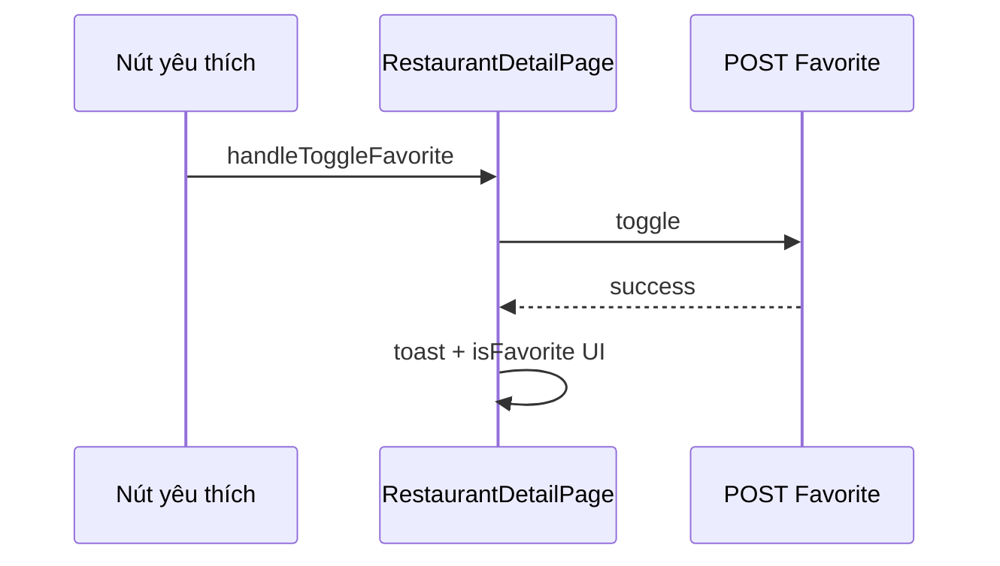
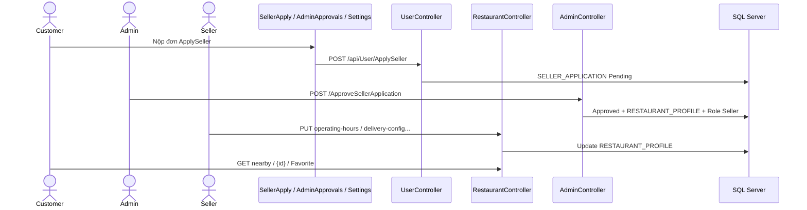

# Tài liệu Quy trình: Nhà hàng & Seller (Restaurant / Seller Application)

Tài liệu mô tả luồng **khách xem quán / gần đây / yêu thích**, **Seller cấu hình quán**, **xin mở quán (ApplySeller)** + **Admin duyệt**, và **UpgradeToMall**.

---


---

## Phần A — UI Interaction Trace (Nút bấm → Code → Data → Hiển thị)

> UI Trace — Restaurant / Seller  
> Mỗi thao tác trả lời: **nút ở đâu** · **bấm chạy file/hàm nào** · **API/BE đâu** · **data trả về** · **hiển thị thế nào**.


---

### UT-RES-01 — Yêu thích quán (`Favorite`)

#### 1. Giao diện

| Mục | Giá trị |
|-----|---------|
| **Route** | `/restaurant/:id` |
| **Page** | `pages/RestaurantDetailPage.tsx` |
| **Nhãn** | Nút tim / lưu quán `onClick={handleToggleFavorite}` |
| **Điều kiện** | User đã đăng nhập (unauth thường redirect login) |

#### 2. Frontend

```text
handleToggleFavorite
  → restaurantService.toggleFavorite(id)
  → POST /Restaurant/{id}/Favorite
```

#### 3. Backend

```text
Toggle FavoriteRestaurant (composite PK UserProfile+Restaurant)
```

#### 5. Hiển thị

| Success | toast `Đã lưu quán...` hoặc `Đã bỏ lưu quán` + đổi icon `isFavorite` |
| Error | toast lỗi API / mạng |
| Load fail | toast `Không thể tải thông tin nhà hàng` lúc mount |

---

### UT-RES-02 — Seller: Lưu thông tin cơ bản cửa hàng

#### 1. Giao diện

| Mục | Giá trị |
|-----|---------|
| **Route** | `/seller/settings` |
| **Page** | `pages/seller/SellerSettingsPage.tsx` |
| **Form** | `onSubmit={handleUpdateBasicInfo}` |

#### 2. Frontend

```text
handleLogoUpload → uploadImage → set logo URL
handleUpdateBasicInfo
  → validate tên/ảnh...
  → toast.loading
  → restaurantService.updateBasicInfo(...)
  → PUT /Restaurant/basic-info
```

GPS: lấy vị trí → toast → điền lat/lng; reverse geocode toast địa chỉ.

#### 3. Backend

```text
Update restaurant profile fields (name, address, geo, logo...)
```

#### 5. Hiển thị

toast `Đã cập nhật thông tin thành công!` (cùng toastId loading).

---

### UT-RES-03 — Seller: Cập nhật giờ mở cửa

```text
form onSubmit={handleUpdateHours}
  → PUT /Restaurant/operating-hours
  → toast success giờ hoạt động
```

---

### UT-RES-04 — Seller: Mở / Đóng cửa

#### 1. Giao diện

Hai nút: `handleUpdateStatus('Active'|'Inactive')`

#### 2–3.

```text
PUT /Restaurant/status { status }
```

#### 5. Hiển thị

toast `Cửa hàng đã mở cửa!` / `tạm đóng cửa!`

---

### UT-RES-05 — Seller: Cấu hình giao hàng

```text
handleUpdateDeliveryConfig
  → validate bán kính > 0, phí hợp lệ
  → PUT /Restaurant/delivery-config (và/hoặc delivery-radius, shipping-fee)
  → toast thành công
```

---

### UT-RES-06 — Admin: Treo / mở nhà hàng

#### 1. Giao diện

| Mục | Giá trị |
|-----|---------|
| **Route** | `/admin/restaurants` |
| **Page** | `AdminRestaurantsPage.tsx` |
| **Nút** | Suspend / unsuspend / toggle verification |

#### 2–3.

```text
PUT /Admin/suspend-restaurant
POST /Admin/Restaurants/{id}/toggle-verification
```

#### 5. Hiển thị

toast treo/mở; Seller bị Suspended → Filter chặn write API (403) khi thao tác bán hàng.

---

### UT-RES-07 — Apply Seller / Mall (cross-link)

- Apply Seller đã login: **UT-REG-03** trong [02_Register_UI_Trace.md](./02_Register_UI_Trace.md)
- Upgrade Mall: Profile/SellerLayout PromptModal → `POST /User/UpgradeToMall`

---

## Sơ đồ Favorite




---

## Phần B — Workflow nghiệp vụ & Backend (chi tiết luồng)
## 1. Luồng Tổng Quan (Workflow)

1. **Browse quán:** Khách mở `/restaurants` → `GET /api/Restaurant/nearby` hoặc detail `GET /api/Restaurant/{id}`.
2. **Yêu thích:** User login → `POST /api/Restaurant/{id}/Favorite`, list `GET /Favorites`.
3. **Apply Seller:** Customer vào `/seller/apply` → `POST /api/User/ApplySeller` → tạo `SELLER_APPLICATION` (Pending).
4. **Admin duyệt:** `/admin/approvals` → `POST /api/Admin/ApproveSellerApplication` → tạo/kích hoạt `RESTAURANT_PROFILE`, Role → Seller.
5. **Seller settings:** `/seller/settings` → PUT basic-info / operating-hours / status / delivery-* / shipping-fee.
6. **Upgrade Mall:** Seller gọi `POST /api/User/UpgradeToMall` → đơn Mall → Admin duyệt tương tự (ApplicationType).



---

## Bước 1: Chi tiết / Nearby / Favorite

**FE:** `RestaurantsPage.tsx`, `RestaurantDetailPage.tsx`, `FavoriteRestaurants.tsx`  
**Service:** `RestaurantService.ts`

| Method | Route | Auth | Việc |
|--------|-------|------|------|
| GET | `/api/Restaurant/{id}` | Public | Chi tiết quán |
| GET | `/api/Restaurant/nearby` | Public | Quán theo lat/lng/radius |
| GET | `/api/Restaurant/Favorites` | Auth | DS yêu thích |
| POST | `/api/Restaurant/{id}/Favorite` | Auth | Toggle favorite |
| GET | `/api/Restaurant/DashboardStats` | Seller | Thống kê dashboard |

**Controller** — `RestaurantController.cs`:

```csharp
[HttpGet("{id}")]
public async Task<ActionResult<ApiResponse>> GetDetail(Guid id)
{
    var query = new GetRestaurantDetailQuery(id);
    if (userDto != null) query.CurrentUserId = userDto.Id;
    var respone = await _mediator.Send(query);
    return Ok(respone);
}
```

**FE:**

```typescript
async getNearby(params: { latitude: number; longitude: number; radiusInKm: number; skip?: number; take?: number }) {
  return httpClient.get(..., { params });
}
async getDetail(id: string) { ... }
```

**DB:** `RESTAURANT_PROFILE`, `FAVORITE_RESTAURANT` (composite PK).

---

## Bước 2: Seller — Cấu hình quán

**FE:** `/seller/settings` → `SellerSettingsPage.tsx`

| Method | Route | Việc |
|--------|-------|------|
| PUT | `/api/Restaurant/basic-info` | Tên, mô tả, ảnh… |
| PUT | `/api/Restaurant/operating-hours` | Giờ mở cửa |
| PUT | `/api/Restaurant/status` | Active/Inactive |
| PUT | `/api/Restaurant/delivery-radius` | Bán kính |
| PUT | `/api/Restaurant/delivery-config` | Platform/Self delivery |
| PUT | `/api/Restaurant/shipping-fee` | Phí ship |

**FE Service:**

```typescript
async updateOperatingHours(data: IUpdateRestaurantOperatingHours) { ... }
async updateDeliveryConfig(data: IUpdateRestaurantDeliveryConfig) { ... }
async updateStatus(data: IUpdateRestaurantStatus) { ... }
```

**Auth:** Seller/Mall; bị Suspended → filter chặn write.

---

## Bước 3: Apply Seller

**Thông tin:**
- **URL (FE):** `/seller/apply` (role Customer)
- **Page:** `SellerApplyPage.tsx`
- **API:** `POST /api/User/ApplySeller`
- **Auth:** Customer đã login
- **Status API:** `GET /api/User/SellerApplication/Status`
- **Update đơn:** `PUT /api/User/SellerApplication`

**Controller** — `UserController.cs`:

```csharp
[HttpPost("ApplySeller")]
public async Task<ActionResult<ApiResponse>> ApplySeller([FromBody] ApplySellerCommand command)
{ ... }

[HttpGet("SellerApplication/Status")]
public async Task<ActionResult<ApiResponse>> GetSellerApplicationStatus(...)
{ ... }
```

**FE:**

```typescript
async applySeller(data: {
  businessName: string;
  businessAddress: string;
  contactInfo: string;
  businessLicenseUrl: string;
  shopImageUrl: string;
}) {
  return httpClient.post('/User/ApplySeller', data);
}
```

**DB:** `SELLER_APPLICATION` (Status Pending, Type NewSeller), giấy tờ URL (Cloudinary qua UploadImage).

---

## Bước 4: Admin duyệt Seller

**API:** `POST /api/Admin/ApproveSellerApplication`  
**FE:** `AdminApprovalsPage.tsx` + `AdminService.approveSellerApplication`

```csharp
[HttpPost("ApproveSellerApplication")]
public async Task<ActionResult<ApiResponse>> ApproveSellerApplication([FromBody] ApproveApplicationCommand command)
{
    var response = await _mediator.Send(command);
    return Ok(response);
}
```

**Hậu quả khi Approved (handler):** tạo/link `RESTAURANT_PROFILE`, cập nhật Role user → **Seller**, có thể gửi Notification.

**Enum:** `ApplicationStatus`: Pending | Approved | Rejected | NeedsInfo.

**List đơn:** `GET /api/Admin/SellerApplications`.

---

## Bước 5: Upgrade To Mall

**API:** `POST /api/User/UpgradeToMall`  
**Auth:** Seller  
**FE:** `SellerMallApplicationPage.tsx`

```csharp
[HttpPost("UpgradeToMall")]
public async Task<ActionResult<ApiResponse>> UpgradeToMall([FromBody] UpgradeToMallCommand command)
```

Tạo `SellerApplication` type **UpgradeToMall** → Admin duyệt qua cùng ApproveSellerApplication (phân biệt Type) → Role **Mall**.

---

## Call chain

```text
SellerApplyPage / RestaurantDetailPage / SellerSettingsPage / AdminApprovalsPage
  ↓
AuthService.applySeller | RestaurantService | AdminService
  ↓
UserController | RestaurantController | AdminController
  ↓
Features/Users (ApplySeller, UpgradeToMall) | Features/Restaurants/* | Features/Admin/ApproveApplication*
  ↓
SELLER_APPLICATION, RESTAURANT_PROFILE, USER_PROFILE.Role, FAVORITE_RESTAURANT
```

| File | Vai trò |
|------|---------|
| `API/Controllers/RestaurantController.cs` | Shop public + settings |
| `API/Controllers/UserController.cs` | ApplySeller, UpgradeToMall |
| `API/Controllers/AdminController.cs` | Approve + list applications |
| `FE/services/RestaurantService.ts` | Client quán |
| `FE/services/AuthService.ts` | Apply seller |
| `FE/pages/SellerApplyPage.tsx` | UI nộp đơn |
| `FE/pages/seller/SellerSettingsPage.tsx` | UI cấu hình |
| `Domain/Models/RestaurantProfile.cs`, `SellerApplication.cs` | Entities |

---

## Toast / Message

| Message | Nơi | Trigger |
|---------|-----|---------|
| Nộp đơn thành công / lỗi | SellerApplyPage | ApplySeller |
| Cập nhật settings OK | SellerSettingsPage | PUT restaurant |
| Duyệt / từ chối seller | AdminApprovals + useAdmin | ApproveSellerApplication |
| Favorite toggle | RestaurantDetail | POST Favorite |

---

## Bảo mật / nghiệp vụ

1. Chỉ **Customer** nộp ApplySeller (FE PrivateRoute); BE kiểm tra role/state trong handler.
2. Admin-only Approve.
3. Quán **Suspended** → chặn mutating API seller.
4. Nearby cần lat/lng hợp lệ từ FE (`useUserLocation`).
5. Giấy phép/ảnh upload qua `UploadImage` / Cloudinary trước khi submit.

---

## Checklist

- [ ] Nearby trả quán trong bán kính
- [ ] Favorite toggle + list Favorites
- [ ] ApplySeller → Pending trong Admin
- [ ] Approve → user thành Seller, vào được `/seller/*`
- [ ] Đổi giờ mở / delivery-config lưu đúng
- [ ] UpgradeToMall tạo đơn type Mall
- [ ] Suspended seller không PUT settings

---

## Tóm tắt

Restaurant = **khám phá + favorite + settings**; Seller onboarding = **ApplySeller → Admin Approve → RestaurantProfile**; Mall = **UpgradeToMall**.

> [Product_Catalog_Workflow.md](./Product_Catalog_Workflow.md) · [Support_Admin_Workflow.md](./Support_Admin_Workflow.md) · [README](./README.md)
