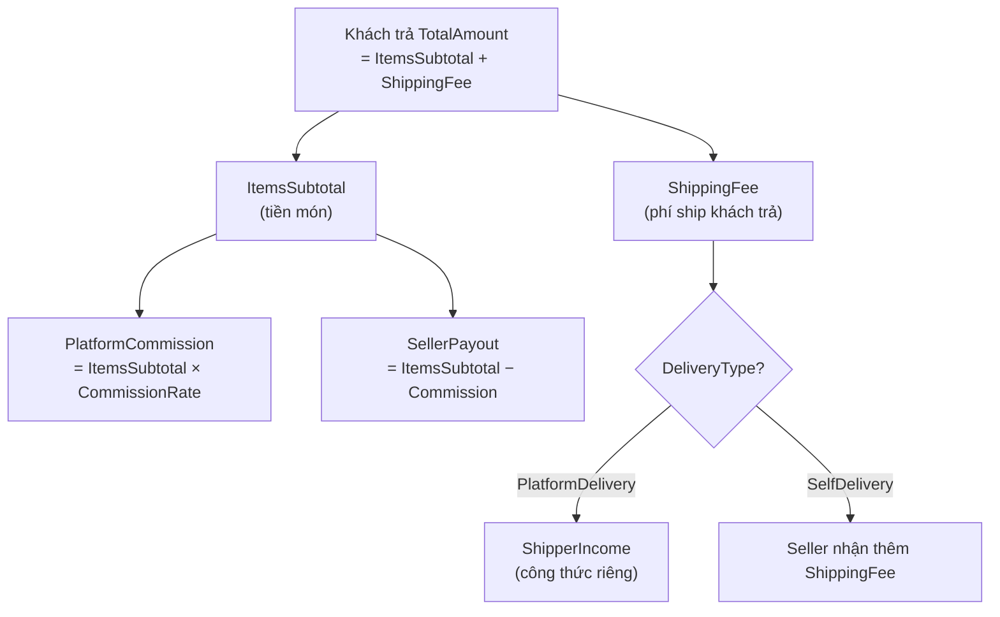
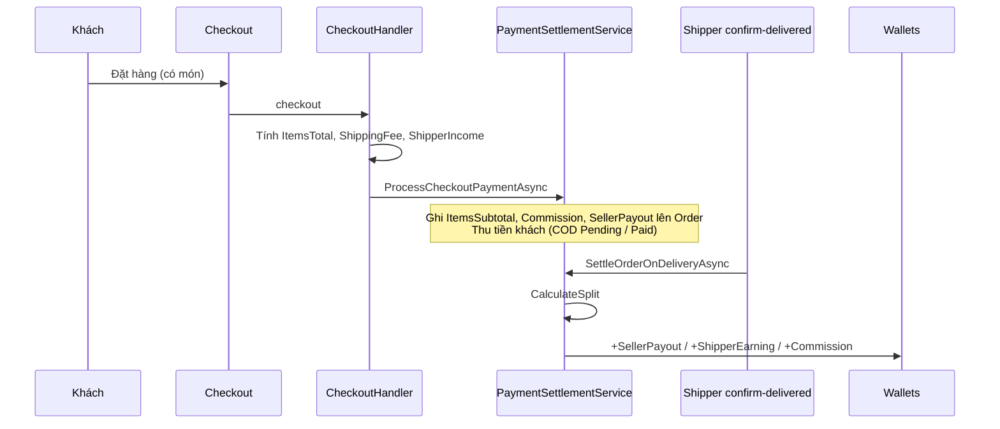

# Requirements: Chia tiền nền tảng · Người bán · Shipper

Tài liệu trả lời câu hỏi: **Khi bán được đơn hàng / sản phẩm, ai kiếm bao nhiêu tiền và chia như thế nào?**

> Liên kết: [Payment_Requirements.md](./Payment_Requirements.md) · [Payment_Checkout_Workflow.md](./Payment_Checkout_Workflow.md) · [Payment_Wallet_Withdraw_Workflow.md](./Payment_Wallet_Withdraw_Workflow.md)

**Source of truth (code):**
- Công thức chia: `PaymentSettlementService.CalculateSplit` — `src/ShoppingFood.Application/Services/PaymentSettlementService.cs` (lines 66–78)
- Tính phí ship + thu nhập shipper lúc checkout: `CheckoutHandler.CalculateTotalAmountAsync` (lines 360–468)
- Chốt tiền khi giao xong: `SettleOrderOnDeliveryAsync` / `SettleSelfDeliveryOrderAsync`
- Config: `PlatformFinanceConfig` — `src/ShoppingFood.Domain/Models/PlatformFinanceConfig.cs`

---

## 1. Tổng quan — Ai nhận tiền gì?

Trên **một đơn hàng**, khách trả:

```text
TotalAmount = ItemsSubtotal + ShippingFee
            = (tiền món đã trừ voucher nếu có) + (phí ship khách phải trả)
```

| Bên | Kiếm tiền từ đâu? | Khi nào nhận vào ví? |
|-----|-------------------|----------------------|
| **Người bán (Seller)** | Doanh thu món sau khi trừ **hoa hồng sàn** (+ phí ship nếu **tự giao**) | Khi đơn **giao thành công** (settle) |
| **Nền tảng (Platform)** | **Hoa hồng %** trên tiền món (`ItemsSubtotal`) | Cùng lúc settle |
| **Shipper** | **Thu nhập giao hàng** (`ShipperIncome`) — độc lập với hoa hồng món | Cùng lúc settle (chỉ khi giao platform) |
| **Khách** | Trả `TotalAmount` (COD / Ví / SePay) | — |



---

## 2. Công thức cốt lõi (Functional Requirements)

### FR-SPLIT-01 — Tách tiền món và phí ship

```text
ItemsSubtotal = max(0, TotalAmount − ShippingFee)
```

Hoa hồng **chỉ tính trên tiền món**, **không** tính trên phí ship khách trả.

### FR-SPLIT-02 — Hoa hồng sàn & tiền người bán (platform delivery)

```text
PlatformCommission = Round(ItemsSubtotal × CommissionRate)   // mặc định 10%
SellerPayout       = ItemsSubtotal − PlatformCommission
ShipperEarning     = ShipperIncome                          // đã tính lúc checkout
```

**Code:**

```csharp
// PaymentSettlementService.CalculateSplit
var itemsSubtotal = Math.Max(0, totalAmount - shippingFee);
var platformCommission = Math.Round(itemsSubtotal * commissionRate, 0);
var sellerPayout = itemsSubtotal - platformCommission;
var shipperEarning = shipperIncome;
```

### FR-SPLIT-03 — Self-delivery (nhà hàng tự giao)

```text
SellerPayout = (ItemsSubtotal − PlatformCommission) + ShippingFee
ShipperEarning = 0   // không có shipper sàn
```

Người bán giữ tiền ship; vẫn phải trả hoa hồng sàn trên tiền món.

### FR-SPLIT-04 — Thời điểm ghi nhận ví

| Sự kiện | Ghi nhận tài chính |
|---------|-------------------|
| Checkout | Chỉ **ghi sẵn** `ItemsSubtotal`, `PlatformCommission`, `SellerPayout` trên Order; **chưa** cộng ví Seller/Shipper |
| Khách trả online (Wallet/Sepay) | Tiền vào **ví nền tảng / session**; Order `Paid` |
| **Giao thành công** | `Settle*` → cộng ví Seller / Shipper / Platform; `PaymentStatus = Settled`; `IsFinancialSettled = true` |
| Hủy đơn đã Paid online | Refund **full TotalAmount** về ví Customer |

> **Quan trọng:** Người bán **không** nhận tiền ngay khi “bán được món” lúc checkout — chỉ nhận khi đơn **đã giao và settle**.

### FR-SPLIT-05 — CommissionRate lấy từ đâu?

| Nguồn | Giá trị mặc định | Dùng khi settle? |
|-------|------------------|------------------|
| `PlatformFinanceConfig.CommissionRate` | **0.10** (10%) | **Có** — đây là rate đang dùng trong `CalculateSplit` |
| `RestaurantProfile.CustomCommissionRate` | null / tùy Admin set | **Chưa** — Admin API có thể ghi field này nhưng **settle hiện không đọc** |

⚠️ **Gap đã biết:** Admin có `UpdateRestaurantCommission` để set `CustomCommissionRate` theo quán, nhưng `SettleOrderOnDeliveryAsync` luôn dùng `config.CommissionRate` toàn cục. Cần fix nếu muốn hoa hồng theo từng nhà hàng.

Admin sửa config toàn cục: `PUT /api/Admin/finance-config`.

---

## 3. Ví dụ số — Bán 1 đơn (dễ hiểu)

### Ví dụ A — Platform delivery + hoa hồng 10%

Khách mua món **100.000₫**, phí ship khách trả **15.000₫**, shipper được tính thu nhập **12.000₫**.

```text
TotalAmount     = 115.000
ItemsSubtotal   = 100.000
ShippingFee     =  15.000
CommissionRate  =  10%

PlatformCommission = 100.000 × 10% = 10.000
SellerPayout       = 100.000 − 10.000 = 90.000
ShipperEarning     = 12.000
```

| Bên | Nhận | Ghi chú |
|-----|------|---------|
| Seller | **90.000₫** | 90% tiền món |
| Platform | **10.000₫** | 10% tiền món |
| Shipper | **12.000₫** | Theo công thức ship (không lấy từ 15.000 ship fee khách) |
| Chênh lệch ship | Khách trả 15.000; shipper nhận 12.000 → **phần còn lại thuộc mô hình phí sàn** (không cộng thẳng ví Seller trong platform delivery) |

### Ví dụ B — Self-delivery

Cùng món 100.000 + ship 15.000, tự giao:

```text
PlatformCommission = 10.000
SellerPayout       = 90.000 + 15.000 = 105.000
ShipperEarning     = 0
```

| Bên | Nhận |
|-----|------|
| Seller | **105.000₫** (món sau CK + ship) |
| Platform | **10.000₫** |
| Shipper | **0** |

### Ví dụ C — COD platform delivery (dòng tiền thực tế)

Khách đưa **115.000 tiền mặt** cho shipper khi nhận hàng.

Khi settle COD (`SettleOrderOnDeliveryAsync`):

```text
amountToRemit (shipper thu hộ cần nộp sàn)
  = SellerPayout + PlatformCommission
  = 90.000 + 10.000 = 100.000   // = ItemsSubtotal

Shipper:
  + CodCollectedAmount  += 100.000   // nợ thu hộ
  + WalletBalance       += 12.000    // thu nhập giao hàng

Seller ví:     +90.000  (SellerPayout — “chờ đối soát” nếu COD)
Platform ví:   +10.000  (Commission)
```

Shipper giữ tiền mặt 115.000 trên tay:
- 12.000 = lương giao (của shipper)
- 100.000 = phải nộp sàn (để sàn trả seller + giữ commission)
- 15.000 ship fee khách: nằm trong TotalAmount; phần shipper earning tách riêng theo công thức — **đối soát vận hành** dựa `CodCollectedAmount` + repay-debt

### Ví dụ D — Online Paid (SePay / Ví) rồi giao

Khách đã trả 115.000 online → tiền đã về phía sàn/session.

Khi giao xong:

```text
Seller ví:    +90.000
Shipper ví:   +12.000
Platform ví:  +10.000
PaymentStatus → Settled
```

Không tăng `CodCollectedAmount`.

---

## 4. Shipper kiếm tiền như thế nào? (chi tiết)

### FR-SHIP-01 — Chỉ khi `DeliveryType = PlatformDelivery`

Self-delivery → `ShipperIncome = 0`.

### FR-SHIP-02 — Công thức thu nhập lúc checkout

**File:** `CheckoutHandler.CalculateTotalAmountAsync`

Config mặc định (`PlatformFinanceConfig`):

| Tham số | Default | Ý nghĩa |
|---------|---------|---------|
| `ShipperBaseFee` | **12.000₫** | Phí cơ bản mỗi đơn |
| `ShipperFeePerKm` | **4.000₫/km** | Tính cho phần quãng đường **> 5 km** |
| `ShipperRushHourBonus` | **10%** | % cộng thêm giờ cao điểm |
| `RushHourStartTime` / `EndTime` | 17:00–19:00 (giờ VN = UTC+7) | Khung peak |

```text
distanceFee = (distanceKm > 5) ? (distanceKm − 5) × ShipperFeePerKm : 0
incomeBeforeBonus = ShipperBaseFee + distanceFee
peakBonus = isRushHour ? incomeBeforeBonus × (ShipperRushHourBonus / 100) : 0
ShipperIncome = Round(incomeBeforeBonus + peakBonus)
```

Lưu breakdown trên Order: `ShipperBaseFeeAmount`, `ShipperDistanceFeeAmount`, `ShipperPeakBonus`.

### FR-SHIP-03 — Phí ship khách trả (khác ShipperIncome)

Với **PlatformDelivery**, phí khách trả lấy từ `DeliverySettings` (SystemConfig):

| Rule | Hành vi |
|------|---------|
| Đơn ≥ `FreeShippingMinimumOrder` (>0) | `ShippingFee = 0` |
| Khoảng cách ≤ `FreeDeliveryRadiusKm` (default 3km) | `ShippingFee = 0` |
| Còn lại | `ShippingFee = DeliverySettings.ShippingFee` (default 15.000) |
| Có món `IsFreeship` | Không cộng fee quán đó |

Với **SelfDelivery**: dùng `RestaurantProfile.ShippingFee`, bán kính / freeship của quán; `ShipperIncome = 0`.

### FR-SHIP-04 — Shipper rút tiền & nợ COD

- Thu nhập settle → ví Shipper → rút qua [Payment_Wallet_Withdraw_Workflow.md](./Payment_Wallet_Withdraw_Workflow.md) (min 50.000₫, Admin duyệt).
- COD: phải nộp `CodCollectedAmount` (`POST /Payment/shipper/repay-debt`).
- Hạn mức nợ mặc định **5.000.000₫**.

---

## 5. Người bán kiếm tiền như thế nào?

### FR-SELL-01 — Doanh thu = SellerPayout khi settle

```text
SellerPayout = ItemsSubtotal × (1 − CommissionRate)   // platform delivery
             = ItemsSubtotal × (1 − CommissionRate) + ShippingFee  // self-delivery
```

### FR-SELL-02 — Không chia theo từng dòng sản phẩm riêng trong settle

Hiện tại split tính **theo cả đơn** (`ItemsSubtotal` của order), không tách hoa hồng từng `OrderItem`.  
“Bán 1 sản phẩm” trong ngữ cảnh tài chính = **sản phẩm nằm trong đơn đã giao**; tiền gom theo đơn.

### FR-SELL-03 — Rút tiền

Seller rút từ ví quán → Admin duyệt (min 50k).

### FR-SELL-04 — Hoa hồng tùy quán (ý định vs thực tế)

| | |
|--|--|
| **Ý định** | Admin `PUT finance-config/restaurants/{id}` set `CustomCommissionRate` |
| **Thực tế code settle** | Luôn dùng `PlatformFinanceConfig.CommissionRate` |
| **Requirement đề xuất** | FR-SPLIT-05b: Khi settle, nếu quán có `CustomCommissionRate` thì dùng rate đó, else rate global |

---

## 6. Nền tảng kiếm tiền như thế nào?

### FR-PLT-01 — Commission trên tiền món

```text
PlatformCommission = Round(ItemsSubtotal × CommissionRate)
```

Ghi `FinancialTransactionType.Commission` vào ví `WalletOwnerType.Platform`.

### FR-PLT-02 — Không lấy % trên ShipperIncome

Shipper earning trả riêng; không trừ thêm % từ lương shipper trong `CalculateSplit`.

### FR-PLT-03 — Chênh lệch ShippingFee vs ShipperIncome

Khách có thể trả `ShippingFee` khác `ShipperIncome`. Phần chênh là **biên phí vận hành sàn** (không có dòng txn “shipping margin” riêng trong settle hiện tại — tiền online nằm ở phía thu TotalAmount; COD shipper thu hộ chủ yếu `ItemsSubtotal`).

### FR-PLT-04 — Config Admin được phép sửa

`PUT /api/Admin/finance-config`:
- `CommissionRate`
- `ShipperBaseFee`, `ShipperFeePerKm`, `ShipperRushHourBonus`
- `BaseDeliveryFee`, `FeePerKm`, rush window (một phần dùng cho fee khách / báo cáo)
- `MinWithdrawalAmount`, `DefaultShipperDebtLimit`, …

---

## 7. Ma trận settle theo PaymentMethod × DeliveryType

| | **COD** | **Online đã Paid** (Wallet/Sepay/Card) |
|--|---------|----------------------------------------|
| **PlatformDelivery** | Shipper: +Earning ví, +CodCollected (SellerPayout+Commission); Seller +Payout; Platform +Commission | Seller +Payout; Shipper +Earning; Platform +Commission; **không** COD debt |
| **SelfDelivery** | Seller +Payout (gồm ship); Seller −Commission (nợ CK); Platform +Commission; không shipper | Seller +Payout (gồm ship); Platform +Commission |

**Guard:** `if (order.IsFinancialSettled) return;` — settle 1 lần duy nhất.

---

## 8. Sequence — từ bán món đến chia tiền



---

## 9. Acceptance Criteria (QA chia tiền)

- [ ] Đơn 100k món + 15k ship, rate 10% → Commission 10k, SellerPayout 90k
- [ ] Self-delivery cùng số → SellerPayout 105k, ShipperIncome 0
- [ ] Platform delivery: ShipperIncome = BaseFee + distanceFee + peak (đúng công thức >5km, rush 17–19 VN)
- [ ] Checkout **không** làm tăng ví Seller/Shipper
- [ ] Chỉ sau `confirm-delivered` / self-delivery confirm mới cộng ví
- [ ] Settle lần 2 không cộng trùng (`IsFinancialSettled`)
- [ ] COD: `CodCollectedAmount` tăng = SellerPayout + Commission
- [ ] Online Paid: không tăng COD debt
- [ ] Đổi `CommissionRate` trên Admin finance-config → đơn mới settle theo rate mới
- [ ] (Gap) `CustomCommissionRate` quán — hiện **chưa** ảnh hưởng settle; test và ticket fix nếu cần

---

## 10. Checklist đọc code khi debug “ai hưởng bao nhiêu”

1. Xem Order: `TotalAmount`, `ShippingFee`, `ItemsSubtotal`, `ShipperIncome`, `PlatformCommission`, `SellerPayout`, `PaymentMethod`, `PaymentStatus`, `IsFinancialSettled`
2. Xem `RestaurantProfile.DeliveryType`
3. Xem `PlatformFinanceConfig.CommissionRate` + shipper fee fields
4. Xem `FINANCIAL_TRANSACTION` theo `OrderId`
5. COD: xem `ShipperProfile.CodCollectedAmount`

---

## 11. Tóm tắt một câu

> **Sàn lấy % trên tiền món; Seller nhận phần còn lại của tiền món (+ ship nếu tự giao); Shipper nhận lương giao tính riêng (base + km + peak), không phải toàn bộ ShippingFee khách trả; tiền chỉ vào ví khi đơn đã giao và settle.**

**Tiếp:** cập nhật vận hành rút tiền tại [Payment_Wallet_Withdraw_Workflow.md](./Payment_Wallet_Withdraw_Workflow.md).
