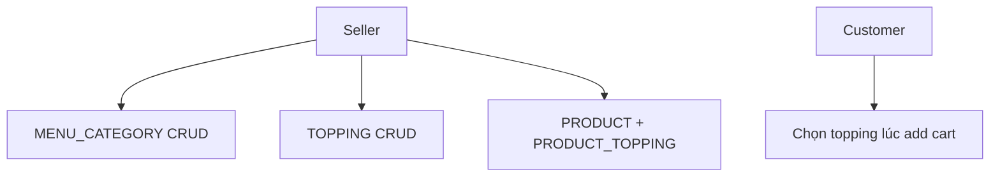

# Tài liệu Quy trình: Danh mục menu & Topping (Seller)

Seller quản lý **MENU_CATEGORY** và **TOPPING** của quán; gán topping khi tạo/sửa sản phẩm.

> Product CRUD: [Product_Catalog_Workflow.md](./Product_Catalog_Workflow.md)

---

## Phần A — UI Interaction Trace

---

## UT-MENU-01 — Load **SellerCategoriesPage**

### 1. UI

| Mục | Giá trị |
|-----|---------|
| **Route** | `/seller/categories` |
| **Page** | `pages/seller/SellerCategoriesPage.tsx` |
| **Layout** | SellerLayout |

### 2–5

```text
Mount
  → authService.getProfile() (lấy restaurantId nếu cần)
  → menuCategoryService.getByRestaurant(restaurantId)
  → GET /api/MenuCategory/{restaurantId}
  → setCategories → render bảng/list
Fail → toast.error('Lỗi khi tải danh mục' | mạng)
```

---

## UT-MENU-02 — Nút **「Thêm danh mục」** / **「Lưu」**

### 1. UI

- Button `handleAdd` → mở Modal form (tên, mô tả, sort…)  
- Edit: icon sửa `handleEdit(cat)`  
- Submit form `handleSubmit`

### 2. FE

```text
Validate: tên bắt buộc → toast.error('Vui lòng nhập tên danh mục')
Nếu editing:
  → menuCategoryService.update(id, payload) → PUT /api/MenuCategory
  → toast.success('Cập nhật danh mục thành công!')
Else:
  → menuCategoryService.create({ restaurantId, name, ... }) → POST /api/MenuCategory
  → toast.success('Thêm danh mục thành công!')
→ đóng modal + fetch lại list
```

### 3. BE

```text
MenuCategoryController POST/PUT
  → Add/Update MenuCategory handlers
  → Kiểm tra Seller owns restaurant
  → Save MENU_CATEGORY
```

### 4. Response

`ApiResponse` success message; data có thể là category DTO.

### 5. Hiển thị

Toast + refresh list; Modal đóng.

---

## UT-MENU-03 — **Xóa danh mục** (Confirm)

### 1–5

```text
handleDeleteClick → mở ConfirmModal
handleDeleteConfirm
  → menuCategoryService.remove(id)   // BaseService → DELETE /api/MenuCategory/{id}
  → toast.success('Xóa danh mục thành công!') | toast.error
```

> **Gap code:** `MenuCategoryController` hiện chỉ expose `GET/{restaurantId}`, `POST`, `PUT` — **không có** `[HttpDelete]`. FE vẫn gọi `remove` qua BaseService; khi debug 404/405 cần bổ sung DELETE handler hoặc đổi FE sang soft-delete qua PUT.

---

## UT-MENU-04 — Load **SellerToppingsPage**

### 1–5

```text
Route: /seller/toppings · SellerToppingsPage.tsx
Mount → toppingService.getByRestaurantId(rid)
  → GET /api/Topping/restaurant/{restaurantId}
  → render list (tên, giá, ảnh, isAvailable)
```

---

## UT-MENU-05 — **Thêm / Sửa topping** + Upload ảnh

### 1. UI

- `handleAdd` / `handleEdit` → Modal  
- Input file → `handleUploadImage`  
- Submit `handleSubmit`

### 2. FE

```text
handleUploadImage
  → toast.loading('Đang tải ảnh lên...')
  → authService.uploadImage(file) → POST /api/User/UploadImage (Cloudinary)
  → setImageUrl + toast.success

handleSubmit
  → validate tên + giá
  → update: PUT /api/Topping/{id}
  → create: POST /api/Topping { restaurantId, name, price, imageUrl, isAvailable }
  → toast.success Thêm/Cập nhật topping thành công!
```

### 3. BE

`ToppingController` POST/PUT → handlers; ownership restaurant.

---

## UT-MENU-06 — Toggle **Còn hàng / Hết hàng** topping

```text
handleToggleAvailable(top)
  → toppingService.update(id, { ...top, isAvailable: !top.isAvailable })
  → PUT /api/Topping/{id}
  → toast.success(`Đã chuyển trạng thái: Còn hàng|Hết hàng`)
```

---

## UT-MENU-07 — **Xóa topping**

```text
ConfirmModal → toppingService.delete(id) → DELETE /api/Topping/{id}
  → toast.success('Xóa topping thành công!')
```

---

## UT-MENU-08 — Gán topping khi **tạo/sửa Product** (SellerProductsPage)

### 1. UI

Trong form sản phẩm (`SellerProductsPage`): multi-select / checkbox danh sách topping của quán.

### 2–5

```text
Load toppings: GET /Topping/restaurant/{id}
Submit product create/update kèm toppingIds
  → POST/PUT /api/Product
  → AddProductHandler / UpdateProductHandler ghi PRODUCT_TOPPING (M-N)
  → toast product success (useProducts / SellerProductsPage)
```

Chi tiết product: [Product_Catalog_Workflow.md](./Product_Catalog_Workflow.md).

---

## Phần B — Workflow nghiệp vụ & Backend

### 1. Luồng tổng quan

1. Seller vào Categories → CRUD danh mục quán.  
2. Seller vào Toppings → CRUD + ảnh + availability.  
3. Khi tạo món: chọn Category + gán Toppings.  
4. Khách trên ProductDetail chọn topping đã gán → giá cộng vào cart.  



### 2. API

| Method | Route | Việc |
|--------|-------|------|
| GET | `/api/MenuCategory/{restaurantId}` | List theo quán |
| POST | `/api/MenuCategory` | Tạo |
| PUT | `/api/MenuCategory` | Sửa |
| GET | `/api/Topping/restaurant/{restaurantId}` | List topping |
| POST | `/api/Topping` | Tạo |
| PUT | `/api/Topping/{id}` | Sửa / toggle available |
| DELETE | `/api/Topping/{id}` | Xóa |
| POST/PUT | `/api/Product` | Gán toppings |

### 3. Bảo mật

- Chỉ Seller/Mall của đúng `RestaurantId`.  
- `CheckSellerSuspensionAttribute` chặn write khi quán Suspended.  
- Upload ảnh: endpoint UploadImage (cloudinary).  

### 4. Checklist

- [ ] Thêm/sửa/xóa category toast đúng  
- [ ] Topping upload ảnh → URL lưu DB  
- [ ] Toggle available phản ánh trên FE customer (nếu filter isAvailable)  
- [ ] Product form load đúng toppings quán  

### 5. File neo

| FE | BE |
|----|-----|
| `SellerCategoriesPage.tsx` | `MenuCategoryController.cs` |
| `SellerToppingsPage.tsx` | `ToppingController.cs` |
| `SellerProductsPage.tsx` | Product handlers + `ProductTopping` |
| `MenuCategoryService.ts`, `ToppingService.ts` | Domain Models MenuCategory, Topping |
