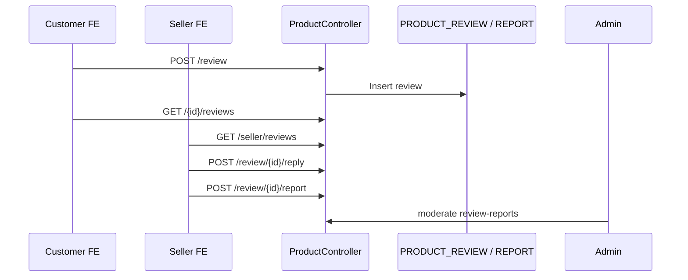

# Tài liệu Quy trình: Đánh giá sản phẩm & Seller phản hồi / báo cáo

Tài liệu mô tả luồng **Product Review** trên trang chi tiết sản phẩm (Customer) và **SellerReviewsPage** (Seller trả lời / báo cáo) trong **Shopping Food**.

> Admin duyệt báo cáo: [Support_Admin_Workflow.md](./Support_Admin_Workflow.md) (review-reports)  
> Catalog / Product detail: [Product_Catalog_Workflow.md](./Product_Catalog_Workflow.md)

---

## Phần A — UI Interaction Trace (Nút bấm → Code → Data → Hiển thị)

---

### UT-REV-01 — Xem đánh giá trên Product Detail

#### 1. Giao diện

| Mục | Giá trị |
|-----|---------|
| **Nơi** | Product detail — section `components/product/ProductReviews.tsx` |
| **Props** | `productId`, `restaurantId?` |
| **Load** | `useEffect([productId])` → `fetchReviews` (không nút) |

#### 2–3

```text
productService.getProductReviews(productId)
  → GET /api/Product/{productId}/reviews?skip&take
```

#### 5. Hiển thị

- Header “Đánh giá & Bình luận” + số lượng + avg rating  
- List: sao, comment, userName, ngày, `sellerReply` nếu có  
- Lỗi load: fail silently (reviews non-critical)

---

### UT-REV-02 — Customer gửi đánh giá mới

#### 1. Giao diện

| Mục | Giá trị |
|-----|---------|
| **Form** | Chọn sao (`rating`) + textarea `comment` (cần login) |
| **Nút** | Submit form → `handleSubmitReview` |

#### 2–3

```text
productService.reviewProduct({ productId, rating, comment })
  → POST /api/Product/review
```

#### 5. Hiển thị

| OK | `toast.success('Đánh giá của bạn đã được gửi!')` + clear form + `fetchReviews` |
| Fail | `toast.error(res.message \|\| 'Lỗi khi gửi đánh giá')` |
| Mạng | toast lỗi mạng |
| Chưa login | form ẩn / yêu cầu đăng nhập (theo UI) |

---

### UT-REV-03 — Seller trả lời trên ProductReviews (inline)

> Cùng component `ProductReviews` khi user role Seller (và thuộc quán).

#### 1. Giao diện

| Mục | Giá trị |
|-----|---------|
| **Nút** | Phản hồi trên một review → `setReplyingTo` |
| **Submit** | `handleSubmitReply(reviewId)` |

#### 2–3

```text
productService.replyReview(reviewId, replyContent)
  → POST /api/Product/review/{reviewId}/reply  body: { reply }
```

#### 5. Hiển thị

| OK | `toast.success('Phản hồi đã được gửi')` + reload |
| Fail | `toast.error(...)` |

---

### UT-REV-04 — Báo cáo review từ ProductReviews (Customer/Seller)

#### 1. Giao diện

| Mục | Giá trị |
|-----|---------|
| **Nút** | Báo cáo → mở Modal lý do |
| **Submit** | `handleReportReview` |

#### 2–3

```text
productService.reportReview(reviewId, reason)
  → POST /api/Product/review/{reviewId}/report  body: { reason }
```

#### 5. Hiển thị

| Thiếu lý do | `toast.error('Vui lòng nhập lý do')` |
| OK | `toast.success('Đã gửi báo cáo vi phạm thành công')` + đóng modal |
| Fail | toast.error |

---

### UT-REV-05 — SellerReviewsPage — Danh sách + trả lời

#### 1. Giao diện

| Mục | Giá trị |
|-----|---------|
| **Route** | `/seller/reviews` |
| **Page** | `pages/seller/SellerReviewsPage.tsx` |
| **Toolbar** | Search (client-side trang hiện tại), filter all/replied/unreplied, phân trang |
| **Nút** | Phản hồi → mở `replyModal` → submit `handleReplyReview` |

#### 2–3

```text
Mount / page change:
  productService.getSellerReviews(skip, take)
  → GET /api/Product/seller/reviews

Reply:
  productService.replyReview(reviewId, content)
  → POST /api/Product/review/{reviewId}/reply
```

#### 5. Hiển thị

| Load fail | `toast.error('Lỗi khi tải danh sách đánh giá')` |
| Reply trống | `toast.error('Vui lòng nhập nội dung phản hồi')` |
| Reply OK | `toast.success('Gửi phản hồi thành công')` + đóng modal + reload |
| Reply fail | toast.error |

---

### UT-REV-06 — SellerReviewsPage — Báo cáo đánh giá

#### 1. Giao diện

| Mục | Giá trị |
|-----|---------|
| **Nút** | Báo cáo trên row → `reportModal` |
| **Submit** | `handleReportReview` |

#### 2–5

```text
productService.reportReview(reviewId, reason)
  → POST /api/Product/review/{reviewId}/report
```

| Thiếu lý do | `toast.error('Vui lòng nhập lý do báo cáo')` |
| OK | `toast.success('Báo cáo đánh giá thành công. Quản trị viên sẽ xem xét.')` |
| Fail | toast.error |

Admin sau đó: `GET /Admin/review-reports` + `POST .../moderate` (Support/Admin workflow).

---

### Bảng tóm tắt Phần A

| ID | Thao tác | FE | API |
|----|----------|-----|-----|
| UT-REV-01 | Xem list | ProductReviews | GET `/{productId}/reviews` |
| UT-REV-02 | Customer gửi review | ProductReviews | POST `/review` |
| UT-REV-03 | Seller reply (detail) | ProductReviews | POST `/review/{id}/reply` |
| UT-REV-04 | Report (detail) | ProductReviews | POST `/review/{id}/report` |
| UT-REV-05 | Seller list + reply | SellerReviewsPage | GET `seller/reviews` + reply |
| UT-REV-06 | Seller report | SellerReviewsPage | POST report |

---

## Phần B — Workflow nghiệp vụ & Backend

### 1. Luồng tổng quan

1. Customer (đã mua / đủ điều kiện BE) gửi review trên product detail.  
2. Public/list hiển thị rating + comment + sellerReply.  
3. Seller trả lời từ detail hoặc `/seller/reviews`.  
4. User báo cáo → `REVIEW_REPORT` Pending → Admin moderate.  
5. Có thể phát Notification type `Review` → Bell (xem [Notification_Realtime_Workflow.md](./Notification_Realtime_Workflow.md)).



### 2. APIs

| Method | Route | Việc |
|--------|-------|------|
| GET | `/api/Product/{productId}/reviews` | List theo SP |
| GET | `/api/Product/seller/reviews` | List theo quán Seller |
| POST | `/api/Product/review` | Tạo review |
| POST | `/api/Product/review/{reviewId}/reply` | Seller reply |
| POST | `/api/Product/review/{reviewId}/report` | Report |
| GET | `/api/Admin/review-reports` | Admin list |
| POST | `/api/Admin/review-reports/{reportId}/moderate` | Admin xử lý |

**Controller:** `ProductController.cs` (review endpoints), `AdminController` (reports).

### 3. FE services

`ShoppingFood.FE/src/services/ProductService.ts`:

- `getProductReviews` / `getSellerReviews`
- `reviewProduct` / `replyReview` / `reportReview`

### 4. Bảo mật / nghiệp vụ

1. Reply: chỉ Seller của quán sở hữu sản phẩm.  
2. Review: rule BE (đã giao / 1 user 1 SP — theo handler).  
3. Report: lý do bắt buộc; chống spam tuỳ BE.  
4. Admin moderate ẩn/xoá/giữ review.

### 5. Checklist

- [ ] Product detail hiện list + avg  
- [ ] Customer gửi review → toast + list cập nhật  
- [ ] Seller reply từ SellerReviewsPage → hiện `sellerReply`  
- [ ] Report → toast; Admin thấy review-reports  
- [ ] Chưa login không gửi được review  

### 6. File neo

| Tầng | Path |
|------|------|
| Customer UI | `ShoppingFood.FE/src/components/product/ProductReviews.tsx` |
| Seller UI | `.../pages/seller/SellerReviewsPage.tsx` |
| Service | `ProductService.ts` |
| API | `ProductController` review* |

---

**Tóm tắt:** Reviews = **Customer viết trên detail + Seller quản lý/reply/report**. UI Trace **UT-REV-01…06** ở Phần A.
